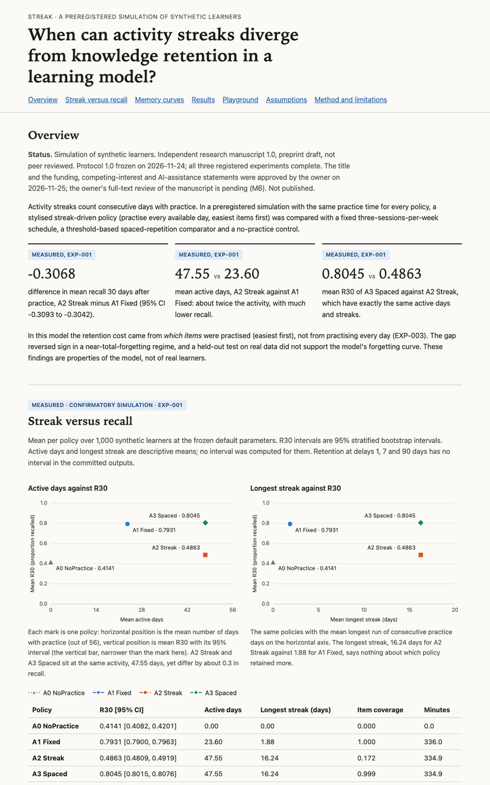

<!-- SPDX-License-Identifier: LicenseRef-STREAK-NC-Research-1.0 -->
# STREAK: When activity and retention diverge

**Question.** When can activity streaks diverge from knowledge retention in a learning model?

**Manuscript title (owner-approved, 2026-11-25).** *When activity and retention diverge: item selection, not daily practice, drives the retention cost of a streak-driven policy in a preregistered learner simulation.*

**Status.** Independent research manuscript 1.0, preprint draft, not peer reviewed. Protocol 1.0 frozen on the owner's approval (2026-11-24); all three registered experiments complete (70,000 learner-arm simulations, none failed). The title and the funding, competing-interest and AI-assistance statements were approved by the owner on 2026-11-25; the owner's full-text review of the manuscript is pending (M6). The repository is public at https://github.com/mohamedbechirkefi/streak-learning-retention (pushed 2026-11-25); no release, tag, DOI or preprint exists yet. Every result is a simulation of synthetic learners and holds only within the model's assumptions: it is not a claim about real human learning or about any commercial product.



## Why it matters

Learning applications often display activity streaks. Activity and retention are different things: a learner can be active every day while practising mostly what they already know. This project asks, in a controlled simulation with matched practice minutes, whether and when streak-driven practice can raise activity measures without raising retention.

## Key results (simulation only; see the manuscript for intervals and limits)

- **EXP-001 (primary).** At the frozen default parameters (1,000 synthetic learners), the streak-driven policy A2 (every available day, easiest items first) doubled active days (47.55 against 23.60) and its mean expected recall 30 days after practice (R30) differed from the fixed schedule A1 by -0.3068 (95% CI -0.3093 to -0.3042). The threshold-based comparator A3, with exactly A2's activity, was practically equivalent to A1 (+0.0114, 95% CI 0.0107 to 0.0123).
- **EXP-002.** The gap was relevant negative in all 27 cells of the parameter grid, from -0.4709 to -0.1763.
- **EXP-003.** Easiest-first selection carried the gap; daily timing alone stayed below the smallest effect size of interest (0.02). The preregistered invalidation test H-inv was not triggered.
- **Negative and contradictory results.** A preregistered held-out test on real Duolingo traces did not support the model's exponential forgetting curve (log-likelihood per trial -0.3865 against -0.3352 for a constant baseline). Before the freeze, in a near-total-forgetting regime, the sign was reversed (+0.0801, exploratory).

## Research navigation

| Item | Location |
|---|---|
| Manuscript 1.0 | [research/paper/manuscript.md](research/paper/manuscript.md) |
| Supplementary material | [research/paper/supplementary.md](research/paper/supplementary.md) |
| Experiment reports | [EXP-001](research/experiments/EXP-001/report.md), [EXP-002](research/experiments/EXP-002/report.md), [EXP-003](research/experiments/EXP-003/report.md) |
| Protocol (1.0, frozen) | [research/protocol.md](research/protocol.md) |
| Experiment registry | [research/experiment_registry.csv](research/experiment_registry.csv) |
| Claims register | [research/claims_register.csv](research/claims_register.csv) |
| Evidence audit and artifact manifest | [research/publication/claims_audit.md](research/publication/claims_audit.md), [research/publication/artifact_manifest.json](research/publication/artifact_manifest.json) |
| Limitations | [research/limitations.md](research/limitations.md) |
| Interactive page | [demo/](demo/README.md) |
| Article drafts | [articles/](articles/README.md) |
| Roadmap and progress | [roadmap.md](roadmap.md), [progress.md](progress.md) |

| Experiment | Question | Status |
|---|---|---|
| EXP-001 | Streak-driven versus fixed practice at matched minutes | complete (confirmatory); supports the expected direction with practical relevance |
| EXP-002 | Robustness across forgetting parameters and availability | complete (confirmatory); relevant negative in 27 of 27 cells |
| EXP-003 | Timing versus item selection; model-form sensitivity | complete (confirmatory); H-inv not triggered |

The status lines of the three frozen EXP protocols still say "not yet run" because frozen files are not edited; the experiment registry and the experiment reports give the current state.

## What is implemented

The simulation engine (`src/streak`): synthetic learners with forgetting, retrieval practice and a fixed practice budget; scheduling arms A0 (no practice), A1 (fixed three sessions a week), A2 (streak-driven, easiest first), A3 (threshold-based spaced repetition, r* = 0.9) and the EXP-003 timing-by-selection cells; versioned result schemas, run manifests, a report generator and a CLI. The interactive page (`demo/`) shows the published results and runs a browser port of the engine in a sandbox. Tests: see `progress.md` for the actual counts.

## Quick start

```
uv sync --frozen
.venv/bin/python -m pytest                                    # Python test suite
.venv/bin/python scripts/run_confirmatory.py EXP-001          # reruns a frozen experiment (guarded)
.venv/bin/python scripts/analyse_confirmatory.py EXP-001
```

### Interactive page (demo)

```
cd demo && npm ci && npm run build && npm run preview
```

`npm test` runs the page's unit tests, including the comparison of the browser engine port with the Python engine. The page works offline after the first load, collects nothing and contacts no other host. Demo URL: https://streak-learning-retention.kefimohamedbechir.workers.dev (Cloudflare Workers static assets, free plan; see [demo/README.md](demo/README.md)).

## Data

Simulated learners are synthetic. One real dataset sets the median initial half-life (h0 = 67.59 days) and supplies the held-out test of the forgetting model: the Duolingo half-life regression traces (Settles and Meeder 2016, doi:10.7910/DVN/N8XJME, CC BY-NC 4.0). It is not redistributed here; `scripts/download_duolingo.py` fetches it and checks its hash. See [data/manifest.json](data/manifest.json).

## Limitations

Every result depends on the memory model, the policy rules and the scheduler's belief; A2 is an extreme stylisation; the magnitude of the gap depends on the number of items and the forgetting speed, which the real data do not validate; practice time is fixed, so nothing here says whether streaks help or hurt learning when they change how much people practise. Full list: manuscript section 7 and [research/limitations.md](research/limitations.md).

## Licence

STREAK Source-Available Non-Commercial Research License v1.0 (`LicenseRef-STREAK-NC-Research-1.0`), a custom licence that is not OSI approved. See [LICENSE](LICENSE) and [NOTICE.md](NOTICE.md). Third-party material keeps its own terms.

## Citation

See [CITATION.cff](CITATION.cff). Author: Mohamed Bechir Kefi, independent researcher. Repository: https://github.com/mohamedbechirkefi/streak-learning-retention. Funding: no funding was received. Competing interests: the author declares no competing interests. AI assistance is disclosed: the AI acts as a research and development assistant; the owner holds authority over hypotheses, protocol freezes, claims and publication.
