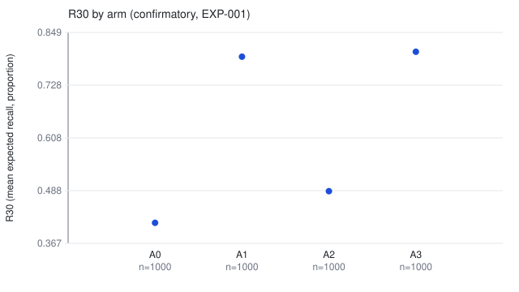
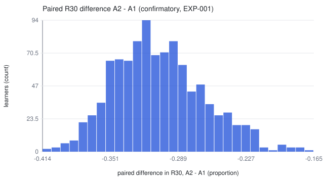

<!-- SPDX-License-Identifier: LicenseRef-STREAK-NC-Research-1.0 -->
# EXP-001: generated results report (CONFIRMATORY)

**Label: CONFIRMATORY.** Simulation of synthetic learners. Not evidence about real human learning, motivation or any real product.

Generated by `streak.report` from the result file. Do not edit by hand.

- Result file: `results/confirmatory/EXP-001/results.json`
- Result SHA-256: `0cd65c26fb370ee6718f8072ace2d980` `105248ef47d987ae77dfbd37ecc24c0f`
- Config hash: `c34b1a07816d3f57ff26e1e1c99d66be` `bbd97a1866455ff2656ce521fffafdd7`
- Protocol version 1.0; engine version 1.1.0
- Records (learner-arms): 4000; failed: 0 (0.00%)
- Master seeds: 1, 2, 3, 4, 5; learners per seed: 200

## Cell `default`

### Retention by arm (means over learners, proportions)

| Arm | n | R30 | R30 95% CI | R1 | R7 | R90 | AUC-R | Weakest decile R30 |
|---|---|---|---|---|---|---|---|---|
| A0 | 1000 | 0.4141 | [0.4082, 0.4201] | 0.5422 | 0.5119 | 0.2513 | 0.3753 | 0.1416 |
| A1 | 1000 | 0.7931 | [0.7900, 0.7963] | 0.9329 | 0.8989 | 0.5969 | 0.7460 | 0.4114 |
| A2 | 1000 | 0.4863 | [0.4809, 0.4919] | 0.6071 | 0.5784 | 0.3314 | 0.4493 | 0.1496 |
| A3 | 1000 | 0.8045 | [0.8015, 0.8076] | 0.9474 | 0.9138 | 0.5982 | 0.7546 | 0.5567 |

### Activity by arm (means over learners)

| Arm | Minutes | Residual slots | Active days | Longest streak | Success rate | Coverage | Spearman (active days, R30) | Residual-flagged |
|---|---|---|---|---|---|---|---|---|
| A0 | 0.0 | 0.00 | 0.00 | 0.00 | n/a | 0.000 | n/a | 0 |
| A1 | 336.0 | 0.08 | 23.60 | 1.88 | 0.878 | 1.000 | -0.032 | 0 |
| A2 | 334.9 | 2.15 | 47.55 | 16.24 | 0.987 | 0.172 | -0.088 | 3 |
| A3 | 334.9 | 2.15 | 47.55 | 16.24 | 0.877 | 0.999 | -0.003 | 3 |

### Paired contrasts on R30: effects

| Kind | Contrast | n | Mean diff | SD diff | d_z | 95% CI | 90% CI |
|---|---|---|---|---|---|---|---|
| primary | A2 - A1 | 1000 | -0.3068 | 0.0415 | -7.40 | [-0.3093, -0.3042] | [-0.3089, -0.3046] |
| primary, flagged excluded | A2 - A1 | 997 | -0.3068 | 0.0415 | -7.39 | [-0.3093, -0.3042] | [-0.3089, -0.3046] |
| secondary | A3 - A1 | 1000 | 0.0114 | 0.0128 | 0.89 | [0.0107, 0.0123] | [0.0108, 0.0121] |
| secondary | A2 - A3 | 1000 | -0.3182 | 0.0427 | -7.45 | [-0.3209, -0.3155] | [-0.3204, -0.3160] |
| secondary | A1 - A0 | 1000 | 0.3790 | 0.0497 | 7.62 | [0.3759, 0.3820] | [0.3764, 0.3815] |
| secondary | A2 - A0 | 1000 | 0.0722 | 0.0159 | 4.55 | [0.0712, 0.0732] | [0.0714, 0.0730] |
| secondary | A3 - A0 | 1000 | 0.3904 | 0.0511 | 7.64 | [0.3872, 0.3935] | [0.3878, 0.3931] |

### Paired contrasts on R30: tests and classes

| Kind | Contrast | p (bootstrap) | p (Holm) | Class (protocol section 4) |
|---|---|---|---|---|
| primary | A2 - A1 | < 0.0001 | n/a | relevant negative |
| primary, flagged excluded | A2 - A1 | < 0.0001 | n/a | relevant negative |
| secondary | A3 - A1 | < 0.0001 | < 0.0001 | practically equivalent under the model |
| secondary | A2 - A3 | < 0.0001 | < 0.0001 | relevant negative |
| secondary | A1 - A0 | < 0.0001 | < 0.0001 | relevant positive |
| secondary | A2 - A0 | < 0.0001 | < 0.0001 | relevant positive |
| secondary | A3 - A0 | < 0.0001 | < 0.0001 | relevant positive |

Per-master-seed mean of the primary paired difference: seed 1: -0.3063, seed 2: -0.3103, seed 3: -0.3079, seed 4: -0.3034, seed 5: -0.3060.

## Figures

## Notes

- Intervals are stratified percentile bootstrap intervals over learners within master seeds (10000 resamples, seed 20261124).
- Classes follow research/protocol.md section 4 with SESOI 0.02. Non-significance is never equivalence.
- Holm adjustment is applied to bootstrap p-values of the secondary contrasts within each cell; intervals are unadjusted (protocol section 14.6). If the config sets holm_primary_across_cells, the primary p-values are also Holm-adjusted across cells (p (Holm) column of primary rows).
