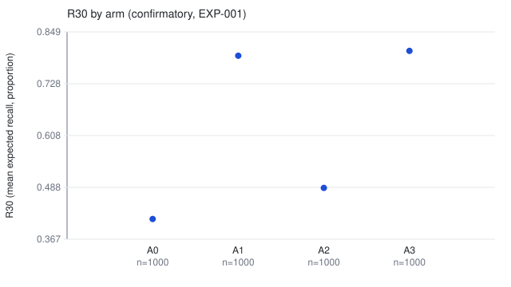
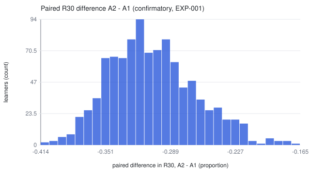

<!-- SPDX-License-Identifier: LicenseRef-STREAK-NC-Research-1.0 -->
# EXP-001 report: streak-driven versus fixed practice at matched minutes

**Label: CONFIRMATORY (frozen protocol 1.0). Simulation of synthetic learners. Not evidence about real human learning, motivation or any real product.**

## 1. Identification

| Field | Value |
|---|---|
| Experiment ID | EXP-001 |
| Date run | 2026-11-25 local time (2026-11-24 23:35:06 to 23:35:37 UTC) |
| Report version | 1.0 (M3, written as the experiment finished) |
| Status | complete: full frozen matrix run, 0 failed learner-arms |
| Authorship | Mohamed Bechir Kefi (no affiliation; decision C3). Drafted by the AI research assistant for the owner's review. |
| Protocol | `research/experiments/EXP-001/protocol.md`, SHA-256 `d618b9f8dbc09079702ad4bb9dd19c0595753b8f2985638e3cbe1fbec4585f32`; parent `research/protocol.md`, SHA-256 `57a60597a93cfc07a1d25e9a2f6bac9f23009b554d3d9820828e7707210711ee` |
| Config | `research/experiments/EXP-001/config.json`, canonical SHA-256 `c34b1a07816d3f57ff26e1e1c99d66bebbd97a1866455ff2656ce521fffafdd7` |
| Code revision | `c942be096240103297fcab6f3cc9886961ce8137` (engine 1.1.0, package 0.2.0), tracked tree clean |

## 2. Executive summary

**Question.** At the frozen default parameters and identical practice minutes, does streak-driven scheduling (A2: every available day, easiest items first) give a different mean expected recall 30 days after practice ends (R30) than a fixed three-sessions-per-week round-robin schedule (A1)?

**Method.** 1,000 synthetic learners (master seeds 1 to 5, 200 each), all four arms on every learner with common random numbers, 4,000 learner-arm simulations. Paired difference, stratified percentile bootstrap (10,000 resamples, seed 20261124), SESOI 0.02.

**Outcome.** Mean paired difference A2 minus A1 in R30 = **-0.3068**, 95% interval **[-0.3093, -0.3042]**, 90% interval [-0.3089, -0.3046], d_z = -7.40. All 1,000 learners had a negative difference (range -0.4135 to -0.1653). Under the frozen rule H0 is rejected and the result **supports the expected direction with practical relevance** (95% interval entirely below -0.02). The threshold-based comparator A3, which has exactly A2's timing and activity, retained slightly more than A1 (+0.0114, 95% [0.0107, 0.0123]; practically equivalent under the model).

**Principal caveat.** The size of the gap is a property of the model, above all of easiest-first selection combined with K = 200 items (A2 reviewed on average 17.2% of the items) and of the difficulty-dependent gain. EXP-003 tests the gain rule and separates timing from selection. The preregistered held-out test on real Duolingo data (section 8.4) found that the model's exponential forgetting curve describes first-repeat recall worse than a constant-recall baseline, which weakens the calibration of the time scale.

## 3. Rationale and literature

Retrieval practice strengthens memory (Roediger and Karpicke 2006), spacing improves long-term retention (Cepeda et al. 2006), and recall decays with time since the last exposure (Murre and Dros 2015; the half-life model of Settles and Meeder 2016). Streaks reward being active every day rather than the memory value of what is practised, and streaks are known to act as goals in themselves (Silverman and Barasch 2022). This experiment holds minutes fixed and asks only about the retention value of how those minutes are scheduled and filled. Citations as verified in `research/literature_review.md` and `research/paper/references.bib`.

## 4. Hypotheses and operational definitions

- Δ_l = R30_l(A2) - R30_l(A1), on the same learner, availability sequence and outcome stream. H0: E[Δ] = 0; H1: E[Δ] ≠ 0 (two-sided; expected direction negative).
- R30 = (1/K) Σ_i p_i(T + 30), p_i(t) = 2^(-(t - s_i) / h_i), T = 56 days, K = 200 items. Unit: proportion.
- Decision rule (EXP-001 protocol section 4): 95% interval entirely below -0.02 supports the expected direction with practical relevance; 95% interval entirely above 0, or 90% interval inside (-0.02, +0.02), contradicts it; otherwise "detectable but below the SESOI" or "inconclusive".
- Controls: A0 NoPractice (negative control) and A3 Spaced (threshold rule r* = 0.9, P§14.5). Minutes matched at M = 672 slots (336 minutes).

## 5. Methodology

- Model of P§2 at the frozen parameters: h0 = 67.59 days (fitted on the Duolingo fit split, J-0009), σ_item = 0.5, σ_learner = 0.3, g_min = 0.1, a = 2.5, b = 0.6, h_min = 0.25, q = 0.85, T = 56, M = 672 slots of 0.5 minutes, daily cap 60 slots, exponential forgetting, difficulty-dependent gain. Arms as in P§3 with P§14.5.
- Seeds 1 to 5, 200 learners each; learners generated by NumPy `SeedSequence` spawning (common random numbers across arms).
- Data provenance: synthetic learners only; the real Duolingo traces (CC BY-NC 4.0) set h0 only and never enter an arm. Data manifest SHA-256 `60b024953faa4e164c83520fefd5b5a8d6e1154d8c18ed8067769ce4aed2ed9e`; raw file SHA-256 verified before the run (`26cf9b33f2e9b2e8aa9a8f262a017b30699ca2f625c56a12ce699d4ea7076873`).
- Hardware and software: Apple M1 Pro (10 cores), macOS (Darwin 24.3.0), Python 3.12.1, NumPy 2.5.4; one worker process under `nice -n 10`.
- Statistical plan exactly as frozen: stratified percentile bootstrap within master seeds; secondary contrasts with Holm-adjusted bootstrap p-values within the cell and unadjusted intervals (P§14.6); residual-flag sensitivity (P§7).

## 6. Implementation verification

- Full test suite before the run: 211 passed, 0 failed (`.venv/bin/python -m pytest`, revision 45ea4ec; c942be0 adds only smoke outputs and journal lines).
- Smoke run at the frozen parameters on smoke seeds 9001 to 9005 (J-0011, exploratory): 400 learner-arms, 0 failed, SD of the paired difference 0.041 (below the 0.3 threshold of P§6).
- Metric validation (J-0012, exploratory): 11 of 11 known cases and every per-record invariant passed, including A0 retention recomputed from the closed form (tolerance 1e-12), budget conservation, day accounting and identical activity of A2 and A3.
- The invariants are also visible in the confirmatory output: A0 spent 0 minutes; A2 and A3 have identical minutes, residual, active days and streaks; A1 spent 336.0 minutes on average.
- Faithfulness: A2 operationalises "streak maintenance with quick wins" as one stylised rule (easiest first by the scheduler's belief). It is not a model of any real product.

## 7. Execution record

| Item | Value |
|---|---|
| Command | `.venv/bin/python scripts/run_confirmatory.py EXP-001`, which runs `nice -n 10 .venv/bin/python -m streak.cli run --config research/experiments/EXP-001/config.json --out results/confirmatory/EXP-001` through the freeze guard |
| Preflight | tracked tree clean; protocol, EXP protocol, config, data manifest and raw data hashes equal to the freeze record |
| Run IDs | EXP-001/default/s1 to EXP-001/default/s5 (one run per master seed) |
| Start and end | 2026-11-24T23:35:06 to 23:35:37 UTC (per-run times in `results/confirmatory/EXP-001/provenance.json`) |
| Runtime | 30.5 s of simulation (30.8 s wall clock); peak RSS 109,936,640 bytes |
| Sample counts | 4,000 learner-arms planned, 4,000 run, 0 failed, 0 dropped |
| Exit status | process exit 0; all five runs ok |
| Deviations | none from the frozen protocol. The code that applies the protocol's verdict wording (`streak.frozen_analysis`) and the run wrapper were written and tested in commit 45ea4ec, before any confirmatory output existed. |

## 8. Results

### 8.1 Retention and activity by arm (n = 1,000 learners per arm)

| Arm | R30 | R30 95% CI | R1 | R7 | R90 | AUC-R | Weakest-decile R30 |
|---|---|---|---|---|---|---|---|
| A0 NoPractice | 0.4141 | [0.4082, 0.4201] | 0.5422 | 0.5119 | 0.2513 | 0.3753 | 0.1416 |
| A1 Fixed | 0.7931 | [0.7900, 0.7963] | 0.9329 | 0.8989 | 0.5969 | 0.7460 | 0.4114 |
| A2 Streak | 0.4863 | [0.4809, 0.4919] | 0.6071 | 0.5784 | 0.3314 | 0.4493 | 0.1496 |
| A3 Spaced | 0.8045 | [0.8015, 0.8076] | 0.9474 | 0.9138 | 0.5982 | 0.7546 | 0.5567 |

| Arm | Minutes | Residual slots | Active days | Longest streak | Success rate | Item coverage | Residual-flagged |
|---|---|---|---|---|---|---|---|
| A0 | 0.0 | 0.00 | 0.00 | 0.00 | n/a | 0.000 | 0 |
| A1 | 336.0 | 0.08 | 23.60 | 1.88 | 0.878 | 1.000 | 0 |
| A2 | 334.9 | 2.15 | 47.55 | 16.24 | 0.987 | 0.172 | 3 |
| A3 | 334.9 | 2.15 | 47.55 | 16.24 | 0.877 | 0.999 | 3 |

Source: `generated/metrics.csv` and `generated/report.md`, generated from `results/confirmatory/EXP-001/results.json`.

### 8.2 Primary contrast

| Contrast | n | Mean diff | SD diff | d_z | 95% CI | 90% CI | p (bootstrap) | Class |
|---|---|---|---|---|---|---|---|---|
| A2 - A1 | 1000 | -0.3068 | 0.0415 | -7.40 | [-0.3093, -0.3042] | [-0.3089, -0.3046] | < 0.0001 | relevant negative |
| A2 - A1, residual-flagged excluded | 997 | -0.3068 | 0.0415 | -7.39 | [-0.3093, -0.3042] | [-0.3089, -0.3046] | < 0.0001 | relevant negative |

Per-master-seed means: -0.3063, -0.3103, -0.3079, -0.3034, -0.3060 (seeds 1 to 5). Distribution of Δ: minimum -0.4135, 5th percentile -0.3682, median -0.3105, 95th percentile -0.2315, maximum -0.1653 (FIG-01b). A bootstrap p-value of 0 means that no resample reached 0; it is reported as below 0.0001.

### 8.3 Secondary contrasts (Holm within the cell; intervals unadjusted)

| Contrast | Mean diff | 95% CI | p (Holm) | Class |
|---|---|---|---|---|
| A3 - A1 | +0.0114 | [0.0107, 0.0123] | < 0.0001 | practically equivalent under the model (the interval also excludes 0) |
| A2 - A3 | -0.3182 | [-0.3209, -0.3155] | < 0.0001 | relevant negative |
| A1 - A0 | +0.3790 | [0.3759, 0.3820] | < 0.0001 | relevant positive |
| A2 - A0 | +0.0722 | [0.0712, 0.0732] | < 0.0001 | relevant positive |
| A3 - A0 | +0.3904 | [0.3872, 0.3935] | < 0.0001 | relevant positive |

Within-arm Spearman correlation between active days and R30 (descriptive): A1 -0.032, A2 -0.088, A3 -0.003.

### 8.4 Preregistered second test on held-out real data (P§14.4)

Run once, after the freeze (`scripts/heldout_test.py`, revision c942be0, 46.8 s; `results/confirmatory/HELDOUT-14.4/heldout.json`). Held-out user split: 161,243 first-repeat rows, 243,337 trials. This test is descriptive and does not test H1.

| Model | h0 fitted on the fit split (days) | Mean log-likelihood per held-out trial |
|---|---|---|
| Constant recall (pooled fit-split recall 0.8948) | n/a | **-0.3352** |
| Power-law form | 96.62 | -0.3710 |
| Exponential form (the model's default) | 67.59 | -0.3865 |

| Delay bin (days) | Trials | Observed recall | Exponential, predicted | Power, predicted |
|---|---|---|---|---|
| [1, 2) | 52,150 | 0.904 | 0.983 | 0.975 |
| [2, 4) | 56,949 | 0.901 | 0.965 | 0.952 |
| [4, 8) | 57,652 | 0.896 | 0.933 | 0.912 |
| [8, 16) | 38,180 | 0.892 | 0.875 | 0.850 |
| [16, 32) | 22,023 | 0.882 | 0.774 | 0.761 |
| [32, 90] | 16,383 | 0.872 | 0.579 | 0.625 |

Reading fixed in P§14.4: the exponential model does **not** describe the held-out first-repeat data better than the constant baseline, and of the two forms the **power-law form is better supported**. Observed recall falls only from 0.904 to 0.872 across delays of 1 to 90 days, while both forms, with the fixed heterogeneity σ = 0.583, predict a much steeper decline. This is a negative result for the model's forgetting assumption on these data.

### 8.5 Figures

## 9. Interpretation

- **Measured (in the model).** At matched minutes A2 doubles active days (47.6 versus 23.6) and raises the longest streak from 1.9 to 16.2 days, while its R30 is 0.307 lower than A1's and only 0.072 above doing nothing after day 0. This is the divergence the research question defines: higher activity, lower retention.
- **Mechanism (model-dependent inference).** A2 reviewed only 17.2% of the items, with a 98.7% practice success rate: under easiest-first selection by the scheduler's belief, the same quick-win items are reviewed again and again and the other items decay from day 0. A3 has exactly the same timing and activity, covers 99.9% of items and retains as much as A1. The contrast A2 - A3 (same timing, different selection: -0.318) indicates that item selection, not daily timing, carries the gap; EXP-003 tests this formally.
- **Alternatives.** The magnitude depends on the difficulty-dependent gain (reviews of well-known items add little), on K = 200 items relative to 672 slots, and on the default parameters. EXP-002 varies h0, a and q; EXP-003 varies the gain rule and the forgetting form.
- **Pre-freeze disclosure.** Smoke runs at the draft parameters (h0 = 1 day, floor regime) had shown A2 above A1 (+0.080; P§14.7). At the frozen parameters the sign is reversed. The amendments that moved the parameters were justified by the control arms only (P§14.7), but the reader should know that the direction changed between the floor regime and the frozen design.
- **Verdict under the frozen rule:** H0 rejected; the result supports the expected direction with practical relevance.

## 10. Threats to validity

- Internal: the gap is produced by a stylised policy and an assumed update rule; A1 and A2 differ in timing and selection at once (EXP-003). Residual minutes are negligible (A2 mean 2.15 slots; 3 learners flagged; excluding them changes nothing at four decimals).
- Construct: R30 is the model's expected recall, not a test score; "streak-driven" is one rule, not a model of real learners or products.
- External: no human data in the arms. The held-out Duolingo test shows that the forgetting form fits real first-repeat recall worse than a constant baseline, so the time scale calibrated from those data should be read as an order of magnitude only.
- Statistical: intervals describe simulation uncertainty given the model. With d_z = -7.4 that uncertainty is negligible relative to the effect; what is uncertain is the model, not the interval.

## 11. Conclusion and next experiment

Within the frozen model, at matched minutes, streak-driven scheduling with easiest-first selection retained substantially less 30 days after practice than a fixed round-robin schedule (-0.307, 95% CI [-0.309, -0.304]), while doubling activity. This answers only the registered question at the default parameters. EXP-002 maps the gap across h0, a and q; EXP-003 decomposes it into timing and selection and tests whether it survives a flat gain rule.

## 12. Reproduction appendix

- Environment: `../.tools/py/bin/uv sync --frozen --all-groups --all-extras`, then `.venv/bin/python -m pytest`.
- Run: `.venv/bin/python scripts/run_confirmatory.py EXP-001` (refuses unless the tracked tree is clean and all frozen hashes match).
- Analysis and figures: `.venv/bin/python scripts/analyse_confirmatory.py EXP-001`, then the copy commands of `reproduction.md` (figures, `metrics.csv` and `run_manifest.json` into this folder).
- Held-out test: `.venv/bin/python scripts/heldout_test.py` (needs `data/processed/first_repeat.npz`, rebuilt by `scripts/download_duolingo.py` and `scripts/ingest_duolingo.py`; SHA-256 in `data/manifest.json`).
- Raw results: `results/confirmatory/EXP-001/results.json` (committed, 2.3 MB, schema `streak.result/1.0`), SHA-256 in `results/confirmatory/EXP-001/sha256_manifest.json` and `run_manifest.json`. Identical seeds and config give byte-identical result files on the same platform (P§8).
- Machine-readable outputs: `generated/analysis.json`, `generated/contrasts.csv`, `generated/metrics.csv`, `generated/frozen_analysis.json`, `run_manifest.json`, `results/confirmatory/EXP-001/provenance.json`.
- References: Cepeda et al. (2006), Murre and Dros (2015, doi:10.1371/journal.pone.0120644), Roediger and Karpicke (2006), Settles and Meeder (2016; data doi:10.7910/DVN/N8XJME), Silverman and Barasch (2022); bibliographic entries as verified in `research/paper/references.bib`.
