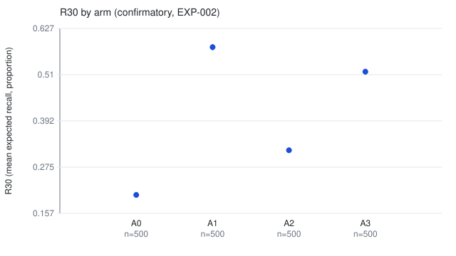
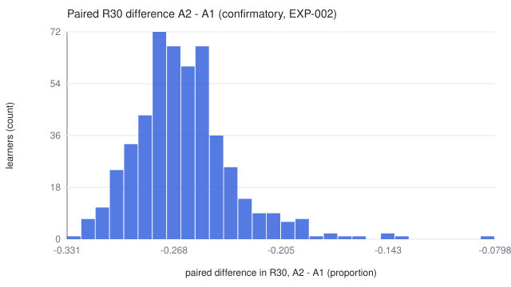

<!-- SPDX-License-Identifier: LicenseRef-STREAK-NC-Research-1.0 -->
# EXP-002: generated results report (CONFIRMATORY)

**Label: CONFIRMATORY.** Simulation of synthetic learners. Not evidence about real human learning, motivation or any real product.

Generated by `streak.report` from the result file. Do not edit by hand.

- Result file: `results/confirmatory/EXP-002/results.json`
- Result SHA-256: `4d4984ce1e45c3d91e924276d5d1a7a3` `1a2e837b77a9e657ca5834dfd58c6fd1`
- Config hash: `2ecfe90453c1663db0a03d1118e5d7b0` `e6cd97b4afc43f7fc4d2bf8d5f02dc46`
- Protocol version 1.0; engine version 1.1.0
- Records (learner-arms): 54000; failed: 0 (0.00%)
- Master seeds: 1, 2, 3, 4, 5; learners per seed: 100

## Cell `h0=33.8|a=1.5|q=0.7`

### Retention by arm (means over learners, proportions)

| Arm | n | R30 | R30 95% CI | R1 | R7 | R90 | AUC-R | Weakest decile R30 |
|---|---|---|---|---|---|---|---|---|
| A0 | 500 | 0.2042 | [0.1973, 0.2112] | 0.3228 | 0.2922 | 0.0908 | 0.1791 | 0.0278 |
| A1 | 500 | 0.5795 | [0.5718, 0.5871] | 0.8245 | 0.7531 | 0.3417 | 0.5277 | 0.0605 |
| A2 | 500 | 0.3176 | [0.3111, 0.3242] | 0.4439 | 0.4107 | 0.1951 | 0.2906 | 0.0297 |
| A3 | 500 | 0.5172 | [0.5099, 0.5245] | 0.7200 | 0.6663 | 0.3040 | 0.4693 | 0.0525 |

### Activity by arm (means over learners)

| Arm | Minutes | Residual slots | Active days | Longest streak | Success rate | Coverage | Spearman (active days, R30) | Residual-flagged |
|---|---|---|---|---|---|---|---|---|
| A0 | 0.0 | 0.00 | 0.00 | 0.00 | n/a | 0.000 | n/a | 0 |
| A1 | 335.4 | 1.11 | 22.36 | 1.97 | 0.756 | 1.000 | -0.024 | 2 |
| A2 | 333.4 | 5.21 | 39.11 | 9.01 | 0.961 | 0.246 | -0.123 | 18 |
| A3 | 333.4 | 5.21 | 39.11 | 9.01 | 0.842 | 0.691 | -0.014 | 18 |

### Paired contrasts on R30: effects

| Kind | Contrast | n | Mean diff | SD diff | d_z | 95% CI | 90% CI |
|---|---|---|---|---|---|---|---|
| primary | A2 - A1 | 500 | -0.2619 | 0.0292 | -8.97 | [-0.2644, -0.2594] | [-0.2640, -0.2598] |
| primary, flagged excluded | A2 - A1 | 482 | -0.2625 | 0.0291 | -9.03 | [-0.2650, -0.2598] | [-0.2646, -0.2603] |
| secondary | A3 - A1 | 500 | -0.0623 | 0.0219 | -2.85 | [-0.0642, -0.0603] | [-0.0638, -0.0606] |
| secondary | A2 - A3 | 500 | -0.1996 | 0.0233 | -8.56 | [-0.2016, -0.1976] | [-0.2013, -0.1979] |
| secondary | A1 - A0 | 500 | 0.3753 | 0.0259 | 14.49 | [0.3730, 0.3775] | [0.3734, 0.3771] |
| secondary | A2 - A0 | 500 | 0.1134 | 0.0172 | 6.60 | [0.1119, 0.1149] | [0.1122, 0.1147] |
| secondary | A3 - A0 | 500 | 0.3131 | 0.0208 | 15.02 | [0.3112, 0.3148] | [0.3115, 0.3146] |

### Paired contrasts on R30: tests and classes

| Kind | Contrast | p (bootstrap) | p (Holm) | Class (protocol section 4) |
|---|---|---|---|---|
| primary | A2 - A1 | < 0.0001 | < 0.0001 | relevant negative |
| primary, flagged excluded | A2 - A1 | < 0.0001 | n/a | relevant negative |
| secondary | A3 - A1 | < 0.0001 | < 0.0001 | relevant negative |
| secondary | A2 - A3 | < 0.0001 | < 0.0001 | relevant negative |
| secondary | A1 - A0 | < 0.0001 | < 0.0001 | relevant positive |
| secondary | A2 - A0 | < 0.0001 | < 0.0001 | relevant positive |
| secondary | A3 - A0 | < 0.0001 | < 0.0001 | relevant positive |

Per-master-seed mean of the primary paired difference: seed 1: -0.2585, seed 2: -0.2639, seed 3: -0.2633, seed 4: -0.2637, seed 5: -0.2602.

## Cell `h0=33.8|a=1.5|q=0.85`

### Retention by arm (means over learners, proportions)

| Arm | n | R30 | R30 95% CI | R1 | R7 | R90 | AUC-R | Weakest decile R30 |
|---|---|---|---|---|---|---|---|---|
| A0 | 500 | 0.2042 | [0.1973, 0.2112] | 0.3228 | 0.2922 | 0.0908 | 0.1791 | 0.0278 |
| A1 | 500 | 0.5789 | [0.5711, 0.5864] | 0.8223 | 0.7518 | 0.3411 | 0.5270 | 0.0616 |
| A2 | 500 | 0.2903 | [0.2839, 0.2969] | 0.4118 | 0.3802 | 0.1729 | 0.2644 | 0.0295 |
| A3 | 500 | 0.5117 | [0.5045, 0.5189] | 0.7124 | 0.6595 | 0.3001 | 0.4641 | 0.0541 |

### Activity by arm (means over learners)

| Arm | Minutes | Residual slots | Active days | Longest streak | Success rate | Coverage | Spearman (active days, R30) | Residual-flagged |
|---|---|---|---|---|---|---|---|---|
| A0 | 0.0 | 0.00 | 0.00 | 0.00 | n/a | 0.000 | n/a | 0 |
| A1 | 336.0 | 0.06 | 23.63 | 1.87 | 0.757 | 1.000 | -0.028 | 0 |
| A2 | 334.9 | 2.23 | 47.59 | 15.97 | 0.974 | 0.174 | -0.122 | 1 |
| A3 | 334.9 | 2.23 | 47.59 | 15.97 | 0.848 | 0.666 | -0.025 | 1 |

### Paired contrasts on R30: effects

| Kind | Contrast | n | Mean diff | SD diff | d_z | 95% CI | 90% CI |
|---|---|---|---|---|---|---|---|
| primary | A2 - A1 | 500 | -0.2885 | 0.0283 | -10.19 | [-0.2909, -0.2860] | [-0.2905, -0.2865] |
| primary, flagged excluded | A2 - A1 | 499 | -0.2886 | 0.0283 | -10.19 | [-0.2910, -0.2861] | [-0.2906, -0.2865] |
| secondary | A3 - A1 | 500 | -0.0671 | 0.0225 | -2.99 | [-0.0691, -0.0651] | [-0.0687, -0.0655] |
| secondary | A2 - A3 | 500 | -0.2214 | 0.0216 | -10.26 | [-0.2232, -0.2195] | [-0.2230, -0.2198] |
| secondary | A1 - A0 | 500 | 0.3747 | 0.0259 | 14.47 | [0.3724, 0.3769] | [0.3727, 0.3765] |
| secondary | A2 - A0 | 500 | 0.0862 | 0.0128 | 6.75 | [0.0850, 0.0872] | [0.0852, 0.0871] |
| secondary | A3 - A0 | 500 | 0.3076 | 0.0192 | 16.00 | [0.3059, 0.3092] | [0.3061, 0.3089] |

### Paired contrasts on R30: tests and classes

| Kind | Contrast | p (bootstrap) | p (Holm) | Class (protocol section 4) |
|---|---|---|---|---|
| primary | A2 - A1 | < 0.0001 | < 0.0001 | relevant negative |
| primary, flagged excluded | A2 - A1 | < 0.0001 | n/a | relevant negative |
| secondary | A3 - A1 | < 0.0001 | < 0.0001 | relevant negative |
| secondary | A2 - A3 | < 0.0001 | < 0.0001 | relevant negative |
| secondary | A1 - A0 | < 0.0001 | < 0.0001 | relevant positive |
| secondary | A2 - A0 | < 0.0001 | < 0.0001 | relevant positive |
| secondary | A3 - A0 | < 0.0001 | < 0.0001 | relevant positive |

Per-master-seed mean of the primary paired difference: seed 1: -0.2838, seed 2: -0.2903, seed 3: -0.2873, seed 4: -0.2918, seed 5: -0.2895.

## Cell `h0=33.8|a=1.5|q=1`

### Retention by arm (means over learners, proportions)

| Arm | n | R30 | R30 95% CI | R1 | R7 | R90 | AUC-R | Weakest decile R30 |
|---|---|---|---|---|---|---|---|---|
| A0 | 500 | 0.2042 | [0.1973, 0.2112] | 0.3228 | 0.2922 | 0.0908 | 0.1791 | 0.0278 |
| A1 | 500 | 0.5777 | [0.5699, 0.5853] | 0.8198 | 0.7499 | 0.3406 | 0.5259 | 0.0612 |
| A2 | 500 | 0.2518 | [0.2453, 0.2584] | 0.3634 | 0.3347 | 0.1448 | 0.2281 | 0.0292 |
| A3 | 500 | 0.5094 | [0.5021, 0.5166] | 0.7095 | 0.6569 | 0.2981 | 0.4618 | 0.0553 |

### Activity by arm (means over learners)

| Arm | Minutes | Residual slots | Active days | Longest streak | Success rate | Coverage | Spearman (active days, R30) | Residual-flagged |
|---|---|---|---|---|---|---|---|---|
| A0 | 0.0 | 0.00 | 0.00 | 0.00 | n/a | 0.000 | n/a | 0 |
| A1 | 336.0 | 0.00 | 24.00 | 1.00 | 0.758 | 1.000 | n/a | 0 |
| A2 | 336.0 | 0.00 | 56.00 | 56.00 | 0.995 | 0.060 | n/a | 0 |
| A3 | 336.0 | 0.00 | 56.00 | 56.00 | 0.853 | 0.652 | n/a | 0 |

### Paired contrasts on R30: effects

| Kind | Contrast | n | Mean diff | SD diff | d_z | 95% CI | 90% CI |
|---|---|---|---|---|---|---|---|
| primary | A2 - A1 | 500 | -0.3260 | 0.0277 | -11.78 | [-0.3283, -0.3235] | [-0.3279, -0.3239] |
| primary, flagged excluded | A2 - A1 | 500 | -0.3260 | 0.0277 | -11.78 | [-0.3283, -0.3235] | [-0.3279, -0.3239] |
| secondary | A3 - A1 | 500 | -0.0684 | 0.0228 | -3.00 | [-0.0703, -0.0664] | [-0.0700, -0.0667] |
| secondary | A2 - A3 | 500 | -0.2576 | 0.0201 | -12.82 | [-0.2593, -0.2558] | [-0.2590, -0.2561] |
| secondary | A1 - A0 | 500 | 0.3735 | 0.0261 | 14.29 | [0.3712, 0.3757] | [0.3716, 0.3754] |
| secondary | A2 - A0 | 500 | 0.0476 | 0.0052 | 9.13 | [0.0471, 0.0480] | [0.0472, 0.0480] |
| secondary | A3 - A0 | 500 | 0.3052 | 0.0190 | 16.09 | [0.3035, 0.3068] | [0.3038, 0.3065] |

### Paired contrasts on R30: tests and classes

| Kind | Contrast | p (bootstrap) | p (Holm) | Class (protocol section 4) |
|---|---|---|---|---|
| primary | A2 - A1 | < 0.0001 | < 0.0001 | relevant negative |
| primary, flagged excluded | A2 - A1 | < 0.0001 | n/a | relevant negative |
| secondary | A3 - A1 | < 0.0001 | < 0.0001 | relevant negative |
| secondary | A2 - A3 | < 0.0001 | < 0.0001 | relevant negative |
| secondary | A1 - A0 | < 0.0001 | < 0.0001 | relevant positive |
| secondary | A2 - A0 | < 0.0001 | < 0.0001 | relevant positive |
| secondary | A3 - A0 | < 0.0001 | < 0.0001 | relevant positive |

Per-master-seed mean of the primary paired difference: seed 1: -0.3205, seed 2: -0.3270, seed 3: -0.3270, seed 4: -0.3273, seed 5: -0.3280.

## Cell `h0=33.8|a=2.5|q=0.7`

### Retention by arm (means over learners, proportions)

| Arm | n | R30 | R30 95% CI | R1 | R7 | R90 | AUC-R | Weakest decile R30 |
|---|---|---|---|---|---|---|---|---|
| A0 | 500 | 0.2042 | [0.1973, 0.2112] | 0.3228 | 0.2922 | 0.0908 | 0.1791 | 0.0278 |
| A1 | 500 | 0.6536 | [0.6468, 0.6602] | 0.8547 | 0.7974 | 0.4330 | 0.6038 | 0.0861 |
| A2 | 500 | 0.3263 | [0.3199, 0.3328] | 0.4476 | 0.4159 | 0.2071 | 0.2999 | 0.0301 |
| A3 | 500 | 0.6009 | [0.5942, 0.6076] | 0.7894 | 0.7404 | 0.3873 | 0.5520 | 0.0777 |

### Activity by arm (means over learners)

| Arm | Minutes | Residual slots | Active days | Longest streak | Success rate | Coverage | Spearman (active days, R30) | Residual-flagged |
|---|---|---|---|---|---|---|---|---|
| A0 | 0.0 | 0.00 | 0.00 | 0.00 | n/a | 0.000 | n/a | 0 |
| A1 | 335.4 | 1.11 | 22.36 | 1.97 | 0.775 | 1.000 | -0.020 | 2 |
| A2 | 333.4 | 5.21 | 39.11 | 9.01 | 0.965 | 0.245 | -0.144 | 18 |
| A3 | 333.4 | 5.21 | 39.11 | 9.01 | 0.834 | 0.794 | -0.018 | 18 |

### Paired contrasts on R30: effects

| Kind | Contrast | n | Mean diff | SD diff | d_z | 95% CI | 90% CI |
|---|---|---|---|---|---|---|---|
| primary | A2 - A1 | 500 | -0.3273 | 0.0288 | -11.37 | [-0.3297, -0.3248] | [-0.3294, -0.3253] |
| primary, flagged excluded | A2 - A1 | 482 | -0.3278 | 0.0286 | -11.45 | [-0.3303, -0.3252] | [-0.3299, -0.3257] |
| secondary | A3 - A1 | 500 | -0.0527 | 0.0245 | -2.15 | [-0.0549, -0.0506] | [-0.0545, -0.0509] |
| secondary | A2 - A3 | 500 | -0.2746 | 0.0241 | -11.41 | [-0.2767, -0.2725] | [-0.2763, -0.2728] |
| secondary | A1 - A0 | 500 | 0.4494 | 0.0273 | 16.44 | [0.4470, 0.4517] | [0.4474, 0.4513] |
| secondary | A2 - A0 | 500 | 0.1221 | 0.0194 | 6.28 | [0.1204, 0.1238] | [0.1207, 0.1235] |
| secondary | A3 - A0 | 500 | 0.3967 | 0.0228 | 17.41 | [0.3947, 0.3986] | [0.3950, 0.3983] |

### Paired contrasts on R30: tests and classes

| Kind | Contrast | p (bootstrap) | p (Holm) | Class (protocol section 4) |
|---|---|---|---|---|
| primary | A2 - A1 | < 0.0001 | < 0.0001 | relevant negative |
| primary, flagged excluded | A2 - A1 | < 0.0001 | n/a | relevant negative |
| secondary | A3 - A1 | < 0.0001 | < 0.0001 | relevant negative |
| secondary | A2 - A3 | < 0.0001 | < 0.0001 | relevant negative |
| secondary | A1 - A0 | < 0.0001 | < 0.0001 | relevant positive |
| secondary | A2 - A0 | < 0.0001 | < 0.0001 | relevant positive |
| secondary | A3 - A0 | < 0.0001 | < 0.0001 | relevant positive |

Per-master-seed mean of the primary paired difference: seed 1: -0.3241, seed 2: -0.3310, seed 3: -0.3285, seed 4: -0.3284, seed 5: -0.3246.

## Cell `h0=33.8|a=2.5|q=0.85`

### Retention by arm (means over learners, proportions)

| Arm | n | R30 | R30 95% CI | R1 | R7 | R90 | AUC-R | Weakest decile R30 |
|---|---|---|---|---|---|---|---|---|
| A0 | 500 | 0.2042 | [0.1973, 0.2112] | 0.3228 | 0.2922 | 0.0908 | 0.1791 | 0.0278 |
| A1 | 500 | 0.6534 | [0.6465, 0.6599] | 0.8531 | 0.7966 | 0.4327 | 0.6034 | 0.0876 |
| A2 | 500 | 0.2962 | [0.2898, 0.3027] | 0.4143 | 0.3837 | 0.1808 | 0.2707 | 0.0297 |
| A3 | 500 | 0.5947 | [0.5880, 0.6013] | 0.7786 | 0.7313 | 0.3837 | 0.5462 | 0.0751 |

### Activity by arm (means over learners)

| Arm | Minutes | Residual slots | Active days | Longest streak | Success rate | Coverage | Spearman (active days, R30) | Residual-flagged |
|---|---|---|---|---|---|---|---|---|
| A0 | 0.0 | 0.00 | 0.00 | 0.00 | n/a | 0.000 | n/a | 0 |
| A1 | 336.0 | 0.06 | 23.63 | 1.87 | 0.776 | 1.000 | -0.028 | 0 |
| A2 | 334.9 | 2.23 | 47.59 | 15.97 | 0.977 | 0.174 | -0.134 | 1 |
| A3 | 334.9 | 2.23 | 47.59 | 15.97 | 0.841 | 0.766 | -0.043 | 1 |

### Paired contrasts on R30: effects

| Kind | Contrast | n | Mean diff | SD diff | d_z | 95% CI | 90% CI |
|---|---|---|---|---|---|---|---|
| primary | A2 - A1 | 500 | -0.3572 | 0.0278 | -12.87 | [-0.3595, -0.3547] | [-0.3591, -0.3551] |
| primary, flagged excluded | A2 - A1 | 499 | -0.3572 | 0.0278 | -12.85 | [-0.3596, -0.3548] | [-0.3592, -0.3552] |
| secondary | A3 - A1 | 500 | -0.0587 | 0.0239 | -2.46 | [-0.0608, -0.0566] | [-0.0604, -0.0569] |
| secondary | A2 - A3 | 500 | -0.2985 | 0.0210 | -14.22 | [-0.3002, -0.2967] | [-0.3000, -0.2969] |
| secondary | A1 - A0 | 500 | 0.4492 | 0.0274 | 16.39 | [0.4467, 0.4515] | [0.4471, 0.4511] |
| secondary | A2 - A0 | 500 | 0.0920 | 0.0143 | 6.43 | [0.0908, 0.0933] | [0.0910, 0.0931] |
| secondary | A3 - A0 | 500 | 0.3905 | 0.0204 | 19.12 | [0.3887, 0.3922] | [0.3890, 0.3920] |

### Paired contrasts on R30: tests and classes

| Kind | Contrast | p (bootstrap) | p (Holm) | Class (protocol section 4) |
|---|---|---|---|---|
| primary | A2 - A1 | < 0.0001 | < 0.0001 | relevant negative |
| primary, flagged excluded | A2 - A1 | < 0.0001 | n/a | relevant negative |
| secondary | A3 - A1 | < 0.0001 | < 0.0001 | relevant negative |
| secondary | A2 - A3 | < 0.0001 | < 0.0001 | relevant negative |
| secondary | A1 - A0 | < 0.0001 | < 0.0001 | relevant positive |
| secondary | A2 - A0 | < 0.0001 | < 0.0001 | relevant positive |
| secondary | A3 - A0 | < 0.0001 | < 0.0001 | relevant positive |

Per-master-seed mean of the primary paired difference: seed 1: -0.3530, seed 2: -0.3603, seed 3: -0.3556, seed 4: -0.3597, seed 5: -0.3571.

## Cell `h0=33.8|a=2.5|q=1`

### Retention by arm (means over learners, proportions)

| Arm | n | R30 | R30 95% CI | R1 | R7 | R90 | AUC-R | Weakest decile R30 |
|---|---|---|---|---|---|---|---|---|
| A0 | 500 | 0.2042 | [0.1973, 0.2112] | 0.3228 | 0.2922 | 0.0908 | 0.1791 | 0.0278 |
| A1 | 500 | 0.6520 | [0.6452, 0.6586] | 0.8510 | 0.7949 | 0.4316 | 0.6021 | 0.0871 |
| A2 | 500 | 0.2518 | [0.2453, 0.2584] | 0.3634 | 0.3347 | 0.1450 | 0.2282 | 0.0292 |
| A3 | 500 | 0.5886 | [0.5819, 0.5952] | 0.7675 | 0.7217 | 0.3805 | 0.5405 | 0.0707 |

### Activity by arm (means over learners)

| Arm | Minutes | Residual slots | Active days | Longest streak | Success rate | Coverage | Spearman (active days, R30) | Residual-flagged |
|---|---|---|---|---|---|---|---|---|
| A0 | 0.0 | 0.00 | 0.00 | 0.00 | n/a | 0.000 | n/a | 0 |
| A1 | 336.0 | 0.00 | 24.00 | 1.00 | 0.777 | 1.000 | n/a | 0 |
| A2 | 336.0 | 0.00 | 56.00 | 56.00 | 0.996 | 0.060 | n/a | 0 |
| A3 | 336.0 | 0.00 | 56.00 | 56.00 | 0.847 | 0.738 | n/a | 0 |

### Paired contrasts on R30: effects

| Kind | Contrast | n | Mean diff | SD diff | d_z | 95% CI | 90% CI |
|---|---|---|---|---|---|---|---|
| primary | A2 - A1 | 500 | -0.4002 | 0.0267 | -14.97 | [-0.4024, -0.3978] | [-0.4021, -0.3982] |
| primary, flagged excluded | A2 - A1 | 500 | -0.4002 | 0.0267 | -14.97 | [-0.4024, -0.3978] | [-0.4021, -0.3982] |
| secondary | A3 - A1 | 500 | -0.0634 | 0.0232 | -2.74 | [-0.0654, -0.0613] | [-0.0651, -0.0617] |
| secondary | A2 - A3 | 500 | -0.3368 | 0.0191 | -17.66 | [-0.3384, -0.3351] | [-0.3382, -0.3354] |
| secondary | A1 - A0 | 500 | 0.4478 | 0.0274 | 16.33 | [0.4454, 0.4501] | [0.4457, 0.4497] |
| secondary | A2 - A0 | 500 | 0.0476 | 0.0052 | 9.11 | [0.0472, 0.0481] | [0.0472, 0.0480] |
| secondary | A3 - A0 | 500 | 0.3844 | 0.0199 | 19.36 | [0.3827, 0.3861] | [0.3830, 0.3858] |

### Paired contrasts on R30: tests and classes

| Kind | Contrast | p (bootstrap) | p (Holm) | Class (protocol section 4) |
|---|---|---|---|---|
| primary | A2 - A1 | < 0.0001 | < 0.0001 | relevant negative |
| primary, flagged excluded | A2 - A1 | < 0.0001 | n/a | relevant negative |
| secondary | A3 - A1 | < 0.0001 | < 0.0001 | relevant negative |
| secondary | A2 - A3 | < 0.0001 | < 0.0001 | relevant negative |
| secondary | A1 - A0 | < 0.0001 | < 0.0001 | relevant positive |
| secondary | A2 - A0 | < 0.0001 | < 0.0001 | relevant positive |
| secondary | A3 - A0 | < 0.0001 | < 0.0001 | relevant positive |

Per-master-seed mean of the primary paired difference: seed 1: -0.3953, seed 2: -0.4025, seed 3: -0.4005, seed 4: -0.4010, seed 5: -0.4016.

## Cell `h0=33.8|a=4|q=0.7`

### Retention by arm (means over learners, proportions)

| Arm | n | R30 | R30 95% CI | R1 | R7 | R90 | AUC-R | Weakest decile R30 |
|---|---|---|---|---|---|---|---|---|
| A0 | 500 | 0.2042 | [0.1973, 0.2112] | 0.3228 | 0.2922 | 0.0908 | 0.1791 | 0.0278 |
| A1 | 500 | 0.7238 | [0.7180, 0.7294] | 0.8807 | 0.8364 | 0.5337 | 0.6799 | 0.1227 |
| A2 | 500 | 0.3346 | [0.3282, 0.3410] | 0.4512 | 0.4208 | 0.2196 | 0.3091 | 0.0303 |
| A3 | 500 | 0.7020 | [0.6958, 0.7081] | 0.8739 | 0.8295 | 0.4950 | 0.6541 | 0.1730 |

### Activity by arm (means over learners)

| Arm | Minutes | Residual slots | Active days | Longest streak | Success rate | Coverage | Spearman (active days, R30) | Residual-flagged |
|---|---|---|---|---|---|---|---|---|
| A0 | 0.0 | 0.00 | 0.00 | 0.00 | n/a | 0.000 | n/a | 0 |
| A1 | 335.4 | 1.11 | 22.36 | 1.97 | 0.795 | 1.000 | -0.019 | 2 |
| A2 | 333.4 | 5.21 | 39.11 | 9.01 | 0.968 | 0.245 | -0.165 | 18 |
| A3 | 333.4 | 5.21 | 39.11 | 9.01 | 0.823 | 0.918 | -0.015 | 18 |

### Paired contrasts on R30: effects

| Kind | Contrast | n | Mean diff | SD diff | d_z | 95% CI | 90% CI |
|---|---|---|---|---|---|---|---|
| primary | A2 - A1 | 500 | -0.3892 | 0.0315 | -12.37 | [-0.3919, -0.3865] | [-0.3915, -0.3869] |
| primary, flagged excluded | A2 - A1 | 482 | -0.3896 | 0.0314 | -12.40 | [-0.3924, -0.3868] | [-0.3920, -0.3873] |
| secondary | A3 - A1 | 500 | -0.0218 | 0.0248 | -0.88 | [-0.0240, -0.0196] | [-0.0236, -0.0200] |
| secondary | A2 - A3 | 500 | -0.3674 | 0.0280 | -13.12 | [-0.3698, -0.3650] | [-0.3695, -0.3654] |
| secondary | A1 - A0 | 500 | 0.5196 | 0.0324 | 16.06 | [0.5168, 0.5223] | [0.5172, 0.5219] |
| secondary | A2 - A0 | 500 | 0.1304 | 0.0216 | 6.03 | [0.1285, 0.1323] | [0.1288, 0.1320] |
| secondary | A3 - A0 | 500 | 0.4978 | 0.0290 | 17.15 | [0.4953, 0.5003] | [0.4957, 0.4999] |

### Paired contrasts on R30: tests and classes

| Kind | Contrast | p (bootstrap) | p (Holm) | Class (protocol section 4) |
|---|---|---|---|---|
| primary | A2 - A1 | < 0.0001 | < 0.0001 | relevant negative |
| primary, flagged excluded | A2 - A1 | < 0.0001 | n/a | relevant negative |
| secondary | A3 - A1 | < 0.0001 | < 0.0001 | detectable but below the SESOI |
| secondary | A2 - A3 | < 0.0001 | < 0.0001 | relevant negative |
| secondary | A1 - A0 | < 0.0001 | < 0.0001 | relevant positive |
| secondary | A2 - A0 | < 0.0001 | < 0.0001 | relevant positive |
| secondary | A3 - A0 | < 0.0001 | < 0.0001 | relevant positive |

Per-master-seed mean of the primary paired difference: seed 1: -0.3861, seed 2: -0.3938, seed 3: -0.3902, seed 4: -0.3898, seed 5: -0.3862.

## Cell `h0=33.8|a=4|q=0.85`

### Retention by arm (means over learners, proportions)

| Arm | n | R30 | R30 95% CI | R1 | R7 | R90 | AUC-R | Weakest decile R30 |
|---|---|---|---|---|---|---|---|---|
| A0 | 500 | 0.2042 | [0.1973, 0.2112] | 0.3228 | 0.2922 | 0.0908 | 0.1791 | 0.0278 |
| A1 | 500 | 0.7239 | [0.7181, 0.7295] | 0.8797 | 0.8360 | 0.5335 | 0.6798 | 0.1246 |
| A2 | 500 | 0.3016 | [0.2952, 0.3080] | 0.4165 | 0.3868 | 0.1889 | 0.2766 | 0.0299 |
| A3 | 500 | 0.6979 | [0.6916, 0.7040] | 0.8706 | 0.8261 | 0.4911 | 0.6501 | 0.1687 |

### Activity by arm (means over learners)

| Arm | Minutes | Residual slots | Active days | Longest streak | Success rate | Coverage | Spearman (active days, R30) | Residual-flagged |
|---|---|---|---|---|---|---|---|---|
| A0 | 0.0 | 0.00 | 0.00 | 0.00 | n/a | 0.000 | n/a | 0 |
| A1 | 336.0 | 0.06 | 23.63 | 1.87 | 0.796 | 1.000 | -0.031 | 0 |
| A2 | 334.9 | 2.23 | 47.59 | 15.97 | 0.979 | 0.173 | -0.146 | 1 |
| A3 | 334.9 | 2.23 | 47.59 | 15.97 | 0.828 | 0.907 | -0.039 | 1 |

### Paired contrasts on R30: effects

| Kind | Contrast | n | Mean diff | SD diff | d_z | 95% CI | 90% CI |
|---|---|---|---|---|---|---|---|
| primary | A2 - A1 | 500 | -0.4223 | 0.0304 | -13.91 | [-0.4249, -0.4196] | [-0.4245, -0.4200] |
| primary, flagged excluded | A2 - A1 | 499 | -0.4223 | 0.0304 | -13.89 | [-0.4249, -0.4196] | [-0.4245, -0.4200] |
| secondary | A3 - A1 | 500 | -0.0260 | 0.0262 | -0.99 | [-0.0283, -0.0237] | [-0.0279, -0.0240] |
| secondary | A2 - A3 | 500 | -0.3963 | 0.0260 | -15.23 | [-0.3985, -0.3941] | [-0.3982, -0.3944] |
| secondary | A1 - A0 | 500 | 0.5197 | 0.0324 | 16.05 | [0.5168, 0.5224] | [0.5173, 0.5220] |
| secondary | A2 - A0 | 500 | 0.0974 | 0.0159 | 6.13 | [0.0960, 0.0988] | [0.0962, 0.0986] |
| secondary | A3 - A0 | 500 | 0.4937 | 0.0269 | 18.34 | [0.4913, 0.4960] | [0.4918, 0.4956] |

### Paired contrasts on R30: tests and classes

| Kind | Contrast | p (bootstrap) | p (Holm) | Class (protocol section 4) |
|---|---|---|---|---|
| primary | A2 - A1 | < 0.0001 | < 0.0001 | relevant negative |
| primary, flagged excluded | A2 - A1 | < 0.0001 | n/a | relevant negative |
| secondary | A3 - A1 | < 0.0001 | < 0.0001 | relevant negative |
| secondary | A2 - A3 | < 0.0001 | < 0.0001 | relevant negative |
| secondary | A1 - A0 | < 0.0001 | < 0.0001 | relevant positive |
| secondary | A2 - A0 | < 0.0001 | < 0.0001 | relevant positive |
| secondary | A3 - A0 | < 0.0001 | < 0.0001 | relevant positive |

Per-master-seed mean of the primary paired difference: seed 1: -0.4185, seed 2: -0.4261, seed 3: -0.4208, seed 4: -0.4236, seed 5: -0.4224.

## Cell `h0=33.8|a=4|q=1`

### Retention by arm (means over learners, proportions)

| Arm | n | R30 | R30 95% CI | R1 | R7 | R90 | AUC-R | Weakest decile R30 |
|---|---|---|---|---|---|---|---|---|
| A0 | 500 | 0.2042 | [0.1973, 0.2112] | 0.3228 | 0.2922 | 0.0908 | 0.1791 | 0.0278 |
| A1 | 500 | 0.7227 | [0.7169, 0.7284] | 0.8780 | 0.8346 | 0.5326 | 0.6787 | 0.1242 |
| A2 | 500 | 0.2518 | [0.2454, 0.2584] | 0.3634 | 0.3347 | 0.1450 | 0.2282 | 0.0292 |
| A3 | 500 | 0.6948 | [0.6883, 0.7011] | 0.8687 | 0.8239 | 0.4876 | 0.6470 | 0.1708 |

### Activity by arm (means over learners)

| Arm | Minutes | Residual slots | Active days | Longest streak | Success rate | Coverage | Spearman (active days, R30) | Residual-flagged |
|---|---|---|---|---|---|---|---|---|
| A0 | 0.0 | 0.00 | 0.00 | 0.00 | n/a | 0.000 | n/a | 0 |
| A1 | 336.0 | 0.00 | 24.00 | 1.00 | 0.797 | 1.000 | n/a | 0 |
| A2 | 336.0 | 0.00 | 56.00 | 56.00 | 0.997 | 0.060 | n/a | 0 |
| A3 | 336.0 | 0.00 | 56.00 | 56.00 | 0.830 | 0.903 | n/a | 0 |

### Paired contrasts on R30: effects

| Kind | Contrast | n | Mean diff | SD diff | d_z | 95% CI | 90% CI |
|---|---|---|---|---|---|---|---|
| primary | A2 - A1 | 500 | -0.4709 | 0.0299 | -15.74 | [-0.4734, -0.4682] | [-0.4730, -0.4687] |
| primary, flagged excluded | A2 - A1 | 500 | -0.4709 | 0.0299 | -15.74 | [-0.4734, -0.4682] | [-0.4730, -0.4687] |
| secondary | A3 - A1 | 500 | -0.0279 | 0.0262 | -1.06 | [-0.0302, -0.0256] | [-0.0298, -0.0260] |
| secondary | A2 - A3 | 500 | -0.4430 | 0.0246 | -18.02 | [-0.4451, -0.4409] | [-0.4448, -0.4412] |
| secondary | A1 - A0 | 500 | 0.5185 | 0.0323 | 16.04 | [0.5157, 0.5212] | [0.5162, 0.5208] |
| secondary | A2 - A0 | 500 | 0.0476 | 0.0052 | 9.09 | [0.0472, 0.0481] | [0.0473, 0.0480] |
| secondary | A3 - A0 | 500 | 0.4906 | 0.0261 | 18.80 | [0.4883, 0.4929] | [0.4887, 0.4925] |

### Paired contrasts on R30: tests and classes

| Kind | Contrast | p (bootstrap) | p (Holm) | Class (protocol section 4) |
|---|---|---|---|---|
| primary | A2 - A1 | < 0.0001 | < 0.0001 | relevant negative |
| primary, flagged excluded | A2 - A1 | < 0.0001 | n/a | relevant negative |
| secondary | A3 - A1 | < 0.0001 | < 0.0001 | relevant negative |
| secondary | A2 - A3 | < 0.0001 | < 0.0001 | relevant negative |
| secondary | A1 - A0 | < 0.0001 | < 0.0001 | relevant positive |
| secondary | A2 - A0 | < 0.0001 | < 0.0001 | relevant positive |
| secondary | A3 - A0 | < 0.0001 | < 0.0001 | relevant positive |

Per-master-seed mean of the primary paired difference: seed 1: -0.4661, seed 2: -0.4737, seed 3: -0.4722, seed 4: -0.4702, seed 5: -0.4721.

## Cell `h0=67.59|a=1.5|q=0.7`

### Retention by arm (means over learners, proportions)

| Arm | n | R30 | R30 95% CI | R1 | R7 | R90 | AUC-R | Weakest decile R30 |
|---|---|---|---|---|---|---|---|---|
| A0 | 500 | 0.4116 | [0.4032, 0.4199] | 0.5399 | 0.5095 | 0.2490 | 0.3728 | 0.1401 |
| A1 | 500 | 0.7496 | [0.7441, 0.7550] | 0.9192 | 0.8772 | 0.5294 | 0.6975 | 0.3420 |
| A2 | 500 | 0.5035 | [0.4961, 0.5108] | 0.6269 | 0.5976 | 0.3458 | 0.4659 | 0.1496 |
| A3 | 500 | 0.7522 | [0.7464, 0.7578] | 0.9241 | 0.8825 | 0.5250 | 0.6981 | 0.4104 |

### Activity by arm (means over learners)

| Arm | Minutes | Residual slots | Active days | Longest streak | Success rate | Coverage | Spearman (active days, R30) | Residual-flagged |
|---|---|---|---|---|---|---|---|---|
| A0 | 0.0 | 0.00 | 0.00 | 0.00 | n/a | 0.000 | n/a | 0 |
| A1 | 335.4 | 1.11 | 22.36 | 1.97 | 0.868 | 1.000 | -0.031 | 2 |
| A2 | 333.4 | 5.21 | 39.11 | 9.01 | 0.978 | 0.241 | -0.083 | 18 |
| A3 | 333.4 | 5.21 | 39.11 | 9.01 | 0.870 | 0.986 | 0.010 | 18 |

### Paired contrasts on R30: effects

| Kind | Contrast | n | Mean diff | SD diff | d_z | 95% CI | 90% CI |
|---|---|---|---|---|---|---|---|
| primary | A2 - A1 | 500 | -0.2461 | 0.0294 | -8.37 | [-0.2487, -0.2436] | [-0.2483, -0.2440] |
| primary, flagged excluded | A2 - A1 | 482 | -0.2467 | 0.0294 | -8.40 | [-0.2493, -0.2441] | [-0.2489, -0.2445] |
| secondary | A3 - A1 | 500 | 0.0025 | 0.0145 | 0.17 | [0.0013, 0.0038] | [0.0015, 0.0036] |
| secondary | A2 - A3 | 500 | -0.2487 | 0.0282 | -8.83 | [-0.2511, -0.2463] | [-0.2507, -0.2467] |
| secondary | A1 - A0 | 500 | 0.3381 | 0.0380 | 8.89 | [0.3348, 0.3413] | [0.3353, 0.3408] |
| secondary | A2 - A0 | 500 | 0.0919 | 0.0188 | 4.90 | [0.0903, 0.0936] | [0.0906, 0.0933] |
| secondary | A3 - A0 | 500 | 0.3406 | 0.0368 | 9.27 | [0.3375, 0.3437] | [0.3380, 0.3432] |

### Paired contrasts on R30: tests and classes

| Kind | Contrast | p (bootstrap) | p (Holm) | Class (protocol section 4) |
|---|---|---|---|---|
| primary | A2 - A1 | < 0.0001 | < 0.0001 | relevant negative |
| primary, flagged excluded | A2 - A1 | < 0.0001 | n/a | relevant negative |
| secondary | A3 - A1 | < 0.0001 | < 0.0001 | practically equivalent under the model |
| secondary | A2 - A3 | < 0.0001 | < 0.0001 | relevant negative |
| secondary | A1 - A0 | < 0.0001 | < 0.0001 | relevant positive |
| secondary | A2 - A0 | < 0.0001 | < 0.0001 | relevant positive |
| secondary | A3 - A0 | < 0.0001 | < 0.0001 | relevant positive |

Per-master-seed mean of the primary paired difference: seed 1: -0.2460, seed 2: -0.2508, seed 3: -0.2472, seed 4: -0.2447, seed 5: -0.2420.

## Cell `h0=67.59|a=1.5|q=0.85`

### Retention by arm (means over learners, proportions)

| Arm | n | R30 | R30 95% CI | R1 | R7 | R90 | AUC-R | Weakest decile R30 |
|---|---|---|---|---|---|---|---|---|
| A0 | 500 | 0.4116 | [0.4032, 0.4199] | 0.5399 | 0.5095 | 0.2490 | 0.3728 | 0.1401 |
| A1 | 500 | 0.7490 | [0.7434, 0.7543] | 0.9180 | 0.8762 | 0.5289 | 0.6969 | 0.3421 |
| A2 | 500 | 0.4803 | [0.4727, 0.4878] | 0.6033 | 0.5741 | 0.3235 | 0.4429 | 0.1473 |
| A3 | 500 | 0.7500 | [0.7441, 0.7558] | 0.9201 | 0.8792 | 0.5239 | 0.6961 | 0.4021 |

### Activity by arm (means over learners)

| Arm | Minutes | Residual slots | Active days | Longest streak | Success rate | Coverage | Spearman (active days, R30) | Residual-flagged |
|---|---|---|---|---|---|---|---|---|
| A0 | 0.0 | 0.00 | 0.00 | 0.00 | n/a | 0.000 | n/a | 0 |
| A1 | 336.0 | 0.06 | 23.63 | 1.87 | 0.869 | 1.000 | -0.027 | 0 |
| A2 | 334.9 | 2.23 | 47.59 | 15.97 | 0.986 | 0.171 | -0.092 | 1 |
| A3 | 334.9 | 2.23 | 47.59 | 15.97 | 0.874 | 0.974 | -0.035 | 1 |

### Paired contrasts on R30: effects

| Kind | Contrast | n | Mean diff | SD diff | d_z | 95% CI | 90% CI |
|---|---|---|---|---|---|---|---|
| primary | A2 - A1 | 500 | -0.2687 | 0.0304 | -8.83 | [-0.2713, -0.2661] | [-0.2709, -0.2665] |
| primary, flagged excluded | A2 - A1 | 499 | -0.2686 | 0.0304 | -8.83 | [-0.2713, -0.2659] | [-0.2708, -0.2664] |
| secondary | A3 - A1 | 500 | 0.0011 | 0.0158 | 0.07 | [-0.0003, 0.0024] | [-0.0001, 0.0022] |
| secondary | A2 - A3 | 500 | -0.2698 | 0.0279 | -9.66 | [-0.2722, -0.2673] | [-0.2718, -0.2677] |
| secondary | A1 - A0 | 500 | 0.3374 | 0.0377 | 8.94 | [0.3341, 0.3406] | [0.3347, 0.3401] |
| secondary | A2 - A0 | 500 | 0.0687 | 0.0146 | 4.70 | [0.0675, 0.0700] | [0.0676, 0.0698] |
| secondary | A3 - A0 | 500 | 0.3385 | 0.0348 | 9.73 | [0.3354, 0.3415] | [0.3359, 0.3410] |

### Paired contrasts on R30: tests and classes

| Kind | Contrast | p (bootstrap) | p (Holm) | Class (protocol section 4) |
|---|---|---|---|---|
| primary | A2 - A1 | < 0.0001 | < 0.0001 | relevant negative |
| primary, flagged excluded | A2 - A1 | < 0.0001 | n/a | relevant negative |
| secondary | A3 - A1 | 0.1370 | 0.1370 | practically equivalent under the model |
| secondary | A2 - A3 | < 0.0001 | < 0.0001 | relevant negative |
| secondary | A1 - A0 | < 0.0001 | < 0.0001 | relevant positive |
| secondary | A2 - A0 | < 0.0001 | < 0.0001 | relevant positive |
| secondary | A3 - A0 | < 0.0001 | < 0.0001 | relevant positive |

Per-master-seed mean of the primary paired difference: seed 1: -0.2678, seed 2: -0.2729, seed 3: -0.2683, seed 4: -0.2682, seed 5: -0.2663.

## Cell `h0=67.59|a=1.5|q=1`

### Retention by arm (means over learners, proportions)

| Arm | n | R30 | R30 95% CI | R1 | R7 | R90 | AUC-R | Weakest decile R30 |
|---|---|---|---|---|---|---|---|---|
| A0 | 500 | 0.4116 | [0.4032, 0.4199] | 0.5399 | 0.5095 | 0.2490 | 0.3728 | 0.1401 |
| A1 | 500 | 0.7484 | [0.7429, 0.7538] | 0.9169 | 0.8753 | 0.5286 | 0.6963 | 0.3420 |
| A2 | 500 | 0.4468 | [0.4389, 0.4546] | 0.5675 | 0.5389 | 0.2938 | 0.4103 | 0.1440 |
| A3 | 500 | 0.7474 | [0.7414, 0.7532] | 0.9154 | 0.8752 | 0.5224 | 0.6936 | 0.3905 |

### Activity by arm (means over learners)

| Arm | Minutes | Residual slots | Active days | Longest streak | Success rate | Coverage | Spearman (active days, R30) | Residual-flagged |
|---|---|---|---|---|---|---|---|---|
| A0 | 0.0 | 0.00 | 0.00 | 0.00 | n/a | 0.000 | n/a | 0 |
| A1 | 336.0 | 0.00 | 24.00 | 1.00 | 0.870 | 1.000 | n/a | 0 |
| A2 | 336.0 | 0.00 | 56.00 | 56.00 | 0.998 | 0.060 | n/a | 0 |
| A3 | 336.0 | 0.00 | 56.00 | 56.00 | 0.875 | 0.961 | n/a | 0 |

### Paired contrasts on R30: effects

| Kind | Contrast | n | Mean diff | SD diff | d_z | 95% CI | 90% CI |
|---|---|---|---|---|---|---|---|
| primary | A2 - A1 | 500 | -0.3017 | 0.0325 | -9.29 | [-0.3044, -0.2988] | [-0.3040, -0.2993] |
| primary, flagged excluded | A2 - A1 | 500 | -0.3017 | 0.0325 | -9.29 | [-0.3044, -0.2988] | [-0.3040, -0.2993] |
| secondary | A3 - A1 | 500 | -0.0011 | 0.0165 | -0.06 | [-0.0025, 0.0003] | [-0.0022, 0.0001] |
| secondary | A2 - A3 | 500 | -0.3006 | 0.0289 | -10.40 | [-0.3031, -0.2981] | [-0.3027, -0.2985] |
| secondary | A1 - A0 | 500 | 0.3369 | 0.0376 | 8.96 | [0.3336, 0.3401] | [0.3341, 0.3396] |
| secondary | A2 - A0 | 500 | 0.0352 | 0.0062 | 5.64 | [0.0347, 0.0357] | [0.0347, 0.0356] |
| secondary | A3 - A0 | 500 | 0.3358 | 0.0336 | 9.99 | [0.3329, 0.3386] | [0.3334, 0.3382] |

### Paired contrasts on R30: tests and classes

| Kind | Contrast | p (bootstrap) | p (Holm) | Class (protocol section 4) |
|---|---|---|---|---|
| primary | A2 - A1 | < 0.0001 | < 0.0001 | relevant negative |
| primary, flagged excluded | A2 - A1 | < 0.0001 | n/a | relevant negative |
| secondary | A3 - A1 | 0.1448 | 0.1448 | practically equivalent under the model |
| secondary | A2 - A3 | < 0.0001 | < 0.0001 | relevant negative |
| secondary | A1 - A0 | < 0.0001 | < 0.0001 | relevant positive |
| secondary | A2 - A0 | < 0.0001 | < 0.0001 | relevant positive |
| secondary | A3 - A0 | < 0.0001 | < 0.0001 | relevant positive |

Per-master-seed mean of the primary paired difference: seed 1: -0.3009, seed 2: -0.3055, seed 3: -0.3026, seed 4: -0.2989, seed 5: -0.3005.

## Cell `h0=67.59|a=2.5|q=0.7`

### Retention by arm (means over learners, proportions)

| Arm | n | R30 | R30 95% CI | R1 | R7 | R90 | AUC-R | Weakest decile R30 |
|---|---|---|---|---|---|---|---|---|
| A0 | 500 | 0.4116 | [0.4032, 0.4199] | 0.5399 | 0.5095 | 0.2490 | 0.3728 | 0.1401 |
| A1 | 500 | 0.7932 | [0.7887, 0.7974] | 0.9339 | 0.8996 | 0.5963 | 0.7460 | 0.4120 |
| A2 | 500 | 0.5086 | [0.5012, 0.5158] | 0.6289 | 0.6003 | 0.3540 | 0.4717 | 0.1502 |
| A3 | 500 | 0.8035 | [0.7993, 0.8077] | 0.9470 | 0.9132 | 0.5967 | 0.7535 | 0.5521 |

### Activity by arm (means over learners)

| Arm | Minutes | Residual slots | Active days | Longest streak | Success rate | Coverage | Spearman (active days, R30) | Residual-flagged |
|---|---|---|---|---|---|---|---|---|
| A0 | 0.0 | 0.00 | 0.00 | 0.00 | n/a | 0.000 | n/a | 0 |
| A1 | 335.4 | 1.11 | 22.36 | 1.97 | 0.878 | 1.000 | -0.031 | 2 |
| A2 | 333.4 | 5.21 | 39.11 | 9.01 | 0.980 | 0.240 | -0.093 | 18 |
| A3 | 333.4 | 5.21 | 39.11 | 9.01 | 0.874 | 1.000 | 0.020 | 18 |

### Paired contrasts on R30: effects

| Kind | Contrast | n | Mean diff | SD diff | d_z | 95% CI | 90% CI |
|---|---|---|---|---|---|---|---|
| primary | A2 - A1 | 500 | -0.2846 | 0.0393 | -7.25 | [-0.2879, -0.2812] | [-0.2874, -0.2817] |
| primary, flagged excluded | A2 - A1 | 482 | -0.2851 | 0.0393 | -7.25 | [-0.2886, -0.2817] | [-0.2881, -0.2822] |
| secondary | A3 - A1 | 500 | 0.0104 | 0.0126 | 0.82 | [0.0093, 0.0115] | [0.0095, 0.0113] |
| secondary | A2 - A3 | 500 | -0.2950 | 0.0408 | -7.22 | [-0.2985, -0.2915] | [-0.2979, -0.2920] |
| secondary | A1 - A0 | 500 | 0.3816 | 0.0497 | 7.68 | [0.3773, 0.3858] | [0.3780, 0.3852] |
| secondary | A2 - A0 | 500 | 0.0970 | 0.0205 | 4.73 | [0.0952, 0.0988] | [0.0955, 0.0985] |
| secondary | A3 - A0 | 500 | 0.3920 | 0.0513 | 7.65 | [0.3875, 0.3963] | [0.3882, 0.3957] |

### Paired contrasts on R30: tests and classes

| Kind | Contrast | p (bootstrap) | p (Holm) | Class (protocol section 4) |
|---|---|---|---|---|
| primary | A2 - A1 | < 0.0001 | < 0.0001 | relevant negative |
| primary, flagged excluded | A2 - A1 | < 0.0001 | n/a | relevant negative |
| secondary | A3 - A1 | < 0.0001 | < 0.0001 | practically equivalent under the model |
| secondary | A2 - A3 | < 0.0001 | < 0.0001 | relevant negative |
| secondary | A1 - A0 | < 0.0001 | < 0.0001 | relevant positive |
| secondary | A2 - A0 | < 0.0001 | < 0.0001 | relevant positive |
| secondary | A3 - A0 | < 0.0001 | < 0.0001 | relevant positive |

Per-master-seed mean of the primary paired difference: seed 1: -0.2850, seed 2: -0.2898, seed 3: -0.2856, seed 4: -0.2822, seed 5: -0.2805.

## Cell `h0=67.59|a=2.5|q=0.85`

### Retention by arm (means over learners, proportions)

| Arm | n | R30 | R30 95% CI | R1 | R7 | R90 | AUC-R | Weakest decile R30 |
|---|---|---|---|---|---|---|---|---|
| A0 | 500 | 0.4116 | [0.4032, 0.4199] | 0.5399 | 0.5095 | 0.2490 | 0.3728 | 0.1401 |
| A1 | 500 | 0.7925 | [0.7880, 0.7968] | 0.9328 | 0.8987 | 0.5957 | 0.7453 | 0.4121 |
| A2 | 500 | 0.4836 | [0.4761, 0.4911] | 0.6045 | 0.5758 | 0.3289 | 0.4467 | 0.1477 |
| A3 | 500 | 0.8034 | [0.7992, 0.8076] | 0.9467 | 0.9131 | 0.5966 | 0.7534 | 0.5533 |

### Activity by arm (means over learners)

| Arm | Minutes | Residual slots | Active days | Longest streak | Success rate | Coverage | Spearman (active days, R30) | Residual-flagged |
|---|---|---|---|---|---|---|---|---|
| A0 | 0.0 | 0.00 | 0.00 | 0.00 | n/a | 0.000 | n/a | 0 |
| A1 | 336.0 | 0.06 | 23.63 | 1.87 | 0.878 | 1.000 | -0.023 | 0 |
| A2 | 334.9 | 2.23 | 47.59 | 15.97 | 0.987 | 0.171 | -0.098 | 1 |
| A3 | 334.9 | 2.23 | 47.59 | 15.97 | 0.877 | 0.999 | -0.019 | 1 |

### Paired contrasts on R30: effects

| Kind | Contrast | n | Mean diff | SD diff | d_z | 95% CI | 90% CI |
|---|---|---|---|---|---|---|---|
| primary | A2 - A1 | 500 | -0.3089 | 0.0408 | -7.57 | [-0.3124, -0.3054] | [-0.3118, -0.3059] |
| primary, flagged excluded | A2 - A1 | 499 | -0.3088 | 0.0408 | -7.57 | [-0.3124, -0.3052] | [-0.3117, -0.3058] |
| secondary | A3 - A1 | 500 | 0.0110 | 0.0125 | 0.88 | [0.0099, 0.0121] | [0.0101, 0.0119] |
| secondary | A2 - A3 | 500 | -0.3198 | 0.0418 | -7.66 | [-0.3234, -0.3162] | [-0.3229, -0.3168] |
| secondary | A1 - A0 | 500 | 0.3809 | 0.0494 | 7.71 | [0.3766, 0.3851] | [0.3773, 0.3845] |
| secondary | A2 - A0 | 500 | 0.0720 | 0.0159 | 4.53 | [0.0707, 0.0734] | [0.0709, 0.0732] |
| secondary | A3 - A0 | 500 | 0.3919 | 0.0505 | 7.76 | [0.3875, 0.3962] | [0.3882, 0.3956] |

### Paired contrasts on R30: tests and classes

| Kind | Contrast | p (bootstrap) | p (Holm) | Class (protocol section 4) |
|---|---|---|---|---|
| primary | A2 - A1 | < 0.0001 | < 0.0001 | relevant negative |
| primary, flagged excluded | A2 - A1 | < 0.0001 | n/a | relevant negative |
| secondary | A3 - A1 | < 0.0001 | < 0.0001 | practically equivalent under the model |
| secondary | A2 - A3 | < 0.0001 | < 0.0001 | relevant negative |
| secondary | A1 - A0 | < 0.0001 | < 0.0001 | relevant positive |
| secondary | A2 - A0 | < 0.0001 | < 0.0001 | relevant positive |
| secondary | A3 - A0 | < 0.0001 | < 0.0001 | relevant positive |

Per-master-seed mean of the primary paired difference: seed 1: -0.3084, seed 2: -0.3135, seed 3: -0.3088, seed 4: -0.3075, seed 5: -0.3062.

## Cell `h0=67.59|a=2.5|q=1`

### Retention by arm (means over learners, proportions)

| Arm | n | R30 | R30 95% CI | R1 | R7 | R90 | AUC-R | Weakest decile R30 |
|---|---|---|---|---|---|---|---|---|
| A0 | 500 | 0.4116 | [0.4032, 0.4199] | 0.5399 | 0.5095 | 0.2490 | 0.3728 | 0.1401 |
| A1 | 500 | 0.7920 | [0.7875, 0.7963] | 0.9320 | 0.8980 | 0.5953 | 0.7448 | 0.4126 |
| A2 | 500 | 0.4468 | [0.4389, 0.4546] | 0.5675 | 0.5389 | 0.2938 | 0.4103 | 0.1440 |
| A3 | 500 | 0.8032 | [0.7988, 0.8074] | 0.9463 | 0.9129 | 0.5959 | 0.7530 | 0.5583 |

### Activity by arm (means over learners)

| Arm | Minutes | Residual slots | Active days | Longest streak | Success rate | Coverage | Spearman (active days, R30) | Residual-flagged |
|---|---|---|---|---|---|---|---|---|
| A0 | 0.0 | 0.00 | 0.00 | 0.00 | n/a | 0.000 | n/a | 0 |
| A1 | 336.0 | 0.00 | 24.00 | 1.00 | 0.879 | 1.000 | n/a | 0 |
| A2 | 336.0 | 0.00 | 56.00 | 56.00 | 0.998 | 0.060 | n/a | 0 |
| A3 | 336.0 | 0.00 | 56.00 | 56.00 | 0.878 | 0.998 | n/a | 0 |

### Paired contrasts on R30: effects

| Kind | Contrast | n | Mean diff | SD diff | d_z | 95% CI | 90% CI |
|---|---|---|---|---|---|---|---|
| primary | A2 - A1 | 500 | -0.3452 | 0.0439 | -7.86 | [-0.3490, -0.3414] | [-0.3484, -0.3420] |
| primary, flagged excluded | A2 - A1 | 500 | -0.3452 | 0.0439 | -7.86 | [-0.3490, -0.3414] | [-0.3484, -0.3420] |
| secondary | A3 - A1 | 500 | 0.0112 | 0.0133 | 0.85 | [0.0100, 0.0124] | [0.0102, 0.0122] |
| secondary | A2 - A3 | 500 | -0.3564 | 0.0448 | -7.96 | [-0.3602, -0.3525] | [-0.3597, -0.3531] |
| secondary | A1 - A0 | 500 | 0.3804 | 0.0493 | 7.72 | [0.3761, 0.3847] | [0.3768, 0.3840] |
| secondary | A2 - A0 | 500 | 0.0352 | 0.0063 | 5.63 | [0.0347, 0.0357] | [0.0348, 0.0357] |
| secondary | A3 - A0 | 500 | 0.3916 | 0.0501 | 7.82 | [0.3873, 0.3959] | [0.3879, 0.3953] |

### Paired contrasts on R30: tests and classes

| Kind | Contrast | p (bootstrap) | p (Holm) | Class (protocol section 4) |
|---|---|---|---|---|
| primary | A2 - A1 | < 0.0001 | < 0.0001 | relevant negative |
| primary, flagged excluded | A2 - A1 | < 0.0001 | n/a | relevant negative |
| secondary | A3 - A1 | < 0.0001 | < 0.0001 | practically equivalent under the model |
| secondary | A2 - A3 | < 0.0001 | < 0.0001 | relevant negative |
| secondary | A1 - A0 | < 0.0001 | < 0.0001 | relevant positive |
| secondary | A2 - A0 | < 0.0001 | < 0.0001 | relevant positive |
| secondary | A3 - A0 | < 0.0001 | < 0.0001 | relevant positive |

Per-master-seed mean of the primary paired difference: seed 1: -0.3448, seed 2: -0.3495, seed 3: -0.3470, seed 4: -0.3410, seed 5: -0.3437.

## Cell `h0=67.59|a=4|q=0.7`

### Retention by arm (means over learners, proportions)

| Arm | n | R30 | R30 95% CI | R1 | R7 | R90 | AUC-R | Weakest decile R30 |
|---|---|---|---|---|---|---|---|---|
| A0 | 500 | 0.4116 | [0.4032, 0.4199] | 0.5399 | 0.5095 | 0.2490 | 0.3728 | 0.1401 |
| A1 | 500 | 0.8354 | [0.8319, 0.8387] | 0.9472 | 0.9203 | 0.6684 | 0.7950 | 0.4902 |
| A2 | 500 | 0.5138 | [0.5065, 0.5209] | 0.6309 | 0.6031 | 0.3630 | 0.4778 | 0.1507 |
| A3 | 500 | 0.8524 | [0.8494, 0.8552] | 0.9616 | 0.9371 | 0.6768 | 0.8092 | 0.6863 |

### Activity by arm (means over learners)

| Arm | Minutes | Residual slots | Active days | Longest streak | Success rate | Coverage | Spearman (active days, R30) | Residual-flagged |
|---|---|---|---|---|---|---|---|---|
| A0 | 0.0 | 0.00 | 0.00 | 0.00 | n/a | 0.000 | n/a | 0 |
| A1 | 335.4 | 1.11 | 22.36 | 1.97 | 0.888 | 1.000 | -0.030 | 2 |
| A2 | 333.4 | 5.21 | 39.11 | 9.01 | 0.981 | 0.240 | -0.102 | 18 |
| A3 | 333.4 | 5.21 | 39.11 | 9.01 | 0.885 | 1.000 | 0.018 | 18 |

### Paired contrasts on R30: effects

| Kind | Contrast | n | Mean diff | SD diff | d_z | 95% CI | 90% CI |
|---|---|---|---|---|---|---|---|
| primary | A2 - A1 | 500 | -0.3216 | 0.0487 | -6.60 | [-0.3258, -0.3174] | [-0.3251, -0.3180] |
| primary, flagged excluded | A2 - A1 | 482 | -0.3221 | 0.0488 | -6.60 | [-0.3265, -0.3179] | [-0.3259, -0.3186] |
| secondary | A3 - A1 | 500 | 0.0170 | 0.0125 | 1.36 | [0.0159, 0.0181] | [0.0161, 0.0179] |
| secondary | A2 - A3 | 500 | -0.3386 | 0.0537 | -6.30 | [-0.3432, -0.3340] | [-0.3425, -0.3346] |
| secondary | A1 - A0 | 500 | 0.4238 | 0.0604 | 7.01 | [0.4186, 0.4290] | [0.4194, 0.4282] |
| secondary | A2 - A0 | 500 | 0.1022 | 0.0222 | 4.60 | [0.1003, 0.1041] | [0.1006, 0.1039] |
| secondary | A3 - A0 | 500 | 0.4408 | 0.0660 | 6.68 | [0.4351, 0.4464] | [0.4360, 0.4456] |

### Paired contrasts on R30: tests and classes

| Kind | Contrast | p (bootstrap) | p (Holm) | Class (protocol section 4) |
|---|---|---|---|---|
| primary | A2 - A1 | < 0.0001 | < 0.0001 | relevant negative |
| primary, flagged excluded | A2 - A1 | < 0.0001 | n/a | relevant negative |
| secondary | A3 - A1 | < 0.0001 | < 0.0001 | practically equivalent under the model |
| secondary | A2 - A3 | < 0.0001 | < 0.0001 | relevant negative |
| secondary | A1 - A0 | < 0.0001 | < 0.0001 | relevant positive |
| secondary | A2 - A0 | < 0.0001 | < 0.0001 | relevant positive |
| secondary | A3 - A0 | < 0.0001 | < 0.0001 | relevant positive |

Per-master-seed mean of the primary paired difference: seed 1: -0.3229, seed 2: -0.3271, seed 3: -0.3227, seed 4: -0.3186, seed 5: -0.3166.

## Cell `h0=67.59|a=4|q=0.85`

### Retention by arm (means over learners, proportions)

| Arm | n | R30 | R30 95% CI | R1 | R7 | R90 | AUC-R | Weakest decile R30 |
|---|---|---|---|---|---|---|---|---|
| A0 | 500 | 0.4116 | [0.4032, 0.4199] | 0.5399 | 0.5095 | 0.2490 | 0.3728 | 0.1401 |
| A1 | 500 | 0.8349 | [0.8314, 0.8382] | 0.9464 | 0.9196 | 0.6680 | 0.7945 | 0.4906 |
| A2 | 500 | 0.4870 | [0.4796, 0.4944] | 0.6058 | 0.5777 | 0.3347 | 0.4507 | 0.1480 |
| A3 | 500 | 0.8524 | [0.8495, 0.8552] | 0.9616 | 0.9372 | 0.6766 | 0.8092 | 0.6892 |

### Activity by arm (means over learners)

| Arm | Minutes | Residual slots | Active days | Longest streak | Success rate | Coverage | Spearman (active days, R30) | Residual-flagged |
|---|---|---|---|---|---|---|---|---|
| A0 | 0.0 | 0.00 | 0.00 | 0.00 | n/a | 0.000 | n/a | 0 |
| A1 | 336.0 | 0.06 | 23.63 | 1.87 | 0.888 | 1.000 | -0.028 | 0 |
| A2 | 334.9 | 2.23 | 47.59 | 15.97 | 0.988 | 0.171 | -0.105 | 1 |
| A3 | 334.9 | 2.23 | 47.59 | 15.97 | 0.886 | 1.000 | -0.005 | 1 |

### Paired contrasts on R30: effects

| Kind | Contrast | n | Mean diff | SD diff | d_z | 95% CI | 90% CI |
|---|---|---|---|---|---|---|---|
| primary | A2 - A1 | 500 | -0.3479 | 0.0507 | -6.86 | [-0.3522, -0.3435] | [-0.3515, -0.3442] |
| primary, flagged excluded | A2 - A1 | 499 | -0.3478 | 0.0507 | -6.86 | [-0.3522, -0.3432] | [-0.3515, -0.3440] |
| secondary | A3 - A1 | 500 | 0.0175 | 0.0127 | 1.38 | [0.0164, 0.0186] | [0.0166, 0.0185] |
| secondary | A2 - A3 | 500 | -0.3654 | 0.0561 | -6.51 | [-0.3702, -0.3606] | [-0.3695, -0.3613] |
| secondary | A1 - A0 | 500 | 0.4233 | 0.0603 | 7.02 | [0.4181, 0.4285] | [0.4190, 0.4277] |
| secondary | A2 - A0 | 500 | 0.0755 | 0.0173 | 4.36 | [0.0740, 0.0769] | [0.0742, 0.0767] |
| secondary | A3 - A0 | 500 | 0.4408 | 0.0657 | 6.71 | [0.4351, 0.4465] | [0.4361, 0.4456] |

### Paired contrasts on R30: tests and classes

| Kind | Contrast | p (bootstrap) | p (Holm) | Class (protocol section 4) |
|---|---|---|---|---|
| primary | A2 - A1 | < 0.0001 | < 0.0001 | relevant negative |
| primary, flagged excluded | A2 - A1 | < 0.0001 | n/a | relevant negative |
| secondary | A3 - A1 | < 0.0001 | < 0.0001 | practically equivalent under the model |
| secondary | A2 - A3 | < 0.0001 | < 0.0001 | relevant negative |
| secondary | A1 - A0 | < 0.0001 | < 0.0001 | relevant positive |
| secondary | A2 - A0 | < 0.0001 | < 0.0001 | relevant positive |
| secondary | A3 - A0 | < 0.0001 | < 0.0001 | relevant positive |

Per-master-seed mean of the primary paired difference: seed 1: -0.3482, seed 2: -0.3531, seed 3: -0.3477, seed 4: -0.3458, seed 5: -0.3445.

## Cell `h0=67.59|a=4|q=1`

### Retention by arm (means over learners, proportions)

| Arm | n | R30 | R30 95% CI | R1 | R7 | R90 | AUC-R | Weakest decile R30 |
|---|---|---|---|---|---|---|---|---|
| A0 | 500 | 0.4116 | [0.4032, 0.4199] | 0.5399 | 0.5095 | 0.2490 | 0.3728 | 0.1401 |
| A1 | 500 | 0.8344 | [0.8309, 0.8378] | 0.9458 | 0.9191 | 0.6674 | 0.7940 | 0.4910 |
| A2 | 500 | 0.4468 | [0.4389, 0.4546] | 0.5675 | 0.5389 | 0.2938 | 0.4103 | 0.1440 |
| A3 | 500 | 0.8527 | [0.8497, 0.8555] | 0.9618 | 0.9374 | 0.6769 | 0.8094 | 0.6911 |

### Activity by arm (means over learners)

| Arm | Minutes | Residual slots | Active days | Longest streak | Success rate | Coverage | Spearman (active days, R30) | Residual-flagged |
|---|---|---|---|---|---|---|---|---|
| A0 | 0.0 | 0.00 | 0.00 | 0.00 | n/a | 0.000 | n/a | 0 |
| A1 | 336.0 | 0.00 | 24.00 | 1.00 | 0.889 | 1.000 | n/a | 0 |
| A2 | 336.0 | 0.00 | 56.00 | 56.00 | 0.998 | 0.060 | n/a | 0 |
| A3 | 336.0 | 0.00 | 56.00 | 56.00 | 0.887 | 1.000 | n/a | 0 |

### Paired contrasts on R30: effects

| Kind | Contrast | n | Mean diff | SD diff | d_z | 95% CI | 90% CI |
|---|---|---|---|---|---|---|---|
| primary | A2 - A1 | 500 | -0.3876 | 0.0546 | -7.09 | [-0.3923, -0.3829] | [-0.3916, -0.3836] |
| primary, flagged excluded | A2 - A1 | 500 | -0.3876 | 0.0546 | -7.09 | [-0.3923, -0.3829] | [-0.3916, -0.3836] |
| secondary | A3 - A1 | 500 | 0.0182 | 0.0124 | 1.48 | [0.0172, 0.0193] | [0.0173, 0.0192] |
| secondary | A2 - A3 | 500 | -0.4059 | 0.0599 | -6.77 | [-0.4110, -0.4006] | [-0.4102, -0.4015] |
| secondary | A1 - A0 | 500 | 0.4228 | 0.0601 | 7.03 | [0.4176, 0.4280] | [0.4184, 0.4272] |
| secondary | A2 - A0 | 500 | 0.0352 | 0.0063 | 5.63 | [0.0347, 0.0358] | [0.0348, 0.0357] |
| secondary | A3 - A0 | 500 | 0.4411 | 0.0654 | 6.74 | [0.4354, 0.4467] | [0.4363, 0.4458] |

### Paired contrasts on R30: tests and classes

| Kind | Contrast | p (bootstrap) | p (Holm) | Class (protocol section 4) |
|---|---|---|---|---|
| primary | A2 - A1 | < 0.0001 | < 0.0001 | relevant negative |
| primary, flagged excluded | A2 - A1 | < 0.0001 | n/a | relevant negative |
| secondary | A3 - A1 | < 0.0001 | < 0.0001 | practically equivalent under the model |
| secondary | A2 - A3 | < 0.0001 | < 0.0001 | relevant negative |
| secondary | A1 - A0 | < 0.0001 | < 0.0001 | relevant positive |
| secondary | A2 - A0 | < 0.0001 | < 0.0001 | relevant positive |
| secondary | A3 - A0 | < 0.0001 | < 0.0001 | relevant positive |

Per-master-seed mean of the primary paired difference: seed 1: -0.3880, seed 2: -0.3928, seed 3: -0.3896, seed 4: -0.3824, seed 5: -0.3853.

## Cell `h0=135.18|a=1.5|q=0.7`

### Retention by arm (means over learners, proportions)

| Arm | n | R30 | R30 95% CI | R1 | R7 | R90 | AUC-R | Weakest decile R30 |
|---|---|---|---|---|---|---|---|---|
| A0 | 500 | 0.6209 | [0.6137, 0.6280] | 0.7226 | 0.6998 | 0.4636 | 0.5822 | 0.3525 |
| A1 | 500 | 0.8596 | [0.8562, 0.8629] | 0.9607 | 0.9379 | 0.6981 | 0.8200 | 0.6425 |
| A2 | 500 | 0.6834 | [0.6771, 0.6895] | 0.7768 | 0.7559 | 0.5381 | 0.6477 | 0.3689 |
| A3 | 500 | 0.8661 | [0.8630, 0.8692] | 0.9666 | 0.9443 | 0.7021 | 0.8257 | 0.7108 |

### Activity by arm (means over learners)

| Arm | Minutes | Residual slots | Active days | Longest streak | Success rate | Coverage | Spearman (active days, R30) | Residual-flagged |
|---|---|---|---|---|---|---|---|---|
| A0 | 0.0 | 0.00 | 0.00 | 0.00 | n/a | 0.000 | n/a | 0 |
| A1 | 335.4 | 1.11 | 22.36 | 1.97 | 0.931 | 1.000 | -0.034 | 2 |
| A2 | 333.4 | 5.21 | 39.11 | 9.01 | 0.988 | 0.238 | -0.064 | 18 |
| A3 | 333.4 | 5.21 | 39.11 | 9.01 | 0.929 | 1.000 | 0.024 | 18 |

### Paired contrasts on R30: effects

| Kind | Contrast | n | Mean diff | SD diff | d_z | 95% CI | 90% CI |
|---|---|---|---|---|---|---|---|
| primary | A2 - A1 | 500 | -0.1763 | 0.0353 | -4.99 | [-0.1793, -0.1732] | [-0.1788, -0.1737] |
| primary, flagged excluded | A2 - A1 | 482 | -0.1767 | 0.0354 | -4.99 | [-0.1799, -0.1736] | [-0.1794, -0.1741] |
| secondary | A3 - A1 | 500 | 0.0065 | 0.0071 | 0.91 | [0.0059, 0.0071] | [0.0060, 0.0070] |
| secondary | A2 - A3 | 500 | -0.1828 | 0.0378 | -4.83 | [-0.1861, -0.1795] | [-0.1855, -0.1800] |
| secondary | A1 - A0 | 500 | 0.2388 | 0.0460 | 5.19 | [0.2348, 0.2427] | [0.2354, 0.2421] |
| secondary | A2 - A0 | 500 | 0.0625 | 0.0160 | 3.91 | [0.0611, 0.0639] | [0.0614, 0.0637] |
| secondary | A3 - A0 | 500 | 0.2453 | 0.0486 | 5.04 | [0.2411, 0.2495] | [0.2418, 0.2488] |

### Paired contrasts on R30: tests and classes

| Kind | Contrast | p (bootstrap) | p (Holm) | Class (protocol section 4) |
|---|---|---|---|---|
| primary | A2 - A1 | < 0.0001 | < 0.0001 | relevant negative |
| primary, flagged excluded | A2 - A1 | < 0.0001 | n/a | relevant negative |
| secondary | A3 - A1 | < 0.0001 | < 0.0001 | practically equivalent under the model |
| secondary | A2 - A3 | < 0.0001 | < 0.0001 | relevant negative |
| secondary | A1 - A0 | < 0.0001 | < 0.0001 | relevant positive |
| secondary | A2 - A0 | < 0.0001 | < 0.0001 | relevant positive |
| secondary | A3 - A0 | < 0.0001 | < 0.0001 | relevant positive |

Per-master-seed mean of the primary paired difference: seed 1: -0.1782, seed 2: -0.1796, seed 3: -0.1766, seed 4: -0.1732, seed 5: -0.1736.

## Cell `h0=135.18|a=1.5|q=0.85`

### Retention by arm (means over learners, proportions)

| Arm | n | R30 | R30 95% CI | R1 | R7 | R90 | AUC-R | Weakest decile R30 |
|---|---|---|---|---|---|---|---|---|
| A0 | 500 | 0.6209 | [0.6137, 0.6280] | 0.7226 | 0.6998 | 0.4636 | 0.5822 | 0.3525 |
| A1 | 500 | 0.8590 | [0.8556, 0.8622] | 0.9600 | 0.9373 | 0.6976 | 0.8194 | 0.6415 |
| A2 | 500 | 0.6672 | [0.6607, 0.6735] | 0.7619 | 0.7407 | 0.5202 | 0.6311 | 0.3646 |
| A3 | 500 | 0.8663 | [0.8631, 0.8693] | 0.9666 | 0.9444 | 0.7024 | 0.8259 | 0.7128 |

### Activity by arm (means over learners)

| Arm | Minutes | Residual slots | Active days | Longest streak | Success rate | Coverage | Spearman (active days, R30) | Residual-flagged |
|---|---|---|---|---|---|---|---|---|
| A0 | 0.0 | 0.00 | 0.00 | 0.00 | n/a | 0.000 | n/a | 0 |
| A1 | 336.0 | 0.06 | 23.63 | 1.87 | 0.931 | 1.000 | -0.032 | 0 |
| A2 | 334.9 | 2.23 | 47.59 | 15.97 | 0.992 | 0.170 | -0.078 | 1 |
| A3 | 334.9 | 2.23 | 47.59 | 15.97 | 0.929 | 1.000 | -0.007 | 1 |

### Paired contrasts on R30: effects

| Kind | Contrast | n | Mean diff | SD diff | d_z | 95% CI | 90% CI |
|---|---|---|---|---|---|---|---|
| primary | A2 - A1 | 500 | -0.1918 | 0.0374 | -5.13 | [-0.1951, -0.1886] | [-0.1946, -0.1891] |
| primary, flagged excluded | A2 - A1 | 499 | -0.1918 | 0.0374 | -5.13 | [-0.1950, -0.1885] | [-0.1945, -0.1890] |
| secondary | A3 - A1 | 500 | 0.0073 | 0.0071 | 1.02 | [0.0067, 0.0079] | [0.0067, 0.0078] |
| secondary | A2 - A3 | 500 | -0.1991 | 0.0396 | -5.02 | [-0.2026, -0.1957] | [-0.2020, -0.1962] |
| secondary | A1 - A0 | 500 | 0.2382 | 0.0459 | 5.19 | [0.2343, 0.2421] | [0.2348, 0.2415] |
| secondary | A2 - A0 | 500 | 0.0463 | 0.0127 | 3.66 | [0.0452, 0.0474] | [0.0454, 0.0472] |
| secondary | A3 - A0 | 500 | 0.2454 | 0.0482 | 5.10 | [0.2413, 0.2496] | [0.2419, 0.2490] |

### Paired contrasts on R30: tests and classes

| Kind | Contrast | p (bootstrap) | p (Holm) | Class (protocol section 4) |
|---|---|---|---|---|
| primary | A2 - A1 | < 0.0001 | < 0.0001 | relevant negative |
| primary, flagged excluded | A2 - A1 | < 0.0001 | n/a | relevant negative |
| secondary | A3 - A1 | < 0.0001 | < 0.0001 | practically equivalent under the model |
| secondary | A2 - A3 | < 0.0001 | < 0.0001 | relevant negative |
| secondary | A1 - A0 | < 0.0001 | < 0.0001 | relevant positive |
| secondary | A2 - A0 | < 0.0001 | < 0.0001 | relevant positive |
| secondary | A3 - A0 | < 0.0001 | < 0.0001 | relevant positive |

Per-master-seed mean of the primary paired difference: seed 1: -0.1933, seed 2: -0.1953, seed 3: -0.1914, seed 4: -0.1899, seed 5: -0.1894.

## Cell `h0=135.18|a=1.5|q=1`

### Retention by arm (means over learners, proportions)

| Arm | n | R30 | R30 95% CI | R1 | R7 | R90 | AUC-R | Weakest decile R30 |
|---|---|---|---|---|---|---|---|---|
| A0 | 500 | 0.6209 | [0.6137, 0.6280] | 0.7226 | 0.6998 | 0.4636 | 0.5822 | 0.3525 |
| A1 | 500 | 0.8587 | [0.8552, 0.8619] | 0.9594 | 0.9368 | 0.6974 | 0.8191 | 0.6412 |
| A2 | 500 | 0.6435 | [0.6367, 0.6502] | 0.7392 | 0.7178 | 0.4956 | 0.6072 | 0.3577 |
| A3 | 500 | 0.8663 | [0.8631, 0.8694] | 0.9666 | 0.9444 | 0.7025 | 0.8259 | 0.7130 |

### Activity by arm (means over learners)

| Arm | Minutes | Residual slots | Active days | Longest streak | Success rate | Coverage | Spearman (active days, R30) | Residual-flagged |
|---|---|---|---|---|---|---|---|---|
| A0 | 0.0 | 0.00 | 0.00 | 0.00 | n/a | 0.000 | n/a | 0 |
| A1 | 336.0 | 0.00 | 24.00 | 1.00 | 0.932 | 1.000 | n/a | 0 |
| A2 | 336.0 | 0.00 | 56.00 | 56.00 | 0.999 | 0.060 | n/a | 0 |
| A3 | 336.0 | 0.00 | 56.00 | 56.00 | 0.929 | 1.000 | n/a | 0 |

### Paired contrasts on R30: effects

| Kind | Contrast | n | Mean diff | SD diff | d_z | 95% CI | 90% CI |
|---|---|---|---|---|---|---|---|
| primary | A2 - A1 | 500 | -0.2151 | 0.0410 | -5.24 | [-0.2187, -0.2116] | [-0.2181, -0.2122] |
| primary, flagged excluded | A2 - A1 | 500 | -0.2151 | 0.0410 | -5.24 | [-0.2187, -0.2116] | [-0.2181, -0.2122] |
| secondary | A3 - A1 | 500 | 0.0077 | 0.0068 | 1.13 | [0.0071, 0.0082] | [0.0072, 0.0082] |
| secondary | A2 - A3 | 500 | -0.2228 | 0.0430 | -5.18 | [-0.2265, -0.2191] | [-0.2259, -0.2197] |
| secondary | A1 - A0 | 500 | 0.2378 | 0.0457 | 5.20 | [0.2339, 0.2418] | [0.2345, 0.2411] |
| secondary | A2 - A0 | 500 | 0.0227 | 0.0053 | 4.25 | [0.0222, 0.0231] | [0.0223, 0.0230] |
| secondary | A3 - A0 | 500 | 0.2455 | 0.0477 | 5.14 | [0.2414, 0.2496] | [0.2420, 0.2490] |

### Paired contrasts on R30: tests and classes

| Kind | Contrast | p (bootstrap) | p (Holm) | Class (protocol section 4) |
|---|---|---|---|---|
| primary | A2 - A1 | < 0.0001 | < 0.0001 | relevant negative |
| primary, flagged excluded | A2 - A1 | < 0.0001 | n/a | relevant negative |
| secondary | A3 - A1 | < 0.0001 | < 0.0001 | practically equivalent under the model |
| secondary | A2 - A3 | < 0.0001 | < 0.0001 | relevant negative |
| secondary | A1 - A0 | < 0.0001 | < 0.0001 | relevant positive |
| secondary | A2 - A0 | < 0.0001 | < 0.0001 | relevant positive |
| secondary | A3 - A0 | < 0.0001 | < 0.0001 | relevant positive |

Per-master-seed mean of the primary paired difference: seed 1: -0.2169, seed 2: -0.2182, seed 3: -0.2160, seed 4: -0.2114, seed 5: -0.2132.

## Cell `h0=135.18|a=2.5|q=0.7`

### Retention by arm (means over learners, proportions)

| Arm | n | R30 | R30 95% CI | R1 | R7 | R90 | AUC-R | Weakest decile R30 |
|---|---|---|---|---|---|---|---|---|
| A0 | 500 | 0.6209 | [0.6137, 0.6280] | 0.7226 | 0.6998 | 0.4636 | 0.5822 | 0.3525 |
| A1 | 500 | 0.8792 | [0.8765, 0.8818] | 0.9664 | 0.9470 | 0.7344 | 0.8436 | 0.6911 |
| A2 | 500 | 0.6858 | [0.6796, 0.6918] | 0.7776 | 0.7571 | 0.5426 | 0.6506 | 0.3693 |
| A3 | 500 | 0.8865 | [0.8842, 0.8888] | 0.9718 | 0.9532 | 0.7404 | 0.8503 | 0.7660 |

### Activity by arm (means over learners)

| Arm | Minutes | Residual slots | Active days | Longest streak | Success rate | Coverage | Spearman (active days, R30) | Residual-flagged |
|---|---|---|---|---|---|---|---|---|
| A0 | 0.0 | 0.00 | 0.00 | 0.00 | n/a | 0.000 | n/a | 0 |
| A1 | 335.4 | 1.11 | 22.36 | 1.97 | 0.934 | 1.000 | -0.036 | 2 |
| A2 | 333.4 | 5.21 | 39.11 | 9.01 | 0.989 | 0.238 | -0.069 | 18 |
| A3 | 333.4 | 5.21 | 39.11 | 9.01 | 0.933 | 1.000 | 0.027 | 18 |

### Paired contrasts on R30: effects

| Kind | Contrast | n | Mean diff | SD diff | d_z | 95% CI | 90% CI |
|---|---|---|---|---|---|---|---|
| primary | A2 - A1 | 500 | -0.1935 | 0.0421 | -4.59 | [-0.1971, -0.1899] | [-0.1965, -0.1904] |
| primary, flagged excluded | A2 - A1 | 482 | -0.1940 | 0.0423 | -4.59 | [-0.1978, -0.1902] | [-0.1972, -0.1908] |
| secondary | A3 - A1 | 500 | 0.0073 | 0.0073 | 1.00 | [0.0067, 0.0080] | [0.0068, 0.0079] |
| secondary | A2 - A3 | 500 | -0.2008 | 0.0456 | -4.40 | [-0.2048, -0.1969] | [-0.2041, -0.1974] |
| secondary | A1 - A0 | 500 | 0.2584 | 0.0538 | 4.80 | [0.2538, 0.2630] | [0.2545, 0.2623] |
| secondary | A2 - A0 | 500 | 0.0649 | 0.0170 | 3.81 | [0.0634, 0.0664] | [0.0637, 0.0662] |
| secondary | A3 - A0 | 500 | 0.2657 | 0.0574 | 4.63 | [0.2608, 0.2706] | [0.2615, 0.2699] |

### Paired contrasts on R30: tests and classes

| Kind | Contrast | p (bootstrap) | p (Holm) | Class (protocol section 4) |
|---|---|---|---|---|
| primary | A2 - A1 | < 0.0001 | < 0.0001 | relevant negative |
| primary, flagged excluded | A2 - A1 | < 0.0001 | n/a | relevant negative |
| secondary | A3 - A1 | < 0.0001 | < 0.0001 | practically equivalent under the model |
| secondary | A2 - A3 | < 0.0001 | < 0.0001 | relevant negative |
| secondary | A1 - A0 | < 0.0001 | < 0.0001 | relevant positive |
| secondary | A2 - A0 | < 0.0001 | < 0.0001 | relevant positive |
| secondary | A3 - A0 | < 0.0001 | < 0.0001 | relevant positive |

Per-master-seed mean of the primary paired difference: seed 1: -0.1963, seed 2: -0.1973, seed 3: -0.1937, seed 4: -0.1898, seed 5: -0.1903.

## Cell `h0=135.18|a=2.5|q=0.85`

### Retention by arm (means over learners, proportions)

| Arm | n | R30 | R30 95% CI | R1 | R7 | R90 | AUC-R | Weakest decile R30 |
|---|---|---|---|---|---|---|---|---|
| A0 | 500 | 0.6209 | [0.6137, 0.6280] | 0.7226 | 0.6998 | 0.4636 | 0.5822 | 0.3525 |
| A1 | 500 | 0.8787 | [0.8760, 0.8812] | 0.9659 | 0.9465 | 0.7338 | 0.8430 | 0.6901 |
| A2 | 500 | 0.6688 | [0.6624, 0.6751] | 0.7624 | 0.7415 | 0.5231 | 0.6330 | 0.3649 |
| A3 | 500 | 0.8867 | [0.8844, 0.8890] | 0.9719 | 0.9533 | 0.7406 | 0.8505 | 0.7675 |

### Activity by arm (means over learners)

| Arm | Minutes | Residual slots | Active days | Longest streak | Success rate | Coverage | Spearman (active days, R30) | Residual-flagged |
|---|---|---|---|---|---|---|---|---|
| A0 | 0.0 | 0.00 | 0.00 | 0.00 | n/a | 0.000 | n/a | 0 |
| A1 | 336.0 | 0.06 | 23.63 | 1.87 | 0.934 | 1.000 | -0.034 | 0 |
| A2 | 334.9 | 2.23 | 47.59 | 15.97 | 0.993 | 0.170 | -0.082 | 1 |
| A3 | 334.9 | 2.23 | 47.59 | 15.97 | 0.933 | 1.000 | -0.009 | 1 |

### Paired contrasts on R30: effects

| Kind | Contrast | n | Mean diff | SD diff | d_z | 95% CI | 90% CI |
|---|---|---|---|---|---|---|---|
| primary | A2 - A1 | 500 | -0.2099 | 0.0445 | -4.72 | [-0.2138, -0.2061] | [-0.2131, -0.2067] |
| primary, flagged excluded | A2 - A1 | 499 | -0.2098 | 0.0445 | -4.72 | [-0.2137, -0.2059] | [-0.2131, -0.2066] |
| secondary | A3 - A1 | 500 | 0.0081 | 0.0071 | 1.14 | [0.0074, 0.0087] | [0.0075, 0.0086] |
| secondary | A2 - A3 | 500 | -0.2180 | 0.0481 | -4.53 | [-0.2222, -0.2138] | [-0.2215, -0.2145] |
| secondary | A1 - A0 | 500 | 0.2578 | 0.0536 | 4.81 | [0.2532, 0.2624] | [0.2539, 0.2617] |
| secondary | A2 - A0 | 500 | 0.0479 | 0.0135 | 3.54 | [0.0467, 0.0491] | [0.0469, 0.0489] |
| secondary | A3 - A0 | 500 | 0.2659 | 0.0573 | 4.64 | [0.2610, 0.2708] | [0.2617, 0.2700] |

### Paired contrasts on R30: tests and classes

| Kind | Contrast | p (bootstrap) | p (Holm) | Class (protocol section 4) |
|---|---|---|---|---|
| primary | A2 - A1 | < 0.0001 | < 0.0001 | relevant negative |
| primary, flagged excluded | A2 - A1 | < 0.0001 | n/a | relevant negative |
| secondary | A3 - A1 | < 0.0001 | < 0.0001 | practically equivalent under the model |
| secondary | A2 - A3 | < 0.0001 | < 0.0001 | relevant negative |
| secondary | A1 - A0 | < 0.0001 | < 0.0001 | relevant positive |
| secondary | A2 - A0 | < 0.0001 | < 0.0001 | relevant positive |
| secondary | A3 - A0 | < 0.0001 | < 0.0001 | relevant positive |

Per-master-seed mean of the primary paired difference: seed 1: -0.2120, seed 2: -0.2138, seed 3: -0.2093, seed 4: -0.2075, seed 5: -0.2070.

## Cell `h0=135.18|a=2.5|q=1`

### Retention by arm (means over learners, proportions)

| Arm | n | R30 | R30 95% CI | R1 | R7 | R90 | AUC-R | Weakest decile R30 |
|---|---|---|---|---|---|---|---|---|
| A0 | 500 | 0.6209 | [0.6137, 0.6280] | 0.7226 | 0.6998 | 0.4636 | 0.5822 | 0.3525 |
| A1 | 500 | 0.8783 | [0.8757, 0.8809] | 0.9654 | 0.9460 | 0.7336 | 0.8427 | 0.6899 |
| A2 | 500 | 0.6435 | [0.6367, 0.6502] | 0.7392 | 0.7178 | 0.4956 | 0.6072 | 0.3577 |
| A3 | 500 | 0.8868 | [0.8844, 0.8891] | 0.9719 | 0.9533 | 0.7408 | 0.8506 | 0.7677 |

### Activity by arm (means over learners)

| Arm | Minutes | Residual slots | Active days | Longest streak | Success rate | Coverage | Spearman (active days, R30) | Residual-flagged |
|---|---|---|---|---|---|---|---|---|
| A0 | 0.0 | 0.00 | 0.00 | 0.00 | n/a | 0.000 | n/a | 0 |
| A1 | 336.0 | 0.00 | 24.00 | 1.00 | 0.935 | 1.000 | n/a | 0 |
| A2 | 336.0 | 0.00 | 56.00 | 56.00 | 0.999 | 0.060 | n/a | 0 |
| A3 | 336.0 | 0.00 | 56.00 | 56.00 | 0.934 | 1.000 | n/a | 0 |

### Paired contrasts on R30: effects

| Kind | Contrast | n | Mean diff | SD diff | d_z | 95% CI | 90% CI |
|---|---|---|---|---|---|---|---|
| primary | A2 - A1 | 500 | -0.2348 | 0.0488 | -4.81 | [-0.2390, -0.2306] | [-0.2384, -0.2313] |
| primary, flagged excluded | A2 - A1 | 500 | -0.2348 | 0.0488 | -4.81 | [-0.2390, -0.2306] | [-0.2384, -0.2313] |
| secondary | A3 - A1 | 500 | 0.0084 | 0.0066 | 1.28 | [0.0079, 0.0090] | [0.0080, 0.0089] |
| secondary | A2 - A3 | 500 | -0.2433 | 0.0520 | -4.68 | [-0.2477, -0.2388] | [-0.2471, -0.2395] |
| secondary | A1 - A0 | 500 | 0.2575 | 0.0536 | 4.81 | [0.2529, 0.2621] | [0.2536, 0.2614] |
| secondary | A2 - A0 | 500 | 0.0227 | 0.0053 | 4.25 | [0.0222, 0.0231] | [0.0223, 0.0230] |
| secondary | A3 - A0 | 500 | 0.2659 | 0.0567 | 4.69 | [0.2611, 0.2708] | [0.2618, 0.2701] |

### Paired contrasts on R30: tests and classes

| Kind | Contrast | p (bootstrap) | p (Holm) | Class (protocol section 4) |
|---|---|---|---|---|
| primary | A2 - A1 | < 0.0001 | < 0.0001 | relevant negative |
| primary, flagged excluded | A2 - A1 | < 0.0001 | n/a | relevant negative |
| secondary | A3 - A1 | < 0.0001 | < 0.0001 | practically equivalent under the model |
| secondary | A2 - A3 | < 0.0001 | < 0.0001 | relevant negative |
| secondary | A1 - A0 | < 0.0001 | < 0.0001 | relevant positive |
| secondary | A2 - A0 | < 0.0001 | < 0.0001 | relevant positive |
| secondary | A3 - A0 | < 0.0001 | < 0.0001 | relevant positive |

Per-master-seed mean of the primary paired difference: seed 1: -0.2372, seed 2: -0.2385, seed 3: -0.2355, seed 4: -0.2302, seed 5: -0.2327.

## Cell `h0=135.18|a=4|q=0.7`

### Retention by arm (means over learners, proportions)

| Arm | n | R30 | R30 95% CI | R1 | R7 | R90 | AUC-R | Weakest decile R30 |
|---|---|---|---|---|---|---|---|---|
| A0 | 500 | 0.6209 | [0.6137, 0.6280] | 0.7226 | 0.6998 | 0.4636 | 0.5822 | 0.3525 |
| A1 | 500 | 0.9000 | [0.8980, 0.9019] | 0.9723 | 0.9564 | 0.7753 | 0.8692 | 0.7425 |
| A2 | 500 | 0.6885 | [0.6823, 0.6945] | 0.7786 | 0.7584 | 0.5478 | 0.6539 | 0.3698 |
| A3 | 500 | 0.9076 | [0.9060, 0.9092] | 0.9772 | 0.9622 | 0.7829 | 0.8766 | 0.8200 |

### Activity by arm (means over learners)

| Arm | Minutes | Residual slots | Active days | Longest streak | Success rate | Coverage | Spearman (active days, R30) | Residual-flagged |
|---|---|---|---|---|---|---|---|---|
| A0 | 0.0 | 0.00 | 0.00 | 0.00 | n/a | 0.000 | n/a | 0 |
| A1 | 335.4 | 1.11 | 22.36 | 1.97 | 0.939 | 1.000 | -0.033 | 2 |
| A2 | 333.4 | 5.21 | 39.11 | 9.01 | 0.989 | 0.238 | -0.075 | 18 |
| A3 | 333.4 | 5.21 | 39.11 | 9.01 | 0.938 | 1.000 | 0.025 | 18 |

### Paired contrasts on R30: effects

| Kind | Contrast | n | Mean diff | SD diff | d_z | 95% CI | 90% CI |
|---|---|---|---|---|---|---|---|
| primary | A2 - A1 | 500 | -0.2115 | 0.0487 | -4.34 | [-0.2158, -0.2074] | [-0.2151, -0.2080] |
| primary, flagged excluded | A2 - A1 | 482 | -0.2120 | 0.0489 | -4.34 | [-0.2165, -0.2077] | [-0.2157, -0.2084] |
| secondary | A3 - A1 | 500 | 0.0076 | 0.0070 | 1.08 | [0.0070, 0.0082] | [0.0071, 0.0081] |
| secondary | A2 - A3 | 500 | -0.2192 | 0.0526 | -4.17 | [-0.2238, -0.2147] | [-0.2230, -0.2153] |
| secondary | A1 - A0 | 500 | 0.2791 | 0.0613 | 4.55 | [0.2739, 0.2844] | [0.2747, 0.2836] |
| secondary | A2 - A0 | 500 | 0.0676 | 0.0182 | 3.71 | [0.0660, 0.0692] | [0.0663, 0.0690] |
| secondary | A3 - A0 | 500 | 0.2868 | 0.0653 | 4.39 | [0.2812, 0.2924] | [0.2821, 0.2915] |

### Paired contrasts on R30: tests and classes

| Kind | Contrast | p (bootstrap) | p (Holm) | Class (protocol section 4) |
|---|---|---|---|---|
| primary | A2 - A1 | < 0.0001 | < 0.0001 | relevant negative |
| primary, flagged excluded | A2 - A1 | < 0.0001 | n/a | relevant negative |
| secondary | A3 - A1 | < 0.0001 | < 0.0001 | practically equivalent under the model |
| secondary | A2 - A3 | < 0.0001 | < 0.0001 | relevant negative |
| secondary | A1 - A0 | < 0.0001 | < 0.0001 | relevant positive |
| secondary | A2 - A0 | < 0.0001 | < 0.0001 | relevant positive |
| secondary | A3 - A0 | < 0.0001 | < 0.0001 | relevant positive |

Per-master-seed mean of the primary paired difference: seed 1: -0.2148, seed 2: -0.2158, seed 3: -0.2121, seed 4: -0.2069, seed 5: -0.2082.

## Cell `h0=135.18|a=4|q=0.85`

### Retention by arm (means over learners, proportions)

| Arm | n | R30 | R30 95% CI | R1 | R7 | R90 | AUC-R | Weakest decile R30 |
|---|---|---|---|---|---|---|---|---|
| A0 | 500 | 0.6209 | [0.6137, 0.6280] | 0.7226 | 0.6998 | 0.4636 | 0.5822 | 0.3525 |
| A1 | 500 | 0.8995 | [0.8975, 0.9014] | 0.9719 | 0.9559 | 0.7746 | 0.8686 | 0.7418 |
| A2 | 500 | 0.6705 | [0.6641, 0.6767] | 0.7630 | 0.7423 | 0.5264 | 0.6351 | 0.3651 |
| A3 | 500 | 0.9076 | [0.9060, 0.9092] | 0.9772 | 0.9622 | 0.7828 | 0.8766 | 0.8196 |

### Activity by arm (means over learners)

| Arm | Minutes | Residual slots | Active days | Longest streak | Success rate | Coverage | Spearman (active days, R30) | Residual-flagged |
|---|---|---|---|---|---|---|---|---|
| A0 | 0.0 | 0.00 | 0.00 | 0.00 | n/a | 0.000 | n/a | 0 |
| A1 | 336.0 | 0.06 | 23.63 | 1.87 | 0.939 | 1.000 | -0.036 | 0 |
| A2 | 334.9 | 2.23 | 47.59 | 15.97 | 0.993 | 0.170 | -0.086 | 1 |
| A3 | 334.9 | 2.23 | 47.59 | 15.97 | 0.939 | 1.000 | -0.016 | 1 |

### Paired contrasts on R30: effects

| Kind | Contrast | n | Mean diff | SD diff | d_z | 95% CI | 90% CI |
|---|---|---|---|---|---|---|---|
| primary | A2 - A1 | 500 | -0.2290 | 0.0516 | -4.44 | [-0.2335, -0.2246] | [-0.2328, -0.2253] |
| primary, flagged excluded | A2 - A1 | 499 | -0.2289 | 0.0515 | -4.44 | [-0.2334, -0.2244] | [-0.2327, -0.2252] |
| secondary | A3 - A1 | 500 | 0.0081 | 0.0067 | 1.21 | [0.0075, 0.0087] | [0.0076, 0.0086] |
| secondary | A2 - A3 | 500 | -0.2371 | 0.0552 | -4.29 | [-0.2420, -0.2324] | [-0.2412, -0.2331] |
| secondary | A1 - A0 | 500 | 0.2786 | 0.0613 | 4.55 | [0.2734, 0.2839] | [0.2742, 0.2831] |
| secondary | A2 - A0 | 500 | 0.0496 | 0.0144 | 3.43 | [0.0484, 0.0508] | [0.0486, 0.0506] |
| secondary | A3 - A0 | 500 | 0.2867 | 0.0650 | 4.41 | [0.2812, 0.2924] | [0.2821, 0.2915] |

### Paired contrasts on R30: tests and classes

| Kind | Contrast | p (bootstrap) | p (Holm) | Class (protocol section 4) |
|---|---|---|---|---|
| primary | A2 - A1 | < 0.0001 | < 0.0001 | relevant negative |
| primary, flagged excluded | A2 - A1 | < 0.0001 | n/a | relevant negative |
| secondary | A3 - A1 | < 0.0001 | < 0.0001 | practically equivalent under the model |
| secondary | A2 - A3 | < 0.0001 | < 0.0001 | relevant negative |
| secondary | A1 - A0 | < 0.0001 | < 0.0001 | relevant positive |
| secondary | A2 - A0 | < 0.0001 | < 0.0001 | relevant positive |
| secondary | A3 - A0 | < 0.0001 | < 0.0001 | relevant positive |

Per-master-seed mean of the primary paired difference: seed 1: -0.2315, seed 2: -0.2334, seed 3: -0.2285, seed 4: -0.2258, seed 5: -0.2260.

## Cell `h0=135.18|a=4|q=1`

### Retention by arm (means over learners, proportions)

| Arm | n | R30 | R30 95% CI | R1 | R7 | R90 | AUC-R | Weakest decile R30 |
|---|---|---|---|---|---|---|---|---|
| A0 | 500 | 0.6209 | [0.6137, 0.6280] | 0.7226 | 0.6998 | 0.4636 | 0.5822 | 0.3525 |
| A1 | 500 | 0.8992 | [0.8972, 0.9011] | 0.9715 | 0.9555 | 0.7744 | 0.8683 | 0.7420 |
| A2 | 500 | 0.6435 | [0.6367, 0.6502] | 0.7392 | 0.7178 | 0.4956 | 0.6072 | 0.3577 |
| A3 | 500 | 0.9077 | [0.9060, 0.9093] | 0.9772 | 0.9623 | 0.7830 | 0.8767 | 0.8195 |

### Activity by arm (means over learners)

| Arm | Minutes | Residual slots | Active days | Longest streak | Success rate | Coverage | Spearman (active days, R30) | Residual-flagged |
|---|---|---|---|---|---|---|---|---|
| A0 | 0.0 | 0.00 | 0.00 | 0.00 | n/a | 0.000 | n/a | 0 |
| A1 | 336.0 | 0.00 | 24.00 | 1.00 | 0.940 | 1.000 | n/a | 0 |
| A2 | 336.0 | 0.00 | 56.00 | 56.00 | 0.999 | 0.060 | n/a | 0 |
| A3 | 336.0 | 0.00 | 56.00 | 56.00 | 0.939 | 1.000 | n/a | 0 |

### Paired contrasts on R30: effects

| Kind | Contrast | n | Mean diff | SD diff | d_z | 95% CI | 90% CI |
|---|---|---|---|---|---|---|---|
| primary | A2 - A1 | 500 | -0.2556 | 0.0563 | -4.54 | [-0.2605, -0.2508] | [-0.2597, -0.2516] |
| primary, flagged excluded | A2 - A1 | 500 | -0.2556 | 0.0563 | -4.54 | [-0.2605, -0.2508] | [-0.2597, -0.2516] |
| secondary | A3 - A1 | 500 | 0.0085 | 0.0067 | 1.27 | [0.0079, 0.0091] | [0.0080, 0.0090] |
| secondary | A2 - A3 | 500 | -0.2641 | 0.0600 | -4.40 | [-0.2693, -0.2590] | [-0.2685, -0.2598] |
| secondary | A1 - A0 | 500 | 0.2783 | 0.0611 | 4.56 | [0.2731, 0.2836] | [0.2739, 0.2828] |
| secondary | A2 - A0 | 500 | 0.0227 | 0.0053 | 4.25 | [0.0222, 0.0231] | [0.0223, 0.0231] |
| secondary | A3 - A0 | 500 | 0.2868 | 0.0648 | 4.43 | [0.2813, 0.2924] | [0.2821, 0.2915] |

### Paired contrasts on R30: tests and classes

| Kind | Contrast | p (bootstrap) | p (Holm) | Class (protocol section 4) |
|---|---|---|---|---|
| primary | A2 - A1 | < 0.0001 | < 0.0001 | relevant negative |
| primary, flagged excluded | A2 - A1 | < 0.0001 | n/a | relevant negative |
| secondary | A3 - A1 | < 0.0001 | < 0.0001 | practically equivalent under the model |
| secondary | A2 - A3 | < 0.0001 | < 0.0001 | relevant negative |
| secondary | A1 - A0 | < 0.0001 | < 0.0001 | relevant positive |
| secondary | A2 - A0 | < 0.0001 | < 0.0001 | relevant positive |
| secondary | A3 - A0 | < 0.0001 | < 0.0001 | relevant positive |

Per-master-seed mean of the primary paired difference: seed 1: -0.2584, seed 2: -0.2598, seed 3: -0.2563, seed 4: -0.2501, seed 5: -0.2535.

## Figures

![FIG-99. Mean paired R30 difference of the primary contrast with 95% bootstrap interval in every cell; cells are numbered 1 to 27 in the order of the cell sections of this report: 1 = h0=33.8|a=1.5|q=0.7; 2 = h0=33.8|a=1.5|q=0.85; 3 = h0=33.8|a=1.5|q=1; 4 = h0=33.8|a=2.5|q=0.7; 5 = h0=33.8|a=2.5|q=0.85; 6 = h0=33.8|a=2.5|q=1; 7 = h0=33.8|a=4|q=0.7; 8 = h0=33.8|a=4|q=0.85; 9 = h0=33.8|a=4|q=1; 10 = h0=67.59|a=1.5|q=0.7; 11 = h0=67.59|a=1.5|q=0.85; 12 = h0=67.59|a=1.5|q=1; 13 = h0=67.59|a=2.5|q=0.7; 14 = h0=67.59|a=2.5|q=0.85; 15 = h0=67.59|a=2.5|q=1; 16 = h0=67.59|a=4|q=0.7; 17 = h0=67.59|a=4|q=0.85; 18 = h0=67.59|a=4|q=1; 19 = h0=135.18|a=1.5|q=0.7; 20 = h0=135.18|a=1.5|q=0.85; 21 = h0=135.18|a=1.5|q=1; 22 = h0=135.18|a=2.5|q=0.7; 23 = h0=135.18|a=2.5|q=0.85; 24 = h0=135.18|a=2.5|q=1; 25 = h0=135.18|a=4|q=0.7; 26 = h0=135.18|a=4|q=0.85; 27 = h0=135.18|a=4|q=1.](figures/FIG-99-cells.svg)

## Notes

- Intervals are stratified percentile bootstrap intervals over learners within master seeds (10000 resamples, seed 20261124).
- Classes follow research/protocol.md section 4 with SESOI 0.02. Non-significance is never equivalence.
- Holm adjustment is applied to bootstrap p-values of the secondary contrasts within each cell; intervals are unadjusted (protocol section 14.6). If the config sets holm_primary_across_cells, the primary p-values are also Holm-adjusted across cells (p (Holm) column of primary rows).
