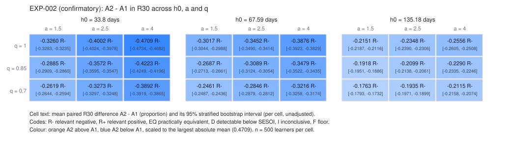
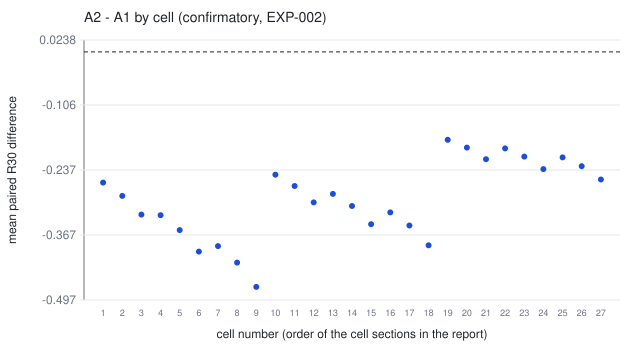
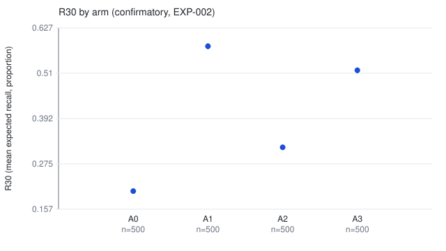
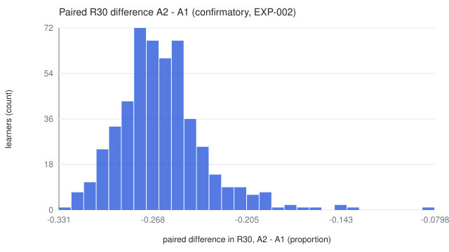

<!-- SPDX-License-Identifier: LicenseRef-STREAK-NC-Research-1.0 -->
# EXP-002 report: when does the streak-retention gap appear? Robustness across forgetting parameters and availability

**Label: CONFIRMATORY (frozen protocol 1.0). Simulation of synthetic learners. Not evidence about real human learning, motivation or any real product.**

## 1. Identification

| Field | Value |
|---|---|
| Experiment ID | EXP-002 |
| Date run | 2026-11-25 local time (2026-11-24 23:35:44 to 23:41:39 UTC) |
| Report version | 1.0, composed from committed results under the owner's approval of 2026-11-25 (D-017, D-018) and written by the coordinator |
| Status | complete: full frozen matrix run (27 cells), 0 failed learner-arms |
| Authorship | Mohamed Bechir Kefi (no affiliation; decision C3). Drafted by the AI research assistant for the owner's review. |
| Protocol | `research/experiments/EXP-002/protocol.md`, SHA-256 `16f54294c4d6db58acf6a7957ebedfed47e7226c5fe997ba42f1841675131c7e`; parent `research/protocol.md`, SHA-256 `57a60597a93cfc07a1d25e9a2f6bac9f23009b554d3d9820828e7707210711ee` |
| Config | `research/experiments/EXP-002/config.json`, canonical SHA-256 `2ecfe90453c1663db0a03d1118e5d7b0e6cd97b4afc43f7fc4d2bf8d5f02dc46` |
| Code revision | `c942be096240103297fcab6f3cc9886961ce8137` (engine 1.1.0). Clean at preflight; the run manifest records `git_dirty = true` (deviation 1, section 7). |

## 2. Executive summary

**Question.** Across a fixed grid of median initial half-life h0, success gain a and daily availability q, in which cells does R30 under A2 Streak differ from A1 Fixed at matched minutes, and is the sign consistent across the grid?

**Method.** 27 cells (h0 in {33.8, 67.59, 135.18} days × a in {1.5, 2.5, 4} × q in {0.7, 0.85, 1.0}) × 4 arms × 5 master seeds × 100 learners = 54,000 learner-arm simulations, with common random numbers across arms and cells. Per cell: paired difference with a stratified percentile bootstrap (10,000 resamples), plus Holm adjustment of the primary p-values across the 27 cells (P§14.6).

**Outcome.** A2 - A1 in R30 was **relevant negative in all 27 cells**, from -0.4709 (h0 = 33.8, a = 4, q = 1) to -0.1763 (h0 = 135.18, a = 1.5, q = 0.7). All 27 cells are "relevant (Holm across cells)". No cell is at the floor, no cell's 95% interval lies above 0 and no cell is practically equivalent. The grid-level descriptive hypothesis (negative in all 27 cells) holds, and grid-level robustness is not disconfirmed.

**Principal caveat.** The grid varies three parameters around the fitted h0; the policy rules, the forgetting form and the update rule stay fixed (EXP-003 varies those). The held-out Duolingo test (EXP-001 report, section 8.4) did not support the exponential forgetting form against a constant baseline.

## 3. Rationale and literature

The research question asks "when". Faster forgetting (small h0) raises the value of reviewing weak items; a larger gain a strengthens the desirable-difficulty penalty on easy reviews; lower availability q shortens streaks for every daily arm and shifts minutes through carry-forward (EXP-002 protocol section 2). Literature as in the EXP-001 report and `research/literature_review.md`.

## 4. Hypotheses and operational definitions

- Per cell c: H0_c: E[Δ_c] = 0; H1_c: E[Δ_c] ≠ 0, Δ = R30(A2) - R30(A1).
- Grid-level descriptive hypothesis (not tested for significance): the sign of E[Δ_c] is negative in all 27 cells.
- Grid-level robustness is disconfirmed by any cell whose 95% interval lies entirely above 0, or by 9 or more practically equivalent cells (90% interval inside ±0.02).
- Floor rule (protocol section 12): a cell is "uninformative (floor)" if the mean R30 of A1 and A2 are both below 0.02.
- Per-cell classes as in P§4 (SESOI 0.02). A cell is "relevant (Holm across cells)" only if its unadjusted 95% interval lies beyond ±0.02 and its Holm-adjusted p is below 0.05 (P§14.6).

## 5. Methodology

- Model of P§2. Fixed parameters as in EXP-001 (K = 200, T = 56, M = 672 slots, daily cap 60, g_min = 0.1, b = 0.6, h_min = 0.25, exponential forgetting, difficulty-dependent gain). Grid as above; h0 axis {0.5, 1, 2} × the fitted 67.59 days (P§14.8).
- Arms A0, A1, A2 and A3 (threshold rule, P§14.5). Seeds 1 to 5, 100 learners each per cell; learner draws shared across cells for the same seed and learner index.
- Data: synthetic learners only. Data manifest SHA-256 `60b024953faa4e164c83520fefd5b5a8d6e1154d8c18ed8067769ce4aed2ed9e`; raw Duolingo SHA-256 verified at preflight.
- Hardware and software: Apple M1 Pro (10 cores), macOS (Darwin 24.3.0), Python 3.12.1, NumPy 2.5.4; one worker process under `nice -n 10`.
- Analysis exactly as frozen: `streak.report.analyse` (per-cell contrasts, Holm across cells via `holm_primary_across_cells`, Holm within cell for secondary contrasts, residual-flag sensitivity) and `streak.frozen_analysis.exp002_grid` (floor rule, categories, grid hypothesis, disconfirmation, q = 1.0 agreement). Both were written and tested before any confirmatory output (commits up to 45ea4ec).

## 6. Implementation verification

- Test suite before the run: 211 passed. The smoke run and metric validation at the frozen parameters (J-0011, J-0012) passed, as reported for EXP-001. The tests in `tests/test_frozen_analysis.py` cover the floor rule, the disconfirmation rule, the grid hypothesis, the q = 1.0 agreement and the heat-map rendering on constructed inputs.
- In the output, every one of the 54,000 records has status ok (failure rate 0.0).

## 7. Execution record

| Item | Value |
|---|---|
| Command | `.venv/bin/python scripts/run_confirmatory.py EXP-002` (runs `nice -n 10 .venv/bin/python -m streak.cli run --config research/experiments/EXP-002/config.json --out results/confirmatory/EXP-002` through the freeze guard) |
| Preflight | tracked tree clean; protocol, EXP protocol, config, data manifest and raw data hashes equal to the freeze record |
| Run IDs | 135 runs, `EXP-002/<cell>/s<seed>` for the 27 cells × seeds 1 to 5 (listed in `results/confirmatory/EXP-002/provenance.json`) |
| Start and end | 2026-11-24T23:35:44 to 23:41:39 UTC |
| Runtime | 354.388 s of simulation (355.265 s wall clock); peak RSS 308,445,184 bytes |
| Sample counts | 54,000 learner-arms planned, 54,000 run, 0 failed, 0 dropped |
| Exit status | process exit 0 |
| Result file | `results/confirmatory/EXP-002/results.json`, 31.8 MB, git-ignored (above 20 MB); SHA-256 `4d4984ce1e45c3d91e924276d5d1a7a31a2e837b77a9e657ca5834dfd58c6fd1` in `run_manifest.json` and `sha256_manifest.json` |
| Deviation 1 (provenance, no effect on results) | The run started on a clean tree, but its manifest records `git_dirty = true`. Record files (journal, claims register and a figures README) were edited while it ran. No code, config or protocol changed (D-016). |
| Deviation 2 (reporting) | The file tool refused this report. On the owner's decision of 2026-11-25 it was composed from committed results and written by the coordinator (D-017, D-018). |

## 8. Results

### 8.1 Primary contrast A2 - A1 in R30 per cell (n = 500 learners per cell)

| h0 (days) | a | q | Mean R30 A1 | Mean R30 A2 | A2 - A1 | 95% CI | Class | Relevant (Holm across cells) |
|---|---|---|---|---|---|---|---|---|
| 33.8 | 1.5 | 0.7 | 0.58 | 0.32 | -0.2619 | [-0.2644, -0.2594] | relevant negative | yes |
| 33.8 | 1.5 | 0.85 | 0.58 | 0.29 | -0.2885 | [-0.2909, -0.2860] | relevant negative | yes |
| 33.8 | 1.5 | 1.0 | 0.58 | 0.25 | -0.3260 | [-0.3283, -0.3235] | relevant negative | yes |
| 33.8 | 2.5 | 0.7 | 0.65 | 0.33 | -0.3273 | [-0.3297, -0.3248] | relevant negative | yes |
| 33.8 | 2.5 | 0.85 | 0.65 | 0.30 | -0.3572 | [-0.3595, -0.3547] | relevant negative | yes |
| 33.8 | 2.5 | 1.0 | 0.65 | 0.25 | -0.4002 | [-0.4024, -0.3978] | relevant negative | yes |
| 33.8 | 4 | 0.7 | 0.72 | 0.33 | -0.3892 | [-0.3919, -0.3865] | relevant negative | yes |
| 33.8 | 4 | 0.85 | 0.72 | 0.30 | -0.4223 | [-0.4249, -0.4196] | relevant negative | yes |
| 33.8 | 4 | 1.0 | 0.72 | 0.25 | -0.4709 | [-0.4734, -0.4682] | relevant negative | yes |
| 67.59 | 1.5 | 0.7 | 0.75 | 0.50 | -0.2461 | [-0.2487, -0.2436] | relevant negative | yes |
| 67.59 | 1.5 | 0.85 | 0.75 | 0.48 | -0.2687 | [-0.2713, -0.2661] | relevant negative | yes |
| 67.59 | 1.5 | 1.0 | 0.75 | 0.45 | -0.3017 | [-0.3044, -0.2988] | relevant negative | yes |
| 67.59 | 2.5 | 0.7 | 0.79 | 0.51 | -0.2846 | [-0.2879, -0.2812] | relevant negative | yes |
| 67.59 | 2.5 | 0.85 | 0.79 | 0.48 | -0.3089 | [-0.3124, -0.3054] | relevant negative | yes |
| 67.59 | 2.5 | 1.0 | 0.79 | 0.45 | -0.3452 | [-0.3490, -0.3414] | relevant negative | yes |
| 67.59 | 4 | 0.7 | 0.84 | 0.51 | -0.3216 | [-0.3258, -0.3174] | relevant negative | yes |
| 67.59 | 4 | 0.85 | 0.83 | 0.49 | -0.3479 | [-0.3522, -0.3435] | relevant negative | yes |
| 67.59 | 4 | 1.0 | 0.83 | 0.45 | -0.3876 | [-0.3923, -0.3829] | relevant negative | yes |
| 135.18 | 1.5 | 0.7 | 0.86 | 0.68 | -0.1763 | [-0.1793, -0.1732] | relevant negative | yes |
| 135.18 | 1.5 | 0.85 | 0.86 | 0.67 | -0.1918 | [-0.1951, -0.1886] | relevant negative | yes |
| 135.18 | 1.5 | 1.0 | 0.86 | 0.64 | -0.2151 | [-0.2187, -0.2116] | relevant negative | yes |
| 135.18 | 2.5 | 0.7 | 0.88 | 0.69 | -0.1935 | [-0.1971, -0.1899] | relevant negative | yes |
| 135.18 | 2.5 | 0.85 | 0.88 | 0.67 | -0.2099 | [-0.2138, -0.2061] | relevant negative | yes |
| 135.18 | 2.5 | 1.0 | 0.88 | 0.64 | -0.2348 | [-0.2390, -0.2306] | relevant negative | yes |
| 135.18 | 4 | 0.7 | 0.90 | 0.69 | -0.2115 | [-0.2158, -0.2074] | relevant negative | yes |
| 135.18 | 4 | 0.85 | 0.90 | 0.67 | -0.2290 | [-0.2335, -0.2246] | relevant negative | yes |
| 135.18 | 4 | 1.0 | 0.90 | 0.64 | -0.2556 | [-0.2605, -0.2508] | relevant negative | yes |

Source: `generated/frozen_analysis.json` (grid) and `generated/contrasts.csv`. The A1 and A2 means are rounded to two decimals from the per-cell values in `frozen_analysis.json`; 90% intervals, SD, d_z and per-seed means are in `generated/contrasts.csv` and `generated/report.md`. The per-cell SD of the paired difference ranged from 0.0267 to 0.0563. All Holm-adjusted primary p-values across cells are below 0.0001 (no bootstrap resample reached 0).

### 8.2 Grid-level summary (frozen rules)

| Rule | Result |
|---|---|
| Uninformative (floor) cells | 0 of 27 |
| Categories | relevant negative 27; relevant positive 0; practically equivalent 0; detectable below SESOI 0; inconclusive 0 |
| Relevant (Holm across cells) | 27 of 27 |
| Grid hypothesis: mean negative in all 27 cells | holds (27 of 27 negative) |
| Robustness disconfirmed? (any 95% CI above 0, or ≥ 9 equivalent cells) | no (0 cells above 0; 0 equivalent) |
| q = 1.0 cells agree in sign with the others (protocol section 13) | yes: all 9 negative, as are the other 18 |

### 8.3 Sensitivity: residual-flagged learners excluded (P§7)

Across the grid 360 learner-arms were residual-flagged (at most 18 in one cell-arm). With flagged learners excluded (n = 482 to 500 per cell), every cell stays relevant negative, with means from -0.4709 to -0.1767.

### 8.4 Secondary contrasts (Holm within each cell; intervals unadjusted)

- A2 - A3 (same timing, different selection): relevant negative in all 27 cells, -0.4430 to -0.1828.
- A1 - A0 and A2 - A0: relevant positive in all cells (A1 - A0 from 0.2378 to 0.5197; A2 - A0 from 0.0227 to 0.1304).
- A3 - A1 depends on h0 (a mixed result reported in full):

| h0 (days) | A3 - A1 range over the 9 (a, q) cells | Classes |
|---|---|---|
| 33.8 | -0.0684 to -0.0218 | relevant negative in 8 cells; detectable below SESOI in 1 (a = 4, q = 0.7: -0.0218 [-0.0240, -0.0196]) |
| 67.59 | -0.0011 to +0.0182 | practically equivalent in all 9 |
| 135.18 | +0.0065 to +0.0085 | practically equivalent in all 9 |

At the shortest half-life the threshold comparator A3 retained less than the fixed round-robin baseline A1. Per-cell values are in `generated/contrasts.csv`.

### 8.5 Activity

A2's mean item coverage ranged from 0.0600 to 0.2458 across cells (`generated/metrics.csv`). Activity metrics per arm and cell are in `generated/metrics.csv`.

### 8.6 Figures

## 9. Interpretation

- **Expected versus observed.** Expected (descriptive): negative in all 27 cells. Observed: negative and practically relevant in all 27 cells, with no exception, floor or equivalence.
- **Pattern (measured in the model).** The gap is largest at the shortest half-life and the largest gain (h0 = 33.8, a = 4) and smallest at h0 = 135.18. Within each (h0, a), it grows as availability q rises from 0.7 to 1.0. At q = 1.0 there is no carry-forward, so the gap is not a budget artefact of carry-forward.
- **Mechanism (model-dependent inference).** The gap tracks the cost of neglecting items. When items decay faster, or when difficult reviews pay more (larger a), the items that easiest-first selection skips lose more retention relative to round-robin.
- **Unexpected secondary result.** At h0 = 33.8 days, A3 (threshold rule, r* = 0.9) is below A1 in 9 of 9 cells, relevant in 8. The fixed threshold appears less suited to fast forgetting than round-robin, but this is a secondary contrast, not a registered hypothesis, and it is reported as observed.
- **Verdict under the frozen rule.** Each cell: H0_c rejected, relevant negative. Grid level: the descriptive hypothesis holds and robustness is not disconfirmed.

## 10. Threats to validity

- Internal: only h0, a and q vary. The policy rules, forgetting form, update rule and scheduler belief stay as in EXP-001 (EXP-003 varies the update rule and forgetting form).
- Construct and external: as in EXP-001. The grid is a planning choice around a fitted h0 that the held-out Duolingo test does not validate as a forgetting curve.
- Statistical: per-cell intervals are unadjusted. Relevance across cells uses Holm as frozen. Learners are shared across cells, so cells are not independent samples.
- Provenance: `git_dirty = true` in the manifest (deviation 1). The code at the recorded revision was unchanged.

## 11. Conclusion and next experiment

Within the frozen model, the retention penalty of streak-driven scheduling with easiest-first selection is present and practically relevant across the whole tested range of forgetting speed, gain and availability. Its size ranges from -0.1763 to -0.4709 in R30. EXP-003 tests whether it depends on the gain rule or the forgetting form, and separates timing from selection.

## 12. Reproduction appendix

- Exact commands: `reproduction.md` (uv sync, pytest, `scripts/run_confirmatory.py EXP-002`, `scripts/analyse_confirmatory.py EXP-002`, copies into this folder).
- Raw results: `results/confirmatory/EXP-002/results.json` (git-ignored, regenerated by the run command; SHA-256 above). Committed: `run_manifest.json`, `provenance.json` (per-run id, config hash, seed, revision, data manifest hash, hardware, derived start and end, exit status), `sha256_manifest.json`, `run.log`.
- Machine-readable outputs: `generated/analysis.json`, `generated/contrasts.csv`, `generated/metrics.csv`, `generated/frozen_analysis.json`, `generated/report.md`, `metrics.csv`, `run_manifest.json`.
- References: as in the EXP-001 report.
