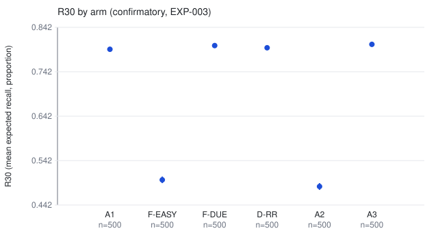
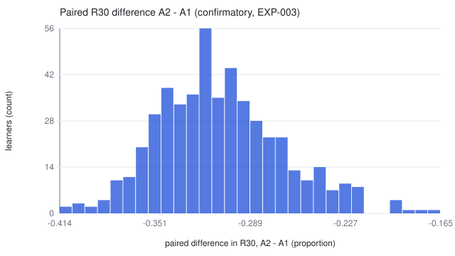
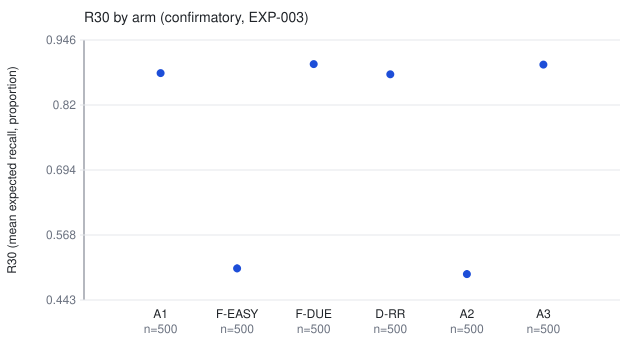
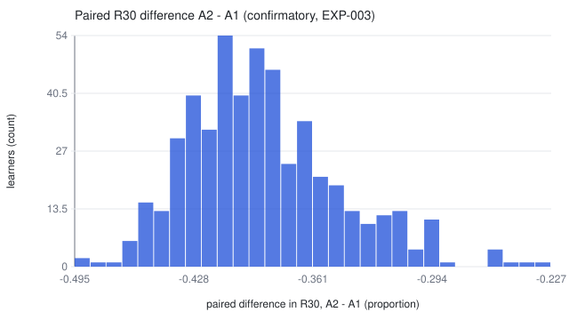
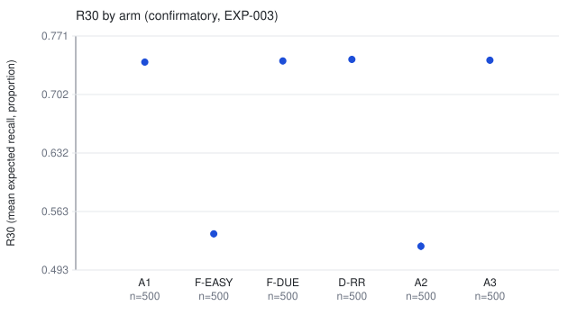
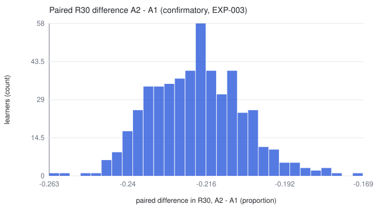
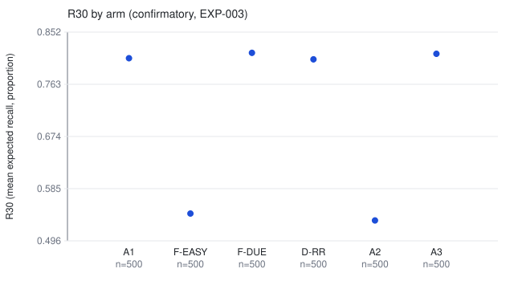
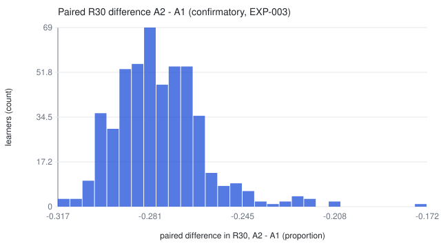
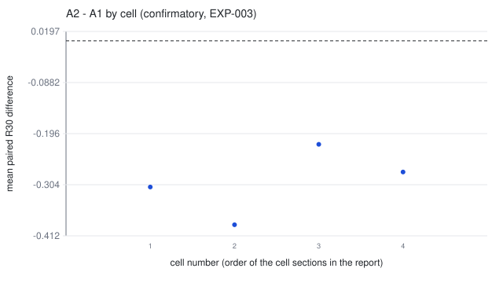

<!-- SPDX-License-Identifier: LicenseRef-STREAK-NC-Research-1.0 -->
# EXP-003: generated results report (CONFIRMATORY)

**Label: CONFIRMATORY.** Simulation of synthetic learners. Not evidence about real human learning, motivation or any real product.

Generated by `streak.report` from the result file. Do not edit by hand.

- Result file: `results/confirmatory/EXP-003/results.json`
- Result SHA-256: `6eecffdbf1cf4d87c29705864eee4611` `758ca35df145c97f0fd7a7f24b404d9f`
- Config hash: `ab1c1799a45e0eab8091125a7d769e20` `ecdf642b5f8e1436e0d9a66c31450ff3`
- Protocol version 1.0; engine version 1.1.0
- Records (learner-arms): 12000; failed: 0 (0.00%)
- Master seeds: 1, 2, 3, 4, 5; learners per seed: 100

## Cell `exp-diff`

### Retention by arm (means over learners, proportions)

| Arm | n | R30 | R30 95% CI | R1 | R7 | R90 | AUC-R | Weakest decile R30 |
|---|---|---|---|---|---|---|---|---|
| A1 | 500 | 0.7925 | [0.7880, 0.7968] | 0.9328 | 0.8987 | 0.5957 | 0.7453 | 0.4121 |
| F-EASY | 500 | 0.4986 | [0.4913, 0.5059] | 0.6141 | 0.5867 | 0.3505 | 0.4632 | 0.1503 |
| F-DUE | 500 | 0.8008 | [0.7965, 0.8049] | 0.9430 | 0.9094 | 0.5951 | 0.7510 | 0.5482 |
| D-RR | 500 | 0.7957 | [0.7913, 0.8000] | 0.9375 | 0.9026 | 0.5988 | 0.7486 | 0.4097 |
| A2 | 500 | 0.4836 | [0.4761, 0.4911] | 0.6045 | 0.5758 | 0.3289 | 0.4467 | 0.1477 |
| A3 | 500 | 0.8034 | [0.7992, 0.8076] | 0.9467 | 0.9131 | 0.5966 | 0.7534 | 0.5533 |

### Activity by arm (means over learners)

| Arm | Minutes | Residual slots | Active days | Longest streak | Success rate | Coverage | Spearman (active days, R30) | Residual-flagged |
|---|---|---|---|---|---|---|---|---|
| A1 | 336.0 | 0.06 | 23.63 | 1.87 | 0.878 | 1.000 | -0.023 | 0 |
| F-EASY | 336.0 | 0.06 | 23.63 | 1.87 | 0.987 | 0.187 | -0.185 | 0 |
| F-DUE | 336.0 | 0.06 | 23.63 | 1.87 | 0.877 | 1.000 | -0.022 | 0 |
| D-RR | 334.9 | 2.23 | 47.59 | 15.97 | 0.875 | 1.000 | -0.000 | 1 |
| A2 | 334.9 | 2.23 | 47.59 | 15.97 | 0.987 | 0.171 | -0.098 | 1 |
| A3 | 334.9 | 2.23 | 47.59 | 15.97 | 0.877 | 0.999 | -0.019 | 1 |

### Paired contrasts on R30: effects

| Kind | Contrast | n | Mean diff | SD diff | d_z | 95% CI | 90% CI |
|---|---|---|---|---|---|---|---|
| primary | A2 - A1 | 500 | -0.3089 | 0.0408 | -7.57 | [-0.3124, -0.3054] | [-0.3118, -0.3059] |
| primary, flagged excluded | A2 - A1 | 499 | -0.3088 | 0.0408 | -7.57 | [-0.3124, -0.3052] | [-0.3117, -0.3058] |
| secondary | F-EASY - A1 | 500 | -0.2939 | 0.0395 | -7.44 | [-0.2973, -0.2905] | [-0.2967, -0.2910] |
| secondary | F-DUE - A1 | 500 | 0.0083 | 0.0112 | 0.74 | [0.0073, 0.0093] | [0.0075, 0.0091] |
| secondary | A2 - D-RR | 500 | -0.3121 | 0.0413 | -7.56 | [-0.3156, -0.3086] | [-0.3151, -0.3092] |
| secondary | A3 - D-RR | 500 | 0.0077 | 0.0121 | 0.64 | [0.0067, 0.0088] | [0.0068, 0.0086] |
| secondary | D-RR - A1 | 500 | 0.0033 | 0.0120 | 0.27 | [0.0022, 0.0043] | [0.0024, 0.0042] |
| secondary | A2 - F-EASY | 500 | -0.0150 | 0.0130 | -1.15 | [-0.0161, -0.0139] | [-0.0159, -0.0140] |
| secondary | A3 - F-DUE | 500 | 0.0027 | 0.0112 | 0.24 | [0.0017, 0.0037] | [0.0019, 0.0035] |
| secondary | A2 - A3 | 500 | -0.3198 | 0.0418 | -7.66 | [-0.3234, -0.3162] | [-0.3229, -0.3168] |

### Paired contrasts on R30: tests and classes

| Kind | Contrast | p (bootstrap) | p (Holm) | Class (protocol section 4) |
|---|---|---|---|---|
| primary | A2 - A1 | < 0.0001 | n/a | relevant negative |
| primary, flagged excluded | A2 - A1 | < 0.0001 | n/a | relevant negative |
| secondary | F-EASY - A1 | < 0.0001 | < 0.0001 | relevant negative |
| secondary | F-DUE - A1 | < 0.0001 | < 0.0001 | practically equivalent under the model |
| secondary | A2 - D-RR | < 0.0001 | < 0.0001 | relevant negative |
| secondary | A3 - D-RR | < 0.0001 | < 0.0001 | practically equivalent under the model |
| secondary | D-RR - A1 | < 0.0001 | < 0.0001 | practically equivalent under the model |
| secondary | A2 - F-EASY | < 0.0001 | < 0.0001 | practically equivalent under the model |
| secondary | A3 - F-DUE | < 0.0001 | < 0.0001 | practically equivalent under the model |
| secondary | A2 - A3 | < 0.0001 | < 0.0001 | relevant negative |

Per-master-seed mean of the primary paired difference: seed 1: -0.3084, seed 2: -0.3135, seed 3: -0.3088, seed 4: -0.3075, seed 5: -0.3062.

## Cell `exp-flat`

### Retention by arm (means over learners, proportions)

| Arm | n | R30 | R30 95% CI | R1 | R7 | R90 | AUC-R | Weakest decile R30 |
|---|---|---|---|---|---|---|---|---|
| A1 | 500 | 0.8816 | [0.8770, 0.8859] | 0.9574 | 0.9384 | 0.7759 | 0.8565 | 0.4851 |
| F-EASY | 500 | 0.5039 | [0.4966, 0.5112] | 0.6156 | 0.5890 | 0.3630 | 0.4704 | 0.1505 |
| F-DUE | 500 | 0.8989 | [0.8948, 0.9028] | 0.9712 | 0.9541 | 0.7869 | 0.8717 | 0.6692 |
| D-RR | 500 | 0.8793 | [0.8747, 0.8837] | 0.9585 | 0.9382 | 0.7719 | 0.8540 | 0.4683 |
| A2 | 500 | 0.4929 | [0.4855, 0.5003] | 0.6076 | 0.5803 | 0.3478 | 0.4584 | 0.1482 |
| A3 | 500 | 0.8981 | [0.8940, 0.9020] | 0.9729 | 0.9553 | 0.7830 | 0.8701 | 0.6706 |

### Activity by arm (means over learners)

| Arm | Minutes | Residual slots | Active days | Longest streak | Success rate | Coverage | Spearman (active days, R30) | Residual-flagged |
|---|---|---|---|---|---|---|---|---|
| A1 | 336.0 | 0.06 | 23.63 | 1.87 | 0.905 | 1.000 | -0.029 | 0 |
| F-EASY | 336.0 | 0.06 | 23.63 | 1.87 | 0.994 | 0.187 | -0.214 | 0 |
| F-DUE | 336.0 | 0.06 | 23.63 | 1.87 | 0.904 | 1.000 | -0.031 | 0 |
| D-RR | 334.9 | 2.23 | 47.59 | 15.97 | 0.900 | 1.000 | -0.001 | 1 |
| A2 | 334.9 | 2.23 | 47.59 | 15.97 | 0.991 | 0.171 | -0.111 | 1 |
| A3 | 334.9 | 2.23 | 47.59 | 15.97 | 0.901 | 1.000 | -0.020 | 1 |

### Paired contrasts on R30: effects

| Kind | Contrast | n | Mean diff | SD diff | d_z | 95% CI | 90% CI |
|---|---|---|---|---|---|---|---|
| primary | A2 - A1 | 500 | -0.3887 | 0.0429 | -9.05 | [-0.3923, -0.3849] | [-0.3917, -0.3855] |
| primary, flagged excluded | A2 - A1 | 499 | -0.3886 | 0.0429 | -9.05 | [-0.3923, -0.3847] | [-0.3917, -0.3854] |
| secondary | F-EASY - A1 | 500 | -0.3777 | 0.0425 | -8.88 | [-0.3813, -0.3740] | [-0.3807, -0.3746] |
| secondary | F-DUE - A1 | 500 | 0.0173 | 0.0109 | 1.59 | [0.0164, 0.0183] | [0.0165, 0.0182] |
| secondary | A2 - D-RR | 500 | -0.3864 | 0.0423 | -9.14 | [-0.3900, -0.3828] | [-0.3894, -0.3833] |
| secondary | A3 - D-RR | 500 | 0.0188 | 0.0125 | 1.51 | [0.0177, 0.0199] | [0.0179, 0.0197] |
| secondary | D-RR - A1 | 500 | -0.0023 | 0.0120 | -0.19 | [-0.0033, -0.0012] | [-0.0031, -0.0014] |
| secondary | A2 - F-EASY | 500 | -0.0110 | 0.0141 | -0.78 | [-0.0122, -0.0098] | [-0.0120, -0.0099] |
| secondary | A3 - F-DUE | 500 | -0.0008 | 0.0098 | -0.09 | [-0.0017, 0.0000] | [-0.0016, -0.0001] |
| secondary | A2 - A3 | 500 | -0.4051 | 0.0463 | -8.75 | [-0.4092, -0.4012] | [-0.4085, -0.4017] |

### Paired contrasts on R30: tests and classes

| Kind | Contrast | p (bootstrap) | p (Holm) | Class (protocol section 4) |
|---|---|---|---|---|
| primary | A2 - A1 | < 0.0001 | n/a | relevant negative |
| primary, flagged excluded | A2 - A1 | < 0.0001 | n/a | relevant negative |
| secondary | F-EASY - A1 | < 0.0001 | < 0.0001 | relevant negative |
| secondary | F-DUE - A1 | < 0.0001 | < 0.0001 | practically equivalent under the model |
| secondary | A2 - D-RR | < 0.0001 | < 0.0001 | relevant negative |
| secondary | A3 - D-RR | < 0.0001 | < 0.0001 | practically equivalent under the model |
| secondary | D-RR - A1 | < 0.0001 | < 0.0001 | practically equivalent under the model |
| secondary | A2 - F-EASY | < 0.0001 | < 0.0001 | practically equivalent under the model |
| secondary | A3 - F-DUE | 0.0516 | 0.0516 | practically equivalent under the model |
| secondary | A2 - A3 | < 0.0001 | < 0.0001 | relevant negative |

Per-master-seed mean of the primary paired difference: seed 1: -0.3880, seed 2: -0.3942, seed 3: -0.3884, seed 4: -0.3884, seed 5: -0.3843.

## Cell `pow-diff`

### Retention by arm (means over learners, proportions)

| Arm | n | R30 | R30 95% CI | R1 | R7 | R90 | AUC-R | Weakest decile R30 |
|---|---|---|---|---|---|---|---|---|
| A1 | 500 | 0.7401 | [0.7362, 0.7439] | 0.8960 | 0.8523 | 0.5870 | 0.7068 | 0.4164 |
| F-EASY | 500 | 0.5361 | [0.5320, 0.5402] | 0.6073 | 0.5896 | 0.4499 | 0.5160 | 0.3229 |
| F-DUE | 500 | 0.7416 | [0.7376, 0.7455] | 0.9036 | 0.8576 | 0.5853 | 0.7079 | 0.4941 |
| D-RR | 500 | 0.7433 | [0.7394, 0.7472] | 0.9029 | 0.8576 | 0.5889 | 0.7099 | 0.4156 |
| A2 | 500 | 0.5213 | [0.5171, 0.5256] | 0.5969 | 0.5779 | 0.4330 | 0.5009 | 0.3213 |
| A3 | 500 | 0.7424 | [0.7383, 0.7464] | 0.9047 | 0.8588 | 0.5857 | 0.7085 | 0.4862 |

### Activity by arm (means over learners)

| Arm | Minutes | Residual slots | Active days | Longest streak | Success rate | Coverage | Spearman (active days, R30) | Residual-flagged |
|---|---|---|---|---|---|---|---|---|
| A1 | 336.0 | 0.06 | 23.63 | 1.87 | 0.819 | 1.000 | -0.028 | 0 |
| F-EASY | 336.0 | 0.06 | 23.63 | 1.87 | 0.979 | 0.189 | -0.208 | 0 |
| F-DUE | 336.0 | 0.06 | 23.63 | 1.87 | 0.818 | 0.998 | -0.035 | 0 |
| D-RR | 334.9 | 2.23 | 47.59 | 15.97 | 0.815 | 1.000 | -0.019 | 1 |
| A2 | 334.9 | 2.23 | 47.59 | 15.97 | 0.979 | 0.173 | -0.136 | 1 |
| A3 | 334.9 | 2.23 | 47.59 | 15.97 | 0.819 | 0.985 | -0.021 | 1 |

### Paired contrasts on R30: effects

| Kind | Contrast | n | Mean diff | SD diff | d_z | 95% CI | 90% CI |
|---|---|---|---|---|---|---|---|
| primary | A2 - A1 | 500 | -0.2188 | 0.0138 | -15.85 | [-0.2200, -0.2176] | [-0.2198, -0.2178] |
| primary, flagged excluded | A2 - A1 | 499 | -0.2188 | 0.0138 | -15.84 | [-0.2200, -0.2176] | [-0.2198, -0.2178] |
| secondary | F-EASY - A1 | 500 | -0.2041 | 0.0144 | -14.12 | [-0.2053, -0.2028] | [-0.2051, -0.2030] |
| secondary | F-DUE - A1 | 500 | 0.0015 | 0.0101 | 0.15 | [0.0006, 0.0023] | [0.0007, 0.0022] |
| secondary | A2 - D-RR | 500 | -0.2220 | 0.0136 | -16.29 | [-0.2231, -0.2208] | [-0.2230, -0.2210] |
| secondary | A3 - D-RR | 500 | -0.0010 | 0.0119 | -0.08 | [-0.0020, 0.0001] | [-0.0018, -0.0001] |
| secondary | D-RR - A1 | 500 | 0.0032 | 0.0100 | 0.32 | [0.0023, 0.0041] | [0.0025, 0.0039] |
| secondary | A2 - F-EASY | 500 | -0.0147 | 0.0094 | -1.58 | [-0.0156, -0.0139] | [-0.0154, -0.0141] |
| secondary | A3 - F-DUE | 500 | 0.0008 | 0.0119 | 0.06 | [-0.0003, 0.0018] | [-0.0001, 0.0016] |
| secondary | A2 - A3 | 500 | -0.2210 | 0.0137 | -16.19 | [-0.2222, -0.2198] | [-0.2220, -0.2200] |

### Paired contrasts on R30: tests and classes

| Kind | Contrast | p (bootstrap) | p (Holm) | Class (protocol section 4) |
|---|---|---|---|---|
| primary | A2 - A1 | < 0.0001 | n/a | relevant negative |
| primary, flagged excluded | A2 - A1 | < 0.0001 | n/a | relevant negative |
| secondary | F-EASY - A1 | < 0.0001 | < 0.0001 | relevant negative |
| secondary | F-DUE - A1 | 0.0012 | 0.0036 | practically equivalent under the model |
| secondary | A2 - D-RR | < 0.0001 | < 0.0001 | relevant negative |
| secondary | A3 - D-RR | 0.0662 | 0.1324 | practically equivalent under the model |
| secondary | D-RR - A1 | < 0.0001 | < 0.0001 | practically equivalent under the model |
| secondary | A2 - F-EASY | < 0.0001 | < 0.0001 | practically equivalent under the model |
| secondary | A3 - F-DUE | 0.1560 | 0.1560 | practically equivalent under the model |
| secondary | A2 - A3 | < 0.0001 | < 0.0001 | relevant negative |

Per-master-seed mean of the primary paired difference: seed 1: -0.2175, seed 2: -0.2201, seed 3: -0.2183, seed 4: -0.2192, seed 5: -0.2189.

## Cell `pow-flat`

### Retention by arm (means over learners, proportions)

| Arm | n | R30 | R30 95% CI | R1 | R7 | R90 | AUC-R | Weakest decile R30 |
|---|---|---|---|---|---|---|---|---|
| A1 | 500 | 0.8079 | [0.8030, 0.8126] | 0.9188 | 0.8880 | 0.6902 | 0.7818 | 0.4282 |
| F-EASY | 500 | 0.5425 | [0.5385, 0.5466] | 0.6084 | 0.5919 | 0.4654 | 0.5247 | 0.3231 |
| F-DUE | 500 | 0.8172 | [0.8122, 0.8219] | 0.9348 | 0.9020 | 0.6916 | 0.7892 | 0.5328 |
| D-RR | 500 | 0.8060 | [0.8011, 0.8109] | 0.9218 | 0.8888 | 0.6867 | 0.7798 | 0.4208 |
| A2 | 500 | 0.5307 | [0.5265, 0.5349] | 0.6000 | 0.5827 | 0.4492 | 0.5118 | 0.3216 |
| A3 | 500 | 0.8155 | [0.8105, 0.8203] | 0.9342 | 0.9010 | 0.6896 | 0.7875 | 0.5275 |

### Activity by arm (means over learners)

| Arm | Minutes | Residual slots | Active days | Longest streak | Success rate | Coverage | Spearman (active days, R30) | Residual-flagged |
|---|---|---|---|---|---|---|---|---|
| A1 | 336.0 | 0.06 | 23.63 | 1.87 | 0.843 | 1.000 | -0.021 | 0 |
| F-EASY | 336.0 | 0.06 | 23.63 | 1.87 | 0.991 | 0.189 | -0.235 | 0 |
| F-DUE | 336.0 | 0.06 | 23.63 | 1.87 | 0.841 | 0.999 | -0.035 | 0 |
| D-RR | 334.9 | 2.23 | 47.59 | 15.97 | 0.836 | 1.000 | -0.014 | 1 |
| A2 | 334.9 | 2.23 | 47.59 | 15.97 | 0.986 | 0.173 | -0.163 | 1 |
| A3 | 334.9 | 2.23 | 47.59 | 15.97 | 0.840 | 0.993 | -0.017 | 1 |

### Paired contrasts on R30: effects

| Kind | Contrast | n | Mean diff | SD diff | d_z | 95% CI | 90% CI |
|---|---|---|---|---|---|---|---|
| primary | A2 - A1 | 500 | -0.2772 | 0.0176 | -15.77 | [-0.2787, -0.2757] | [-0.2785, -0.2759] |
| primary, flagged excluded | A2 - A1 | 499 | -0.2773 | 0.0176 | -15.77 | [-0.2788, -0.2757] | [-0.2785, -0.2760] |
| secondary | F-EASY - A1 | 500 | -0.2654 | 0.0194 | -13.71 | [-0.2670, -0.2637] | [-0.2668, -0.2639] |
| secondary | F-DUE - A1 | 500 | 0.0093 | 0.0103 | 0.90 | [0.0083, 0.0101] | [0.0085, 0.0100] |
| secondary | A2 - D-RR | 500 | -0.2754 | 0.0180 | -15.26 | [-0.2768, -0.2738] | [-0.2766, -0.2740] |
| secondary | A3 - D-RR | 500 | 0.0094 | 0.0115 | 0.82 | [0.0084, 0.0104] | [0.0086, 0.0102] |
| secondary | D-RR - A1 | 500 | -0.0019 | 0.0110 | -0.17 | [-0.0028, -0.0009] | [-0.0027, -0.0011] |
| secondary | A2 - F-EASY | 500 | -0.0119 | 0.0103 | -1.15 | [-0.0127, -0.0110] | [-0.0126, -0.0111] |
| secondary | A3 - F-DUE | 500 | -0.0017 | 0.0116 | -0.15 | [-0.0027, -0.0007] | [-0.0026, -0.0009] |
| secondary | A2 - A3 | 500 | -0.2848 | 0.0182 | -15.63 | [-0.2863, -0.2832] | [-0.2861, -0.2835] |

### Paired contrasts on R30: tests and classes

| Kind | Contrast | p (bootstrap) | p (Holm) | Class (protocol section 4) |
|---|---|---|---|---|
| primary | A2 - A1 | < 0.0001 | n/a | relevant negative |
| primary, flagged excluded | A2 - A1 | < 0.0001 | n/a | relevant negative |
| secondary | F-EASY - A1 | < 0.0001 | < 0.0001 | relevant negative |
| secondary | F-DUE - A1 | < 0.0001 | < 0.0001 | practically equivalent under the model |
| secondary | A2 - D-RR | < 0.0001 | < 0.0001 | relevant negative |
| secondary | A3 - D-RR | < 0.0001 | < 0.0001 | practically equivalent under the model |
| secondary | D-RR - A1 | < 0.0001 | < 0.0001 | practically equivalent under the model |
| secondary | A2 - F-EASY | < 0.0001 | < 0.0001 | practically equivalent under the model |
| secondary | A3 - F-DUE | 0.0006 | 0.0006 | practically equivalent under the model |
| secondary | A2 - A3 | < 0.0001 | < 0.0001 | relevant negative |

Per-master-seed mean of the primary paired difference: seed 1: -0.2739, seed 2: -0.2781, seed 3: -0.2774, seed 4: -0.2799, seed 5: -0.2769.

## Figures

## Notes

- Intervals are stratified percentile bootstrap intervals over learners within master seeds (10000 resamples, seed 20261124).
- Classes follow research/protocol.md section 4 with SESOI 0.02. Non-significance is never equivalence.
- Holm adjustment is applied to bootstrap p-values of the secondary contrasts within each cell; intervals are unadjusted (protocol section 14.6). If the config sets holm_primary_across_cells, the primary p-values are also Holm-adjusted across cells (p (Holm) column of primary rows).
