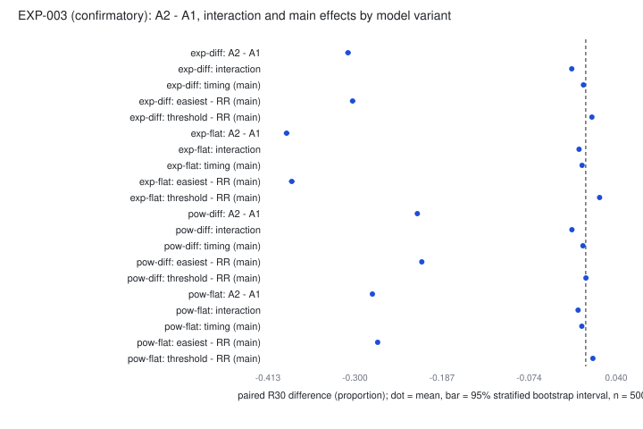
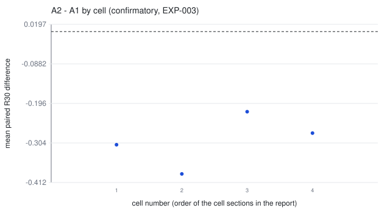

<!-- SPDX-License-Identifier: LicenseRef-STREAK-NC-Research-1.0 -->
# EXP-003 report: timing versus item selection, and model-form sensitivity

**Label: CONFIRMATORY (frozen protocol 1.0). Simulation of synthetic learners. Not evidence about real human learning, motivation or any real product.**

## 1. Identification

| Field | Value |
|---|---|
| Experiment ID | EXP-003 |
| Date run | 2026-11-25 local time (2026-11-24 23:41:57 to 23:43:20 UTC) |
| Report version | 1.0, composed from committed results under the owner's approval of 2026-11-25 (D-017, D-018) and written by the coordinator |
| Status | complete: full frozen matrix run (6 policy cells × 4 model variants), 0 failed learner-arms |
| Authorship | Mohamed Bechir Kefi, independent researcher (owner, 2026-11-26, decision sheet, B3; replaces "no affiliation" of decision C3). Drafted by the AI research assistant for the owner's review. |
| Protocol | `research/experiments/EXP-003/protocol.md`, SHA-256 `20fc86cd0d595776589525cfd76153abae7c1c88b5faefbbdcc7b9f0c798cfba`; parent `research/protocol.md`, SHA-256 `57a60597a93cfc07a1d25e9a2f6bac9f23009b554d3d9820828e7707210711ee` |
| Config | `research/experiments/EXP-003/config.json`, canonical SHA-256 `ab1c1799a45e0eab8091125a7d769e20ecdf642b5f8e1436e0d9a66c31450ff3` |
| Code revision | `219c05473a3dc573621e54f15db153280cc08ee9` (engine 1.1.0), tracked tree clean (`git_dirty = false`) |
| Role | contains the preregistered invalidation test H-inv (P§9 item 1) |

## 2. Executive summary

**Question.** (a) How much of the R30 difference between A2 Streak and A1 Fixed comes from daily timing and how much from easiest-first selection? (b) Does the difference survive a flat gain rule and a power-law forgetting curve?

**Method.** 2 timings (daily, 3 per week) × 3 selections (round-robin, easiest first, threshold rule r* = 0.9): A1 = (3 per week, round-robin), F-EASY, F-DUE, D-RR, A2 = (daily, easiest), A3 = (daily, threshold). Four model variants: exponential or power-law forgetting × difficulty-dependent or flat gain. 5 seeds × 100 learners, 12,000 learner-arm simulations with common random numbers. Stratified percentile bootstrap (10,000 resamples), Holm within each variant for the 8 secondary contrasts.

**Outcome.** A2 - A1 stayed relevant negative in all four variants: exp-diff -0.3089 [-0.3124, -0.3054], exp-flat -0.3887 [-0.3923, -0.3849], pow-diff -0.2188 [-0.2200, -0.2176], pow-flat -0.2772 [-0.2787, -0.2757]. **H-inv was not triggered** under flat gain with either forgetting form, so the EXP-001 direction does not depend on the difficulty-dependent gain assumption. Selection carries the gap: the easiest-first main effect ranges from -0.2130 to -0.3820. The timing main effect (-0.0030 to -0.0051) and the timing × selection interaction (-0.0087 to -0.0183) are practically equivalent to zero at the SESOI.

**Principal caveat.** The scheduler's belief stays exponential with difficulty-dependent gain in all variants, so the non-default variants are also misspecified for the scheduler by design. The main effects use a conventional definition that the protocol does not give (an AI reading, labelled).

## 3. Rationale and literature

The expected streak penalty rests on two assumptions: that reviewing well-known items yields little durability gain (difficulty-dependent gain), and exponential forgetting. Spacing research (Cepeda et al. 2006) supports spacing benefits but does not fix the functional form; the FSRS documentation uses a power-law curve. If the penalty disappeared under other assumptions, the conclusion would have to be stated as conditional on them (EXP-003 protocol section 2).

## 4. Hypotheses and operational definitions

- H-sel: within each timing level, R30(easiest first) - R30(round-robin) ≠ 0 (expected negative under difficulty-dependent gain). Contrasts F-EASY - A1 and A2 - D-RR.
- H-time: within each selection rule, R30(daily) - R30(3 per week) ≠ 0 (no expected direction). Contrasts D-RR - A1, A2 - F-EASY and A3 - F-DUE.
- **H-inv:** under flat gain, for each forgetting form, E[R30(A2) - R30(A1)] ≠ 0. If the 90% interval lies inside ±0.02, or the 95% interval lies entirely above 0, the EXP-001 interpretation is reported as dependent on the difficulty-dependent gain. Reported unadjusted.
- Interaction (protocol section 9): [R30(A2) - R30(D-RR)] - [R30(F-EASY) - R30(A1)].
- Main effects (AI reading of "main effects", equal-weight marginal definition): timing = mean of the three daily cells minus mean of the three 3-per-week cells; selection = mean over timing of (easiest - round-robin) and of (threshold - round-robin). Outside the Holm family, which the frozen config defines as its 8 secondary contrasts.
- Flat gain: h ← 1.85 h on success. Power law: p = (1 + 3 Δt / h)^(-0.5).

## 5. Methodology

- Model of P§2 at the frozen parameters (h0 = 67.59 days, K = 200, q = 0.85, a = 2.5 and the rest as in EXP-001). Variants change only the true forgetting form and gain rule; the scheduler's belief is unchanged.
- Seeds 1 to 5, 100 learners each, every learner run under all 6 policy cells and all 4 variants.
- Data: synthetic learners only. Data manifest SHA-256 `60b024953faa4e164c83520fefd5b5a8d6e1154d8c18ed8067769ce4aed2ed9e`; raw Duolingo SHA-256 verified at preflight.
- Hardware and software: Apple M1 Pro (10 cores), macOS (Darwin 24.3.0), Python 3.12.1, NumPy 2.5.4; one worker process under `nice -n 10`.
- Analysis exactly as frozen: `streak.report.analyse` per variant, plus `streak.frozen_analysis.exp003_effects` (interaction, H-inv, main effects), written and tested before any confirmatory output (commit 45ea4ec).

## 6. Implementation verification

- Test suite: 211 passed before and after the run. Smoke and metric validation at the frozen parameters passed (J-0011, J-0012). `tests/test_frozen_analysis.py` checks the interaction as a difference of differences, pairing, and the presence of H-inv only in flat-gain variants.
- Output: 12,000 of 12,000 records ok (failure rate 0.0). In every variant the three daily cells share the same activity (mean active days 47.59) and the three 3-per-week cells share theirs (23.63), as timing requires.

## 7. Execution record

| Item | Value |
|---|---|
| Command | `.venv/bin/python scripts/run_confirmatory.py EXP-003` (runs `nice -n 10 .venv/bin/python -m streak.cli run --config research/experiments/EXP-003/config.json --out results/confirmatory/EXP-003` through the freeze guard) |
| Preflight | tracked tree clean; all frozen hashes and the raw data hash equal to the freeze record |
| Run IDs | 20 runs, `EXP-003/<variant>/s<seed>` for variants exp-diff, exp-flat, pow-diff and pow-flat × seeds 1 to 5 (`results/confirmatory/EXP-003/provenance.json`) |
| Start and end | 2026-11-24T23:41:57 to 23:43:20 UTC |
| Runtime | 82.876 s of simulation (83.279 s wall clock); peak RSS 156,385,280 bytes |
| Sample counts | 12,000 learner-arms planned, 12,000 run, 0 failed, 0 dropped |
| Exit status | process exit 0 |
| Result file | `results/confirmatory/EXP-003/results.json` (committed, 6.9 MB), SHA-256 `6eecffdbf1cf4d87c29705864eee4611758ca35df145c97f0fd7a7f24b404d9f` |
| Deviation 1 (no run started) | The first launch, chained after EXP-002, was refused by the wrapper's preflight because record files had been edited, so the tree was not clean. Nothing was simulated. After the records were committed (219c054), EXP-003 ran once (J-0016, D-016). |
| Deviation 2 (reporting) | The file tool refused this report. On the owner's decision of 2026-11-25 it was composed from committed results and written by the coordinator (D-017, D-018). |

## 8. Results

### 8.1 Mean R30 by policy cell and model variant (n = 500 learners each)

| Variant | A1 (3/wk, RR) | F-EASY (3/wk, easiest) | F-DUE (3/wk, threshold) | D-RR (daily, RR) | A2 (daily, easiest) | A3 (daily, threshold) |
|---|---|---|---|---|---|---|
| exp-diff | 0.7925 | 0.4986 | 0.8008 | 0.7957 | 0.4836 | 0.8034 |
| exp-flat | 0.8816 | 0.5039 | 0.8989 | 0.8793 | 0.4929 | 0.8981 |
| pow-diff | 0.7401 | 0.5361 | 0.7416 | 0.7433 | 0.5213 | 0.7424 |
| pow-flat | 0.8079 | 0.5425 | 0.8172 | 0.8060 | 0.5307 | 0.8155 |

Mean item coverage: easiest-first cells 0.171 to 0.189; round-robin cells 1.0; threshold cells 0.985 to 1.0 (`generated/analysis.json`).

### 8.2 Primary contrast A2 - A1 and H-inv

| Variant | Mean diff | 95% CI | 90% CI | Class | H-inv |
|---|---|---|---|---|---|
| exp-diff | -0.3089 | [-0.3124, -0.3054] | [-0.3118, -0.3059] | relevant negative | n/a (default gain) |
| exp-flat | -0.3887 | [-0.3923, -0.3849] | [-0.3917, -0.3855] | relevant negative | not triggered (90% CI not inside ±0.02; 95% CI not above 0) |
| pow-diff | -0.2188 | [-0.2200, -0.2176] | [-0.2198, -0.2178] | relevant negative | n/a (default gain) |
| pow-flat | -0.2772 | [-0.2787, -0.2757] | [-0.2785, -0.2759] | relevant negative | not triggered |

Under flat gain, H0 of H-inv is rejected (unadjusted) for both forms, in the expected direction. Residual-flagged learners excluded (12 flagged learner-arms in total; n = 499 per variant): every variant stays relevant negative, -0.3886 to -0.2188. The exp-diff variant uses the default parameters; its value equals the EXP-002 cell h0 = 67.59, a = 2.5, q = 0.85 (-0.3089 [-0.3124, -0.3054]) and differs from EXP-001 (-0.3068), which has 200 learners per seed.

### 8.3 Selection and timing contrasts (secondary, Holm within variant; intervals unadjusted)

| Contrast | exp-diff | exp-flat | pow-diff | pow-flat |
|---|---|---|---|---|
| F-EASY - A1 (selection, 3/wk) | -0.2939 [-0.2973, -0.2905] RN | -0.3777 [-0.3813, -0.3740] RN | -0.2041 [-0.2053, -0.2028] RN | -0.2654 [-0.2670, -0.2637] RN |
| A2 - D-RR (selection, daily) | -0.3121 [-0.3156, -0.3086] RN | -0.3864 [-0.3900, -0.3828] RN | -0.2220 [-0.2231, -0.2208] RN | -0.2754 [-0.2768, -0.2738] RN |
| F-DUE - A1 | +0.0083 [+0.0073, +0.0093] EQ | +0.0173 [+0.0164, +0.0183] EQ | +0.0015 [+0.0006, +0.0023] EQ | +0.0093 [+0.0083, +0.0101] EQ |
| A3 - D-RR | +0.0077 [+0.0067, +0.0088] EQ | +0.0188 [+0.0177, +0.0199] EQ | -0.0010 [-0.0020, +0.0001] EQ | +0.0094 [+0.0084, +0.0104] EQ |
| D-RR - A1 (timing, RR) | +0.0033 [+0.0022, +0.0043] EQ | -0.0023 [-0.0033, -0.0012] EQ | +0.0032 [+0.0023, +0.0041] EQ | -0.0019 [-0.0028, -0.0009] EQ |
| A2 - F-EASY (timing, easiest) | -0.0150 [-0.0161, -0.0139] EQ | -0.0110 [-0.0122, -0.0098] EQ | -0.0147 [-0.0156, -0.0139] EQ | -0.0119 [-0.0127, -0.0110] EQ |
| A3 - F-DUE (timing, threshold) | +0.0027 [+0.0017, +0.0037] EQ | -0.0008 [-0.0017, +0.0000] EQ | +0.0008 [-0.0003, +0.0018] EQ | -0.0017 [-0.0027, -0.0007] EQ |
| A2 - A3 | -0.3198 [-0.3234, -0.3162] RN | -0.4051 [-0.4092, -0.4012] RN | -0.2210 [-0.2222, -0.2198] RN | -0.2848 [-0.2863, -0.2832] RN |

RN = relevant negative; EQ = practically equivalent under the model (90% CI inside ±0.02). Holm-adjusted p-values are below 0.0001 except: exp-flat A3 - F-DUE 0.0516; pow-diff F-DUE - A1 0.0036, A3 - D-RR 0.132, A3 - F-DUE 0.156; pow-flat A3 - F-DUE 0.0006 (`generated/contrasts.csv`).

### 8.4 Interaction and main effects (interaction as frozen; main effects by the conventional definition)

| Variant | Interaction [(A2 - D-RR) - (F-EASY - A1)] | Timing main effect | Easiest - RR main effect | Threshold - RR main effect |
|---|---|---|---|---|
| exp-diff | -0.0183 [-0.0198, -0.0167] EQ | -0.0030 [-0.0037, -0.0024] EQ | -0.3030 [-0.3064, -0.2996] RN | +0.0080 [+0.0072, +0.0088] EQ |
| exp-flat | -0.0087 [-0.0103, -0.0071] EQ | -0.0047 [-0.0054, -0.0041] EQ | -0.3820 [-0.3855, -0.3784] RN | +0.0181 [+0.0172, +0.0189] EQ |
| pow-diff | -0.0179 [-0.0191, -0.0167] EQ | -0.0036 [-0.0042, -0.0030] EQ | -0.2130 [-0.2141, -0.2120] RN | +0.0003 [-0.0005, +0.0010] EQ |
| pow-flat | -0.0100 [-0.0113, -0.0087] EQ | -0.0051 [-0.0058, -0.0045] EQ | -0.2704 [-0.2718, -0.2689] RN | +0.0093 [+0.0086, +0.0101] EQ |

Intervals are 95% stratified bootstrap intervals, unadjusted. Source: `generated/frozen_analysis.json`.

### 8.5 Figures

Per variant (1 = exp-diff, 2 = exp-flat, 3 = pow-diff, 4 = pow-flat): FIG-0Na shows mean R30 per policy cell with 95% interval, and FIG-0Nb the distribution of per-learner A2 - A1 differences (`figures/FIG-01a-arm-r30.svg` to `figures/FIG-04b-primary-diff.svg`).

## 9. Interpretation

- **Expected versus observed.** H-sel was expected negative under difficulty-dependent gain: observed relevant negative in both timing levels and also under flat gain. H-time had no expected direction: observed practically equivalent to zero in every selection rule and variant. H-inv could have invalidated the EXP-001 interpretation, but it was not triggered.
- **Measured (in the model).** At matched minutes, selection determines retention and timing barely matters. Every easiest-first cell loses 0.20 to 0.39 in R30 against its round-robin counterpart. Daily versus 3-per-week changes R30 by at most 0.0188 in absolute value in any timing contrast, and every timing contrast is practically equivalent.
- **Mechanism (model-dependent inference).** Under flat gain the gap grows rather than shrinks (exponential: -0.3887 versus -0.3089). Easiest-first selection therefore costs retention through coverage (about 0.17 to 0.19 of items reviewed), not through the low gain of easy reviews. Power-law forgetting decays more slowly at long delays and makes the gap smaller (-0.2188, -0.2772), though still far beyond the SESOI.
- **Relation to the held-out test.** The Duolingo held-out test favoured the power-law form over the exponential form (EXP-001 report, section 8.4). Under power-law forgetting the gap persists at -0.2188 (difficulty gain) and -0.2772 (flat gain).
- **Verdict under the frozen rule.** The H-inv rule does not trigger, so the EXP-001 interpretation is not reported as dependent on the difficulty-dependent gain. H-sel: rejected H0 in all variants (negative). H-time: H0 rejected in most contrasts at the Holm level but all practically equivalent; non-significance is not claimed where p-values exceed 0.05, and no equivalence is claimed beyond the 90% interval rule.

## 10. Threats to validity

- Internal: the scheduler's belief is exponential with difficulty-dependent gain in all variants, which is misspecified in three of them. Item independence, no interference and no within-day decay remain assumptions.
- Construct: the main effects use an AI reading of an undefined term in the protocol. The interaction is exactly as defined in protocol section 9.
- External: as in EXP-001 (synthetic learners only; the forgetting form does not beat a constant baseline on held-out real data).
- Statistical: intervals unadjusted; Holm within variant for the 8 secondary contrasts as frozen; H-inv and the interaction are unadjusted.

## 11. Conclusion and next experiment

Within the frozen model, the retention penalty of streak-driven scheduling comes from easiest-first item selection, not from daily timing. It survives a flat gain rule and a power-law forgetting curve, so the preregistered invalidation test does not apply. M4 should synthesise EXP-001 to EXP-003 together with the negative held-out result on the forgetting form, and challenge the preferred reading in a second review pass.

## 12. Reproduction appendix

- Exact commands: `reproduction.md` (uv sync, pytest, `scripts/run_confirmatory.py EXP-003`, `scripts/analyse_confirmatory.py EXP-003`, copies into this folder).
- Raw results: `results/confirmatory/EXP-003/results.json` (committed; SHA-256 above), with `run_manifest.json`, `provenance.json`, `sha256_manifest.json` and `run.log`.
- Machine-readable outputs: `generated/analysis.json`, `generated/contrasts.csv`, `generated/metrics.csv`, `generated/frozen_analysis.json`, `generated/report.md`, `metrics.csv`, `run_manifest.json`.
- References: as in the EXP-001 report; FSRS forgetting-curve documentation as cited in `research/literature_review.md`.

## M4 audit note (2026-11-25)

No number, table, figure or verdict in this report changed. The M4 evidence audit (`research/publication/claims_audit.md`) recomputed the four primary contrasts from `results/confirmatory/EXP-003/results.json` and traced every decimal number in this report to a committed output. Two qualifications apply.

- **Citation (section 3).** Cepeda et al. (2006) was read as an abstract only (`research/literature_review.md`, section 4). The abstract reports that spacing and lag effects were examined and that the optimal interstudy interval grows with the retention interval; it does not state the direction of the spacing effect in the sentences read. "Supports spacing benefits" is therefore not verified from the source.
- **Mechanism (section 9).** The sentence "easiest-first selection therefore costs retention through coverage" goes further than this experiment shows. The flat-gain result rules out the low gain of easy reviews as the only cause. It does not isolate coverage from the repeated review of the same items. An exploratory M4 check (journal J-0018) found a gap of -0.2358 at K = 50 items, where A2 still covered 0.6726 of the items. Coverage is therefore one channel, not the whole explanation. Section 6.2 of the manuscript gives the qualified reading.
- **Correction (section 9, "Measured").** The sentence "Daily versus 3-per-week changes R30 by at most 0.0188 in absolute value in any timing contrast" is wrong. The value 0.0188 is the selection contrast A3 - D-RR under exp-flat (table 8.3), not a timing contrast. The largest timing contrast in absolute value is A2 - F-EASY under exp-diff, -0.0150 [-0.0161, -0.0139] (table 8.3, `generated/contrasts.csv`). The conclusion of the sentence is unchanged, since every timing contrast is practically equivalent. Section 9 itself is left as written, so the error stays visible.

## M6 audit note (2026-11-25)

No number, table, figure or verdict changed. In M6 the full texts of four sources previously read as abstracts were opened from free, legal copies and the cited points checked (`research/publication/claims_audit.md`, section 6). Cepeda et al. (2006), author-hosted full text, p. 358: "Spaced presentations led to markedly better final-test performance, compared with massed presentations"; the statement that spacing benefits retention, qualified in the M4 note above, is therefore supported by the source for the verbal recall tasks it reviews. Roediger and Karpicke (2006, p. 249), Murre and Dros (2015, Abstract and Discussion) and Silverman and Barasch (accepted manuscript, Abstract and General Discussion) confirm the points cited from their abstracts.
