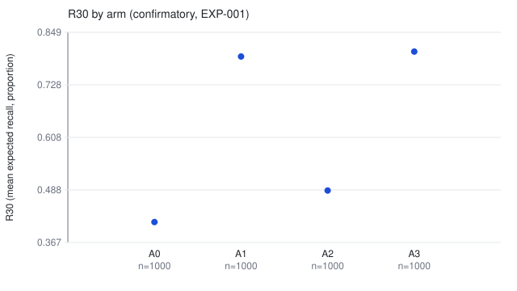
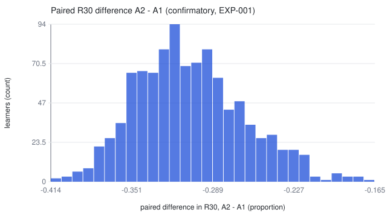
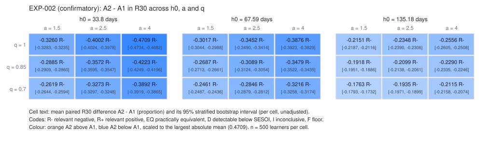
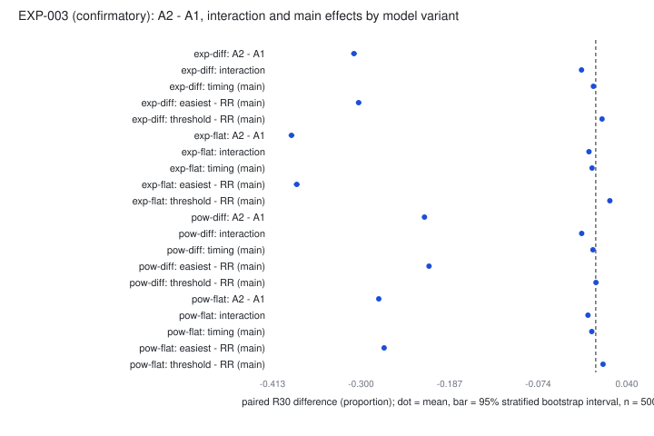

<!-- SPDX-License-Identifier: LicenseRef-STREAK-NC-Research-1.0 -->

---
title: "When activity and retention diverge: item selection, not daily practice, drives the retention cost of a streak-driven policy in a preregistered learner simulation"
author: "Mohamed Bechir Kefi"
affiliation: "none"
ai-assistance: "An AI system (Claude, Anthropic) was used as a disclosed research and development assistant. It is not an author."
status: "Independent research manuscript, preprint draft, not peer reviewed. Version 1.0 (M4 synthesis, revised after the second review pass in research/publication/review_pass_2.md), 2026-11-25."
---

# Abstract

Activity streaks count consecutive days with practice. Activity and retention are different quantities, and it is not known in general when they move apart. We asked when activity streaks can diverge from knowledge retention in a learning model. In a preregistered simulation of synthetic learners with forgetting, retrieval practice and a fixed practice time of 336 minutes over 56 days, we compared a stylised streak-driven policy (practise every available day, easiest items first) with a fixed three-sessions-per-week round-robin schedule, a threshold-based spaced-repetition comparator and a no-practice control. The median initial half-life was fitted to public Duolingo traces. At the frozen default parameters (1,000 learners), the streak-driven policy doubled active days, and its mean expected recall 30 days after practice differed from the fixed schedule's by -0.3068 (95% CI -0.3093 to -0.3042). The gap was practically relevant in all 27 cells of a parameter grid and under flat-gain and power-law variants. A 2 × 3 decomposition attributed it to easiest-first item selection: daily timing alone changed recall by less than 0.02, and the spaced comparator had identical activity without the loss. Before the freeze, in a degenerate regime where nearly everything was forgotten, the sign was reversed. A preregistered held-out test on real data was negative: the exponential forgetting curve fitted worse than a constant baseline. The findings are properties of the model, not of real learners.

# Keywords

spaced repetition; gamification; activity streaks; forgetting curve; simulation study; preregistration

# 1. Introduction

## 1.1 Motivation

Activity measures count practice: days practised, sessions completed, the length of an unbroken run of active days (a streak). Such counts are easy to observe and easy to reward. Retention, the ability to recall what was studied after a delay, is harder to observe and is what learning is for. If a learner, or a scheduling policy acting for the learner, organises practice so as to keep a streak alive, activity counts can rise while retention does not. Whether and when this happens depends on how practice time is distributed over days and over material.

Streaks are known to affect behaviour. Silverman and Barasch (2022) report, in the abstract read for this study, that intact logged streaks increased subsequent engagement relative to broken ones. That is an engagement result. This study holds the amount of practice fixed by design and asks a narrower question about the retention value of how that time is used.

## 1.2 Research gap

Spaced-repetition schedulers that optimise recall exist (Settles and Meeder 2016; Tabibian et al. 2019; Ye et al. 2022), and Roediger and Karpicke (2006) report, in the abstract read, that prior testing produced greater retention than restudy on delayed tests. We did not find, in an ad hoc search that was not a systematic review, a controlled simulation that holds practice minutes fixed and separates the two ingredients of streak-driven practice: practising every day (timing) and filling short daily sessions with items that are easy to succeed on (selection). We do not claim novelty beyond this statement, because no documented systematic search was performed.

## 1.3 Questions and hypotheses

The master question is: *when can activity streaks diverge from knowledge retention in a learning model?* "Diverge" is defined as a policy scoring higher on activity measures while scoring equal or lower on retention after a held-out delay. Three preregistered experiments address it:

- **EXP-001** (primary). At default parameters and matched minutes, does the streak-driven policy A2 give a different mean expected recall 30 days after practice (R30) than the fixed policy A1? H0: E[Δ] = 0, Δ = R30(A2) - R30(A1); H1 two-sided, expected direction negative.
- **EXP-002** ("when"). Across 27 cells of median initial half-life, success gain and availability, where does the A2 - A1 difference appear, and is its sign consistent?
- **EXP-003** (mechanism and invalidation test). How much of the difference is due to timing and how much to selection, and does it survive a flat gain rule (H-inv) and a power-law forgetting curve?

A fourth, descriptive test (protocol section 14.4) checks the model's forgetting assumption on held-out real data.

## 1.4 Contributions

1. A small, open, deterministic simulation engine for synthetic learners with forgetting, retrieval practice, a matched practice budget, stochastic availability and common random numbers across policies, with invariant and golden tests.
2. A preregistered, frozen protocol with a smallest effect size of interest (SESOI) of 0.02 in R30, executed once in full: 70,000 learner-arm simulations, none failed.
3. A decomposition of the streak-driven retention gap into timing and selection under four model variants, including a preregistered test that could have invalidated the main interpretation.
4. A preregistered held-out test of the forgetting model on public Duolingo traces, reported as a negative result.

# 2. Related work

## 2.1 Forgetting, retrieval practice and spacing

The default memory model uses the exponential half-life form p = 2^(-Δ/h) of half-life regression (Settles and Meeder 2016), which the authors introduce as the Ebbinghaus model in which "memory decays exponentially over time". Murre and Dros (2015) report a savings-based replication of the Ebbinghaus forgetting curve. Roediger and Karpicke (2006) report that prior testing produced greater retention than restudy on delayed final tests, while restudy was better at a 5-minute test. Cepeda et al. (2006) synthesised 839 assessments of distributed practice and report that the interstudy interval producing maximal retention increased with the retention interval. These sources motivate modelling reviews as retrieval attempts and making the memory gain depend on the state of the item; they do not fix the functional forms used here.

## 2.2 Spaced-repetition scheduling

Half-life regression (Settles and Meeder 2016) trains a half-life model on Duolingo logs. In their historical evaluation, a constant prediction of the average recall rate had lower mean absolute error than the Leitner and Pimsleur heuristics and logistic regression; only the two half-life regression variants beat it. Tabibian et al. (2019) formulate scheduling as optimal control and report that, for two memory models, the optimal reviewing schedule is given by the recall probability itself. Ye et al. (2022) is a further scheduler-optimisation reference; only its metadata were verified. The FSRS documentation (open-spaced-repetition wiki) uses power-law forgetting curves; our power-law variant is a simplified single curve, not FSRS.

## 2.3 Streaks and engagement

Silverman and Barasch (2022) study streaks as goals in themselves and their effect on subsequent engagement. This study does not model motivation or engagement: total practice time is the same for every practice policy.

## 2.4 Position of this study

This is a simulation study, not a replication of any of the above. It extends the scheduler literature in one narrow direction: it treats a streak-maintaining policy as a scheduler and asks what it costs in retention when practice time is held fixed.

# 3. Background and formal model

## 3.1 Notation and memory model

Time is in days. Each learner studies K items. Item i of learner l has half-life h (days) and last exposure s. True recall at time t is p(t) = 2^(-(t - s)/h) (exponential, default) or p(t) = (1 + 3(t - s)/h)^(-0.5) (power law, sensitivity); both equal 0.5 at t - s = h. At day 0 every item is studied once: h = h0 · u_i · θ_l with u_i ~ LogNormal(0, 0.5²) and θ_l ~ LogNormal(0, 0.3²).

A review at time t succeeds with probability p(t). On success the half-life grows by h ← h(1 + g_min + a(1 - p(t))) with g_min = 0.1 and a = 2.5 (difficulty-dependent gain, default), or by h ← 1.85h (flat gain, sensitivity; equal to the default gain at p = 0.7). On failure h ← max(0.25, 0.6h). Each item is reviewed at most once per day.

## 3.2 Time budget and availability

Each review costs one slot of 0.5 minutes. The practice horizon is days 1 to T = 56, with M = 672 slots (336 minutes) per learner and a daily cap of 60 slots. Each day the learner is available with probability q (default 0.85), drawn once per learner and shared by all policies. Slots that cannot be spent on a day carry forward to the next available day; slots unspent at the end are the residual r, and spent + r = M exactly.

## 3.3 Scheduling policies

| Policy | Timing | Item selection | Role |
|---|---|---|---|
| A0 NoPractice | none after day 0 | none | negative control |
| A1 Fixed | 3 fixed weekdays, 28 slots per session, make-up on the next available day | round-robin in fixed order | primary baseline |
| A2 Streak | every available day, 12 slots plus carry-forward | easiest first (highest estimated recall) | treatment |
| A3 Spaced | as A2 | threshold rule: items with estimated recall ≤ 0.9 first, highest first; then the rest, lowest first | comparator |

A2 is deliberately an extreme stylisation: a deterministic rule that always reviews the items it believes easiest. It is not a model of how real learners keep streaks, and the size of its effect is not an estimate for any real behaviour. Policies that rank items use the scheduler's belief, an estimate of recall with population-median parameters and the default model, updated with observed outcomes. The scheduler never sees the true state. A2 and A3 have identical timing and therefore identical activity counts and streaks. EXP-003 adds the cells F-EASY (3 per week, easiest first), F-DUE (3 per week, threshold rule) and D-RR (daily, round-robin).

## 3.4 Metrics

The primary metric R30 is the mean true recall probability over all K items at t = T + 30, computed analytically from the true memory state. Secondary metrics include R1, R7, R90, the area under the retention curve, minutes, residual, active days, longest streak, practice success rate, item coverage and weakest-decile R30. All are defined in protocol section 5.

# 4. Methods

## 4.1 Design and experimental unit

The unit is one synthetic learner. Every policy runs on every learner with common random numbers (the same learner parameters, item difficulties, availability sequence and outcome stream). Contrasts are within-learner paired differences.

## 4.2 Data

All simulated learners are synthetic. One parameter, the median initial half-life h0, was calibrated on public Duolingo learning traces (CC BY-NC 4.0, Harvard Dataverse doi:10.7910/DVN/N8XJME), using first repeats with delays of 1 to 90 days. Ingestion read 12,854,226 rows and kept 324,353, split by a hash of the user identifier into a fit split (163,110 rows, 245,827 trials) and a held-out split (161,243 rows, 243,337 trials). Maximum marginal likelihood on the fit split gave h0 = 67.59 days (naive 95% likelihood-ratio interval 66.70 to 68.49 days). The held-out split was evaluated once, after the freeze. The raw file and its processed form are not redistributed.

## 4.3 Parameters and the floor check

The number of items K was set before the freeze by a rule fixed in advance that used the control arms A0 and A1 only on smoke seeds: K = 100 put A1's mean R30 at 0.873, above the 0.8 ceiling of the rule, and K = 200 put it at 0.791. K = 200 was adopted and ratified by the owner. No A2 or A3 run and no contrast was computed at the frozen parameters before the freeze.

## 4.4 Experiments and sample sizes

| Experiment | Matrix | Learners per condition | Learner-arm simulations |
|---|---|---|---|
| EXP-001 | 4 policies, default parameters | 1,000 (5 seeds × 200) | 4,000 |
| EXP-002 | 27 cells: h0 ∈ {33.8, 67.59, 135.18} days × a ∈ {1.5, 2.5, 4} × q ∈ {0.7, 0.85, 1.0}; 4 policies | 500 per cell | 54,000 |
| EXP-003 | 6 policy cells × 4 model variants (exponential or power law × difficulty or flat gain) | 500 per variant | 12,000 |

Confirmatory master seeds were 1 to 5; smoke and development seeds were 9001 to 9005 and were never pooled with confirmatory results.

## 4.5 Statistical analysis

For each contrast we report the mean paired difference with a stratified percentile bootstrap (10,000 resamples, learners resampled within master seed, bootstrap seed 20261124), 95% and 90% intervals, per-seed means and d_z. The frozen decision rule: reject H0 if the 95% interval excludes 0; "relevant" if it also lies beyond ±0.02; "practically equivalent under the model" if the 90% interval lies inside (-0.02, +0.02); otherwise "detectable below the SESOI" or "inconclusive". Secondary contrasts carry Holm-adjusted bootstrap p-values within each cell or model variant, with unadjusted intervals. In EXP-002 the primary p-values are also Holm-adjusted across the 27 cells. Learners with a residual above 5% of the budget are flagged and excluded in a sensitivity analysis.

## 4.6 Implementation and verification

The engine is written in Python with NumPy. Tests cover forgetting-curve bounds, scheduling rules, budget conservation, the no-practice closed form, hand-computed golden examples and determinism; 211 tests passed before and after the confirmatory runs. A smoke run at the frozen parameters on smoke seeds (400 learner-arms) passed every invariant and 11 known cases before the confirmatory runs.

## 4.7 Registration, confirmatory and exploratory work

The protocol and the three experiment protocols were frozen at version 1.0 on 2026-11-24 on the owner's approval, with SHA-256 hashes recorded and checked by a run guard that refuses any changed config. All three experiments then ran once in full. Before the freeze, exploratory smoke runs at the draft parameters had computed the primary contrast; those values are disclosed in section 5.5. Work labelled exploratory in this manuscript (sections 5.5 and 5.6) is separate from the frozen analysis and changes no verdict.

## 4.8 Reproducibility

Each experiment has a standalone report with the exact commands, hashes and run identifiers (Data and code availability).

# 5. Results

## 5.1 EXP-001: streak-driven versus fixed practice at default parameters

| Policy | R30 [95% CI] | Active days | Longest streak (days) | Item coverage | Success rate |
|---|---|---|---|---|---|
| A0 NoPractice | 0.4141 [0.4082, 0.4201] | 0.00 | 0.00 | 0.000 | n/a |
| A1 Fixed | 0.7931 [0.7900, 0.7963] | 23.60 | 1.88 | 1.000 | 0.878 |
| A2 Streak | 0.4863 [0.4809, 0.4919] | 47.55 | 16.24 | 0.172 | 0.987 |
| A3 Spaced | 0.8045 [0.8015, 0.8076] | 47.55 | 16.24 | 0.999 | 0.877 |

Table 1. EXP-001, n = 1,000 learners per policy. Source: `research/experiments/EXP-001/generated/metrics.csv`.

The primary contrast A2 - A1 in R30 was -0.3068 (95% CI -0.3093 to -0.3042; 90% CI -0.3089 to -0.3046; SD 0.0415; d_z = -7.40). All 1,000 learners had a negative difference (range -0.4135 to -0.1653), and the five per-seed means lay between -0.3103 and -0.3034. Excluding the 3 residual-flagged learners changed nothing at four decimals. Under the frozen rule H0 is rejected and the result supports the expected direction with practical relevance.

A2 practised on about twice as many days as A1 and had a longest streak about eight times longer, while its R30 was only 0.0722 (95% CI 0.0712 to 0.0732) above doing nothing after day 0. A3, with exactly A2's activity, retained slightly more than A1 (+0.0114, 95% CI 0.0107 to 0.0123), practically equivalent under the model. A2 - A3 was -0.3182. Within each policy the Spearman correlation between active days and R30 was close to zero (A1 -0.032, A2 -0.088, A3 -0.003).

## 5.2 EXP-002: where the gap appears

A2 - A1 was relevant negative in all 27 cells, from -0.4709 (h0 = 33.8 days, a = 4, q = 1.0) to -0.1763 (h0 = 135.18 days, a = 1.5, q = 0.7), and relevant after Holm adjustment across cells in all 27. No cell was at the floor, no 95% interval lay above zero and no cell was practically equivalent; the grid-level hypothesis (negative in every cell) held and robustness was not disconfirmed. The gap grew as forgetting got faster (smaller h0), as the gain for difficult reviews grew (larger a) and as availability rose. It was present at q = 1.0, where no carry-forward occurs. Excluding residual-flagged learners left every cell relevant negative.

One secondary result was not expected. At h0 = 33.8 days the threshold comparator A3 retained less than A1 in all 9 cells (-0.0684 to -0.0218), relevant in 8. At the two longer half-lives A3 was practically equivalent to A1 in all 18 cells.

## 5.3 EXP-003: timing, selection and model form

| Variant | A2 - A1 [95% CI] | Easiest - round-robin (main effect) | Timing (main effect) | Interaction |
|---|---|---|---|---|
| exponential, difficulty gain | -0.3089 [-0.3124, -0.3054] | -0.3030 | -0.0030 | -0.0183 |
| exponential, flat gain | -0.3887 [-0.3923, -0.3849] | -0.3820 | -0.0047 | -0.0087 |
| power law, difficulty gain | -0.2188 [-0.2200, -0.2176] | -0.2130 | -0.0036 | -0.0179 |
| power law, flat gain | -0.2772 [-0.2787, -0.2757] | -0.2704 | -0.0051 | -0.0100 |

Table 2. EXP-003, n = 500 learners per variant. Main effects use the conventional equal-weight marginal definition, which the protocol names without a formula. Source: `research/experiments/EXP-003/generated/frozen_analysis.json`.

The preregistered invalidation test H-inv was not triggered: under flat gain, A2 - A1 stayed relevant negative for both forgetting forms, and the gap was larger than under the default gain. Within each timing level, easiest-first selection lowered R30 by 0.20 to 0.39 relative to round-robin. Every timing contrast (daily versus 3 per week, within a selection rule) was practically equivalent to zero, the largest in absolute value being 0.0150. The threshold rule was practically equivalent to round-robin at both timings in every variant.

## 5.4 Held-out test of the forgetting model on real data

On the held-out Duolingo split, the mean binomial log-likelihood per trial was -0.3352 for a constant-recall baseline (pooled fit-split recall 0.8948), -0.3710 for the power-law form (h0 fitted 96.62 days) and -0.3865 for the exponential form (h0 67.59 days). Under the reading fixed before the freeze, the exponential model does not describe the held-out first-repeat data better than the constant baseline, and the power-law form is better supported than the exponential form. Observed recall fell only from 0.904 at delays of 1 to 2 days to 0.872 at 32 to 90 days, while the exponential form predicted 0.983 and 0.579.

## 5.5 Contradictory evidence: the floor regime (exploratory, seen before the freeze)

At the draft parameters (h0 = 1 day, K = 100, an earlier A3 rule), smoke runs on development seeds gave the opposite sign: A2 - A1 = +0.0801 (95% CI 0.0788 to 0.0813, n = 1,000), positive in 23 of 27 smoke grid cells (range -0.0787 to +0.0920) and in all four smoke model variants (+0.0245 to +0.0855). In that regime nearly every item was forgotten by the 30-day test, so the parameters were moved off the recall floor by rules justified by the control arms. The sign change between the floor regime and the frozen design is a real feature of the model, not an error, and it is part of the answer to "when" (section 6.3). These values were seen before the freeze, and the decision to leave the floor regime was taken with them visible; the rules that set the new parameters used only the control arms (protocol section 14.7).

## 5.6 M4 sensitivity checks (exploratory)

After the confirmatory analysis we ran cheap exploratory checks on smoke seeds 9001 to 9005 (100 learners each, all four policies, frozen defaults otherwise). They change no verdict.

| Variation | A2 - A1 [95% CI] | A2 item coverage | A3 - A1 (class) |
|---|---|---|---|
| K = 50 | -0.2358 [-0.2414, -0.2302] | 0.6726 | +0.0049 (equivalent) |
| K = 100 | -0.3164 [-0.3215, -0.3113] | 0.3382 | +0.0120 (equivalent) |
| K = 200 | -0.3078 [-0.3115, -0.3040] | 0.1689 | +0.0106 (equivalent) |
| K = 400 | -0.2323 [-0.2343, -0.2303] | 0.0846 | -0.0621 (relevant negative) |
| h0 = 270.36 days | -0.1226 [-0.1255, -0.1197] | 0.1674 | +0.0030 (equivalent) |
| h0 = 540.72 days | -0.0661 [-0.0679, -0.0644] | 0.1671 | +0.0013 (equivalent) |
| h0 = 1081.44 days | -0.0342 [-0.0352, -0.0333] | 0.1670 | +0.0006 (equivalent) |

Table 3. Exploratory sensitivity, n = 500 learners per row. Source: `results/exploratory/M4-SENSITIVITY/summary.csv`.

In all three slow-forgetting rows A2 recovered about the same share of A1's gain over no practice (0.186 to 0.188, against 0.191 in EXP-001), and at h0 of 540.72 and 1081.44 days A2 was practically equivalent to no practice. In the committed EXP-001 data, the per-learner gap was strongly associated with the learner's no-practice retention (Spearman 0.919) and weakly with A2's item coverage (Spearman 0.206). Source: `results/exploratory/M4-SENSITIVITY/summary.json`.

# 6. Discussion

## 6.1 Activity and retention diverge in this model

At matched minutes, the streak-driven policy had about twice the active days and a longest streak about eight times longer, and retained far less. This is the divergence the question defines, and it held in every confirmatory condition tested. The more instructive comparison is A2 against A3. Both have exactly the same active days, streaks and minutes, yet A3 retained 0.3182 more. An activity metric cannot tell these two policies apart. Within each policy the correlation between active days and R30 was also close to zero, so activity carried almost no information about retention inside a policy either.

## 6.2 The mechanism is selection, not daily practice

EXP-003 is the most informative result. Daily practice by itself did not change retention at the SESOI: D-RR versus A1 and A3 versus F-DUE were practically equivalent in every variant. Easiest-first selection lowered R30 by 0.20 to 0.39 at either timing. Timing was not exactly neutral, though. Combined with easiest-first selection, daily practice was slightly worse than 3 per week (A2 - F-EASY, -0.0110 to -0.0150, every 95% interval excluding zero), and the interaction (-0.0087 to -0.0183) points the same way. These effects are below the SESOI and are reported as such.

The flat-gain result rules out one explanation: the gap does not exist only because the model gives little gain for easy reviews. Under flat gain the gap was larger. Item coverage is one channel: A2 reviewed about 17% of the items with a success rate of 0.987, so the rest decayed from day 0. It is not the whole channel. In the exploratory K = 50 run, A2 covered 0.6726 of the items and the gap was still -0.2358, and in EXP-001 the per-learner gap was only weakly associated with coverage. Spending the budget again and again on items that are already safe also wastes it.

A3 shows the other side at the default parameters: identical activity, full coverage, and retention equivalent to the fixed baseline. That equivalence is conditional. A3 fell below A1 at the shortest half-life in EXP-002 (all 9 cells, relevant in 8) and at K = 400 in the exploratory sweep (-0.0621). Its single fixed threshold r* = 0.9 suits some regimes and not others.

## 6.3 When the gap appears

Within the frozen grid, the answer to "when" is "in every tested cell", with a size that grows with forgetting speed, with the gain for difficult reviews and with availability. The exploratory checks add three qualifications. First, the size depends on the number of items relative to the budget in a non-monotone way (from -0.2323 to -0.3164 for K = 50 to 400), and K = 200 was set by a ceiling rule, not by data. Second, under much slower forgetting the absolute gap shrinks (-0.0342 at 16 times the fitted half-life), while the share of A1's gain that A2 recovers stays near 0.19. The rule stays equally inefficient, and there is simply less to lose. Third, in the floor regime of the draft parameters, where nearly everything is forgotten, the sign reverses and daily easy practice beats sparse round-robin. The divergence therefore needs a regime in which neglected items lose something that could have been kept.

The held-out real-data test matters here. Real first-repeat recall was much flatter across delays than the model predicts. If that flatness reflected slow forgetting, the absolute gap for real learners would be at the small end of the range above. The flatness may instead reflect which users and words reach long delays in an adaptive product. This study cannot tell these apart.

## 6.4 Relation to prior work

The direction agrees with the optimal-control view of Tabibian et al. (2019), in which reviews are scheduled according to recall probability, and with the testing-effect result of Roediger and Karpicke (2006). The agreement is largely by construction, because the model encodes those assumptions through retrieval-based updates and a state-dependent gain. The simulation is not independent evidence for them. The negative held-out result echoes Settles and Meeder (2016), whose constant baseline had lower mean absolute error than several established heuristics.

## 6.5 Practical significance

The model is an existence example. A scheduling policy can maximise activity metrics while losing most of the retention that the same minutes could buy, and an activity metric alone cannot distinguish it from a policy that keeps that retention. Because the learners are synthetic, the study does not show how often this happens with real learners or products.

# 7. Limitations and threats to validity

- **Model dependence.** Every result is conditional on the memory model, the policy rules and the scheduler's belief. EXP-003 varied the gain rule and the forgetting form; item independence, the absence of interference and the absence of within-day decay were never varied.
- **Forgetting form.** The held-out test did not support the exponential form against a constant baseline. The calibrated h0 anchors only an order of magnitude.
- **Construct.** A2 is one stylised operationalisation of streak-driven practice. R30 is an expected recall probability, not a test score.
- **Statistical.** Intervals describe simulation noise given the model; with d_z = -7.40 they are narrow, but the uncertainty that matters is about the model. The 27 EXP-002 cells share learners and are not independent confirmations. The EXP-003 default variant reproduces the EXP-002 default cell exactly (-0.3089) because both use the same seeds and learner counts.
- **Magnitude.** The size of the gap depends on K, which was set by a ceiling rule, and on the forgetting speed, which the real data do not validate (section 6.3).
- **No motivation.** Practice time is fixed, so the study cannot say whether streaks help or hurt learning overall when they change how much people practise.
- **Pre-freeze information.** A2 > A1 had been seen at the draft parameters before the freeze (section 5.5). The rules that set the frozen parameters used only the control arms and were committed before the fit, but the decision to leave the floor regime was taken with the contrary values visible.
- **Deviations and owner decisions.** All are listed in supplementary section S6. None changed a frozen protocol, config, seed or verdict.

# 8. Ethics and responsible research

No human participants were involved and no personal data were collected. The Duolingo traces are public, licensed CC BY-NC 4.0, used for non-commercial research with attribution, and contain pseudonymous user identifiers; they are not redistributed, and user identifiers were used only to split the data. No claim is made about any real product's internals, about real learners or about causal human behaviour. The study does not recommend pressure-based design; attention and user agency are outcomes, not targets.

# 9. Conclusion and future work

In a preregistered simulation at matched practice time, a stylised streak-driven policy with easiest-first selection produced more activity and much less retention than a fixed round-robin schedule, across a parameter grid and four model variants. The gap came from item selection, not from daily practice: a policy with identical activity and threshold-based selection lost nothing at the default parameters. The divergence needs a regime in which neglected items have something to lose; it reversed in a near-total-forgetting regime and shrank under very slow forgetting. A held-out test on real data did not support the model's forgetting form. Future work: vary item interference and the scheduler's belief, test a streak policy with coverage guarantees, and test the forgetting model with free-recall data.

# Data and code availability

All code, frozen protocols, configs, committed results and reports are in this repository (public URL: placeholder, not yet published; publication requires the owner's approval). Experiment reports: `research/experiments/EXP-001/report.md`, `EXP-002/report.md`, `EXP-003/report.md`. Reproduction: `uv sync --frozen`, `.venv/bin/python -m pytest`, `.venv/bin/python scripts/run_confirmatory.py EXP-00N`, `.venv/bin/python scripts/analyse_confirmatory.py EXP-00N`. The Duolingo file is downloaded by `scripts/download_duolingo.py` and checked against the SHA-256 in `data/manifest.json`. The artifact manifest `research/publication/artifact_manifest.json` maps each number to its source.

# Funding, competing interests and AI assistance

No funding. No competing interests. An AI system (Claude, Anthropic) acted as a disclosed research and development assistant: it drafted the protocol, code, tests, analyses, reports and this manuscript under the owner's direction. The owner made every freeze, design and publication decision. Every number was checked against committed outputs by scripts (section S7 of the supplement). The AI's internal review is quality control, not peer review.

# References

- Cepeda, N. J., Pashler, H., Vul, E., Wixted, J. T., and Rohrer, D. (2006). Distributed practice in verbal recall tasks: A review and quantitative synthesis. *Psychological Bulletin* 132(3), 354-380. doi:10.1037/0033-2909.132.3.354. (Abstract read; the cited points checked against the author-hosted full text in M6, pp. 354 and 358.)
- Murre, J. M. J., and Dros, J. (2015). Replication and analysis of Ebbinghaus' forgetting curve. *PLOS ONE* 10(7), e0120644. doi:10.1371/journal.pone.0120644. (Abstract read; the cited point checked against the open-access full text in M6, Abstract and Discussion.)
- open-spaced-repetition. The Algorithm (awesome-fsrs wiki). https://github.com/open-spaced-repetition/awesome-fsrs/wiki/The-Algorithm, accessed 2026-11-24. (Page read.)
- Roediger, H. L., and Karpicke, J. D. (2006). Test-enhanced learning: Taking memory tests improves long-term retention. *Psychological Science* 17(3), 249-255. doi:10.1111/j.1467-9280.2006.01693.x. (Abstract read; the cited point checked against the author-hosted full text in M6, p. 249 and Experiments 1 and 2.)
- Settles, B., and Meeder, B. (2016). A trainable spaced repetition model for language learning. *Proceedings of the 54th Annual Meeting of the ACL (Volume 1: Long Papers)*, 1848-1858. doi:10.18653/v1/P16-1174. (Full text read for the cited points.) Data: Harvard Dataverse, doi:10.7910/DVN/N8XJME, version 1.0, CC BY-NC 4.0.
- Silverman, J., and Barasch, A. (2022). On or off track: How (broken) streaks affect consumer decisions. *Journal of Consumer Research* 49(6), 1095-1117. doi:10.1093/jcr/ucac029. (Abstract read; the cited point checked against the accepted manuscript in the University of Delaware repository in M6, Abstract and General Discussion.)
- Tabibian, B., Upadhyay, U., De, A., Zarezade, A., Schölkopf, B., and Gomez-Rodriguez, M. (2019). Enhancing human learning via spaced repetition optimization. *PNAS* 116(10), 3988-3993. doi:10.1073/pnas.1815156116. (Abstract read.)
- Ye, J., Su, J., and Cao, Y. (2022). A stochastic shortest path algorithm for optimizing spaced repetition scheduling. *Proceedings of KDD 2022*, 4381-4390. doi:10.1145/3534678.3539081. (Metadata only.)

# Supplementary appendix

See `research/paper/supplementary.md`: complete matrix, extended tables, configurations, robustness results, report links, deviations and the evidence audit.
