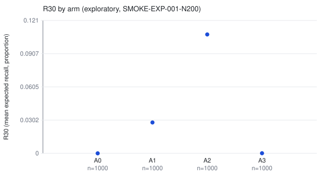
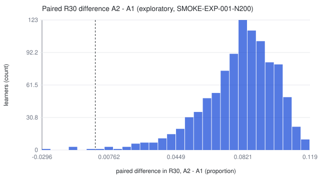

<!-- SPDX-License-Identifier: LicenseRef-STREAK-NC-Research-1.0 -->
# SMOKE-EXP-001-N200: generated results report (EXPLORATORY)

**Label: EXPLORATORY.** Simulation of synthetic learners. Not evidence about real human learning, motivation or any real product.
This report is exploratory. It uses development seeds only and is not a finding; nothing in it may be cited as a result of a registered experiment.

Generated by `streak.report` from the result file. Do not edit by hand.

- Result file: `results/raw/exploratory/SMOKE-EXP-001-N200/results.json`
- Result SHA-256: `4e2ac2a2e3165de535b1ed714e74b1a0` `1cf7828f72ed416728e5139e64d5248d`
- Config hash: `b6dd7db28f04c1e4184da9caea9723df` `bed80043a83be35d2760c251b905e7cd`
- Protocol version 0.1-draft; engine version 1.0.1
- Records (learner-arms): 4000; failed: 0 (0.00%)
- Master seeds: 9001, 9002, 9003, 9004, 9005; learners per seed: 200

## Cell `default`

### Retention by arm (means over learners, proportions)

| Arm | n | R30 | R30 95% CI | R1 | R7 | R90 | AUC-R | Weakest decile R30 |
|---|---|---|---|---|---|---|---|---|
| A0 | 1000 | 0.0000 | [0.0000, 0.0000] | 0.0000 | 0.0000 | 0.0000 | 0.0000 | 0.0000 |
| A1 | 1000 | 0.0281 | [0.0266, 0.0296] | 0.0437 | 0.0384 | 0.0148 | 0.0254 | 0.0000 |
| A2 | 1000 | 0.1082 | [0.1074, 0.1090] | 0.1210 | 0.1139 | 0.0997 | 0.1067 | 0.0000 |
| A3 | 1000 | 0.0001 | [0.0001, 0.0001] | 0.0127 | 0.0010 | 0.0000 | 0.0018 | 0.0000 |

### Activity by arm (means over learners)

| Arm | Minutes | Residual slots | Active days | Longest streak | Success rate | Coverage | Spearman (active days, R30) | Residual-flagged |
|---|---|---|---|---|---|---|---|---|
| A0 | 0.0 | 0.00 | 0.00 | 0.00 | n/a | 0.000 | n/a | 0 |
| A1 | 336.0 | 0.08 | 23.62 | 1.88 | 0.064 | 1.000 | 0.044 | 0 |
| A2 | 335.0 | 1.94 | 47.71 | 16.39 | 0.709 | 0.529 | 0.037 | 3 |
| A3 | 335.0 | 1.94 | 47.71 | 16.39 | 0.020 | 1.000 | -0.014 | 3 |

### Paired contrasts on R30: effects

| Kind | Contrast | n | Mean diff | SD diff | d_z | 95% CI | 90% CI |
|---|---|---|---|---|---|---|---|
| primary | A2 - A1 | 1000 | 0.0801 | 0.0207 | 3.88 | [0.0788, 0.0813] | [0.0790, 0.0811] |
| primary, flagged excluded | A2 - A1 | 997 | 0.0801 | 0.0207 | 3.87 | [0.0788, 0.0814] | [0.0790, 0.0812] |
| secondary | A3 - A1 | 1000 | -0.0280 | 0.0243 | -1.15 | [-0.0295, -0.0265] | [-0.0293, -0.0268] |
| secondary | A2 - A3 | 1000 | 0.1081 | 0.0133 | 8.15 | [0.1073, 0.1089] | [0.1074, 0.1088] |
| secondary | A1 - A0 | 1000 | 0.0281 | 0.0245 | 1.15 | [0.0266, 0.0296] | [0.0268, 0.0294] |
| secondary | A2 - A0 | 1000 | 0.1082 | 0.0134 | 8.09 | [0.1074, 0.1090] | [0.1075, 0.1089] |
| secondary | A3 - A0 | 1000 | 0.0001 | 0.0004 | 0.23 | [0.0001, 0.0001] | [0.0001, 0.0001] |

### Paired contrasts on R30: tests and classes

| Kind | Contrast | p (bootstrap) | p (Holm) | Class (protocol section 4) |
|---|---|---|---|---|
| primary | A2 - A1 | < 0.0001 | n/a | relevant positive |
| primary, flagged excluded | A2 - A1 | < 0.0001 | n/a | relevant positive |
| secondary | A3 - A1 | < 0.0001 | < 0.0001 | relevant negative |
| secondary | A2 - A3 | < 0.0001 | < 0.0001 | relevant positive |
| secondary | A1 - A0 | < 0.0001 | < 0.0001 | relevant positive |
| secondary | A2 - A0 | < 0.0001 | < 0.0001 | relevant positive |
| secondary | A3 - A0 | < 0.0001 | < 0.0001 | practically equivalent under the model |

Per-master-seed mean of the primary paired difference: seed 9001: 0.0789, seed 9002: 0.0825, seed 9003: 0.0807, seed 9004: 0.0790, seed 9005: 0.0793.

## Figures

## Notes

- Intervals are stratified percentile bootstrap intervals over learners within master seeds (10000 resamples, seed 20261124).
- Classes follow research/protocol.md section 4 with SESOI 0.02. Non-significance is never equivalence.
- Holm adjustment is applied to bootstrap p-values of the secondary contrasts within each cell.
