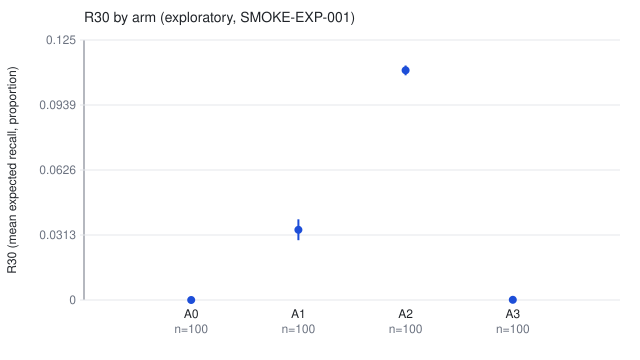
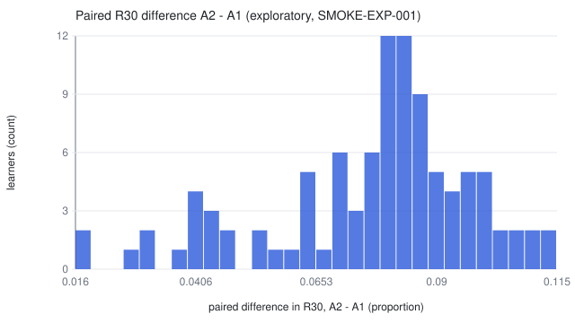

<!-- SPDX-License-Identifier: LicenseRef-STREAK-NC-Research-1.0 -->
# SMOKE-EXP-001: generated results report (EXPLORATORY)

**Label: EXPLORATORY.** Simulation of synthetic learners. Not evidence about real human learning, motivation or any real product.
This report is exploratory. It uses development seeds only and is not a finding; nothing in it may be cited as a result of a registered experiment.

Generated by `streak.report` from the result file. Do not edit by hand.

- Result file: `results/exploratory/SMOKE-EXP-001/results.json`
- Result SHA-256: `a1f8a510170b848d1873aebbc8526e43` `f24434feac1e7a74184b041b297c04ec`
- Config hash: `5098ce78e055e1cd70eb465f60603c7c` `2b32b7fb7b4028369da27644ebc6d709`
- Protocol version 0.1-draft; engine version 1.0.1
- Records (learner-arms): 400; failed: 0 (0.00%)
- Master seeds: 9001, 9002, 9003, 9004, 9005; learners per seed: 20

## Cell `default`

### Retention by arm (means over learners, proportions)

| Arm | n | R30 | R30 95% CI | R1 | R7 | R90 | AUC-R | Weakest decile R30 |
|---|---|---|---|---|---|---|---|---|
| A0 | 100 | 0.0000 | [0.0000, 0.0000] | 0.0000 | 0.0000 | 0.0000 | 0.0000 | 0.0000 |
| A1 | 100 | 0.0338 | [0.0288, 0.0389] | 0.0517 | 0.0456 | 0.0181 | 0.0305 | 0.0000 |
| A2 | 100 | 0.1106 | [0.1082, 0.1129] | 0.1237 | 0.1163 | 0.1021 | 0.1091 | 0.0000 |
| A3 | 100 | 0.0001 | [0.0001, 0.0001] | 0.0132 | 0.0012 | 0.0000 | 0.0019 | 0.0000 |

### Activity by arm (means over learners)

| Arm | Minutes | Residual slots | Active days | Longest streak | Success rate | Coverage | Spearman (active days, R30) | Residual-flagged |
|---|---|---|---|---|---|---|---|---|
| A0 | 0.0 | 0.00 | 0.00 | 0.00 | n/a | 0.000 | n/a | 0 |
| A1 | 335.9 | 0.28 | 23.68 | 1.89 | 0.072 | 1.000 | 0.203 | 0 |
| A2 | 335.2 | 1.68 | 47.92 | 16.25 | 0.728 | 0.525 | -0.000 | 1 |
| A3 | 335.2 | 1.68 | 47.92 | 16.25 | 0.022 | 1.000 | 0.093 | 1 |

### Paired contrasts on R30: effects

| Kind | Contrast | n | Mean diff | SD diff | d_z | 95% CI | 90% CI |
|---|---|---|---|---|---|---|---|
| primary | A2 - A1 | 100 | 0.0768 | 0.0212 | 3.63 | [0.0727, 0.0808] | [0.0734, 0.0801] |
| primary, flagged excluded | A2 - A1 | 99 | 0.0769 | 0.0213 | 3.61 | [0.0727, 0.0809] | [0.0734, 0.0802] |
| secondary | A3 - A1 | 100 | -0.0337 | 0.0261 | -1.29 | [-0.0388, -0.0287] | [-0.0380, -0.0295] |
| secondary | A2 - A3 | 100 | 0.1105 | 0.0121 | 9.11 | [0.1081, 0.1128] | [0.1085, 0.1125] |
| secondary | A1 - A0 | 100 | 0.0338 | 0.0262 | 1.29 | [0.0288, 0.0389] | [0.0296, 0.0381] |
| secondary | A2 - A0 | 100 | 0.1106 | 0.0122 | 9.04 | [0.1082, 0.1129] | [0.1086, 0.1126] |
| secondary | A3 - A0 | 100 | 0.0001 | 0.0002 | 0.52 | [0.0001, 0.0001] | [0.0001, 0.0001] |

### Paired contrasts on R30: tests and classes

| Kind | Contrast | p (bootstrap) | p (Holm) | Class (protocol section 4) |
|---|---|---|---|---|
| primary | A2 - A1 | < 0.0001 | n/a | relevant positive |
| primary, flagged excluded | A2 - A1 | < 0.0001 | n/a | relevant positive |
| secondary | A3 - A1 | < 0.0001 | < 0.0001 | relevant negative |
| secondary | A2 - A3 | < 0.0001 | < 0.0001 | relevant positive |
| secondary | A1 - A0 | < 0.0001 | < 0.0001 | relevant positive |
| secondary | A2 - A0 | < 0.0001 | < 0.0001 | relevant positive |
| secondary | A3 - A0 | < 0.0001 | < 0.0001 | practically equivalent under the model |

Per-master-seed mean of the primary paired difference: seed 9001: 0.0750, seed 9002: 0.0760, seed 9003: 0.0841, seed 9004: 0.0717, seed 9005: 0.0772.

## Figures

## Notes

- Intervals are stratified percentile bootstrap intervals over learners within master seeds (10000 resamples, seed 20261124).
- Classes follow research/protocol.md section 4 with SESOI 0.02. Non-significance is never equivalence.
- Holm adjustment is applied to bootstrap p-values of the secondary contrasts within each cell.
