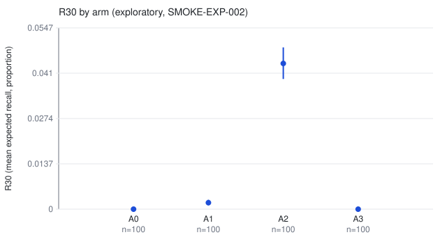
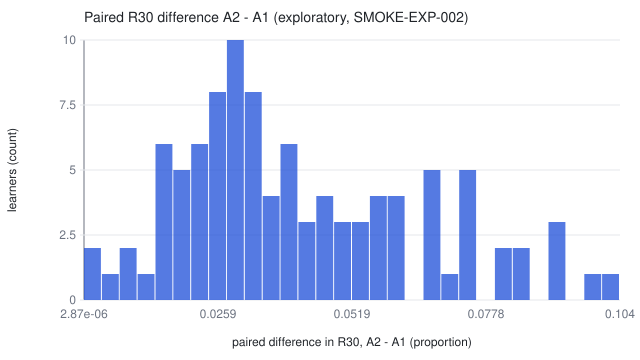

<!-- SPDX-License-Identifier: LicenseRef-STREAK-NC-Research-1.0 -->
# SMOKE-EXP-002: generated results report (EXPLORATORY)

**Label: EXPLORATORY.** Simulation of synthetic learners. Not evidence about real human learning, motivation or any real product.
This report is exploratory. It uses development seeds only and is not a finding; nothing in it may be cited as a result of a registered experiment.

Generated by `streak.report` from the result file. Do not edit by hand.

- Result file: `results/raw/exploratory/SMOKE-EXP-002/results.json`
- Result SHA-256: `0de12dbed7db1feba5415765d3eb8d72` `ecedb89b4e169e21d4913809822a3c87`
- Config hash: `b47759ac97cd65034004ded9aac7362d` `f95b063edf014ad94d636634256a3e95`
- Protocol version 0.1-draft; engine version 1.0.1
- Records (learner-arms): 10800; failed: 0 (0.00%)
- Master seeds: 9001, 9002, 9003, 9004, 9005; learners per seed: 20

## Cell `h0=0.5|a=1.5|q=0.7`

### Retention by arm (means over learners, proportions)

| Arm | n | R30 | R30 95% CI | R1 | R7 | R90 | AUC-R | Weakest decile R30 |
|---|---|---|---|---|---|---|---|---|
| A0 | 100 | 0.0000 | [0.0000, 0.0000] | 0.0000 | 0.0000 | 0.0000 | 0.0000 | 0.0000 |
| A1 | 100 | 0.0020 | [0.0012, 0.0028] | 0.0053 | 0.0032 | 0.0007 | 0.0020 | 0.0000 |
| A2 | 100 | 0.0440 | [0.0393, 0.0488] | 0.0642 | 0.0523 | 0.0338 | 0.0430 | 0.0000 |
| A3 | 100 | 0.0000 | [0.0000, 0.0000] | 0.0101 | 0.0001 | 0.0000 | 0.0016 | 0.0000 |

### Activity by arm (means over learners)

| Arm | Minutes | Residual slots | Active days | Longest streak | Success rate | Coverage | Spearman (active days, R30) | Residual-flagged |
|---|---|---|---|---|---|---|---|---|
| A0 | 0.0 | 0.00 | 0.00 | 0.00 | n/a | 0.000 | n/a | 0 |
| A1 | 335.4 | 1.12 | 22.34 | 2.00 | 0.017 | 1.000 | 0.110 | 0 |
| A2 | 333.7 | 4.68 | 39.31 | 8.90 | 0.284 | 0.625 | 0.324 | 4 |
| A3 | 333.7 | 4.68 | 39.31 | 8.90 | 0.008 | 1.000 | 0.191 | 4 |

### Paired contrasts on R30: effects

| Kind | Contrast | n | Mean diff | SD diff | d_z | 95% CI | 90% CI |
|---|---|---|---|---|---|---|---|
| primary | A2 - A1 | 100 | 0.0420 | 0.0235 | 1.79 | [0.0376, 0.0466] | [0.0383, 0.0458] |
| primary, flagged excluded | A2 - A1 | 96 | 0.0425 | 0.0238 | 1.79 | [0.0380, 0.0471] | [0.0387, 0.0464] |
| secondary | A3 - A1 | 100 | -0.0020 | 0.0042 | -0.46 | [-0.0028, -0.0012] | [-0.0027, -0.0013] |
| secondary | A2 - A3 | 100 | 0.0440 | 0.0251 | 1.76 | [0.0393, 0.0488] | [0.0400, 0.0480] |
| secondary | A1 - A0 | 100 | 0.0020 | 0.0042 | 0.46 | [0.0012, 0.0028] | [0.0013, 0.0027] |
| secondary | A2 - A0 | 100 | 0.0440 | 0.0251 | 1.76 | [0.0393, 0.0488] | [0.0400, 0.0480] |
| secondary | A3 - A0 | 100 | 0.0000 | 0.0000 | 0.12 | [0.0000, 0.0000] | [0.0000, 0.0000] |

### Paired contrasts on R30: tests and classes

| Kind | Contrast | p (bootstrap) | p (Holm) | Class (protocol section 4) |
|---|---|---|---|---|
| primary | A2 - A1 | < 0.0001 | n/a | relevant positive |
| primary, flagged excluded | A2 - A1 | < 0.0001 | n/a | relevant positive |
| secondary | A3 - A1 | < 0.0001 | < 0.0001 | practically equivalent under the model |
| secondary | A2 - A3 | < 0.0001 | < 0.0001 | relevant positive |
| secondary | A1 - A0 | < 0.0001 | < 0.0001 | practically equivalent under the model |
| secondary | A2 - A0 | < 0.0001 | < 0.0001 | relevant positive |
| secondary | A3 - A0 | < 0.0001 | < 0.0001 | practically equivalent under the model |

Per-master-seed mean of the primary paired difference: seed 9001: 0.0400, seed 9002: 0.0454, seed 9003: 0.0333, seed 9004: 0.0448, seed 9005: 0.0467.

## Cell `h0=0.5|a=1.5|q=0.85`

### Retention by arm (means over learners, proportions)

| Arm | n | R30 | R30 95% CI | R1 | R7 | R90 | AUC-R | Weakest decile R30 |
|---|---|---|---|---|---|---|---|---|
| A0 | 100 | 0.0000 | [0.0000, 0.0000] | 0.0000 | 0.0000 | 0.0000 | 0.0000 | 0.0000 |
| A1 | 100 | 0.0017 | [0.0010, 0.0025] | 0.0042 | 0.0029 | 0.0006 | 0.0016 | 0.0000 |
| A2 | 100 | 0.0573 | [0.0530, 0.0616] | 0.0760 | 0.0658 | 0.0470 | 0.0560 | 0.0000 |
| A3 | 100 | 0.0000 | [0.0000, 0.0001] | 0.0094 | 0.0001 | 0.0000 | 0.0016 | 0.0000 |

### Activity by arm (means over learners)

| Arm | Minutes | Residual slots | Active days | Longest streak | Success rate | Coverage | Spearman (active days, R30) | Residual-flagged |
|---|---|---|---|---|---|---|---|---|
| A0 | 0.0 | 0.00 | 0.00 | 0.00 | n/a | 0.000 | n/a | 0 |
| A1 | 335.9 | 0.28 | 23.68 | 1.89 | 0.017 | 1.000 | 0.080 | 0 |
| A2 | 335.2 | 1.68 | 47.92 | 16.25 | 0.407 | 0.422 | 0.321 | 1 |
| A3 | 335.2 | 1.68 | 47.92 | 16.25 | 0.009 | 1.000 | 0.049 | 1 |

### Paired contrasts on R30: effects

| Kind | Contrast | n | Mean diff | SD diff | d_z | 95% CI | 90% CI |
|---|---|---|---|---|---|---|---|
| primary | A2 - A1 | 100 | 0.0555 | 0.0216 | 2.58 | [0.0515, 0.0597] | [0.0521, 0.0590] |
| primary, flagged excluded | A2 - A1 | 99 | 0.0558 | 0.0215 | 2.59 | [0.0518, 0.0600] | [0.0524, 0.0593] |
| secondary | A3 - A1 | 100 | -0.0017 | 0.0040 | -0.42 | [-0.0025, -0.0010] | [-0.0024, -0.0011] |
| secondary | A2 - A3 | 100 | 0.0572 | 0.0225 | 2.54 | [0.0530, 0.0616] | [0.0537, 0.0608] |
| secondary | A1 - A0 | 100 | 0.0017 | 0.0040 | 0.43 | [0.0010, 0.0025] | [0.0011, 0.0024] |
| secondary | A2 - A0 | 100 | 0.0573 | 0.0225 | 2.54 | [0.0530, 0.0616] | [0.0537, 0.0609] |
| secondary | A3 - A0 | 100 | 0.0000 | 0.0001 | 0.14 | [0.0000, 0.0001] | [0.0000, 0.0000] |

### Paired contrasts on R30: tests and classes

| Kind | Contrast | p (bootstrap) | p (Holm) | Class (protocol section 4) |
|---|---|---|---|---|
| primary | A2 - A1 | < 0.0001 | n/a | relevant positive |
| primary, flagged excluded | A2 - A1 | < 0.0001 | n/a | relevant positive |
| secondary | A3 - A1 | < 0.0001 | < 0.0001 | practically equivalent under the model |
| secondary | A2 - A3 | < 0.0001 | < 0.0001 | relevant positive |
| secondary | A1 - A0 | < 0.0001 | < 0.0001 | practically equivalent under the model |
| secondary | A2 - A0 | < 0.0001 | < 0.0001 | relevant positive |
| secondary | A3 - A0 | < 0.0001 | < 0.0001 | practically equivalent under the model |

Per-master-seed mean of the primary paired difference: seed 9001: 0.0555, seed 9002: 0.0562, seed 9003: 0.0486, seed 9004: 0.0574, seed 9005: 0.0600.

## Cell `h0=0.5|a=1.5|q=1`

### Retention by arm (means over learners, proportions)

| Arm | n | R30 | R30 95% CI | R1 | R7 | R90 | AUC-R | Weakest decile R30 |
|---|---|---|---|---|---|---|---|---|
| A0 | 100 | 0.0000 | [0.0000, 0.0000] | 0.0000 | 0.0000 | 0.0000 | 0.0000 | 0.0000 |
| A1 | 100 | 0.0014 | [0.0008, 0.0020] | 0.0029 | 0.0023 | 0.0005 | 0.0012 | 0.0000 |
| A2 | 100 | 0.0668 | [0.0635, 0.0701] | 0.0853 | 0.0757 | 0.0568 | 0.0654 | 0.0000 |
| A3 | 100 | 0.0000 | [0.0000, 0.0000] | 0.0086 | 0.0001 | 0.0000 | 0.0015 | 0.0000 |

### Activity by arm (means over learners)

| Arm | Minutes | Residual slots | Active days | Longest streak | Success rate | Coverage | Spearman (active days, R30) | Residual-flagged |
|---|---|---|---|---|---|---|---|---|
| A0 | 0.0 | 0.00 | 0.00 | 0.00 | n/a | 0.000 | n/a | 0 |
| A1 | 336.0 | 0.00 | 24.00 | 1.00 | 0.018 | 1.000 | n/a | 0 |
| A2 | 336.0 | 0.00 | 56.00 | 56.00 | 0.523 | 0.120 | n/a | 0 |
| A3 | 336.0 | 0.00 | 56.00 | 56.00 | 0.009 | 1.000 | n/a | 0 |

### Paired contrasts on R30: effects

| Kind | Contrast | n | Mean diff | SD diff | d_z | 95% CI | 90% CI |
|---|---|---|---|---|---|---|---|
| primary | A2 - A1 | 100 | 0.0654 | 0.0169 | 3.87 | [0.0622, 0.0686] | [0.0627, 0.0681] |
| primary, flagged excluded | A2 - A1 | 100 | 0.0654 | 0.0169 | 3.87 | [0.0622, 0.0686] | [0.0627, 0.0681] |
| secondary | A3 - A1 | 100 | -0.0014 | 0.0032 | -0.44 | [-0.0020, -0.0008] | [-0.0019, -0.0009] |
| secondary | A2 - A3 | 100 | 0.0668 | 0.0171 | 3.89 | [0.0635, 0.0701] | [0.0640, 0.0695] |
| secondary | A1 - A0 | 100 | 0.0014 | 0.0032 | 0.44 | [0.0008, 0.0020] | [0.0009, 0.0019] |
| secondary | A2 - A0 | 100 | 0.0668 | 0.0171 | 3.89 | [0.0635, 0.0701] | [0.0640, 0.0695] |
| secondary | A3 - A0 | 100 | 0.0000 | 0.0000 | 0.18 | [0.0000, 0.0000] | [0.0000, 0.0000] |

### Paired contrasts on R30: tests and classes

| Kind | Contrast | p (bootstrap) | p (Holm) | Class (protocol section 4) |
|---|---|---|---|---|
| primary | A2 - A1 | < 0.0001 | n/a | relevant positive |
| primary, flagged excluded | A2 - A1 | < 0.0001 | n/a | relevant positive |
| secondary | A3 - A1 | < 0.0001 | < 0.0001 | practically equivalent under the model |
| secondary | A2 - A3 | < 0.0001 | < 0.0001 | relevant positive |
| secondary | A1 - A0 | < 0.0001 | < 0.0001 | practically equivalent under the model |
| secondary | A2 - A0 | < 0.0001 | < 0.0001 | relevant positive |
| secondary | A3 - A0 | < 0.0001 | < 0.0001 | practically equivalent under the model |

Per-master-seed mean of the primary paired difference: seed 9001: 0.0648, seed 9002: 0.0610, seed 9003: 0.0629, seed 9004: 0.0648, seed 9005: 0.0736.

## Cell `h0=0.5|a=2.5|q=0.7`

### Retention by arm (means over learners, proportions)

| Arm | n | R30 | R30 95% CI | R1 | R7 | R90 | AUC-R | Weakest decile R30 |
|---|---|---|---|---|---|---|---|---|
| A0 | 100 | 0.0000 | [0.0000, 0.0000] | 0.0000 | 0.0000 | 0.0000 | 0.0000 | 0.0000 |
| A1 | 100 | 0.0067 | [0.0048, 0.0087] | 0.0115 | 0.0090 | 0.0036 | 0.0063 | 0.0000 |
| A2 | 100 | 0.0714 | [0.0669, 0.0760] | 0.0900 | 0.0801 | 0.0598 | 0.0698 | 0.0000 |
| A3 | 100 | 0.0000 | [0.0000, 0.0001] | 0.0118 | 0.0006 | 0.0000 | 0.0018 | 0.0000 |

### Activity by arm (means over learners)

| Arm | Minutes | Residual slots | Active days | Longest streak | Success rate | Coverage | Spearman (active days, R30) | Residual-flagged |
|---|---|---|---|---|---|---|---|---|
| A0 | 0.0 | 0.00 | 0.00 | 0.00 | n/a | 0.000 | n/a | 0 |
| A1 | 335.4 | 1.12 | 22.34 | 2.00 | 0.021 | 1.000 | 0.117 | 0 |
| A2 | 333.7 | 4.68 | 39.31 | 8.90 | 0.390 | 0.624 | 0.392 | 4 |
| A3 | 333.7 | 4.68 | 39.31 | 8.90 | 0.008 | 1.000 | 0.176 | 4 |

### Paired contrasts on R30: effects

| Kind | Contrast | n | Mean diff | SD diff | d_z | 95% CI | 90% CI |
|---|---|---|---|---|---|---|---|
| primary | A2 - A1 | 100 | 0.0647 | 0.0205 | 3.15 | [0.0608, 0.0687] | [0.0614, 0.0680] |
| primary, flagged excluded | A2 - A1 | 96 | 0.0651 | 0.0206 | 3.17 | [0.0611, 0.0691] | [0.0618, 0.0685] |
| secondary | A3 - A1 | 100 | -0.0067 | 0.0103 | -0.64 | [-0.0087, -0.0048] | [-0.0084, -0.0051] |
| secondary | A2 - A3 | 100 | 0.0713 | 0.0239 | 2.98 | [0.0668, 0.0760] | [0.0675, 0.0752] |
| secondary | A1 - A0 | 100 | 0.0067 | 0.0104 | 0.65 | [0.0048, 0.0087] | [0.0051, 0.0084] |
| secondary | A2 - A0 | 100 | 0.0714 | 0.0239 | 2.98 | [0.0669, 0.0760] | [0.0675, 0.0752] |
| secondary | A3 - A0 | 100 | 0.0000 | 0.0002 | 0.13 | [0.0000, 0.0001] | [0.0000, 0.0001] |

### Paired contrasts on R30: tests and classes

| Kind | Contrast | p (bootstrap) | p (Holm) | Class (protocol section 4) |
|---|---|---|---|---|
| primary | A2 - A1 | < 0.0001 | n/a | relevant positive |
| primary, flagged excluded | A2 - A1 | < 0.0001 | n/a | relevant positive |
| secondary | A3 - A1 | < 0.0001 | < 0.0001 | practically equivalent under the model |
| secondary | A2 - A3 | < 0.0001 | < 0.0001 | relevant positive |
| secondary | A1 - A0 | < 0.0001 | < 0.0001 | practically equivalent under the model |
| secondary | A2 - A0 | < 0.0001 | < 0.0001 | relevant positive |
| secondary | A3 - A0 | < 0.0001 | < 0.0001 | practically equivalent under the model |

Per-master-seed mean of the primary paired difference: seed 9001: 0.0640, seed 9002: 0.0654, seed 9003: 0.0608, seed 9004: 0.0627, seed 9005: 0.0705.

## Cell `h0=0.5|a=2.5|q=0.85`

### Retention by arm (means over learners, proportions)

| Arm | n | R30 | R30 95% CI | R1 | R7 | R90 | AUC-R | Weakest decile R30 |
|---|---|---|---|---|---|---|---|---|
| A0 | 100 | 0.0000 | [0.0000, 0.0000] | 0.0000 | 0.0000 | 0.0000 | 0.0000 | 0.0000 |
| A1 | 100 | 0.0066 | [0.0048, 0.0085] | 0.0108 | 0.0091 | 0.0034 | 0.0060 | 0.0000 |
| A2 | 100 | 0.0857 | [0.0823, 0.0891] | 0.1003 | 0.0932 | 0.0753 | 0.0840 | 0.0000 |
| A3 | 100 | 0.0001 | [0.0000, 0.0002] | 0.0126 | 0.0009 | 0.0000 | 0.0019 | 0.0000 |

### Activity by arm (means over learners)

| Arm | Minutes | Residual slots | Active days | Longest streak | Success rate | Coverage | Spearman (active days, R30) | Residual-flagged |
|---|---|---|---|---|---|---|---|---|
| A0 | 0.0 | 0.00 | 0.00 | 0.00 | n/a | 0.000 | n/a | 0 |
| A1 | 335.9 | 0.28 | 23.68 | 1.89 | 0.022 | 1.000 | 0.151 | 0 |
| A2 | 335.2 | 1.68 | 47.92 | 16.25 | 0.540 | 0.421 | 0.226 | 1 |
| A3 | 335.2 | 1.68 | 47.92 | 16.25 | 0.009 | 1.000 | 0.045 | 1 |

### Paired contrasts on R30: effects

| Kind | Contrast | n | Mean diff | SD diff | d_z | 95% CI | 90% CI |
|---|---|---|---|---|---|---|---|
| primary | A2 - A1 | 100 | 0.0791 | 0.0157 | 5.04 | [0.0760, 0.0821] | [0.0766, 0.0816] |
| primary, flagged excluded | A2 - A1 | 99 | 0.0792 | 0.0157 | 5.05 | [0.0761, 0.0823] | [0.0767, 0.0818] |
| secondary | A3 - A1 | 100 | -0.0065 | 0.0096 | -0.68 | [-0.0084, -0.0048] | [-0.0081, -0.0050] |
| secondary | A2 - A3 | 100 | 0.0856 | 0.0178 | 4.81 | [0.0822, 0.0890] | [0.0827, 0.0885] |
| secondary | A1 - A0 | 100 | 0.0066 | 0.0096 | 0.69 | [0.0048, 0.0085] | [0.0051, 0.0082] |
| secondary | A2 - A0 | 100 | 0.0857 | 0.0179 | 4.79 | [0.0823, 0.0891] | [0.0828, 0.0886] |
| secondary | A3 - A0 | 100 | 0.0001 | 0.0005 | 0.12 | [0.0000, 0.0002] | [0.0000, 0.0002] |

### Paired contrasts on R30: tests and classes

| Kind | Contrast | p (bootstrap) | p (Holm) | Class (protocol section 4) |
|---|---|---|---|---|
| primary | A2 - A1 | < 0.0001 | n/a | relevant positive |
| primary, flagged excluded | A2 - A1 | < 0.0001 | n/a | relevant positive |
| secondary | A3 - A1 | < 0.0001 | < 0.0001 | practically equivalent under the model |
| secondary | A2 - A3 | < 0.0001 | < 0.0001 | relevant positive |
| secondary | A1 - A0 | < 0.0001 | < 0.0001 | practically equivalent under the model |
| secondary | A2 - A0 | < 0.0001 | < 0.0001 | relevant positive |
| secondary | A3 - A0 | < 0.0001 | < 0.0001 | practically equivalent under the model |

Per-master-seed mean of the primary paired difference: seed 9001: 0.0800, seed 9002: 0.0799, seed 9003: 0.0774, seed 9004: 0.0763, seed 9005: 0.0817.

## Cell `h0=0.5|a=2.5|q=1`

### Retention by arm (means over learners, proportions)

| Arm | n | R30 | R30 95% CI | R1 | R7 | R90 | AUC-R | Weakest decile R30 |
|---|---|---|---|---|---|---|---|---|
| A0 | 100 | 0.0000 | [0.0000, 0.0000] | 0.0000 | 0.0000 | 0.0000 | 0.0000 | 0.0000 |
| A1 | 100 | 0.0059 | [0.0041, 0.0077] | 0.0092 | 0.0081 | 0.0030 | 0.0053 | 0.0000 |
| A2 | 100 | 0.0953 | [0.0933, 0.0974] | 0.1074 | 0.1023 | 0.0859 | 0.0935 | 0.0000 |
| A3 | 100 | 0.0000 | [0.0000, 0.0000] | 0.0117 | 0.0007 | 0.0000 | 0.0017 | 0.0000 |

### Activity by arm (means over learners)

| Arm | Minutes | Residual slots | Active days | Longest streak | Success rate | Coverage | Spearman (active days, R30) | Residual-flagged |
|---|---|---|---|---|---|---|---|---|
| A0 | 0.0 | 0.00 | 0.00 | 0.00 | n/a | 0.000 | n/a | 0 |
| A1 | 336.0 | 0.00 | 24.00 | 1.00 | 0.023 | 1.000 | n/a | 0 |
| A2 | 336.0 | 0.00 | 56.00 | 56.00 | 0.676 | 0.120 | n/a | 0 |
| A3 | 336.0 | 0.00 | 56.00 | 56.00 | 0.009 | 1.000 | n/a | 0 |

### Paired contrasts on R30: effects

| Kind | Contrast | n | Mean diff | SD diff | d_z | 95% CI | 90% CI |
|---|---|---|---|---|---|---|---|
| primary | A2 - A1 | 100 | 0.0895 | 0.0127 | 7.06 | [0.0871, 0.0918] | [0.0875, 0.0915] |
| primary, flagged excluded | A2 - A1 | 100 | 0.0895 | 0.0127 | 7.06 | [0.0871, 0.0918] | [0.0875, 0.0915] |
| secondary | A3 - A1 | 100 | -0.0059 | 0.0093 | -0.63 | [-0.0077, -0.0041] | [-0.0074, -0.0044] |
| secondary | A2 - A3 | 100 | 0.0953 | 0.0110 | 8.69 | [0.0933, 0.0974] | [0.0936, 0.0971] |
| secondary | A1 - A0 | 100 | 0.0059 | 0.0093 | 0.63 | [0.0041, 0.0077] | [0.0044, 0.0074] |
| secondary | A2 - A0 | 100 | 0.0953 | 0.0110 | 8.69 | [0.0933, 0.0974] | [0.0936, 0.0971] |
| secondary | A3 - A0 | 100 | 0.0000 | 0.0000 | 0.31 | [0.0000, 0.0000] | [0.0000, 0.0000] |

### Paired contrasts on R30: tests and classes

| Kind | Contrast | p (bootstrap) | p (Holm) | Class (protocol section 4) |
|---|---|---|---|---|
| primary | A2 - A1 | < 0.0001 | n/a | relevant positive |
| primary, flagged excluded | A2 - A1 | < 0.0001 | n/a | relevant positive |
| secondary | A3 - A1 | < 0.0001 | < 0.0001 | practically equivalent under the model |
| secondary | A2 - A3 | < 0.0001 | < 0.0001 | relevant positive |
| secondary | A1 - A0 | < 0.0001 | < 0.0001 | practically equivalent under the model |
| secondary | A2 - A0 | < 0.0001 | < 0.0001 | relevant positive |
| secondary | A3 - A0 | < 0.0001 | < 0.0001 | practically equivalent under the model |

Per-master-seed mean of the primary paired difference: seed 9001: 0.0901, seed 9002: 0.0846, seed 9003: 0.0917, seed 9004: 0.0864, seed 9005: 0.0945.

## Cell `h0=0.5|a=4|q=0.7`

### Retention by arm (means over learners, proportions)

| Arm | n | R30 | R30 95% CI | R1 | R7 | R90 | AUC-R | Weakest decile R30 |
|---|---|---|---|---|---|---|---|---|
| A0 | 100 | 0.0000 | [0.0000, 0.0000] | 0.0000 | 0.0000 | 0.0000 | 0.0000 | 0.0000 |
| A1 | 100 | 0.0153 | [0.0123, 0.0185] | 0.0209 | 0.0183 | 0.0102 | 0.0143 | 0.0000 |
| A2 | 100 | 0.0906 | [0.0870, 0.0943] | 0.1052 | 0.0977 | 0.0802 | 0.0890 | 0.0000 |
| A3 | 100 | 0.0001 | [0.0000, 0.0001] | 0.0123 | 0.0007 | 0.0000 | 0.0018 | 0.0000 |

### Activity by arm (means over learners)

| Arm | Minutes | Residual slots | Active days | Longest streak | Success rate | Coverage | Spearman (active days, R30) | Residual-flagged |
|---|---|---|---|---|---|---|---|---|
| A0 | 0.0 | 0.00 | 0.00 | 0.00 | n/a | 0.000 | n/a | 0 |
| A1 | 335.4 | 1.12 | 22.34 | 2.00 | 0.028 | 1.000 | 0.212 | 0 |
| A2 | 333.7 | 4.68 | 39.31 | 8.90 | 0.461 | 0.623 | 0.409 | 4 |
| A3 | 333.7 | 4.68 | 39.31 | 8.90 | 0.008 | 1.000 | 0.142 | 4 |

### Paired contrasts on R30: effects

| Kind | Contrast | n | Mean diff | SD diff | d_z | 95% CI | 90% CI |
|---|---|---|---|---|---|---|---|
| primary | A2 - A1 | 100 | 0.0754 | 0.0171 | 4.40 | [0.0721, 0.0786] | [0.0726, 0.0781] |
| primary, flagged excluded | A2 - A1 | 96 | 0.0757 | 0.0173 | 4.39 | [0.0723, 0.0791] | [0.0729, 0.0785] |
| secondary | A3 - A1 | 100 | -0.0152 | 0.0163 | -0.94 | [-0.0184, -0.0122] | [-0.0179, -0.0127] |
| secondary | A2 - A3 | 100 | 0.0906 | 0.0193 | 4.69 | [0.0869, 0.0942] | [0.0875, 0.0937] |
| secondary | A1 - A0 | 100 | 0.0153 | 0.0163 | 0.93 | [0.0123, 0.0185] | [0.0127, 0.0180] |
| secondary | A2 - A0 | 100 | 0.0906 | 0.0194 | 4.68 | [0.0870, 0.0943] | [0.0876, 0.0937] |
| secondary | A3 - A0 | 100 | 0.0001 | 0.0004 | 0.16 | [0.0000, 0.0001] | [0.0000, 0.0001] |

### Paired contrasts on R30: tests and classes

| Kind | Contrast | p (bootstrap) | p (Holm) | Class (protocol section 4) |
|---|---|---|---|---|
| primary | A2 - A1 | < 0.0001 | n/a | relevant positive |
| primary, flagged excluded | A2 - A1 | < 0.0001 | n/a | relevant positive |
| secondary | A3 - A1 | < 0.0001 | < 0.0001 | practically equivalent under the model |
| secondary | A2 - A3 | < 0.0001 | < 0.0001 | relevant positive |
| secondary | A1 - A0 | < 0.0001 | < 0.0001 | practically equivalent under the model |
| secondary | A2 - A0 | < 0.0001 | < 0.0001 | relevant positive |
| secondary | A3 - A0 | < 0.0001 | < 0.0001 | practically equivalent under the model |

Per-master-seed mean of the primary paired difference: seed 9001: 0.0716, seed 9002: 0.0766, seed 9003: 0.0778, seed 9004: 0.0730, seed 9005: 0.0778.

## Cell `h0=0.5|a=4|q=0.85`

### Retention by arm (means over learners, proportions)

| Arm | n | R30 | R30 95% CI | R1 | R7 | R90 | AUC-R | Weakest decile R30 |
|---|---|---|---|---|---|---|---|---|
| A0 | 100 | 0.0000 | [0.0000, 0.0000] | 0.0000 | 0.0000 | 0.0000 | 0.0000 | 0.0000 |
| A1 | 100 | 0.0163 | [0.0131, 0.0195] | 0.0214 | 0.0196 | 0.0108 | 0.0151 | 0.0000 |
| A2 | 100 | 0.1011 | [0.0987, 0.1035] | 0.1111 | 0.1063 | 0.0933 | 0.0997 | 0.0000 |
| A3 | 100 | 0.0000 | [0.0000, 0.0000] | 0.0117 | 0.0005 | 0.0000 | 0.0017 | 0.0000 |

### Activity by arm (means over learners)

| Arm | Minutes | Residual slots | Active days | Longest streak | Success rate | Coverage | Spearman (active days, R30) | Residual-flagged |
|---|---|---|---|---|---|---|---|---|
| A0 | 0.0 | 0.00 | 0.00 | 0.00 | n/a | 0.000 | n/a | 0 |
| A1 | 335.9 | 0.28 | 23.68 | 1.89 | 0.030 | 1.000 | 0.219 | 0 |
| A2 | 335.2 | 1.68 | 47.92 | 16.25 | 0.615 | 0.420 | 0.131 | 1 |
| A3 | 335.2 | 1.68 | 47.92 | 16.25 | 0.009 | 1.000 | 0.037 | 1 |

### Paired contrasts on R30: effects

| Kind | Contrast | n | Mean diff | SD diff | d_z | 95% CI | 90% CI |
|---|---|---|---|---|---|---|---|
| primary | A2 - A1 | 100 | 0.0849 | 0.0164 | 5.17 | [0.0817, 0.0880] | [0.0822, 0.0875] |
| primary, flagged excluded | A2 - A1 | 99 | 0.0851 | 0.0162 | 5.25 | [0.0820, 0.0882] | [0.0825, 0.0878] |
| secondary | A3 - A1 | 100 | -0.0162 | 0.0168 | -0.97 | [-0.0195, -0.0131] | [-0.0190, -0.0136] |
| secondary | A2 - A3 | 100 | 0.1011 | 0.0127 | 7.97 | [0.0987, 0.1035] | [0.0990, 0.1032] |
| secondary | A1 - A0 | 100 | 0.0163 | 0.0168 | 0.97 | [0.0131, 0.0195] | [0.0136, 0.0190] |
| secondary | A2 - A0 | 100 | 0.1011 | 0.0127 | 7.96 | [0.0987, 0.1035] | [0.0990, 0.1032] |
| secondary | A3 - A0 | 100 | 0.0000 | 0.0001 | 0.27 | [0.0000, 0.0000] | [0.0000, 0.0000] |

### Paired contrasts on R30: tests and classes

| Kind | Contrast | p (bootstrap) | p (Holm) | Class (protocol section 4) |
|---|---|---|---|---|
| primary | A2 - A1 | < 0.0001 | n/a | relevant positive |
| primary, flagged excluded | A2 - A1 | < 0.0001 | n/a | relevant positive |
| secondary | A3 - A1 | < 0.0001 | < 0.0001 | practically equivalent under the model |
| secondary | A2 - A3 | < 0.0001 | < 0.0001 | relevant positive |
| secondary | A1 - A0 | < 0.0001 | < 0.0001 | practically equivalent under the model |
| secondary | A2 - A0 | < 0.0001 | < 0.0001 | relevant positive |
| secondary | A3 - A0 | < 0.0001 | < 0.0001 | practically equivalent under the model |

Per-master-seed mean of the primary paired difference: seed 9001: 0.0861, seed 9002: 0.0830, seed 9003: 0.0888, seed 9004: 0.0825, seed 9005: 0.0839.

## Cell `h0=0.5|a=4|q=1`

### Retention by arm (means over learners, proportions)

| Arm | n | R30 | R30 95% CI | R1 | R7 | R90 | AUC-R | Weakest decile R30 |
|---|---|---|---|---|---|---|---|---|
| A0 | 100 | 0.0000 | [0.0000, 0.0000] | 0.0000 | 0.0000 | 0.0000 | 0.0000 | 0.0000 |
| A1 | 100 | 0.0158 | [0.0126, 0.0192] | 0.0202 | 0.0189 | 0.0106 | 0.0146 | 0.0000 |
| A2 | 100 | 0.1078 | [0.1063, 0.1094] | 0.1142 | 0.1118 | 0.1015 | 0.1065 | 0.0000 |
| A3 | 100 | 0.0000 | [0.0000, 0.0000] | 0.0084 | 0.0001 | 0.0000 | 0.0015 | 0.0000 |

### Activity by arm (means over learners)

| Arm | Minutes | Residual slots | Active days | Longest streak | Success rate | Coverage | Spearman (active days, R30) | Residual-flagged |
|---|---|---|---|---|---|---|---|---|
| A0 | 0.0 | 0.00 | 0.00 | 0.00 | n/a | 0.000 | n/a | 0 |
| A1 | 336.0 | 0.00 | 24.00 | 1.00 | 0.031 | 1.000 | n/a | 0 |
| A2 | 336.0 | 0.00 | 56.00 | 56.00 | 0.754 | 0.120 | n/a | 0 |
| A3 | 336.0 | 0.00 | 56.00 | 56.00 | 0.009 | 1.000 | n/a | 0 |

### Paired contrasts on R30: effects

| Kind | Contrast | n | Mean diff | SD diff | d_z | 95% CI | 90% CI |
|---|---|---|---|---|---|---|---|
| primary | A2 - A1 | 100 | 0.0920 | 0.0171 | 5.39 | [0.0887, 0.0952] | [0.0892, 0.0948] |
| primary, flagged excluded | A2 - A1 | 100 | 0.0920 | 0.0171 | 5.39 | [0.0887, 0.0952] | [0.0892, 0.0948] |
| secondary | A3 - A1 | 100 | -0.0158 | 0.0169 | -0.94 | [-0.0192, -0.0126] | [-0.0186, -0.0131] |
| secondary | A2 - A3 | 100 | 0.1078 | 0.0081 | 13.24 | [0.1063, 0.1094] | [0.1065, 0.1091] |
| secondary | A1 - A0 | 100 | 0.0158 | 0.0169 | 0.94 | [0.0126, 0.0192] | [0.0132, 0.0186] |
| secondary | A2 - A0 | 100 | 0.1078 | 0.0082 | 13.23 | [0.1063, 0.1094] | [0.1065, 0.1091] |
| secondary | A3 - A0 | 100 | 0.0000 | 0.0000 | 0.26 | [0.0000, 0.0000] | [0.0000, 0.0000] |

### Paired contrasts on R30: tests and classes

| Kind | Contrast | p (bootstrap) | p (Holm) | Class (protocol section 4) |
|---|---|---|---|---|
| primary | A2 - A1 | < 0.0001 | n/a | relevant positive |
| primary, flagged excluded | A2 - A1 | < 0.0001 | n/a | relevant positive |
| secondary | A3 - A1 | < 0.0001 | < 0.0001 | practically equivalent under the model |
| secondary | A2 - A3 | < 0.0001 | < 0.0001 | relevant positive |
| secondary | A1 - A0 | < 0.0001 | < 0.0001 | practically equivalent under the model |
| secondary | A2 - A0 | < 0.0001 | < 0.0001 | relevant positive |
| secondary | A3 - A0 | < 0.0001 | < 0.0001 | practically equivalent under the model |

Per-master-seed mean of the primary paired difference: seed 9001: 0.0912, seed 9002: 0.0889, seed 9003: 0.0956, seed 9004: 0.0918, seed 9005: 0.0926.

## Cell `h0=1|a=1.5|q=0.7`

### Retention by arm (means over learners, proportions)

| Arm | n | R30 | R30 95% CI | R1 | R7 | R90 | AUC-R | Weakest decile R30 |
|---|---|---|---|---|---|---|---|---|
| A0 | 100 | 0.0000 | [0.0000, 0.0000] | 0.0000 | 0.0000 | 0.0000 | 0.0000 | 0.0000 |
| A1 | 100 | 0.0124 | [0.0098, 0.0151] | 0.0278 | 0.0211 | 0.0045 | 0.0114 | 0.0000 |
| A2 | 100 | 0.0895 | [0.0841, 0.0949] | 0.1154 | 0.1014 | 0.0730 | 0.0868 | 0.0000 |
| A3 | 100 | 0.0001 | [0.0000, 0.0001] | 0.0185 | 0.0021 | 0.0000 | 0.0022 | 0.0000 |

### Activity by arm (means over learners)

| Arm | Minutes | Residual slots | Active days | Longest streak | Success rate | Coverage | Spearman (active days, R30) | Residual-flagged |
|---|---|---|---|---|---|---|---|---|
| A0 | 0.0 | 0.00 | 0.00 | 0.00 | n/a | 0.000 | n/a | 0 |
| A1 | 335.4 | 1.12 | 22.34 | 2.00 | 0.053 | 1.000 | 0.124 | 0 |
| A2 | 333.7 | 4.68 | 39.31 | 8.90 | 0.532 | 0.778 | 0.189 | 4 |
| A3 | 333.7 | 4.68 | 39.31 | 8.90 | 0.021 | 1.000 | 0.108 | 4 |

### Paired contrasts on R30: effects

| Kind | Contrast | n | Mean diff | SD diff | d_z | 95% CI | 90% CI |
|---|---|---|---|---|---|---|---|
| primary | A2 - A1 | 100 | 0.0771 | 0.0224 | 3.44 | [0.0727, 0.0814] | [0.0734, 0.0808] |
| primary, flagged excluded | A2 - A1 | 96 | 0.0770 | 0.0224 | 3.43 | [0.0726, 0.0813] | [0.0733, 0.0807] |
| secondary | A3 - A1 | 100 | -0.0123 | 0.0136 | -0.91 | [-0.0150, -0.0098] | [-0.0146, -0.0102] |
| secondary | A2 - A3 | 100 | 0.0894 | 0.0280 | 3.20 | [0.0840, 0.0948] | [0.0849, 0.0940] |
| secondary | A1 - A0 | 100 | 0.0124 | 0.0137 | 0.90 | [0.0098, 0.0151] | [0.0102, 0.0147] |
| secondary | A2 - A0 | 100 | 0.0895 | 0.0280 | 3.19 | [0.0841, 0.0949] | [0.0850, 0.0941] |
| secondary | A3 - A0 | 100 | 0.0001 | 0.0002 | 0.34 | [0.0000, 0.0001] | [0.0000, 0.0001] |

### Paired contrasts on R30: tests and classes

| Kind | Contrast | p (bootstrap) | p (Holm) | Class (protocol section 4) |
|---|---|---|---|---|
| primary | A2 - A1 | < 0.0001 | n/a | relevant positive |
| primary, flagged excluded | A2 - A1 | < 0.0001 | n/a | relevant positive |
| secondary | A3 - A1 | < 0.0001 | < 0.0001 | practically equivalent under the model |
| secondary | A2 - A3 | < 0.0001 | < 0.0001 | relevant positive |
| secondary | A1 - A0 | < 0.0001 | < 0.0001 | practically equivalent under the model |
| secondary | A2 - A0 | < 0.0001 | < 0.0001 | relevant positive |
| secondary | A3 - A0 | < 0.0001 | < 0.0001 | practically equivalent under the model |

Per-master-seed mean of the primary paired difference: seed 9001: 0.0778, seed 9002: 0.0767, seed 9003: 0.0718, seed 9004: 0.0752, seed 9005: 0.0840.

## Cell `h0=1|a=1.5|q=0.85`

### Retention by arm (means over learners, proportions)

| Arm | n | R30 | R30 95% CI | R1 | R7 | R90 | AUC-R | Weakest decile R30 |
|---|---|---|---|---|---|---|---|---|
| A0 | 100 | 0.0000 | [0.0000, 0.0000] | 0.0000 | 0.0000 | 0.0000 | 0.0000 | 0.0000 |
| A1 | 100 | 0.0125 | [0.0102, 0.0150] | 0.0263 | 0.0208 | 0.0046 | 0.0113 | 0.0000 |
| A2 | 100 | 0.0955 | [0.0915, 0.0993] | 0.1135 | 0.1037 | 0.0837 | 0.0935 | 0.0000 |
| A3 | 100 | 0.0000 | [0.0000, 0.0001] | 0.0191 | 0.0020 | 0.0000 | 0.0022 | 0.0000 |

### Activity by arm (means over learners)

| Arm | Minutes | Residual slots | Active days | Longest streak | Success rate | Coverage | Spearman (active days, R30) | Residual-flagged |
|---|---|---|---|---|---|---|---|---|
| A0 | 0.0 | 0.00 | 0.00 | 0.00 | n/a | 0.000 | n/a | 0 |
| A1 | 335.9 | 0.28 | 23.68 | 1.89 | 0.054 | 1.000 | 0.161 | 0 |
| A2 | 335.2 | 1.68 | 47.92 | 16.25 | 0.660 | 0.537 | 0.029 | 1 |
| A3 | 335.2 | 1.68 | 47.92 | 16.25 | 0.022 | 1.000 | 0.056 | 1 |

### Paired contrasts on R30: effects

| Kind | Contrast | n | Mean diff | SD diff | d_z | 95% CI | 90% CI |
|---|---|---|---|---|---|---|---|
| primary | A2 - A1 | 100 | 0.0830 | 0.0166 | 5.00 | [0.0797, 0.0861] | [0.0802, 0.0856] |
| primary, flagged excluded | A2 - A1 | 99 | 0.0828 | 0.0166 | 4.98 | [0.0797, 0.0860] | [0.0802, 0.0855] |
| secondary | A3 - A1 | 100 | -0.0125 | 0.0128 | -0.98 | [-0.0150, -0.0101] | [-0.0145, -0.0105] |
| secondary | A2 - A3 | 100 | 0.0955 | 0.0197 | 4.84 | [0.0915, 0.0992] | [0.0921, 0.0987] |
| secondary | A1 - A0 | 100 | 0.0125 | 0.0128 | 0.98 | [0.0102, 0.0150] | [0.0105, 0.0146] |
| secondary | A2 - A0 | 100 | 0.0955 | 0.0198 | 4.83 | [0.0915, 0.0993] | [0.0922, 0.0987] |
| secondary | A3 - A0 | 100 | 0.0000 | 0.0001 | 0.48 | [0.0000, 0.0001] | [0.0000, 0.0001] |

### Paired contrasts on R30: tests and classes

| Kind | Contrast | p (bootstrap) | p (Holm) | Class (protocol section 4) |
|---|---|---|---|---|
| primary | A2 - A1 | < 0.0001 | n/a | relevant positive |
| primary, flagged excluded | A2 - A1 | < 0.0001 | n/a | relevant positive |
| secondary | A3 - A1 | < 0.0001 | < 0.0001 | practically equivalent under the model |
| secondary | A2 - A3 | < 0.0001 | < 0.0001 | relevant positive |
| secondary | A1 - A0 | < 0.0001 | < 0.0001 | practically equivalent under the model |
| secondary | A2 - A0 | < 0.0001 | < 0.0001 | relevant positive |
| secondary | A3 - A0 | < 0.0001 | < 0.0001 | practically equivalent under the model |

Per-master-seed mean of the primary paired difference: seed 9001: 0.0818, seed 9002: 0.0860, seed 9003: 0.0831, seed 9004: 0.0781, seed 9005: 0.0859.

## Cell `h0=1|a=1.5|q=1`

### Retention by arm (means over learners, proportions)

| Arm | n | R30 | R30 95% CI | R1 | R7 | R90 | AUC-R | Weakest decile R30 |
|---|---|---|---|---|---|---|---|---|
| A0 | 100 | 0.0000 | [0.0000, 0.0000] | 0.0000 | 0.0000 | 0.0000 | 0.0000 | 0.0000 |
| A1 | 100 | 0.0123 | [0.0100, 0.0148] | 0.0250 | 0.0203 | 0.0045 | 0.0109 | 0.0000 |
| A2 | 100 | 0.0856 | [0.0823, 0.0890] | 0.0977 | 0.0917 | 0.0781 | 0.0844 | 0.0000 |
| A3 | 100 | 0.0000 | [0.0000, 0.0001] | 0.0211 | 0.0022 | 0.0000 | 0.0022 | 0.0000 |

### Activity by arm (means over learners)

| Arm | Minutes | Residual slots | Active days | Longest streak | Success rate | Coverage | Spearman (active days, R30) | Residual-flagged |
|---|---|---|---|---|---|---|---|---|
| A0 | 0.0 | 0.00 | 0.00 | 0.00 | n/a | 0.000 | n/a | 0 |
| A1 | 336.0 | 0.00 | 24.00 | 1.00 | 0.057 | 1.000 | n/a | 0 |
| A2 | 336.0 | 0.00 | 56.00 | 56.00 | 0.689 | 0.120 | n/a | 0 |
| A3 | 336.0 | 0.00 | 56.00 | 56.00 | 0.023 | 1.000 | n/a | 0 |

### Paired contrasts on R30: effects

| Kind | Contrast | n | Mean diff | SD diff | d_z | 95% CI | 90% CI |
|---|---|---|---|---|---|---|---|
| primary | A2 - A1 | 100 | 0.0733 | 0.0175 | 4.20 | [0.0699, 0.0767] | [0.0704, 0.0761] |
| primary, flagged excluded | A2 - A1 | 100 | 0.0733 | 0.0175 | 4.20 | [0.0699, 0.0767] | [0.0704, 0.0761] |
| secondary | A3 - A1 | 100 | -0.0123 | 0.0124 | -0.99 | [-0.0147, -0.0100] | [-0.0143, -0.0103] |
| secondary | A2 - A3 | 100 | 0.0856 | 0.0172 | 4.96 | [0.0823, 0.0890] | [0.0828, 0.0884] |
| secondary | A1 - A0 | 100 | 0.0123 | 0.0124 | 0.99 | [0.0100, 0.0148] | [0.0103, 0.0143] |
| secondary | A2 - A0 | 100 | 0.0856 | 0.0173 | 4.96 | [0.0823, 0.0890] | [0.0828, 0.0885] |
| secondary | A3 - A0 | 100 | 0.0000 | 0.0001 | 0.48 | [0.0000, 0.0001] | [0.0000, 0.0000] |

### Paired contrasts on R30: tests and classes

| Kind | Contrast | p (bootstrap) | p (Holm) | Class (protocol section 4) |
|---|---|---|---|---|
| primary | A2 - A1 | < 0.0001 | n/a | relevant positive |
| primary, flagged excluded | A2 - A1 | < 0.0001 | n/a | relevant positive |
| secondary | A3 - A1 | < 0.0001 | < 0.0001 | practically equivalent under the model |
| secondary | A2 - A3 | < 0.0001 | < 0.0001 | relevant positive |
| secondary | A1 - A0 | < 0.0001 | < 0.0001 | practically equivalent under the model |
| secondary | A2 - A0 | < 0.0001 | < 0.0001 | relevant positive |
| secondary | A3 - A0 | < 0.0001 | < 0.0001 | practically equivalent under the model |

Per-master-seed mean of the primary paired difference: seed 9001: 0.0721, seed 9002: 0.0707, seed 9003: 0.0769, seed 9004: 0.0707, seed 9005: 0.0760.

## Cell `h0=1|a=2.5|q=0.7`

### Retention by arm (means over learners, proportions)

| Arm | n | R30 | R30 95% CI | R1 | R7 | R90 | AUC-R | Weakest decile R30 |
|---|---|---|---|---|---|---|---|---|
| A0 | 100 | 0.0000 | [0.0000, 0.0000] | 0.0000 | 0.0000 | 0.0000 | 0.0000 | 0.0000 |
| A1 | 100 | 0.0329 | [0.0277, 0.0382] | 0.0513 | 0.0445 | 0.0174 | 0.0298 | 0.0000 |
| A2 | 100 | 0.1092 | [0.1050, 0.1135] | 0.1303 | 0.1185 | 0.0958 | 0.1070 | 0.0000 |
| A3 | 100 | 0.0002 | [0.0001, 0.0003] | 0.0154 | 0.0018 | 0.0000 | 0.0021 | 0.0000 |

### Activity by arm (means over learners)

| Arm | Minutes | Residual slots | Active days | Longest streak | Success rate | Coverage | Spearman (active days, R30) | Residual-flagged |
|---|---|---|---|---|---|---|---|---|
| A0 | 0.0 | 0.00 | 0.00 | 0.00 | n/a | 0.000 | n/a | 0 |
| A1 | 335.4 | 1.12 | 22.34 | 2.00 | 0.069 | 1.000 | 0.115 | 0 |
| A2 | 333.7 | 4.68 | 39.31 | 8.90 | 0.598 | 0.766 | 0.103 | 4 |
| A3 | 333.7 | 4.68 | 39.31 | 8.90 | 0.021 | 1.000 | 0.074 | 4 |

### Paired contrasts on R30: effects

| Kind | Contrast | n | Mean diff | SD diff | d_z | 95% CI | 90% CI |
|---|---|---|---|---|---|---|---|
| primary | A2 - A1 | 100 | 0.0763 | 0.0211 | 3.62 | [0.0723, 0.0803] | [0.0729, 0.0797] |
| primary, flagged excluded | A2 - A1 | 96 | 0.0757 | 0.0209 | 3.62 | [0.0716, 0.0798] | [0.0722, 0.0791] |
| secondary | A3 - A1 | 100 | -0.0327 | 0.0274 | -1.19 | [-0.0381, -0.0276] | [-0.0371, -0.0284] |
| secondary | A2 - A3 | 100 | 0.1090 | 0.0216 | 5.05 | [0.1049, 0.1133] | [0.1055, 0.1126] |
| secondary | A1 - A0 | 100 | 0.0329 | 0.0276 | 1.19 | [0.0277, 0.0382] | [0.0286, 0.0373] |
| secondary | A2 - A0 | 100 | 0.1092 | 0.0218 | 5.02 | [0.1050, 0.1135] | [0.1057, 0.1128] |
| secondary | A3 - A0 | 100 | 0.0002 | 0.0005 | 0.37 | [0.0001, 0.0003] | [0.0001, 0.0003] |

### Paired contrasts on R30: tests and classes

| Kind | Contrast | p (bootstrap) | p (Holm) | Class (protocol section 4) |
|---|---|---|---|---|
| primary | A2 - A1 | < 0.0001 | n/a | relevant positive |
| primary, flagged excluded | A2 - A1 | < 0.0001 | n/a | relevant positive |
| secondary | A3 - A1 | < 0.0001 | < 0.0001 | relevant negative |
| secondary | A2 - A3 | < 0.0001 | < 0.0001 | relevant positive |
| secondary | A1 - A0 | < 0.0001 | < 0.0001 | relevant positive |
| secondary | A2 - A0 | < 0.0001 | < 0.0001 | relevant positive |
| secondary | A3 - A0 | < 0.0001 | < 0.0001 | practically equivalent under the model |

Per-master-seed mean of the primary paired difference: seed 9001: 0.0726, seed 9002: 0.0759, seed 9003: 0.0843, seed 9004: 0.0720, seed 9005: 0.0767.

## Cell `h0=1|a=2.5|q=0.85`

### Retention by arm (means over learners, proportions)

| Arm | n | R30 | R30 95% CI | R1 | R7 | R90 | AUC-R | Weakest decile R30 |
|---|---|---|---|---|---|---|---|---|
| A0 | 100 | 0.0000 | [0.0000, 0.0000] | 0.0000 | 0.0000 | 0.0000 | 0.0000 | 0.0000 |
| A1 | 100 | 0.0338 | [0.0288, 0.0389] | 0.0517 | 0.0456 | 0.0181 | 0.0305 | 0.0000 |
| A2 | 100 | 0.1106 | [0.1082, 0.1129] | 0.1237 | 0.1163 | 0.1021 | 0.1091 | 0.0000 |
| A3 | 100 | 0.0001 | [0.0001, 0.0001] | 0.0132 | 0.0012 | 0.0000 | 0.0019 | 0.0000 |

### Activity by arm (means over learners)

| Arm | Minutes | Residual slots | Active days | Longest streak | Success rate | Coverage | Spearman (active days, R30) | Residual-flagged |
|---|---|---|---|---|---|---|---|---|
| A0 | 0.0 | 0.00 | 0.00 | 0.00 | n/a | 0.000 | n/a | 0 |
| A1 | 335.9 | 0.28 | 23.68 | 1.89 | 0.072 | 1.000 | 0.203 | 0 |
| A2 | 335.2 | 1.68 | 47.92 | 16.25 | 0.728 | 0.525 | -0.000 | 1 |
| A3 | 335.2 | 1.68 | 47.92 | 16.25 | 0.022 | 1.000 | 0.093 | 1 |

### Paired contrasts on R30: effects

| Kind | Contrast | n | Mean diff | SD diff | d_z | 95% CI | 90% CI |
|---|---|---|---|---|---|---|---|
| primary | A2 - A1 | 100 | 0.0768 | 0.0212 | 3.63 | [0.0727, 0.0808] | [0.0734, 0.0801] |
| primary, flagged excluded | A2 - A1 | 99 | 0.0769 | 0.0213 | 3.61 | [0.0727, 0.0809] | [0.0734, 0.0802] |
| secondary | A3 - A1 | 100 | -0.0337 | 0.0261 | -1.29 | [-0.0388, -0.0287] | [-0.0380, -0.0295] |
| secondary | A2 - A3 | 100 | 0.1105 | 0.0121 | 9.11 | [0.1081, 0.1128] | [0.1085, 0.1125] |
| secondary | A1 - A0 | 100 | 0.0338 | 0.0262 | 1.29 | [0.0288, 0.0389] | [0.0296, 0.0381] |
| secondary | A2 - A0 | 100 | 0.1106 | 0.0122 | 9.04 | [0.1082, 0.1129] | [0.1086, 0.1126] |
| secondary | A3 - A0 | 100 | 0.0001 | 0.0002 | 0.52 | [0.0001, 0.0001] | [0.0001, 0.0001] |

### Paired contrasts on R30: tests and classes

| Kind | Contrast | p (bootstrap) | p (Holm) | Class (protocol section 4) |
|---|---|---|---|---|
| primary | A2 - A1 | < 0.0001 | n/a | relevant positive |
| primary, flagged excluded | A2 - A1 | < 0.0001 | n/a | relevant positive |
| secondary | A3 - A1 | < 0.0001 | < 0.0001 | relevant negative |
| secondary | A2 - A3 | < 0.0001 | < 0.0001 | relevant positive |
| secondary | A1 - A0 | < 0.0001 | < 0.0001 | relevant positive |
| secondary | A2 - A0 | < 0.0001 | < 0.0001 | relevant positive |
| secondary | A3 - A0 | < 0.0001 | < 0.0001 | practically equivalent under the model |

Per-master-seed mean of the primary paired difference: seed 9001: 0.0750, seed 9002: 0.0760, seed 9003: 0.0841, seed 9004: 0.0717, seed 9005: 0.0772.

## Cell `h0=1|a=2.5|q=1`

### Retention by arm (means over learners, proportions)

| Arm | n | R30 | R30 95% CI | R1 | R7 | R90 | AUC-R | Weakest decile R30 |
|---|---|---|---|---|---|---|---|---|
| A0 | 100 | 0.0000 | [0.0000, 0.0000] | 0.0000 | 0.0000 | 0.0000 | 0.0000 | 0.0000 |
| A1 | 100 | 0.0336 | [0.0287, 0.0385] | 0.0518 | 0.0459 | 0.0177 | 0.0302 | 0.0000 |
| A2 | 100 | 0.1050 | [0.1032, 0.1069] | 0.1126 | 0.1095 | 0.0986 | 0.1037 | 0.0000 |
| A3 | 100 | 0.0001 | [0.0001, 0.0001] | 0.0111 | 0.0008 | 0.0000 | 0.0017 | 0.0000 |

### Activity by arm (means over learners)

| Arm | Minutes | Residual slots | Active days | Longest streak | Success rate | Coverage | Spearman (active days, R30) | Residual-flagged |
|---|---|---|---|---|---|---|---|---|
| A0 | 0.0 | 0.00 | 0.00 | 0.00 | n/a | 0.000 | n/a | 0 |
| A1 | 336.0 | 0.00 | 24.00 | 1.00 | 0.075 | 1.000 | n/a | 0 |
| A2 | 336.0 | 0.00 | 56.00 | 56.00 | 0.800 | 0.120 | n/a | 0 |
| A3 | 336.0 | 0.00 | 56.00 | 56.00 | 0.023 | 1.000 | n/a | 0 |

### Paired contrasts on R30: effects

| Kind | Contrast | n | Mean diff | SD diff | d_z | 95% CI | 90% CI |
|---|---|---|---|---|---|---|---|
| primary | A2 - A1 | 100 | 0.0714 | 0.0242 | 2.95 | [0.0666, 0.0761] | [0.0675, 0.0753] |
| primary, flagged excluded | A2 - A1 | 100 | 0.0714 | 0.0242 | 2.95 | [0.0666, 0.0761] | [0.0675, 0.0753] |
| secondary | A3 - A1 | 100 | -0.0335 | 0.0250 | -1.34 | [-0.0384, -0.0287] | [-0.0376, -0.0295] |
| secondary | A2 - A3 | 100 | 0.1049 | 0.0097 | 10.83 | [0.1031, 0.1068] | [0.1034, 0.1065] |
| secondary | A1 - A0 | 100 | 0.0336 | 0.0251 | 1.34 | [0.0287, 0.0385] | [0.0295, 0.0377] |
| secondary | A2 - A0 | 100 | 0.1050 | 0.0097 | 10.78 | [0.1032, 0.1069] | [0.1035, 0.1066] |
| secondary | A3 - A0 | 100 | 0.0001 | 0.0002 | 0.52 | [0.0001, 0.0001] | [0.0001, 0.0001] |

### Paired contrasts on R30: tests and classes

| Kind | Contrast | p (bootstrap) | p (Holm) | Class (protocol section 4) |
|---|---|---|---|---|
| primary | A2 - A1 | < 0.0001 | n/a | relevant positive |
| primary, flagged excluded | A2 - A1 | < 0.0001 | n/a | relevant positive |
| secondary | A3 - A1 | < 0.0001 | < 0.0001 | relevant negative |
| secondary | A2 - A3 | < 0.0001 | < 0.0001 | relevant positive |
| secondary | A1 - A0 | < 0.0001 | < 0.0001 | relevant positive |
| secondary | A2 - A0 | < 0.0001 | < 0.0001 | relevant positive |
| secondary | A3 - A0 | < 0.0001 | < 0.0001 | practically equivalent under the model |

Per-master-seed mean of the primary paired difference: seed 9001: 0.0713, seed 9002: 0.0670, seed 9003: 0.0763, seed 9004: 0.0670, seed 9005: 0.0756.

## Cell `h0=1|a=4|q=0.7`

### Retention by arm (means over learners, proportions)

| Arm | n | R30 | R30 95% CI | R1 | R7 | R90 | AUC-R | Weakest decile R30 |
|---|---|---|---|---|---|---|---|---|
| A0 | 100 | 0.0000 | [0.0000, 0.0000] | 0.0000 | 0.0000 | 0.0000 | 0.0000 | 0.0000 |
| A1 | 100 | 0.0656 | [0.0579, 0.0734] | 0.0846 | 0.0782 | 0.0443 | 0.0609 | 0.0000 |
| A2 | 100 | 0.1223 | [0.1179, 0.1270] | 0.1392 | 0.1295 | 0.1114 | 0.1205 | 0.0000 |
| A3 | 100 | 0.0004 | [0.0003, 0.0005] | 0.0136 | 0.0021 | 0.0000 | 0.0022 | 0.0000 |

### Activity by arm (means over learners)

| Arm | Minutes | Residual slots | Active days | Longest streak | Success rate | Coverage | Spearman (active days, R30) | Residual-flagged |
|---|---|---|---|---|---|---|---|---|
| A0 | 0.0 | 0.00 | 0.00 | 0.00 | n/a | 0.000 | n/a | 0 |
| A1 | 335.4 | 1.12 | 22.34 | 2.00 | 0.093 | 1.000 | 0.203 | 0 |
| A2 | 333.7 | 4.68 | 39.31 | 8.90 | 0.632 | 0.760 | -0.017 | 4 |
| A3 | 333.7 | 4.68 | 39.31 | 8.90 | 0.021 | 1.000 | 0.094 | 4 |

### Paired contrasts on R30: effects

| Kind | Contrast | n | Mean diff | SD diff | d_z | 95% CI | 90% CI |
|---|---|---|---|---|---|---|---|
| primary | A2 - A1 | 100 | 0.0568 | 0.0298 | 1.91 | [0.0511, 0.0624] | [0.0521, 0.0614] |
| primary, flagged excluded | A2 - A1 | 96 | 0.0560 | 0.0296 | 1.89 | [0.0503, 0.0616] | [0.0513, 0.0607] |
| secondary | A3 - A1 | 100 | -0.0652 | 0.0402 | -1.62 | [-0.0729, -0.0576] | [-0.0716, -0.0589] |
| secondary | A2 - A3 | 100 | 0.1219 | 0.0228 | 5.36 | [0.1176, 0.1265] | [0.1183, 0.1257] |
| secondary | A1 - A0 | 100 | 0.0656 | 0.0407 | 1.61 | [0.0579, 0.0734] | [0.0592, 0.0721] |
| secondary | A2 - A0 | 100 | 0.1223 | 0.0232 | 5.28 | [0.1179, 0.1270] | [0.1186, 0.1262] |
| secondary | A3 - A0 | 100 | 0.0004 | 0.0007 | 0.57 | [0.0003, 0.0005] | [0.0003, 0.0005] |

### Paired contrasts on R30: tests and classes

| Kind | Contrast | p (bootstrap) | p (Holm) | Class (protocol section 4) |
|---|---|---|---|---|
| primary | A2 - A1 | < 0.0001 | n/a | relevant positive |
| primary, flagged excluded | A2 - A1 | < 0.0001 | n/a | relevant positive |
| secondary | A3 - A1 | < 0.0001 | < 0.0001 | relevant negative |
| secondary | A2 - A3 | < 0.0001 | < 0.0001 | relevant positive |
| secondary | A1 - A0 | < 0.0001 | < 0.0001 | relevant positive |
| secondary | A2 - A0 | < 0.0001 | < 0.0001 | relevant positive |
| secondary | A3 - A0 | < 0.0001 | < 0.0001 | practically equivalent under the model |

Per-master-seed mean of the primary paired difference: seed 9001: 0.0501, seed 9002: 0.0525, seed 9003: 0.0724, seed 9004: 0.0531, seed 9005: 0.0556.

## Cell `h0=1|a=4|q=0.85`

### Retention by arm (means over learners, proportions)

| Arm | n | R30 | R30 95% CI | R1 | R7 | R90 | AUC-R | Weakest decile R30 |
|---|---|---|---|---|---|---|---|---|
| A0 | 100 | 0.0000 | [0.0000, 0.0000] | 0.0000 | 0.0000 | 0.0000 | 0.0000 | 0.0000 |
| A1 | 100 | 0.0692 | [0.0616, 0.0768] | 0.0884 | 0.0825 | 0.0467 | 0.0640 | 0.0000 |
| A2 | 100 | 0.1178 | [0.1156, 0.1201] | 0.1278 | 0.1218 | 0.1120 | 0.1169 | 0.0000 |
| A3 | 100 | 0.0003 | [0.0002, 0.0004] | 0.0111 | 0.0014 | 0.0000 | 0.0020 | 0.0000 |

### Activity by arm (means over learners)

| Arm | Minutes | Residual slots | Active days | Longest streak | Success rate | Coverage | Spearman (active days, R30) | Residual-flagged |
|---|---|---|---|---|---|---|---|---|
| A0 | 0.0 | 0.00 | 0.00 | 0.00 | n/a | 0.000 | n/a | 0 |
| A1 | 335.9 | 0.28 | 23.68 | 1.89 | 0.098 | 1.000 | 0.190 | 0 |
| A2 | 335.2 | 1.68 | 47.92 | 16.25 | 0.763 | 0.519 | -0.105 | 1 |
| A3 | 335.2 | 1.68 | 47.92 | 16.25 | 0.022 | 1.000 | 0.066 | 1 |

### Paired contrasts on R30: effects

| Kind | Contrast | n | Mean diff | SD diff | d_z | 95% CI | 90% CI |
|---|---|---|---|---|---|---|---|
| primary | A2 - A1 | 100 | 0.0486 | 0.0343 | 1.42 | [0.0420, 0.0551] | [0.0430, 0.0541] |
| primary, flagged excluded | A2 - A1 | 99 | 0.0489 | 0.0344 | 1.42 | [0.0423, 0.0553] | [0.0433, 0.0544] |
| secondary | A3 - A1 | 100 | -0.0688 | 0.0393 | -1.75 | [-0.0764, -0.0614] | [-0.0753, -0.0625] |
| secondary | A2 - A3 | 100 | 0.1175 | 0.0112 | 10.51 | [0.1153, 0.1197] | [0.1156, 0.1193] |
| secondary | A1 - A0 | 100 | 0.0692 | 0.0396 | 1.75 | [0.0616, 0.0768] | [0.0628, 0.0757] |
| secondary | A2 - A0 | 100 | 0.1178 | 0.0115 | 10.23 | [0.1156, 0.1201] | [0.1159, 0.1197] |
| secondary | A3 - A0 | 100 | 0.0003 | 0.0005 | 0.64 | [0.0002, 0.0004] | [0.0003, 0.0004] |

### Paired contrasts on R30: tests and classes

| Kind | Contrast | p (bootstrap) | p (Holm) | Class (protocol section 4) |
|---|---|---|---|---|
| primary | A2 - A1 | < 0.0001 | n/a | relevant positive |
| primary, flagged excluded | A2 - A1 | < 0.0001 | n/a | relevant positive |
| secondary | A3 - A1 | < 0.0001 | < 0.0001 | relevant negative |
| secondary | A2 - A3 | < 0.0001 | < 0.0001 | relevant positive |
| secondary | A1 - A0 | < 0.0001 | < 0.0001 | relevant positive |
| secondary | A2 - A0 | < 0.0001 | < 0.0001 | relevant positive |
| secondary | A3 - A0 | < 0.0001 | < 0.0001 | practically equivalent under the model |

Per-master-seed mean of the primary paired difference: seed 9001: 0.0424, seed 9002: 0.0471, seed 9003: 0.0627, seed 9004: 0.0448, seed 9005: 0.0462.

## Cell `h0=1|a=4|q=1`

### Retention by arm (means over learners, proportions)

| Arm | n | R30 | R30 95% CI | R1 | R7 | R90 | AUC-R | Weakest decile R30 |
|---|---|---|---|---|---|---|---|---|
| A0 | 100 | 0.0000 | [0.0000, 0.0000] | 0.0000 | 0.0000 | 0.0000 | 0.0000 | 0.0000 |
| A1 | 100 | 0.0710 | [0.0629, 0.0791] | 0.0905 | 0.0850 | 0.0478 | 0.0656 | 0.0000 |
| A2 | 100 | 0.1127 | [0.1114, 0.1140] | 0.1167 | 0.1153 | 0.1085 | 0.1118 | 0.0000 |
| A3 | 100 | 0.0003 | [0.0002, 0.0004] | 0.0102 | 0.0012 | 0.0000 | 0.0019 | 0.0000 |

### Activity by arm (means over learners)

| Arm | Minutes | Residual slots | Active days | Longest streak | Success rate | Coverage | Spearman (active days, R30) | Residual-flagged |
|---|---|---|---|---|---|---|---|---|
| A0 | 0.0 | 0.00 | 0.00 | 0.00 | n/a | 0.000 | n/a | 0 |
| A1 | 336.0 | 0.00 | 24.00 | 1.00 | 0.103 | 1.000 | n/a | 0 |
| A2 | 336.0 | 0.00 | 56.00 | 56.00 | 0.852 | 0.120 | n/a | 0 |
| A3 | 336.0 | 0.00 | 56.00 | 56.00 | 0.023 | 1.000 | n/a | 0 |

### Paired contrasts on R30: effects

| Kind | Contrast | n | Mean diff | SD diff | d_z | 95% CI | 90% CI |
|---|---|---|---|---|---|---|---|
| primary | A2 - A1 | 100 | 0.0417 | 0.0396 | 1.05 | [0.0341, 0.0495] | [0.0352, 0.0483] |
| primary, flagged excluded | A2 - A1 | 100 | 0.0417 | 0.0396 | 1.05 | [0.0341, 0.0495] | [0.0352, 0.0483] |
| secondary | A3 - A1 | 100 | -0.0707 | 0.0408 | -1.73 | [-0.0787, -0.0627] | [-0.0774, -0.0640] |
| secondary | A2 - A3 | 100 | 0.1124 | 0.0066 | 17.00 | [0.1111, 0.1137] | [0.1114, 0.1135] |
| secondary | A1 - A0 | 100 | 0.0710 | 0.0411 | 1.73 | [0.0629, 0.0791] | [0.0642, 0.0778] |
| secondary | A2 - A0 | 100 | 0.1127 | 0.0067 | 16.80 | [0.1114, 0.1140] | [0.1117, 0.1138] |
| secondary | A3 - A0 | 100 | 0.0003 | 0.0005 | 0.62 | [0.0002, 0.0004] | [0.0002, 0.0004] |

### Paired contrasts on R30: tests and classes

| Kind | Contrast | p (bootstrap) | p (Holm) | Class (protocol section 4) |
|---|---|---|---|---|
| primary | A2 - A1 | < 0.0001 | n/a | relevant positive |
| primary, flagged excluded | A2 - A1 | < 0.0001 | n/a | relevant positive |
| secondary | A3 - A1 | < 0.0001 | < 0.0001 | relevant negative |
| secondary | A2 - A3 | < 0.0001 | < 0.0001 | relevant positive |
| secondary | A1 - A0 | < 0.0001 | < 0.0001 | relevant positive |
| secondary | A2 - A0 | < 0.0001 | < 0.0001 | relevant positive |
| secondary | A3 - A0 | < 0.0001 | < 0.0001 | practically equivalent under the model |

Per-master-seed mean of the primary paired difference: seed 9001: 0.0370, seed 9002: 0.0397, seed 9003: 0.0497, seed 9004: 0.0400, seed 9005: 0.0421.

## Cell `h0=2|a=1.5|q=0.7`

### Retention by arm (means over learners, proportions)

| Arm | n | R30 | R30 95% CI | R1 | R7 | R90 | AUC-R | Weakest decile R30 |
|---|---|---|---|---|---|---|---|---|
| A0 | 100 | 0.0000 | [0.0000, 0.0001] | 0.0004 | 0.0002 | 0.0000 | 0.0001 | 0.0000 |
| A1 | 100 | 0.0557 | [0.0481, 0.0634] | 0.1146 | 0.0918 | 0.0214 | 0.0501 | 0.0000 |
| A2 | 100 | 0.1271 | [0.1233, 0.1309] | 0.1739 | 0.1480 | 0.1046 | 0.1238 | 0.0000 |
| A3 | 100 | 0.0011 | [0.0007, 0.0017] | 0.0298 | 0.0073 | 0.0001 | 0.0037 | 0.0000 |

### Activity by arm (means over learners)

| Arm | Minutes | Residual slots | Active days | Longest streak | Success rate | Coverage | Spearman (active days, R30) | Residual-flagged |
|---|---|---|---|---|---|---|---|---|
| A0 | 0.0 | 0.00 | 0.00 | 0.00 | n/a | 0.000 | n/a | 0 |
| A1 | 335.4 | 1.12 | 22.34 | 2.00 | 0.147 | 1.000 | 0.146 | 0 |
| A2 | 333.7 | 4.68 | 39.31 | 8.90 | 0.715 | 0.734 | -0.039 | 4 |
| A3 | 333.7 | 4.68 | 39.31 | 8.90 | 0.049 | 1.000 | 0.085 | 4 |

### Paired contrasts on R30: effects

| Kind | Contrast | n | Mean diff | SD diff | d_z | 95% CI | 90% CI |
|---|---|---|---|---|---|---|---|
| primary | A2 - A1 | 100 | 0.0713 | 0.0284 | 2.51 | [0.0660, 0.0767] | [0.0667, 0.0758] |
| primary, flagged excluded | A2 - A1 | 96 | 0.0708 | 0.0284 | 2.49 | [0.0651, 0.0762] | [0.0661, 0.0753] |
| secondary | A3 - A1 | 100 | -0.0546 | 0.0384 | -1.42 | [-0.0619, -0.0473] | [-0.0607, -0.0484] |
| secondary | A2 - A3 | 100 | 0.1259 | 0.0188 | 6.71 | [0.1223, 0.1296] | [0.1229, 0.1289] |
| secondary | A1 - A0 | 100 | 0.0557 | 0.0398 | 1.40 | [0.0481, 0.0634] | [0.0493, 0.0621] |
| secondary | A2 - A0 | 100 | 0.1270 | 0.0198 | 6.40 | [0.1232, 0.1309] | [0.1238, 0.1303] |
| secondary | A3 - A0 | 100 | 0.0011 | 0.0024 | 0.46 | [0.0007, 0.0016] | [0.0007, 0.0015] |

### Paired contrasts on R30: tests and classes

| Kind | Contrast | p (bootstrap) | p (Holm) | Class (protocol section 4) |
|---|---|---|---|---|
| primary | A2 - A1 | < 0.0001 | n/a | relevant positive |
| primary, flagged excluded | A2 - A1 | < 0.0001 | n/a | relevant positive |
| secondary | A3 - A1 | < 0.0001 | < 0.0001 | relevant negative |
| secondary | A2 - A3 | < 0.0001 | < 0.0001 | relevant positive |
| secondary | A1 - A0 | < 0.0001 | < 0.0001 | relevant positive |
| secondary | A2 - A0 | < 0.0001 | < 0.0001 | relevant positive |
| secondary | A3 - A0 | < 0.0001 | < 0.0001 | practically equivalent under the model |

Per-master-seed mean of the primary paired difference: seed 9001: 0.0725, seed 9002: 0.0730, seed 9003: 0.0811, seed 9004: 0.0656, seed 9005: 0.0645.

## Cell `h0=2|a=1.5|q=0.85`

### Retention by arm (means over learners, proportions)

| Arm | n | R30 | R30 95% CI | R1 | R7 | R90 | AUC-R | Weakest decile R30 |
|---|---|---|---|---|---|---|---|---|
| A0 | 100 | 0.0000 | [0.0000, 0.0001] | 0.0004 | 0.0002 | 0.0000 | 0.0001 | 0.0000 |
| A1 | 100 | 0.0591 | [0.0515, 0.0667] | 0.1172 | 0.0958 | 0.0231 | 0.0528 | 0.0000 |
| A2 | 100 | 0.1184 | [0.1164, 0.1205] | 0.1451 | 0.1285 | 0.1079 | 0.1172 | 0.0000 |
| A3 | 100 | 0.0009 | [0.0006, 0.0013] | 0.0277 | 0.0067 | 0.0001 | 0.0034 | 0.0000 |

### Activity by arm (means over learners)

| Arm | Minutes | Residual slots | Active days | Longest streak | Success rate | Coverage | Spearman (active days, R30) | Residual-flagged |
|---|---|---|---|---|---|---|---|---|
| A0 | 0.0 | 0.00 | 0.00 | 0.00 | n/a | 0.000 | n/a | 0 |
| A1 | 335.9 | 0.28 | 23.68 | 1.89 | 0.153 | 1.000 | 0.217 | 0 |
| A2 | 335.2 | 1.68 | 47.92 | 16.25 | 0.819 | 0.498 | -0.097 | 1 |
| A3 | 335.2 | 1.68 | 47.92 | 16.25 | 0.051 | 1.000 | 0.052 | 1 |

### Paired contrasts on R30: effects

| Kind | Contrast | n | Mean diff | SD diff | d_z | 95% CI | 90% CI |
|---|---|---|---|---|---|---|---|
| primary | A2 - A1 | 100 | 0.0594 | 0.0331 | 1.79 | [0.0530, 0.0658] | [0.0540, 0.0647] |
| primary, flagged excluded | A2 - A1 | 99 | 0.0596 | 0.0332 | 1.79 | [0.0530, 0.0658] | [0.0541, 0.0648] |
| secondary | A3 - A1 | 100 | -0.0582 | 0.0378 | -1.54 | [-0.0655, -0.0509] | [-0.0643, -0.0520] |
| secondary | A2 - A3 | 100 | 0.1176 | 0.0097 | 12.06 | [0.1157, 0.1194] | [0.1160, 0.1191] |
| secondary | A1 - A0 | 100 | 0.0590 | 0.0390 | 1.51 | [0.0514, 0.0666] | [0.0527, 0.0654] |
| secondary | A2 - A0 | 100 | 0.1184 | 0.0105 | 11.30 | [0.1164, 0.1204] | [0.1167, 0.1201] |
| secondary | A3 - A0 | 100 | 0.0008 | 0.0019 | 0.43 | [0.0005, 0.0012] | [0.0006, 0.0012] |

### Paired contrasts on R30: tests and classes

| Kind | Contrast | p (bootstrap) | p (Holm) | Class (protocol section 4) |
|---|---|---|---|---|
| primary | A2 - A1 | < 0.0001 | n/a | relevant positive |
| primary, flagged excluded | A2 - A1 | < 0.0001 | n/a | relevant positive |
| secondary | A3 - A1 | < 0.0001 | < 0.0001 | relevant negative |
| secondary | A2 - A3 | < 0.0001 | < 0.0001 | relevant positive |
| secondary | A1 - A0 | < 0.0001 | < 0.0001 | relevant positive |
| secondary | A2 - A0 | < 0.0001 | < 0.0001 | relevant positive |
| secondary | A3 - A0 | < 0.0001 | < 0.0001 | practically equivalent under the model |

Per-master-seed mean of the primary paired difference: seed 9001: 0.0536, seed 9002: 0.0606, seed 9003: 0.0701, seed 9004: 0.0599, seed 9005: 0.0527.

## Cell `h0=2|a=1.5|q=1`

### Retention by arm (means over learners, proportions)

| Arm | n | R30 | R30 95% CI | R1 | R7 | R90 | AUC-R | Weakest decile R30 |
|---|---|---|---|---|---|---|---|---|
| A0 | 100 | 0.0000 | [0.0000, 0.0001] | 0.0004 | 0.0002 | 0.0000 | 0.0001 | 0.0000 |
| A1 | 100 | 0.0577 | [0.0507, 0.0648] | 0.1154 | 0.0946 | 0.0225 | 0.0517 | 0.0000 |
| A2 | 100 | 0.1109 | [0.1087, 0.1130] | 0.1155 | 0.1136 | 0.1064 | 0.1100 | 0.0000 |
| A3 | 100 | 0.0007 | [0.0005, 0.0010] | 0.0220 | 0.0049 | 0.0000 | 0.0029 | 0.0000 |

### Activity by arm (means over learners)

| Arm | Minutes | Residual slots | Active days | Longest streak | Success rate | Coverage | Spearman (active days, R30) | Residual-flagged |
|---|---|---|---|---|---|---|---|---|
| A0 | 0.0 | 0.00 | 0.00 | 0.00 | n/a | 0.000 | n/a | 0 |
| A1 | 336.0 | 0.00 | 24.00 | 1.00 | 0.155 | 1.000 | n/a | 0 |
| A2 | 336.0 | 0.00 | 56.00 | 56.00 | 0.904 | 0.138 | n/a | 0 |
| A3 | 336.0 | 0.00 | 56.00 | 56.00 | 0.052 | 1.000 | n/a | 0 |

### Paired contrasts on R30: effects

| Kind | Contrast | n | Mean diff | SD diff | d_z | 95% CI | 90% CI |
|---|---|---|---|---|---|---|---|
| primary | A2 - A1 | 100 | 0.0532 | 0.0325 | 1.63 | [0.0470, 0.0593] | [0.0481, 0.0583] |
| primary, flagged excluded | A2 - A1 | 100 | 0.0532 | 0.0325 | 1.63 | [0.0470, 0.0593] | [0.0481, 0.0583] |
| secondary | A3 - A1 | 100 | -0.0570 | 0.0357 | -1.59 | [-0.0638, -0.0501] | [-0.0627, -0.0512] |
| secondary | A2 - A3 | 100 | 0.1102 | 0.0111 | 9.96 | [0.1080, 0.1122] | [0.1084, 0.1119] |
| secondary | A1 - A0 | 100 | 0.0577 | 0.0366 | 1.58 | [0.0507, 0.0648] | [0.0518, 0.0636] |
| secondary | A2 - A0 | 100 | 0.1109 | 0.0113 | 9.77 | [0.1087, 0.1129] | [0.1090, 0.1126] |
| secondary | A3 - A0 | 100 | 0.0007 | 0.0012 | 0.57 | [0.0005, 0.0010] | [0.0005, 0.0009] |

### Paired contrasts on R30: tests and classes

| Kind | Contrast | p (bootstrap) | p (Holm) | Class (protocol section 4) |
|---|---|---|---|---|
| primary | A2 - A1 | < 0.0001 | n/a | relevant positive |
| primary, flagged excluded | A2 - A1 | < 0.0001 | n/a | relevant positive |
| secondary | A3 - A1 | < 0.0001 | < 0.0001 | relevant negative |
| secondary | A2 - A3 | < 0.0001 | < 0.0001 | relevant positive |
| secondary | A1 - A0 | < 0.0001 | < 0.0001 | relevant positive |
| secondary | A2 - A0 | < 0.0001 | < 0.0001 | relevant positive |
| secondary | A3 - A0 | < 0.0001 | < 0.0001 | practically equivalent under the model |

Per-master-seed mean of the primary paired difference: seed 9001: 0.0440, seed 9002: 0.0510, seed 9003: 0.0657, seed 9004: 0.0550, seed 9005: 0.0502.

## Cell `h0=2|a=2.5|q=0.7`

### Retention by arm (means over learners, proportions)

| Arm | n | R30 | R30 95% CI | R1 | R7 | R90 | AUC-R | Weakest decile R30 |
|---|---|---|---|---|---|---|---|---|
| A0 | 100 | 0.0000 | [0.0000, 0.0001] | 0.0004 | 0.0002 | 0.0000 | 0.0001 | 0.0000 |
| A1 | 100 | 0.1186 | [0.1065, 0.1308] | 0.1795 | 0.1595 | 0.0645 | 0.1072 | 0.0000 |
| A2 | 100 | 0.1503 | [0.1455, 0.1552] | 0.1911 | 0.1690 | 0.1278 | 0.1465 | 0.0000 |
| A3 | 100 | 0.0025 | [0.0016, 0.0036] | 0.0286 | 0.0099 | 0.0003 | 0.0048 | 0.0000 |

### Activity by arm (means over learners)

| Arm | Minutes | Residual slots | Active days | Longest streak | Success rate | Coverage | Spearman (active days, R30) | Residual-flagged |
|---|---|---|---|---|---|---|---|---|
| A0 | 0.0 | 0.00 | 0.00 | 0.00 | n/a | 0.000 | n/a | 0 |
| A1 | 335.4 | 1.12 | 22.34 | 2.00 | 0.190 | 1.000 | 0.178 | 0 |
| A2 | 333.7 | 4.68 | 39.31 | 8.90 | 0.749 | 0.718 | -0.172 | 4 |
| A3 | 333.7 | 4.68 | 39.31 | 8.90 | 0.049 | 1.000 | 0.116 | 4 |

### Paired contrasts on R30: effects

| Kind | Contrast | n | Mean diff | SD diff | d_z | 95% CI | 90% CI |
|---|---|---|---|---|---|---|---|
| primary | A2 - A1 | 100 | 0.0317 | 0.0468 | 0.68 | [0.0227, 0.0406] | [0.0242, 0.0391] |
| primary, flagged excluded | A2 - A1 | 96 | 0.0300 | 0.0462 | 0.65 | [0.0209, 0.0388] | [0.0224, 0.0374] |
| secondary | A3 - A1 | 100 | -0.1161 | 0.0600 | -1.94 | [-0.1276, -0.1046] | [-0.1256, -0.1065] |
| secondary | A2 - A3 | 100 | 0.1478 | 0.0228 | 6.47 | [0.1434, 0.1522] | [0.1441, 0.1515] |
| secondary | A1 - A0 | 100 | 0.1186 | 0.0631 | 1.88 | [0.1064, 0.1307] | [0.1085, 0.1286] |
| secondary | A2 - A0 | 100 | 0.1502 | 0.0252 | 5.96 | [0.1454, 0.1552] | [0.1462, 0.1544] |
| secondary | A3 - A0 | 100 | 0.0025 | 0.0049 | 0.51 | [0.0016, 0.0035] | [0.0017, 0.0033] |

### Paired contrasts on R30: tests and classes

| Kind | Contrast | p (bootstrap) | p (Holm) | Class (protocol section 4) |
|---|---|---|---|---|
| primary | A2 - A1 | < 0.0001 | n/a | relevant positive |
| primary, flagged excluded | A2 - A1 | < 0.0001 | n/a | relevant positive |
| secondary | A3 - A1 | < 0.0001 | < 0.0001 | relevant negative |
| secondary | A2 - A3 | < 0.0001 | < 0.0001 | relevant positive |
| secondary | A1 - A0 | < 0.0001 | < 0.0001 | relevant positive |
| secondary | A2 - A0 | < 0.0001 | < 0.0001 | relevant positive |
| secondary | A3 - A0 | < 0.0001 | < 0.0001 | practically equivalent under the model |

Per-master-seed mean of the primary paired difference: seed 9001: 0.0274, seed 9002: 0.0324, seed 9003: 0.0522, seed 9004: 0.0270, seed 9005: 0.0195.

## Cell `h0=2|a=2.5|q=0.85`

### Retention by arm (means over learners, proportions)

| Arm | n | R30 | R30 95% CI | R1 | R7 | R90 | AUC-R | Weakest decile R30 |
|---|---|---|---|---|---|---|---|---|
| A0 | 100 | 0.0000 | [0.0000, 0.0001] | 0.0004 | 0.0002 | 0.0000 | 0.0001 | 0.0000 |
| A1 | 100 | 0.1231 | [0.1112, 0.1350] | 0.1839 | 0.1646 | 0.0675 | 0.1112 | 0.0000 |
| A2 | 100 | 0.1288 | [0.1260, 0.1319] | 0.1540 | 0.1390 | 0.1190 | 0.1277 | 0.0000 |
| A3 | 100 | 0.0018 | [0.0013, 0.0026] | 0.0244 | 0.0078 | 0.0002 | 0.0040 | 0.0000 |

### Activity by arm (means over learners)

| Arm | Minutes | Residual slots | Active days | Longest streak | Success rate | Coverage | Spearman (active days, R30) | Residual-flagged |
|---|---|---|---|---|---|---|---|---|
| A0 | 0.0 | 0.00 | 0.00 | 0.00 | n/a | 0.000 | n/a | 0 |
| A1 | 335.9 | 0.28 | 23.68 | 1.89 | 0.196 | 1.000 | 0.218 | 0 |
| A2 | 335.2 | 1.68 | 47.92 | 16.25 | 0.845 | 0.484 | -0.231 | 1 |
| A3 | 335.2 | 1.68 | 47.92 | 16.25 | 0.051 | 1.000 | 0.045 | 1 |

### Paired contrasts on R30: effects

| Kind | Contrast | n | Mean diff | SD diff | d_z | 95% CI | 90% CI |
|---|---|---|---|---|---|---|---|
| primary | A2 - A1 | 100 | 0.0057 | 0.0540 | 0.11 | [-0.0047, 0.0160] | [-0.0029, 0.0143] |
| primary, flagged excluded | A2 - A1 | 99 | 0.0059 | 0.0543 | 0.11 | [-0.0046, 0.0160] | [-0.0030, 0.0144] |
| secondary | A3 - A1 | 100 | -0.1213 | 0.0600 | -2.02 | [-0.1327, -0.1098] | [-0.1309, -0.1116] |
| secondary | A2 - A3 | 100 | 0.1270 | 0.0140 | 9.04 | [0.1244, 0.1298] | [0.1248, 0.1293] |
| secondary | A1 - A0 | 100 | 0.1231 | 0.0621 | 1.98 | [0.1112, 0.1349] | [0.1131, 0.1331] |
| secondary | A2 - A0 | 100 | 0.1288 | 0.0155 | 8.32 | [0.1259, 0.1319] | [0.1263, 0.1314] |
| secondary | A3 - A0 | 100 | 0.0018 | 0.0035 | 0.51 | [0.0012, 0.0025] | [0.0013, 0.0024] |

### Paired contrasts on R30: tests and classes

| Kind | Contrast | p (bootstrap) | p (Holm) | Class (protocol section 4) |
|---|---|---|---|---|
| primary | A2 - A1 | 0.2810 | n/a | practically equivalent under the model |
| primary, flagged excluded | A2 - A1 | 0.2636 | n/a | practically equivalent under the model |
| secondary | A3 - A1 | < 0.0001 | < 0.0001 | relevant negative |
| secondary | A2 - A3 | < 0.0001 | < 0.0001 | relevant positive |
| secondary | A1 - A0 | < 0.0001 | < 0.0001 | relevant positive |
| secondary | A2 - A0 | < 0.0001 | < 0.0001 | relevant positive |
| secondary | A3 - A0 | < 0.0001 | < 0.0001 | practically equivalent under the model |

Per-master-seed mean of the primary paired difference: seed 9001: -0.0069, seed 9002: 0.0041, seed 9003: 0.0308, seed 9004: 0.0062, seed 9005: -0.0056.

## Cell `h0=2|a=2.5|q=1`

### Retention by arm (means over learners, proportions)

| Arm | n | R30 | R30 95% CI | R1 | R7 | R90 | AUC-R | Weakest decile R30 |
|---|---|---|---|---|---|---|---|---|
| A0 | 100 | 0.0000 | [0.0000, 0.0001] | 0.0004 | 0.0002 | 0.0000 | 0.0001 | 0.0000 |
| A1 | 100 | 0.1241 | [0.1127, 0.1355] | 0.1855 | 0.1665 | 0.0678 | 0.1120 | 0.0000 |
| A2 | 100 | 0.1168 | [0.1158, 0.1177] | 0.1190 | 0.1183 | 0.1142 | 0.1162 | 0.0000 |
| A3 | 100 | 0.0016 | [0.0012, 0.0022] | 0.0202 | 0.0065 | 0.0001 | 0.0035 | 0.0000 |

### Activity by arm (means over learners)

| Arm | Minutes | Residual slots | Active days | Longest streak | Success rate | Coverage | Spearman (active days, R30) | Residual-flagged |
|---|---|---|---|---|---|---|---|---|
| A0 | 0.0 | 0.00 | 0.00 | 0.00 | n/a | 0.000 | n/a | 0 |
| A1 | 336.0 | 0.00 | 24.00 | 1.00 | 0.201 | 1.000 | n/a | 0 |
| A2 | 336.0 | 0.00 | 56.00 | 56.00 | 0.944 | 0.135 | n/a | 0 |
| A3 | 336.0 | 0.00 | 56.00 | 56.00 | 0.052 | 1.000 | n/a | 0 |

### Paired contrasts on R30: effects

| Kind | Contrast | n | Mean diff | SD diff | d_z | 95% CI | 90% CI |
|---|---|---|---|---|---|---|---|
| primary | A2 - A1 | 100 | -0.0073 | 0.0574 | -0.13 | [-0.0184, 0.0038] | [-0.0164, 0.0021] |
| primary, flagged excluded | A2 - A1 | 100 | -0.0073 | 0.0574 | -0.13 | [-0.0184, 0.0038] | [-0.0164, 0.0021] |
| secondary | A3 - A1 | 100 | -0.1225 | 0.0571 | -2.14 | [-0.1335, -0.1114] | [-0.1316, -0.1131] |
| secondary | A2 - A3 | 100 | 0.1152 | 0.0053 | 21.71 | [0.1141, 0.1161] | [0.1143, 0.1160] |
| secondary | A1 - A0 | 100 | 0.1240 | 0.0590 | 2.10 | [0.1127, 0.1355] | [0.1144, 0.1335] |
| secondary | A2 - A0 | 100 | 0.1168 | 0.0051 | 22.88 | [0.1157, 0.1177] | [0.1159, 0.1176] |
| secondary | A3 - A0 | 100 | 0.0016 | 0.0027 | 0.59 | [0.0011, 0.0022] | [0.0012, 0.0021] |

### Paired contrasts on R30: tests and classes

| Kind | Contrast | p (bootstrap) | p (Holm) | Class (protocol section 4) |
|---|---|---|---|---|
| primary | A2 - A1 | 0.1958 | n/a | practically equivalent under the model |
| primary, flagged excluded | A2 - A1 | 0.1958 | n/a | practically equivalent under the model |
| secondary | A3 - A1 | < 0.0001 | < 0.0001 | relevant negative |
| secondary | A2 - A3 | < 0.0001 | < 0.0001 | relevant positive |
| secondary | A1 - A0 | < 0.0001 | < 0.0001 | relevant positive |
| secondary | A2 - A0 | < 0.0001 | < 0.0001 | relevant positive |
| secondary | A3 - A0 | < 0.0001 | < 0.0001 | practically equivalent under the model |

Per-master-seed mean of the primary paired difference: seed 9001: -0.0218, seed 9002: -0.0058, seed 9003: 0.0111, seed 9004: -0.0043, seed 9005: -0.0156.

## Cell `h0=2|a=4|q=0.7`

### Retention by arm (means over learners, proportions)

| Arm | n | R30 | R30 95% CI | R1 | R7 | R90 | AUC-R | Weakest decile R30 |
|---|---|---|---|---|---|---|---|---|
| A0 | 100 | 0.0000 | [0.0000, 0.0001] | 0.0004 | 0.0002 | 0.0000 | 0.0001 | 0.0000 |
| A1 | 100 | 0.1856 | [0.1699, 0.2010] | 0.2348 | 0.2201 | 0.1278 | 0.1724 | 0.0000 |
| A2 | 100 | 0.1697 | [0.1636, 0.1760] | 0.2026 | 0.1849 | 0.1492 | 0.1660 | 0.0000 |
| A3 | 100 | 0.0066 | [0.0039, 0.0102] | 0.0360 | 0.0178 | 0.0014 | 0.0083 | 0.0000 |

### Activity by arm (means over learners)

| Arm | Minutes | Residual slots | Active days | Longest streak | Success rate | Coverage | Spearman (active days, R30) | Residual-flagged |
|---|---|---|---|---|---|---|---|---|
| A0 | 0.0 | 0.00 | 0.00 | 0.00 | n/a | 0.000 | n/a | 0 |
| A1 | 335.4 | 1.12 | 22.34 | 2.00 | 0.230 | 1.000 | 0.228 | 0 |
| A2 | 333.7 | 4.68 | 39.31 | 8.90 | 0.772 | 0.707 | -0.200 | 4 |
| A3 | 333.7 | 4.68 | 39.31 | 8.90 | 0.050 | 1.000 | 0.101 | 4 |

### Paired contrasts on R30: effects

| Kind | Contrast | n | Mean diff | SD diff | d_z | 95% CI | 90% CI |
|---|---|---|---|---|---|---|---|
| primary | A2 - A1 | 100 | -0.0159 | 0.0628 | -0.25 | [-0.0276, -0.0040] | [-0.0258, -0.0060] |
| primary, flagged excluded | A2 - A1 | 96 | -0.0181 | 0.0618 | -0.29 | [-0.0298, -0.0061] | [-0.0281, -0.0081] |
| secondary | A3 - A1 | 100 | -0.1790 | 0.0753 | -2.38 | [-0.1929, -0.1650] | [-0.1909, -0.1671] |
| secondary | A2 - A3 | 100 | 0.1631 | 0.0294 | 5.55 | [0.1574, 0.1689] | [0.1584, 0.1679] |
| secondary | A1 - A0 | 100 | 0.1856 | 0.0824 | 2.25 | [0.1699, 0.2010] | [0.1724, 0.1986] |
| secondary | A2 - A0 | 100 | 0.1697 | 0.0316 | 5.37 | [0.1635, 0.1759] | [0.1645, 0.1749] |
| secondary | A3 - A0 | 100 | 0.0066 | 0.0168 | 0.39 | [0.0039, 0.0102] | [0.0042, 0.0096] |

### Paired contrasts on R30: tests and classes

| Kind | Contrast | p (bootstrap) | p (Holm) | Class (protocol section 4) |
|---|---|---|---|---|
| primary | A2 - A1 | 0.0094 | n/a | detectable but below the SESOI |
| primary, flagged excluded | A2 - A1 | 0.0030 | n/a | detectable but below the SESOI |
| secondary | A3 - A1 | < 0.0001 | < 0.0001 | relevant negative |
| secondary | A2 - A3 | < 0.0001 | < 0.0001 | relevant positive |
| secondary | A1 - A0 | < 0.0001 | < 0.0001 | relevant positive |
| secondary | A2 - A0 | < 0.0001 | < 0.0001 | relevant positive |
| secondary | A3 - A0 | < 0.0001 | < 0.0001 | practically equivalent under the model |

Per-master-seed mean of the primary paired difference: seed 9001: -0.0267, seed 9002: -0.0180, seed 9003: 0.0186, seed 9004: -0.0210, seed 9005: -0.0326.

## Cell `h0=2|a=4|q=0.85`

### Retention by arm (means over learners, proportions)

| Arm | n | R30 | R30 95% CI | R1 | R7 | R90 | AUC-R | Weakest decile R30 |
|---|---|---|---|---|---|---|---|---|
| A0 | 100 | 0.0000 | [0.0000, 0.0001] | 0.0004 | 0.0002 | 0.0000 | 0.0001 | 0.0000 |
| A1 | 100 | 0.1950 | [0.1797, 0.2101] | 0.2447 | 0.2307 | 0.1346 | 0.1810 | 0.0000 |
| A2 | 100 | 0.1393 | [0.1354, 0.1435] | 0.1633 | 0.1497 | 0.1287 | 0.1379 | 0.0000 |
| A3 | 100 | 0.0041 | [0.0032, 0.0052] | 0.0281 | 0.0123 | 0.0005 | 0.0058 | 0.0000 |

### Activity by arm (means over learners)

| Arm | Minutes | Residual slots | Active days | Longest streak | Success rate | Coverage | Spearman (active days, R30) | Residual-flagged |
|---|---|---|---|---|---|---|---|---|
| A0 | 0.0 | 0.00 | 0.00 | 0.00 | n/a | 0.000 | n/a | 0 |
| A1 | 335.9 | 0.28 | 23.68 | 1.89 | 0.241 | 1.000 | 0.235 | 0 |
| A2 | 335.2 | 1.68 | 47.92 | 16.25 | 0.860 | 0.477 | -0.311 | 1 |
| A3 | 335.2 | 1.68 | 47.92 | 16.25 | 0.051 | 1.000 | 0.049 | 1 |

### Paired contrasts on R30: effects

| Kind | Contrast | n | Mean diff | SD diff | d_z | 95% CI | 90% CI |
|---|---|---|---|---|---|---|---|
| primary | A2 - A1 | 100 | -0.0557 | 0.0711 | -0.78 | [-0.0692, -0.0421] | [-0.0670, -0.0443] |
| primary, flagged excluded | A2 - A1 | 99 | -0.0555 | 0.0714 | -0.78 | [-0.0693, -0.0424] | [-0.0669, -0.0443] |
| secondary | A3 - A1 | 100 | -0.1909 | 0.0768 | -2.49 | [-0.2052, -0.1763] | [-0.2030, -0.1785] |
| secondary | A2 - A3 | 100 | 0.1352 | 0.0189 | 7.13 | [0.1317, 0.1389] | [0.1322, 0.1383] |
| secondary | A1 - A0 | 100 | 0.1950 | 0.0805 | 2.42 | [0.1797, 0.2101] | [0.1819, 0.2078] |
| secondary | A2 - A0 | 100 | 0.1393 | 0.0212 | 6.56 | [0.1354, 0.1434] | [0.1359, 0.1428] |
| secondary | A3 - A0 | 100 | 0.0041 | 0.0051 | 0.80 | [0.0031, 0.0051] | [0.0033, 0.0049] |

### Paired contrasts on R30: tests and classes

| Kind | Contrast | p (bootstrap) | p (Holm) | Class (protocol section 4) |
|---|---|---|---|---|
| primary | A2 - A1 | < 0.0001 | n/a | relevant negative |
| primary, flagged excluded | A2 - A1 | < 0.0001 | n/a | relevant negative |
| secondary | A3 - A1 | < 0.0001 | < 0.0001 | relevant negative |
| secondary | A2 - A3 | < 0.0001 | < 0.0001 | relevant positive |
| secondary | A1 - A0 | < 0.0001 | < 0.0001 | relevant positive |
| secondary | A2 - A0 | < 0.0001 | < 0.0001 | relevant positive |
| secondary | A3 - A0 | < 0.0001 | < 0.0001 | practically equivalent under the model |

Per-master-seed mean of the primary paired difference: seed 9001: -0.0717, seed 9002: -0.0580, seed 9003: -0.0203, seed 9004: -0.0532, seed 9005: -0.0754.

## Cell `h0=2|a=4|q=1`

### Retention by arm (means over learners, proportions)

| Arm | n | R30 | R30 95% CI | R1 | R7 | R90 | AUC-R | Weakest decile R30 |
|---|---|---|---|---|---|---|---|---|
| A0 | 100 | 0.0000 | [0.0000, 0.0001] | 0.0004 | 0.0002 | 0.0000 | 0.0001 | 0.0000 |
| A1 | 100 | 0.1971 | [0.1818, 0.2123] | 0.2467 | 0.2331 | 0.1356 | 0.1827 | 0.0000 |
| A2 | 100 | 0.1184 | [0.1178, 0.1190] | 0.1195 | 0.1192 | 0.1170 | 0.1181 | 0.0000 |
| A3 | 100 | 0.0040 | [0.0031, 0.0051] | 0.0278 | 0.0124 | 0.0005 | 0.0057 | 0.0000 |

### Activity by arm (means over learners)

| Arm | Minutes | Residual slots | Active days | Longest streak | Success rate | Coverage | Spearman (active days, R30) | Residual-flagged |
|---|---|---|---|---|---|---|---|---|
| A0 | 0.0 | 0.00 | 0.00 | 0.00 | n/a | 0.000 | n/a | 0 |
| A1 | 336.0 | 0.00 | 24.00 | 1.00 | 0.245 | 1.000 | n/a | 0 |
| A2 | 336.0 | 0.00 | 56.00 | 56.00 | 0.959 | 0.134 | n/a | 0 |
| A3 | 336.0 | 0.00 | 56.00 | 56.00 | 0.052 | 1.000 | n/a | 0 |

### Paired contrasts on R30: effects

| Kind | Contrast | n | Mean diff | SD diff | d_z | 95% CI | 90% CI |
|---|---|---|---|---|---|---|---|
| primary | A2 - A1 | 100 | -0.0787 | 0.0790 | -1.00 | [-0.0937, -0.0635] | [-0.0912, -0.0658] |
| primary, flagged excluded | A2 - A1 | 100 | -0.0787 | 0.0790 | -1.00 | [-0.0937, -0.0635] | [-0.0912, -0.0658] |
| secondary | A3 - A1 | 100 | -0.1931 | 0.0760 | -2.54 | [-0.2075, -0.1785] | [-0.2052, -0.1807] |
| secondary | A2 - A3 | 100 | 0.1144 | 0.0056 | 20.42 | [0.1133, 0.1154] | [0.1135, 0.1153] |
| secondary | A1 - A0 | 100 | 0.1971 | 0.0797 | 2.47 | [0.1818, 0.2122] | [0.1840, 0.2098] |
| secondary | A2 - A0 | 100 | 0.1184 | 0.0032 | 37.13 | [0.1177, 0.1189] | [0.1179, 0.1189] |
| secondary | A3 - A0 | 100 | 0.0040 | 0.0050 | 0.79 | [0.0030, 0.0050] | [0.0032, 0.0048] |

### Paired contrasts on R30: tests and classes

| Kind | Contrast | p (bootstrap) | p (Holm) | Class (protocol section 4) |
|---|---|---|---|---|
| primary | A2 - A1 | < 0.0001 | n/a | relevant negative |
| primary, flagged excluded | A2 - A1 | < 0.0001 | n/a | relevant negative |
| secondary | A3 - A1 | < 0.0001 | < 0.0001 | relevant negative |
| secondary | A2 - A3 | < 0.0001 | < 0.0001 | relevant positive |
| secondary | A1 - A0 | < 0.0001 | < 0.0001 | relevant positive |
| secondary | A2 - A0 | < 0.0001 | < 0.0001 | relevant positive |
| secondary | A3 - A0 | < 0.0001 | < 0.0001 | practically equivalent under the model |

Per-master-seed mean of the primary paired difference: seed 9001: -0.1018, seed 9002: -0.0796, seed 9003: -0.0472, seed 9004: -0.0741, seed 9005: -0.0906.

## Figures

![FIG-99. Mean paired R30 difference of the primary contrast with 95% bootstrap interval in every cell; cells are numbered 1 to 27 in the order of the cell sections of this report: 1 = h0=0.5|a=1.5|q=0.7; 2 = h0=0.5|a=1.5|q=0.85; 3 = h0=0.5|a=1.5|q=1; 4 = h0=0.5|a=2.5|q=0.7; 5 = h0=0.5|a=2.5|q=0.85; 6 = h0=0.5|a=2.5|q=1; 7 = h0=0.5|a=4|q=0.7; 8 = h0=0.5|a=4|q=0.85; 9 = h0=0.5|a=4|q=1; 10 = h0=1|a=1.5|q=0.7; 11 = h0=1|a=1.5|q=0.85; 12 = h0=1|a=1.5|q=1; 13 = h0=1|a=2.5|q=0.7; 14 = h0=1|a=2.5|q=0.85; 15 = h0=1|a=2.5|q=1; 16 = h0=1|a=4|q=0.7; 17 = h0=1|a=4|q=0.85; 18 = h0=1|a=4|q=1; 19 = h0=2|a=1.5|q=0.7; 20 = h0=2|a=1.5|q=0.85; 21 = h0=2|a=1.5|q=1; 22 = h0=2|a=2.5|q=0.7; 23 = h0=2|a=2.5|q=0.85; 24 = h0=2|a=2.5|q=1; 25 = h0=2|a=4|q=0.7; 26 = h0=2|a=4|q=0.85; 27 = h0=2|a=4|q=1.](figures/FIG-99-cells.svg)

## Notes

- Intervals are stratified percentile bootstrap intervals over learners within master seeds (10000 resamples, seed 20261124).
- Classes follow research/protocol.md section 4 with SESOI 0.02. Non-significance is never equivalence.
- Holm adjustment is applied to bootstrap p-values of the secondary contrasts within each cell.
