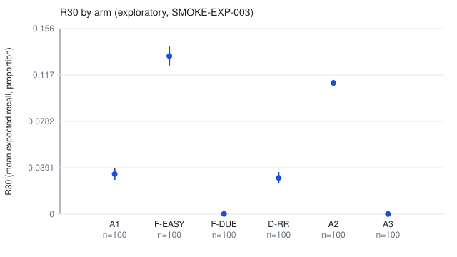
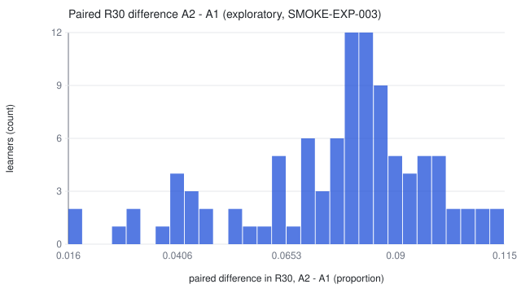
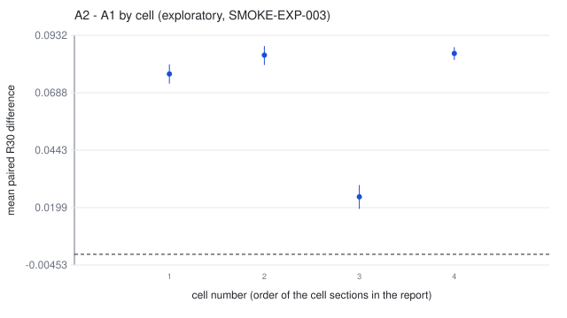

<!-- SPDX-License-Identifier: LicenseRef-STREAK-NC-Research-1.0 -->
# SMOKE-EXP-003: generated results report (EXPLORATORY)

**Label: EXPLORATORY.** Simulation of synthetic learners. Not evidence about real human learning, motivation or any real product.
This report is exploratory. It uses development seeds only and is not a finding; nothing in it may be cited as a result of a registered experiment.

Generated by `streak.report` from the result file. Do not edit by hand.

- Result file: `results/raw/exploratory/SMOKE-EXP-003/results.json`
- Result SHA-256: `3d5de47940def6d012810f783a52055c` `2d2bae4f4d66c81d18bdb3a3dfbdbf1e`
- Config hash: `ed37e8f04277dd8ae32d53a6761f52cb` `c7945d539122eb623baa03470b201d81`
- Protocol version 0.1-draft; engine version 1.0.1
- Records (learner-arms): 2400; failed: 0 (0.00%)
- Master seeds: 9001, 9002, 9003, 9004, 9005; learners per seed: 20

## Cell `exp-diff`

### Retention by arm (means over learners, proportions)

| Arm | n | R30 | R30 95% CI | R1 | R7 | R90 | AUC-R | Weakest decile R30 |
|---|---|---|---|---|---|---|---|---|
| A1 | 100 | 0.0338 | [0.0288, 0.0389] | 0.0517 | 0.0456 | 0.0181 | 0.0305 | 0.0000 |
| F-EASY | 100 | 0.1332 | [0.1252, 0.1412] | 0.1521 | 0.1468 | 0.1063 | 0.1268 | 0.0000 |
| F-DUE | 100 | 0.0003 | [0.0001, 0.0004] | 0.0109 | 0.0027 | 0.0000 | 0.0010 | 0.0000 |
| D-RR | 100 | 0.0306 | [0.0257, 0.0355] | 0.0546 | 0.0410 | 0.0165 | 0.0291 | 0.0000 |
| A2 | 100 | 0.1106 | [0.1082, 0.1129] | 0.1237 | 0.1163 | 0.1021 | 0.1091 | 0.0000 |
| A3 | 100 | 0.0001 | [0.0001, 0.0001] | 0.0132 | 0.0012 | 0.0000 | 0.0019 | 0.0000 |

### Activity by arm (means over learners)

| Arm | Minutes | Residual slots | Active days | Longest streak | Success rate | Coverage | Spearman (active days, R30) | Residual-flagged |
|---|---|---|---|---|---|---|---|---|
| A1 | 335.9 | 0.28 | 23.68 | 1.89 | 0.072 | 1.000 | 0.203 | 0 |
| F-EASY | 335.9 | 0.28 | 23.68 | 1.89 | 0.493 | 0.574 | 0.138 | 0 |
| F-DUE | 335.9 | 0.28 | 23.68 | 1.89 | 0.031 | 1.000 | 0.130 | 0 |
| D-RR | 335.2 | 1.68 | 47.92 | 16.25 | 0.058 | 1.000 | 0.064 | 1 |
| A2 | 335.2 | 1.68 | 47.92 | 16.25 | 0.728 | 0.525 | -0.000 | 1 |
| A3 | 335.2 | 1.68 | 47.92 | 16.25 | 0.022 | 1.000 | 0.093 | 1 |

### Paired contrasts on R30: effects

| Kind | Contrast | n | Mean diff | SD diff | d_z | 95% CI | 90% CI |
|---|---|---|---|---|---|---|---|
| primary | A2 - A1 | 100 | 0.0768 | 0.0212 | 3.63 | [0.0727, 0.0808] | [0.0734, 0.0801] |
| primary, flagged excluded | A2 - A1 | 99 | 0.0769 | 0.0213 | 3.61 | [0.0727, 0.0809] | [0.0734, 0.0802] |
| secondary | F-EASY - A1 | 100 | 0.0994 | 0.0280 | 3.55 | [0.0940, 0.1047] | [0.0949, 0.1039] |
| secondary | F-DUE - A1 | 100 | -0.0336 | 0.0258 | -1.30 | [-0.0386, -0.0286] | [-0.0378, -0.0294] |
| secondary | A2 - D-RR | 100 | 0.0801 | 0.0204 | 3.93 | [0.0761, 0.0839] | [0.0768, 0.0833] |
| secondary | A3 - D-RR | 100 | -0.0305 | 0.0251 | -1.22 | [-0.0354, -0.0257] | [-0.0345, -0.0264] |
| secondary | D-RR - A1 | 100 | -0.0033 | 0.0190 | -0.17 | [-0.0071, 0.0004] | [-0.0065, -0.0002] |
| secondary | A2 - F-EASY | 100 | -0.0226 | 0.0343 | -0.66 | [-0.0292, -0.0161] | [-0.0281, -0.0171] |
| secondary | A3 - F-DUE | 100 | -0.0002 | 0.0007 | -0.21 | [-0.0003, -0.0000] | [-0.0003, -0.0001] |
| secondary | A2 - A3 | 100 | 0.1105 | 0.0121 | 9.11 | [0.1081, 0.1128] | [0.1085, 0.1125] |

### Paired contrasts on R30: tests and classes

| Kind | Contrast | p (bootstrap) | p (Holm) | Class (protocol section 4) |
|---|---|---|---|---|
| primary | A2 - A1 | < 0.0001 | n/a | relevant positive |
| primary, flagged excluded | A2 - A1 | < 0.0001 | n/a | relevant positive |
| secondary | F-EASY - A1 | < 0.0001 | < 0.0001 | relevant positive |
| secondary | F-DUE - A1 | < 0.0001 | < 0.0001 | relevant negative |
| secondary | A2 - D-RR | < 0.0001 | < 0.0001 | relevant positive |
| secondary | A3 - D-RR | < 0.0001 | < 0.0001 | relevant negative |
| secondary | D-RR - A1 | 0.0824 | 0.0824 | practically equivalent under the model |
| secondary | A2 - F-EASY | < 0.0001 | < 0.0001 | detectable but below the SESOI |
| secondary | A3 - F-DUE | 0.0006 | 0.0012 | practically equivalent under the model |
| secondary | A2 - A3 | < 0.0001 | < 0.0001 | relevant positive |

Per-master-seed mean of the primary paired difference: seed 9001: 0.0750, seed 9002: 0.0760, seed 9003: 0.0841, seed 9004: 0.0717, seed 9005: 0.0772.

## Cell `exp-flat`

### Retention by arm (means over learners, proportions)

| Arm | n | R30 | R30 95% CI | R1 | R7 | R90 | AUC-R | Weakest decile R30 |
|---|---|---|---|---|---|---|---|---|
| A1 | 100 | 0.0146 | [0.0114, 0.0180] | 0.0227 | 0.0190 | 0.0098 | 0.0139 | 0.0000 |
| F-EASY | 100 | 0.1093 | [0.0998, 0.1191] | 0.1108 | 0.1097 | 0.1090 | 0.1094 | 0.0000 |
| F-DUE | 100 | 0.0001 | [0.0000, 0.0002] | 0.0083 | 0.0017 | 0.0000 | 0.0007 | 0.0000 |
| D-RR | 100 | 0.0113 | [0.0084, 0.0144] | 0.0272 | 0.0155 | 0.0070 | 0.0121 | 0.0000 |
| A2 | 100 | 0.0994 | [0.0947, 0.1040] | 0.1071 | 0.1005 | 0.0988 | 0.0999 | 0.0000 |
| A3 | 100 | 0.0000 | [0.0000, 0.0000] | 0.0119 | 0.0008 | 0.0000 | 0.0018 | 0.0000 |

### Activity by arm (means over learners)

| Arm | Minutes | Residual slots | Active days | Longest streak | Success rate | Coverage | Spearman (active days, R30) | Residual-flagged |
|---|---|---|---|---|---|---|---|---|
| A1 | 335.9 | 0.28 | 23.68 | 1.89 | 0.053 | 1.000 | 0.222 | 0 |
| F-EASY | 335.9 | 0.28 | 23.68 | 1.89 | 0.385 | 0.575 | 0.132 | 0 |
| F-DUE | 335.9 | 0.28 | 23.68 | 1.89 | 0.031 | 1.000 | 0.159 | 0 |
| D-RR | 335.2 | 1.68 | 47.92 | 16.25 | 0.039 | 1.000 | 0.148 | 1 |
| A2 | 335.2 | 1.68 | 47.92 | 16.25 | 0.645 | 0.537 | -0.088 | 1 |
| A3 | 335.2 | 1.68 | 47.92 | 16.25 | 0.022 | 1.000 | 0.101 | 1 |

### Paired contrasts on R30: effects

| Kind | Contrast | n | Mean diff | SD diff | d_z | 95% CI | 90% CI |
|---|---|---|---|---|---|---|---|
| primary | A2 - A1 | 100 | 0.0848 | 0.0204 | 4.16 | [0.0806, 0.0887] | [0.0814, 0.0881] |
| primary, flagged excluded | A2 - A1 | 99 | 0.0847 | 0.0205 | 4.14 | [0.0806, 0.0886] | [0.0813, 0.0880] |
| secondary | F-EASY - A1 | 100 | 0.0947 | 0.0392 | 2.42 | [0.0873, 0.1022] | [0.0884, 0.1010] |
| secondary | F-DUE - A1 | 100 | -0.0145 | 0.0170 | -0.86 | [-0.0179, -0.0114] | [-0.0173, -0.0118] |
| secondary | A2 - D-RR | 100 | 0.0882 | 0.0211 | 4.18 | [0.0840, 0.0922] | [0.0847, 0.0916] |
| secondary | A3 - D-RR | 100 | -0.0112 | 0.0158 | -0.71 | [-0.0144, -0.0083] | [-0.0138, -0.0088] |
| secondary | D-RR - A1 | 100 | -0.0034 | 0.0115 | -0.29 | [-0.0056, -0.0012] | [-0.0052, -0.0015] |
| secondary | A2 - F-EASY | 100 | -0.0099 | 0.0370 | -0.27 | [-0.0169, -0.0030] | [-0.0159, -0.0041] |
| secondary | A3 - F-DUE | 100 | -0.0001 | 0.0004 | -0.19 | [-0.0002, -0.0000] | [-0.0001, -0.0000] |
| secondary | A2 - A3 | 100 | 0.0994 | 0.0236 | 4.21 | [0.0947, 0.1039] | [0.0955, 0.1032] |

### Paired contrasts on R30: tests and classes

| Kind | Contrast | p (bootstrap) | p (Holm) | Class (protocol section 4) |
|---|---|---|---|---|
| primary | A2 - A1 | < 0.0001 | n/a | relevant positive |
| primary, flagged excluded | A2 - A1 | < 0.0001 | n/a | relevant positive |
| secondary | F-EASY - A1 | < 0.0001 | < 0.0001 | relevant positive |
| secondary | F-DUE - A1 | < 0.0001 | < 0.0001 | practically equivalent under the model |
| secondary | A2 - D-RR | < 0.0001 | < 0.0001 | relevant positive |
| secondary | A3 - D-RR | < 0.0001 | < 0.0001 | practically equivalent under the model |
| secondary | D-RR - A1 | 0.0034 | 0.0068 | practically equivalent under the model |
| secondary | A2 - F-EASY | 0.0058 | 0.0068 | practically equivalent under the model |
| secondary | A3 - F-DUE | 0.0018 | 0.0054 | practically equivalent under the model |
| secondary | A2 - A3 | < 0.0001 | < 0.0001 | relevant positive |

Per-master-seed mean of the primary paired difference: seed 9001: 0.0860, seed 9002: 0.0864, seed 9003: 0.0845, seed 9004: 0.0808, seed 9005: 0.0863.

## Cell `pow-diff`

### Retention by arm (means over learners, proportions)

| Arm | n | R30 | R30 95% CI | R1 | R7 | R90 | AUC-R | Weakest decile R30 |
|---|---|---|---|---|---|---|---|---|
| A1 | 100 | 0.1583 | [0.1510, 0.1655] | 0.3064 | 0.2362 | 0.1041 | 0.1538 | 0.0468 |
| F-EASY | 100 | 0.2343 | [0.2289, 0.2397] | 0.2947 | 0.2734 | 0.1866 | 0.2248 | 0.0377 |
| F-DUE | 100 | 0.1107 | [0.1068, 0.1147] | 0.2375 | 0.1736 | 0.0707 | 0.1086 | 0.0502 |
| D-RR | 100 | 0.1519 | [0.1448, 0.1591] | 0.3230 | 0.2330 | 0.0989 | 0.1496 | 0.0475 |
| A2 | 100 | 0.1828 | [0.1795, 0.1861] | 0.2247 | 0.2063 | 0.1582 | 0.1788 | 0.0375 |
| A3 | 100 | 0.1108 | [0.1072, 0.1143] | 0.2640 | 0.1783 | 0.0700 | 0.1106 | 0.0509 |

### Activity by arm (means over learners)

| Arm | Minutes | Residual slots | Active days | Longest streak | Success rate | Coverage | Spearman (active days, R30) | Residual-flagged |
|---|---|---|---|---|---|---|---|---|
| A1 | 335.9 | 0.28 | 23.68 | 1.89 | 0.255 | 1.000 | 0.224 | 0 |
| F-EASY | 335.9 | 0.28 | 23.68 | 1.89 | 0.684 | 0.532 | 0.045 | 0 |
| F-DUE | 335.9 | 0.28 | 23.68 | 1.89 | 0.193 | 1.000 | 0.210 | 0 |
| D-RR | 335.2 | 1.68 | 47.92 | 16.25 | 0.240 | 1.000 | -0.007 | 1 |
| A2 | 335.2 | 1.68 | 47.92 | 16.25 | 0.816 | 0.458 | -0.067 | 1 |
| A3 | 335.2 | 1.68 | 47.92 | 16.25 | 0.184 | 1.000 | 0.036 | 1 |

### Paired contrasts on R30: effects

| Kind | Contrast | n | Mean diff | SD diff | d_z | 95% CI | 90% CI |
|---|---|---|---|---|---|---|---|
| primary | A2 - A1 | 100 | 0.0245 | 0.0269 | 0.91 | [0.0193, 0.0295] | [0.0202, 0.0287] |
| primary, flagged excluded | A2 - A1 | 99 | 0.0246 | 0.0270 | 0.91 | [0.0193, 0.0296] | [0.0201, 0.0288] |
| secondary | F-EASY - A1 | 100 | 0.0760 | 0.0234 | 3.25 | [0.0716, 0.0807] | [0.0723, 0.0798] |
| secondary | F-DUE - A1 | 100 | -0.0476 | 0.0238 | -2.00 | [-0.0521, -0.0431] | [-0.0514, -0.0438] |
| secondary | A2 - D-RR | 100 | 0.0308 | 0.0261 | 1.18 | [0.0259, 0.0358] | [0.0267, 0.0350] |
| secondary | A3 - D-RR | 100 | -0.0412 | 0.0235 | -1.75 | [-0.0458, -0.0367] | [-0.0450, -0.0374] |
| secondary | D-RR - A1 | 100 | -0.0063 | 0.0239 | -0.27 | [-0.0111, -0.0018] | [-0.0103, -0.0026] |
| secondary | A2 - F-EASY | 100 | -0.0516 | 0.0190 | -2.72 | [-0.0552, -0.0478] | [-0.0546, -0.0485] |
| secondary | A3 - F-DUE | 100 | 0.0001 | 0.0095 | 0.01 | [-0.0017, 0.0019] | [-0.0015, 0.0016] |
| secondary | A2 - A3 | 100 | 0.0720 | 0.0112 | 6.46 | [0.0699, 0.0741] | [0.0703, 0.0738] |

### Paired contrasts on R30: tests and classes

| Kind | Contrast | p (bootstrap) | p (Holm) | Class (protocol section 4) |
|---|---|---|---|---|
| primary | A2 - A1 | < 0.0001 | n/a | detectable but below the SESOI |
| primary, flagged excluded | A2 - A1 | < 0.0001 | n/a | detectable but below the SESOI |
| secondary | F-EASY - A1 | < 0.0001 | < 0.0001 | relevant positive |
| secondary | F-DUE - A1 | < 0.0001 | < 0.0001 | relevant negative |
| secondary | A2 - D-RR | < 0.0001 | < 0.0001 | relevant positive |
| secondary | A3 - D-RR | < 0.0001 | < 0.0001 | relevant negative |
| secondary | D-RR - A1 | 0.0058 | 0.0116 | practically equivalent under the model |
| secondary | A2 - F-EASY | < 0.0001 | < 0.0001 | relevant negative |
| secondary | A3 - F-DUE | 0.9360 | 0.9360 | practically equivalent under the model |
| secondary | A2 - A3 | < 0.0001 | < 0.0001 | relevant positive |

Per-master-seed mean of the primary paired difference: seed 9001: 0.0165, seed 9002: 0.0244, seed 9003: 0.0372, seed 9004: 0.0244, seed 9005: 0.0199.

## Cell `pow-flat`

### Retention by arm (means over learners, proportions)

| Arm | n | R30 | R30 95% CI | R1 | R7 | R90 | AUC-R | Weakest decile R30 |
|---|---|---|---|---|---|---|---|---|
| A1 | 100 | 0.0889 | [0.0843, 0.0934] | 0.2026 | 0.1437 | 0.0563 | 0.0880 | 0.0465 |
| F-EASY | 100 | 0.1947 | [0.1860, 0.2036] | 0.2329 | 0.2145 | 0.1770 | 0.1924 | 0.0375 |
| F-DUE | 100 | 0.0794 | [0.0773, 0.0817] | 0.1806 | 0.1279 | 0.0501 | 0.0785 | 0.0494 |
| D-RR | 100 | 0.0855 | [0.0812, 0.0901] | 0.2222 | 0.1432 | 0.0534 | 0.0867 | 0.0473 |
| A2 | 100 | 0.1744 | [0.1715, 0.1773] | 0.2080 | 0.1917 | 0.1586 | 0.1723 | 0.0367 |
| A3 | 100 | 0.0808 | [0.0785, 0.0829] | 0.2061 | 0.1332 | 0.0506 | 0.0816 | 0.0501 |

### Activity by arm (means over learners)

| Arm | Minutes | Residual slots | Active days | Longest streak | Success rate | Coverage | Spearman (active days, R30) | Residual-flagged |
|---|---|---|---|---|---|---|---|---|
| A1 | 335.9 | 0.28 | 23.68 | 1.89 | 0.209 | 1.000 | 0.187 | 0 |
| F-EASY | 335.9 | 0.28 | 23.68 | 1.89 | 0.549 | 0.533 | 0.032 | 0 |
| F-DUE | 335.9 | 0.28 | 23.68 | 1.89 | 0.183 | 1.000 | 0.241 | 0 |
| D-RR | 335.2 | 1.68 | 47.92 | 16.25 | 0.196 | 1.000 | 0.005 | 1 |
| A2 | 335.2 | 1.68 | 47.92 | 16.25 | 0.778 | 0.470 | 0.068 | 1 |
| A3 | 335.2 | 1.68 | 47.92 | 16.25 | 0.175 | 1.000 | 0.063 | 1 |

### Paired contrasts on R30: effects

| Kind | Contrast | n | Mean diff | SD diff | d_z | 95% CI | 90% CI |
|---|---|---|---|---|---|---|---|
| primary | A2 - A1 | 100 | 0.0855 | 0.0144 | 5.93 | [0.0827, 0.0882] | [0.0832, 0.0878] |
| primary, flagged excluded | A2 - A1 | 99 | 0.0856 | 0.0144 | 5.93 | [0.0827, 0.0884] | [0.0833, 0.0879] |
| secondary | F-EASY - A1 | 100 | 0.1059 | 0.0286 | 3.70 | [0.1004, 0.1114] | [0.1013, 0.1106] |
| secondary | F-DUE - A1 | 100 | -0.0094 | 0.0146 | -0.65 | [-0.0122, -0.0067] | [-0.0118, -0.0071] |
| secondary | A2 - D-RR | 100 | 0.0889 | 0.0143 | 6.20 | [0.0861, 0.0915] | [0.0866, 0.0911] |
| secondary | A3 - D-RR | 100 | -0.0047 | 0.0139 | -0.34 | [-0.0075, -0.0022] | [-0.0071, -0.0025] |
| secondary | D-RR - A1 | 100 | -0.0034 | 0.0133 | -0.25 | [-0.0059, -0.0009] | [-0.0055, -0.0012] |
| secondary | A2 - F-EASY | 100 | -0.0204 | 0.0345 | -0.59 | [-0.0272, -0.0139] | [-0.0260, -0.0149] |
| secondary | A3 - F-DUE | 100 | 0.0013 | 0.0045 | 0.29 | [0.0004, 0.0022] | [0.0006, 0.0020] |
| secondary | A2 - A3 | 100 | 0.0936 | 0.0080 | 11.71 | [0.0921, 0.0951] | [0.0924, 0.0949] |

### Paired contrasts on R30: tests and classes

| Kind | Contrast | p (bootstrap) | p (Holm) | Class (protocol section 4) |
|---|---|---|---|---|
| primary | A2 - A1 | < 0.0001 | n/a | relevant positive |
| primary, flagged excluded | A2 - A1 | < 0.0001 | n/a | relevant positive |
| secondary | F-EASY - A1 | < 0.0001 | < 0.0001 | relevant positive |
| secondary | F-DUE - A1 | < 0.0001 | < 0.0001 | practically equivalent under the model |
| secondary | A2 - D-RR | < 0.0001 | < 0.0001 | relevant positive |
| secondary | A3 - D-RR | 0.0002 | 0.0006 | practically equivalent under the model |
| secondary | D-RR - A1 | 0.0082 | 0.0082 | practically equivalent under the model |
| secondary | A2 - F-EASY | < 0.0001 | < 0.0001 | detectable but below the SESOI |
| secondary | A3 - F-DUE | 0.0024 | 0.0048 | practically equivalent under the model |
| secondary | A2 - A3 | < 0.0001 | < 0.0001 | relevant positive |

Per-master-seed mean of the primary paired difference: seed 9001: 0.0827, seed 9002: 0.0859, seed 9003: 0.0902, seed 9004: 0.0841, seed 9005: 0.0847.

## Figures

## Notes

- Intervals are stratified percentile bootstrap intervals over learners within master seeds (10000 resamples, seed 20261124).
- Classes follow research/protocol.md section 4 with SESOI 0.02. Non-significance is never equivalence.
- Holm adjustment is applied to bootstrap p-values of the secondary contrasts within each cell.
