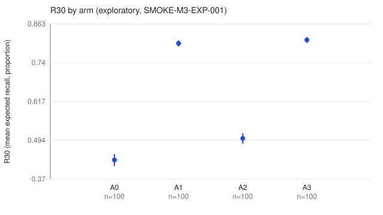
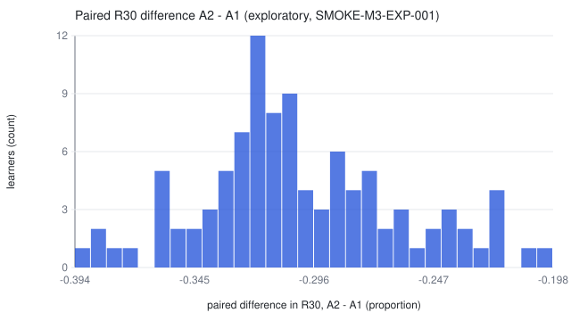

<!-- SPDX-License-Identifier: LicenseRef-STREAK-NC-Research-1.0 -->
# SMOKE-M3-EXP-001: generated results report (EXPLORATORY)

**Label: EXPLORATORY.** Simulation of synthetic learners. Not evidence about real human learning, motivation or any real product.
This report is exploratory. It uses development seeds only and is not a finding; nothing in it may be cited as a result of a registered experiment.

Generated by `streak.report` from the result file. Do not edit by hand.

- Result file: `results/exploratory/SMOKE-M3-EXP-001/results.json`
- Result SHA-256: `edac1326fdd0bd333d183add20fb2d22` `67439311803fade0c05ae6ebc856ae11`
- Config hash: `cc6bd5a82c4cab6867dbc306aac10eba` `b03a42a082478f22d03ad929269c9e09`
- Protocol version 1.0; engine version 1.1.0
- Records (learner-arms): 400; failed: 0 (0.00%)
- Master seeds: 9001, 9002, 9003, 9004, 9005; learners per seed: 20

## Cell `default`

### Retention by arm (means over learners, proportions)

| Arm | n | R30 | R30 95% CI | R1 | R7 | R90 | AUC-R | Weakest decile R30 |
|---|---|---|---|---|---|---|---|---|
| A0 | 100 | 0.4312 | [0.4124, 0.4500] | 0.5580 | 0.5281 | 0.2673 | 0.3920 | 0.1560 |
| A1 | 100 | 0.8014 | [0.7917, 0.8110] | 0.9370 | 0.9042 | 0.6091 | 0.7552 | 0.4391 |
| A2 | 100 | 0.4998 | [0.4830, 0.5166] | 0.6188 | 0.5907 | 0.3443 | 0.4625 | 0.1636 |
| A3 | 100 | 0.8121 | [0.8028, 0.8213] | 0.9502 | 0.9179 | 0.6101 | 0.7631 | 0.5779 |

### Activity by arm (means over learners)

| Arm | Minutes | Residual slots | Active days | Longest streak | Success rate | Coverage | Spearman (active days, R30) | Residual-flagged |
|---|---|---|---|---|---|---|---|---|
| A0 | 0.0 | 0.00 | 0.00 | 0.00 | n/a | 0.000 | n/a | 0 |
| A1 | 335.9 | 0.28 | 23.68 | 1.89 | 0.885 | 1.000 | 0.187 | 0 |
| A2 | 335.2 | 1.68 | 47.92 | 16.25 | 0.988 | 0.164 | 0.028 | 1 |
| A3 | 335.2 | 1.68 | 47.92 | 16.25 | 0.882 | 1.000 | 0.080 | 1 |

### Paired contrasts on R30: effects

| Kind | Contrast | n | Mean diff | SD diff | d_z | 95% CI | 90% CI |
|---|---|---|---|---|---|---|---|
| primary | A2 - A1 | 100 | -0.3017 | 0.0414 | -7.29 | [-0.3096, -0.2937] | [-0.3083, -0.2950] |
| primary, flagged excluded | A2 - A1 | 99 | -0.3020 | 0.0414 | -7.29 | [-0.3098, -0.2939] | [-0.3086, -0.2952] |
| secondary | A3 - A1 | 100 | 0.0107 | 0.0129 | 0.83 | [0.0083, 0.0132] | [0.0086, 0.0128] |
| secondary | A2 - A3 | 100 | -0.3124 | 0.0426 | -7.33 | [-0.3206, -0.3041] | [-0.3193, -0.3054] |
| secondary | A1 - A0 | 100 | 0.3702 | 0.0513 | 7.22 | [0.3603, 0.3800] | [0.3619, 0.3785] |
| secondary | A2 - A0 | 100 | 0.0685 | 0.0163 | 4.19 | [0.0655, 0.0717] | [0.0660, 0.0712] |
| secondary | A3 - A0 | 100 | 0.3809 | 0.0532 | 7.16 | [0.3706, 0.3911] | [0.3724, 0.3895] |

### Paired contrasts on R30: tests and classes

| Kind | Contrast | p (bootstrap) | p (Holm) | Class (protocol section 4) |
|---|---|---|---|---|
| primary | A2 - A1 | < 0.0001 | n/a | relevant negative |
| primary, flagged excluded | A2 - A1 | < 0.0001 | n/a | relevant negative |
| secondary | A3 - A1 | < 0.0001 | < 0.0001 | practically equivalent under the model |
| secondary | A2 - A3 | < 0.0001 | < 0.0001 | relevant negative |
| secondary | A1 - A0 | < 0.0001 | < 0.0001 | relevant positive |
| secondary | A2 - A0 | < 0.0001 | < 0.0001 | relevant positive |
| secondary | A3 - A0 | < 0.0001 | < 0.0001 | relevant positive |

Per-master-seed mean of the primary paired difference: seed 9001: -0.2990, seed 9002: -0.2972, seed 9003: -0.3143, seed 9004: -0.3039, seed 9005: -0.2940.

## Figures

## Notes

- Intervals are stratified percentile bootstrap intervals over learners within master seeds (10000 resamples, seed 20261124).
- Classes follow research/protocol.md section 4 with SESOI 0.02. Non-significance is never equivalence.
- Holm adjustment is applied to bootstrap p-values of the secondary contrasts within each cell; intervals are unadjusted (protocol section 14.6). If the config sets holm_primary_across_cells, the primary p-values are also Holm-adjusted across cells (p (Holm) column of primary rows).
