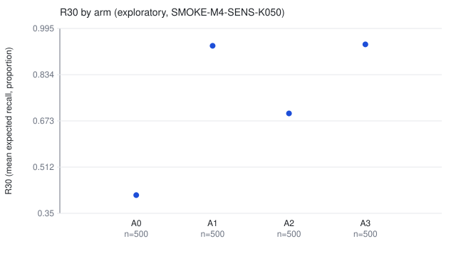
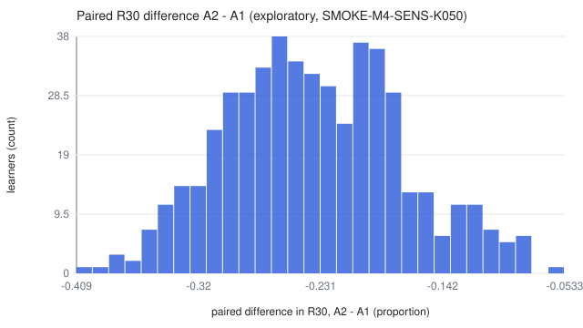

<!-- SPDX-License-Identifier: LicenseRef-STREAK-NC-Research-1.0 -->
# SMOKE-M4-SENS-K050: generated results report (EXPLORATORY)

**Label: EXPLORATORY.** Simulation of synthetic learners. Not evidence about real human learning, motivation or any real product.
This report is exploratory. It uses development seeds only and is not a finding; nothing in it may be cited as a result of a registered experiment.

Generated by `streak.report` from the result file. Do not edit by hand.

- Result file: `results/raw/exploratory/SMOKE-M4-SENS-K050/results.json`
- Result SHA-256: `29dc6fd6d762fb49fc60de9da27b0ff4` `b02efbdf17938325d8e9997a7d47cac1`
- Config hash: `31fb933b2da68d8cf234aeec629b6f6b` `df8091536fd27cdbe545ed33abba2c3b`
- Protocol version 1.0; engine version 1.1.0
- Records (learner-arms): 2000; failed: 0 (0.00%)
- Master seeds: 9001, 9002, 9003, 9004, 9005; learners per seed: 100

## Cell `default`

### Retention by arm (means over learners, proportions)

| Arm | n | R30 | R30 95% CI | R1 | R7 | R90 | AUC-R | Weakest decile R30 |
|---|---|---|---|---|---|---|---|---|
| A0 | 500 | 0.4140 | [0.4051, 0.4229] | 0.5420 | 0.5116 | 0.2517 | 0.3753 | 0.1481 |
| A1 | 500 | 0.9348 | [0.9335, 0.9360] | 0.9919 | 0.9797 | 0.8302 | 0.9088 | 0.8574 |
| A2 | 500 | 0.6990 | [0.6925, 0.7055] | 0.7974 | 0.7740 | 0.5682 | 0.6678 | 0.2076 |
| A3 | 500 | 0.9397 | [0.9386, 0.9408] | 0.9948 | 0.9831 | 0.8368 | 0.9141 | 0.8977 |

### Activity by arm (means over learners)

| Arm | Minutes | Residual slots | Active days | Longest streak | Success rate | Coverage | Spearman (active days, R30) | Residual-flagged |
|---|---|---|---|---|---|---|---|---|
| A0 | 0.0 | 0.00 | 0.00 | 0.00 | n/a | 0.000 | n/a | 0 |
| A1 | 335.9 | 0.12 | 23.92 | 2.05 | 0.978 | 1.000 | 0.083 | 0 |
| A2 | 335.1 | 1.78 | 47.67 | 15.99 | 0.987 | 0.673 | -0.414 | 2 |
| A3 | 335.1 | 1.78 | 47.67 | 15.99 | 0.978 | 1.000 | 0.036 | 2 |

### Paired contrasts on R30: effects

| Kind | Contrast | n | Mean diff | SD diff | d_z | 95% CI | 90% CI |
|---|---|---|---|---|---|---|---|
| primary | A2 - A1 | 500 | -0.2358 | 0.0641 | -3.68 | [-0.2414, -0.2302] | [-0.2405, -0.2312] |
| primary, flagged excluded | A2 - A1 | 498 | -0.2359 | 0.0642 | -3.68 | [-0.2416, -0.2303] | [-0.2406, -0.2312] |
| secondary | A3 - A1 | 500 | 0.0049 | 0.0054 | 0.92 | [0.0045, 0.0054] | [0.0045, 0.0053] |
| secondary | A2 - A3 | 500 | -0.2407 | 0.0652 | -3.69 | [-0.2465, -0.2350] | [-0.2455, -0.2360] |
| secondary | A1 - A0 | 500 | 0.5208 | 0.0877 | 5.94 | [0.5132, 0.5286] | [0.5144, 0.5272] |
| secondary | A2 - A0 | 500 | 0.2850 | 0.0647 | 4.41 | [0.2794, 0.2907] | [0.2804, 0.2897] |
| secondary | A3 - A0 | 500 | 0.5257 | 0.0893 | 5.89 | [0.5179, 0.5336] | [0.5192, 0.5323] |

### Paired contrasts on R30: tests and classes

| Kind | Contrast | p (bootstrap) | p (Holm) | Class (protocol section 4) |
|---|---|---|---|---|
| primary | A2 - A1 | < 0.0001 | n/a | relevant negative |
| primary, flagged excluded | A2 - A1 | < 0.0001 | n/a | relevant negative |
| secondary | A3 - A1 | < 0.0001 | < 0.0001 | practically equivalent under the model |
| secondary | A2 - A3 | < 0.0001 | < 0.0001 | relevant negative |
| secondary | A1 - A0 | < 0.0001 | < 0.0001 | relevant positive |
| secondary | A2 - A0 | < 0.0001 | < 0.0001 | relevant positive |
| secondary | A3 - A0 | < 0.0001 | < 0.0001 | relevant positive |

Per-master-seed mean of the primary paired difference: seed 9001: -0.2329, seed 9002: -0.2379, seed 9003: -0.2307, seed 9004: -0.2408, seed 9005: -0.2365.

## Figures

## Notes

- Intervals are stratified percentile bootstrap intervals over learners within master seeds (10000 resamples, seed 20261124).
- Classes follow research/protocol.md section 4 with SESOI 0.02. Non-significance is never equivalence.
- Holm adjustment is applied to bootstrap p-values of the secondary contrasts within each cell; intervals are unadjusted (protocol section 14.6). If the config sets holm_primary_across_cells, the primary p-values are also Holm-adjusted across cells (p (Holm) column of primary rows).
