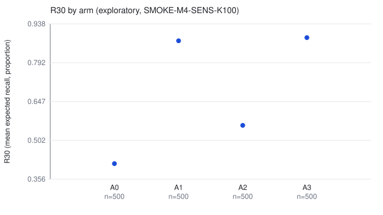
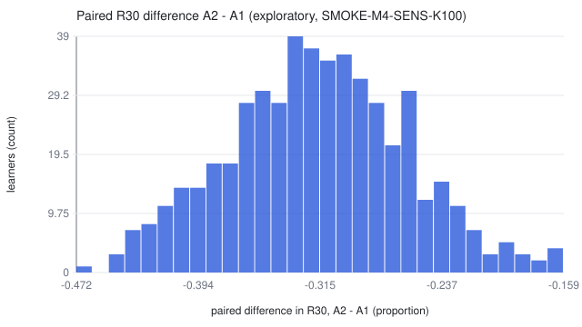

<!-- SPDX-License-Identifier: LicenseRef-STREAK-NC-Research-1.0 -->
# SMOKE-M4-SENS-K100: generated results report (EXPLORATORY)

**Label: EXPLORATORY.** Simulation of synthetic learners. Not evidence about real human learning, motivation or any real product.
This report is exploratory. It uses development seeds only and is not a finding; nothing in it may be cited as a result of a registered experiment.

Generated by `streak.report` from the result file. Do not edit by hand.

- Result file: `results/raw/exploratory/SMOKE-M4-SENS-K100/results.json`
- Result SHA-256: `879e84704c590fbe72b06dcf21a07309` `f4de8a27f9828294cf98274cf428c083`
- Config hash: `7debfd8e3276b33c2ccac4b9d4884fb1` `62a2d356d7ca1e691bdd8b0cdd4b62c9`
- Protocol version 1.0; engine version 1.1.0
- Records (learner-arms): 2000; failed: 0 (0.00%)
- Master seeds: 9001, 9002, 9003, 9004, 9005; learners per seed: 100

## Cell `default`

### Retention by arm (means over learners, proportions)

| Arm | n | R30 | R30 95% CI | R1 | R7 | R90 | AUC-R | Weakest decile R30 |
|---|---|---|---|---|---|---|---|---|
| A0 | 500 | 0.4146 | [0.4057, 0.4234] | 0.5424 | 0.5121 | 0.2523 | 0.3759 | 0.1452 |
| A1 | 500 | 0.8743 | [0.8717, 0.8768] | 0.9748 | 0.9521 | 0.7106 | 0.8340 | 0.6796 |
| A2 | 500 | 0.5579 | [0.5505, 0.5651] | 0.6708 | 0.6440 | 0.4114 | 0.5229 | 0.1631 |
| A3 | 500 | 0.8862 | [0.8841, 0.8883] | 0.9831 | 0.9620 | 0.7210 | 0.8453 | 0.7887 |

### Activity by arm (means over learners)

| Arm | Minutes | Residual slots | Active days | Longest streak | Success rate | Coverage | Spearman (active days, R30) | Residual-flagged |
|---|---|---|---|---|---|---|---|---|
| A0 | 0.0 | 0.00 | 0.00 | 0.00 | n/a | 0.000 | n/a | 0 |
| A1 | 335.9 | 0.11 | 23.61 | 1.90 | 0.944 | 1.000 | 0.019 | 0 |
| A2 | 335.1 | 1.78 | 47.67 | 15.99 | 0.987 | 0.338 | -0.197 | 2 |
| A3 | 335.1 | 1.78 | 47.67 | 15.99 | 0.945 | 1.000 | 0.015 | 2 |

### Paired contrasts on R30: effects

| Kind | Contrast | n | Mean diff | SD diff | d_z | 95% CI | 90% CI |
|---|---|---|---|---|---|---|---|
| primary | A2 - A1 | 500 | -0.3164 | 0.0575 | -5.51 | [-0.3215, -0.3113] | [-0.3207, -0.3122] |
| primary, flagged excluded | A2 - A1 | 498 | -0.3167 | 0.0574 | -5.52 | [-0.3217, -0.3116] | [-0.3209, -0.3124] |
| secondary | A3 - A1 | 500 | 0.0120 | 0.0108 | 1.10 | [0.0110, 0.0129] | [0.0112, 0.0128] |
| secondary | A2 - A3 | 500 | -0.3284 | 0.0615 | -5.34 | [-0.3338, -0.3230] | [-0.3329, -0.3239] |
| secondary | A1 - A0 | 500 | 0.4597 | 0.0738 | 6.23 | [0.4532, 0.4663] | [0.4543, 0.4651] |
| secondary | A2 - A0 | 500 | 0.1433 | 0.0332 | 4.32 | [0.1404, 0.1462] | [0.1409, 0.1457] |
| secondary | A3 - A0 | 500 | 0.4716 | 0.0782 | 6.03 | [0.4648, 0.4786] | [0.4660, 0.4775] |

### Paired contrasts on R30: tests and classes

| Kind | Contrast | p (bootstrap) | p (Holm) | Class (protocol section 4) |
|---|---|---|---|---|
| primary | A2 - A1 | < 0.0001 | n/a | relevant negative |
| primary, flagged excluded | A2 - A1 | < 0.0001 | n/a | relevant negative |
| secondary | A3 - A1 | < 0.0001 | < 0.0001 | practically equivalent under the model |
| secondary | A2 - A3 | < 0.0001 | < 0.0001 | relevant negative |
| secondary | A1 - A0 | < 0.0001 | < 0.0001 | relevant positive |
| secondary | A2 - A0 | < 0.0001 | < 0.0001 | relevant positive |
| secondary | A3 - A0 | < 0.0001 | < 0.0001 | relevant positive |

Per-master-seed mean of the primary paired difference: seed 9001: -0.3146, seed 9002: -0.3193, seed 9003: -0.3131, seed 9004: -0.3239, seed 9005: -0.3110.

## Figures

## Notes

- Intervals are stratified percentile bootstrap intervals over learners within master seeds (10000 resamples, seed 20261124).
- Classes follow research/protocol.md section 4 with SESOI 0.02. Non-significance is never equivalence.
- Holm adjustment is applied to bootstrap p-values of the secondary contrasts within each cell; intervals are unadjusted (protocol section 14.6). If the config sets holm_primary_across_cells, the primary p-values are also Holm-adjusted across cells (p (Holm) column of primary rows).
