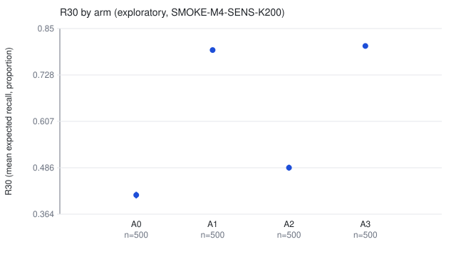
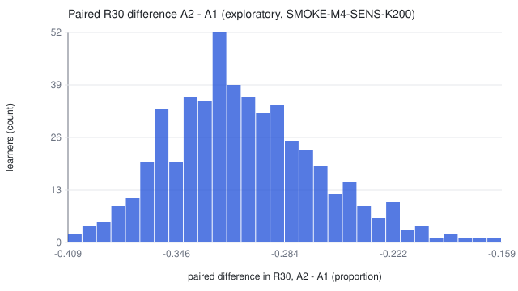

<!-- SPDX-License-Identifier: LicenseRef-STREAK-NC-Research-1.0 -->
# SMOKE-M4-SENS-K200: generated results report (EXPLORATORY)

**Label: EXPLORATORY.** Simulation of synthetic learners. Not evidence about real human learning, motivation or any real product.
This report is exploratory. It uses development seeds only and is not a finding; nothing in it may be cited as a result of a registered experiment.

Generated by `streak.report` from the result file. Do not edit by hand.

- Result file: `results/raw/exploratory/SMOKE-M4-SENS-K200/results.json`
- Result SHA-256: `07b3a0e1e62ebf7f551f5e9fa39e8026` `8547a10fcaacee99f28246f13ab4136b`
- Config hash: `4e26e42b5000ed9e90d9199b4d64594a` `2a7f94760b863276febe03abbacf50db`
- Protocol version 1.0; engine version 1.1.0
- Records (learner-arms): 2000; failed: 0 (0.00%)
- Master seeds: 9001, 9002, 9003, 9004, 9005; learners per seed: 100

## Cell `default`

### Retention by arm (means over learners, proportions)

| Arm | n | R30 | R30 95% CI | R1 | R7 | R90 | AUC-R | Weakest decile R30 |
|---|---|---|---|---|---|---|---|---|
| A0 | 500 | 0.4144 | [0.4055, 0.4229] | 0.5422 | 0.5119 | 0.2520 | 0.3756 | 0.1430 |
| A1 | 500 | 0.7936 | [0.7891, 0.7981] | 0.9332 | 0.8992 | 0.5979 | 0.7467 | 0.4132 |
| A2 | 500 | 0.4859 | [0.4779, 0.4937] | 0.6062 | 0.5777 | 0.3316 | 0.4491 | 0.1505 |
| A3 | 500 | 0.8043 | [0.7998, 0.8086] | 0.9473 | 0.9137 | 0.5979 | 0.7544 | 0.5559 |

### Activity by arm (means over learners)

| Arm | Minutes | Residual slots | Active days | Longest streak | Success rate | Coverage | Spearman (active days, R30) | Residual-flagged |
|---|---|---|---|---|---|---|---|---|
| A0 | 0.0 | 0.00 | 0.00 | 0.00 | n/a | 0.000 | n/a | 0 |
| A1 | 335.9 | 0.11 | 23.61 | 1.90 | 0.880 | 1.000 | 0.017 | 0 |
| A2 | 335.1 | 1.78 | 47.67 | 15.99 | 0.987 | 0.169 | -0.081 | 2 |
| A3 | 335.1 | 1.78 | 47.67 | 15.99 | 0.877 | 0.999 | 0.012 | 2 |

### Paired contrasts on R30: effects

| Kind | Contrast | n | Mean diff | SD diff | d_z | 95% CI | 90% CI |
|---|---|---|---|---|---|---|---|
| primary | A2 - A1 | 500 | -0.3078 | 0.0426 | -7.23 | [-0.3115, -0.3040] | [-0.3109, -0.3046] |
| primary, flagged excluded | A2 - A1 | 498 | -0.3080 | 0.0425 | -7.24 | [-0.3117, -0.3042] | [-0.3111, -0.3048] |
| secondary | A3 - A1 | 500 | 0.0106 | 0.0122 | 0.87 | [0.0096, 0.0117] | [0.0097, 0.0115] |
| secondary | A2 - A3 | 500 | -0.3184 | 0.0439 | -7.26 | [-0.3223, -0.3146] | [-0.3216, -0.3152] |
| secondary | A1 - A0 | 500 | 0.3793 | 0.0513 | 7.39 | [0.3748, 0.3838] | [0.3755, 0.3831] |
| secondary | A2 - A0 | 500 | 0.0715 | 0.0164 | 4.35 | [0.0701, 0.0730] | [0.0704, 0.0727] |
| secondary | A3 - A0 | 500 | 0.3899 | 0.0528 | 7.39 | [0.3854, 0.3946] | [0.3860, 0.3938] |

### Paired contrasts on R30: tests and classes

| Kind | Contrast | p (bootstrap) | p (Holm) | Class (protocol section 4) |
|---|---|---|---|---|
| primary | A2 - A1 | < 0.0001 | n/a | relevant negative |
| primary, flagged excluded | A2 - A1 | < 0.0001 | n/a | relevant negative |
| secondary | A3 - A1 | < 0.0001 | < 0.0001 | practically equivalent under the model |
| secondary | A2 - A3 | < 0.0001 | < 0.0001 | relevant negative |
| secondary | A1 - A0 | < 0.0001 | < 0.0001 | relevant positive |
| secondary | A2 - A0 | < 0.0001 | < 0.0001 | relevant positive |
| secondary | A3 - A0 | < 0.0001 | < 0.0001 | relevant positive |

Per-master-seed mean of the primary paired difference: seed 9001: -0.3080, seed 9002: -0.3113, seed 9003: -0.3061, seed 9004: -0.3128, seed 9005: -0.3006.

## Figures

## Notes

- Intervals are stratified percentile bootstrap intervals over learners within master seeds (10000 resamples, seed 20261124).
- Classes follow research/protocol.md section 4 with SESOI 0.02. Non-significance is never equivalence.
- Holm adjustment is applied to bootstrap p-values of the secondary contrasts within each cell; intervals are unadjusted (protocol section 14.6). If the config sets holm_primary_across_cells, the primary p-values are also Holm-adjusted across cells (p (Holm) column of primary rows).
