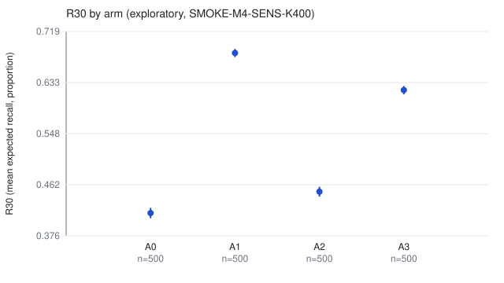
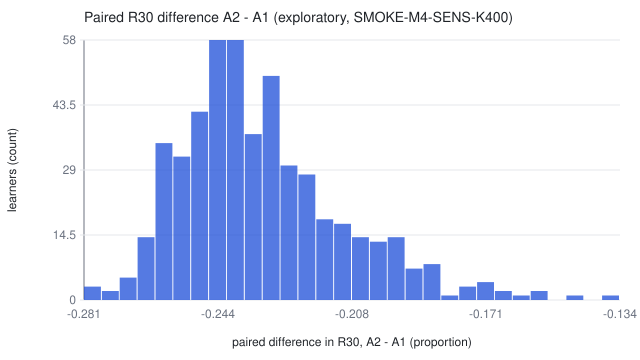

<!-- SPDX-License-Identifier: LicenseRef-STREAK-NC-Research-1.0 -->
# SMOKE-M4-SENS-K400: generated results report (EXPLORATORY)

**Label: EXPLORATORY.** Simulation of synthetic learners. Not evidence about real human learning, motivation or any real product.
This report is exploratory. It uses development seeds only and is not a finding; nothing in it may be cited as a result of a registered experiment.

Generated by `streak.report` from the result file. Do not edit by hand.

- Result file: `results/raw/exploratory/SMOKE-M4-SENS-K400/results.json`
- Result SHA-256: `ad244da5d63c16f562172a5d1ddfc383` `cb44333449fbc314c2c5901420a132b3`
- Config hash: `b9c9d96e0e5f5a77857da87788904a03` `2160423fc6be55031f6d56fde0e72f94`
- Protocol version 1.0; engine version 1.1.0
- Records (learner-arms): 2000; failed: 0 (0.00%)
- Master seeds: 9001, 9002, 9003, 9004, 9005; learners per seed: 100

## Cell `default`

### Retention by arm (means over learners, proportions)

| Arm | n | R30 | R30 95% CI | R1 | R7 | R90 | AUC-R | Weakest decile R30 |
|---|---|---|---|---|---|---|---|---|
| A0 | 500 | 0.4145 | [0.4057, 0.4231] | 0.5423 | 0.5120 | 0.2521 | 0.3758 | 0.1418 |
| A1 | 500 | 0.6826 | [0.6758, 0.6893] | 0.8477 | 0.8066 | 0.4786 | 0.6349 | 0.2216 |
| A2 | 500 | 0.4504 | [0.4421, 0.4585] | 0.5745 | 0.5450 | 0.2920 | 0.4126 | 0.1454 |
| A3 | 500 | 0.6205 | [0.6135, 0.6273] | 0.7602 | 0.7271 | 0.4326 | 0.5755 | 0.1930 |

### Activity by arm (means over learners)

| Arm | Minutes | Residual slots | Active days | Longest streak | Success rate | Coverage | Spearman (active days, R30) | Residual-flagged |
|---|---|---|---|---|---|---|---|---|
| A0 | 0.0 | 0.00 | 0.00 | 0.00 | n/a | 0.000 | n/a | 0 |
| A1 | 335.9 | 0.11 | 23.61 | 1.90 | 0.792 | 1.000 | 0.006 | 0 |
| A2 | 335.1 | 1.78 | 47.67 | 15.99 | 0.987 | 0.085 | -0.031 | 2 |
| A3 | 335.1 | 1.78 | 47.67 | 15.99 | 0.868 | 0.556 | 0.003 | 2 |

### Paired contrasts on R30: effects

| Kind | Contrast | n | Mean diff | SD diff | d_z | 95% CI | 90% CI |
|---|---|---|---|---|---|---|---|
| primary | A2 - A1 | 500 | -0.2323 | 0.0227 | -10.23 | [-0.2343, -0.2303] | [-0.2339, -0.2306] |
| primary, flagged excluded | A2 - A1 | 498 | -0.2324 | 0.0227 | -10.24 | [-0.2343, -0.2303] | [-0.2340, -0.2307] |
| secondary | A3 - A1 | 500 | -0.0621 | 0.0113 | -5.49 | [-0.0631, -0.0611] | [-0.0629, -0.0613] |
| secondary | A2 - A3 | 500 | -0.1702 | 0.0190 | -8.97 | [-0.1718, -0.1685] | [-0.1716, -0.1688] |
| secondary | A1 - A0 | 500 | 0.2681 | 0.0265 | 10.10 | [0.2658, 0.2705] | [0.2662, 0.2701] |
| secondary | A2 - A0 | 500 | 0.0359 | 0.0083 | 4.35 | [0.0352, 0.0366] | [0.0353, 0.0365] |
| secondary | A3 - A0 | 500 | 0.2060 | 0.0234 | 8.82 | [0.2040, 0.2081] | [0.2043, 0.2078] |

### Paired contrasts on R30: tests and classes

| Kind | Contrast | p (bootstrap) | p (Holm) | Class (protocol section 4) |
|---|---|---|---|---|
| primary | A2 - A1 | < 0.0001 | n/a | relevant negative |
| primary, flagged excluded | A2 - A1 | < 0.0001 | n/a | relevant negative |
| secondary | A3 - A1 | < 0.0001 | < 0.0001 | relevant negative |
| secondary | A2 - A3 | < 0.0001 | < 0.0001 | relevant negative |
| secondary | A1 - A0 | < 0.0001 | < 0.0001 | relevant positive |
| secondary | A2 - A0 | < 0.0001 | < 0.0001 | relevant positive |
| secondary | A3 - A0 | < 0.0001 | < 0.0001 | relevant positive |

Per-master-seed mean of the primary paired difference: seed 9001: -0.2319, seed 9002: -0.2346, seed 9003: -0.2318, seed 9004: -0.2336, seed 9005: -0.2293.

## Figures

## Notes

- Intervals are stratified percentile bootstrap intervals over learners within master seeds (10000 resamples, seed 20261124).
- Classes follow research/protocol.md section 4 with SESOI 0.02. Non-significance is never equivalence.
- Holm adjustment is applied to bootstrap p-values of the secondary contrasts within each cell; intervals are unadjusted (protocol section 14.6). If the config sets holm_primary_across_cells, the primary p-values are also Holm-adjusted across cells (p (Holm) column of primary rows).
