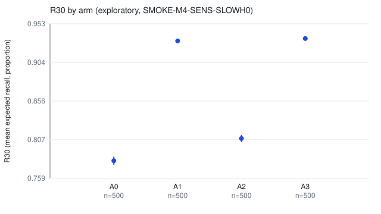
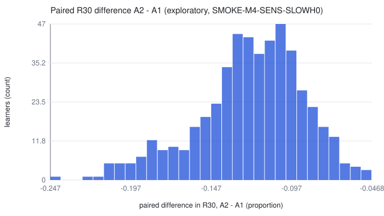
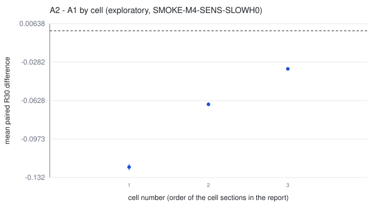

<!-- SPDX-License-Identifier: LicenseRef-STREAK-NC-Research-1.0 -->
# SMOKE-M4-SENS-SLOWH0: generated results report (EXPLORATORY)

**Label: EXPLORATORY.** Simulation of synthetic learners. Not evidence about real human learning, motivation or any real product.
This report is exploratory. It uses development seeds only and is not a finding; nothing in it may be cited as a result of a registered experiment.

Generated by `streak.report` from the result file. Do not edit by hand.

- Result file: `results/raw/exploratory/SMOKE-M4-SENS-SLOWH0/results.json`
- Result SHA-256: `102e7ba885af27b4e4b77bffde133d67` `a4d980760997b78912f3eb38dde2f3f5`
- Config hash: `2587c2ca47b4de45ada8103e4decedc5` `1d4ab108a6828c50966a7f3f3da8b35a`
- Protocol version 1.0; engine version 1.1.0
- Records (learner-arms): 6000; failed: 0 (0.00%)
- Master seeds: 9001, 9002, 9003, 9004, 9005; learners per seed: 100

## Cell `h0=270.36`

### Retention by arm (means over learners, proportions)

| Arm | n | R30 | R30 95% CI | R1 | R7 | R90 | AUC-R | Weakest decile R30 |
|---|---|---|---|---|---|---|---|---|
| A0 | 500 | 0.7810 | [0.7758, 0.7861] | 0.8467 | 0.8325 | 0.6657 | 0.7524 | 0.5848 |
| A1 | 500 | 0.9315 | [0.9299, 0.9331] | 0.9817 | 0.9710 | 0.8391 | 0.9085 | 0.8398 |
| A2 | 500 | 0.8090 | [0.8044, 0.8134] | 0.8688 | 0.8559 | 0.7035 | 0.7827 | 0.5955 |
| A3 | 500 | 0.9345 | [0.9330, 0.9360] | 0.9841 | 0.9736 | 0.8423 | 0.9115 | 0.8648 |

### Activity by arm (means over learners)

| Arm | Minutes | Residual slots | Active days | Longest streak | Success rate | Coverage | Spearman (active days, R30) | Residual-flagged |
|---|---|---|---|---|---|---|---|---|
| A0 | 0.0 | 0.00 | 0.00 | 0.00 | n/a | 0.000 | n/a | 0 |
| A1 | 335.9 | 0.11 | 23.61 | 1.90 | 0.966 | 1.000 | 0.012 | 0 |
| A2 | 335.1 | 1.78 | 47.67 | 15.99 | 0.996 | 0.167 | -0.056 | 2 |
| A3 | 335.1 | 1.78 | 47.67 | 15.99 | 0.965 | 1.000 | 0.024 | 2 |

### Paired contrasts on R30: effects

| Kind | Contrast | n | Mean diff | SD diff | d_z | 95% CI | 90% CI |
|---|---|---|---|---|---|---|---|
| primary | A2 - A1 | 500 | -0.1226 | 0.0333 | -3.68 | [-0.1255, -0.1197] | [-0.1250, -0.1202] |
| primary, flagged excluded | A2 - A1 | 498 | -0.1227 | 0.0333 | -3.68 | [-0.1257, -0.1198] | [-0.1252, -0.1203] |
| secondary | A3 - A1 | 500 | 0.0030 | 0.0031 | 0.96 | [0.0027, 0.0033] | [0.0028, 0.0032] |
| secondary | A2 - A3 | 500 | -0.1256 | 0.0345 | -3.64 | [-0.1286, -0.1226] | [-0.1281, -0.1231] |
| secondary | A1 - A0 | 500 | 0.1505 | 0.0405 | 3.72 | [0.1470, 0.1541] | [0.1476, 0.1535] |
| secondary | A2 - A0 | 500 | 0.0279 | 0.0097 | 2.87 | [0.0271, 0.0288] | [0.0272, 0.0286] |
| secondary | A3 - A0 | 500 | 0.1535 | 0.0416 | 3.69 | [0.1499, 0.1572] | [0.1505, 0.1566] |

### Paired contrasts on R30: tests and classes

| Kind | Contrast | p (bootstrap) | p (Holm) | Class (protocol section 4) |
|---|---|---|---|---|
| primary | A2 - A1 | < 0.0001 | n/a | relevant negative |
| primary, flagged excluded | A2 - A1 | < 0.0001 | n/a | relevant negative |
| secondary | A3 - A1 | < 0.0001 | < 0.0001 | practically equivalent under the model |
| secondary | A2 - A3 | < 0.0001 | < 0.0001 | relevant negative |
| secondary | A1 - A0 | < 0.0001 | < 0.0001 | relevant positive |
| secondary | A2 - A0 | < 0.0001 | < 0.0001 | relevant positive |
| secondary | A3 - A0 | < 0.0001 | < 0.0001 | relevant positive |

Per-master-seed mean of the primary paired difference: seed 9001: -0.1232, seed 9002: -0.1246, seed 9003: -0.1232, seed 9004: -0.1266, seed 9005: -0.1152.

## Cell `h0=540.72`

### Retention by arm (means over learners, proportions)

| Arm | n | R30 | R30 95% CI | R1 | R7 | R90 | AUC-R | Weakest decile R30 |
|---|---|---|---|---|---|---|---|---|
| A0 | 500 | 0.8811 | [0.8780, 0.8841] | 0.9189 | 0.9109 | 0.8096 | 0.8633 | 0.7604 |
| A1 | 500 | 0.9625 | [0.9615, 0.9634] | 0.9902 | 0.9844 | 0.9084 | 0.9490 | 0.9154 |
| A2 | 500 | 0.8963 | [0.8936, 0.8990] | 0.9306 | 0.9234 | 0.8312 | 0.8801 | 0.7680 |
| A3 | 500 | 0.9637 | [0.9628, 0.9646] | 0.9913 | 0.9855 | 0.9100 | 0.9503 | 0.9235 |

### Activity by arm (means over learners)

| Arm | Minutes | Residual slots | Active days | Longest streak | Success rate | Coverage | Spearman (active days, R30) | Residual-flagged |
|---|---|---|---|---|---|---|---|---|
| A0 | 0.0 | 0.00 | 0.00 | 0.00 | n/a | 0.000 | n/a | 0 |
| A1 | 335.9 | 0.11 | 23.61 | 1.90 | 0.982 | 1.000 | 0.014 | 0 |
| A2 | 335.1 | 1.78 | 47.67 | 15.99 | 0.998 | 0.167 | -0.051 | 2 |
| A3 | 335.1 | 1.78 | 47.67 | 15.99 | 0.982 | 1.000 | 0.020 | 2 |

### Paired contrasts on R30: effects

| Kind | Contrast | n | Mean diff | SD diff | d_z | 95% CI | 90% CI |
|---|---|---|---|---|---|---|---|
| primary | A2 - A1 | 500 | -0.0661 | 0.0198 | -3.33 | [-0.0679, -0.0644] | [-0.0676, -0.0647] |
| primary, flagged excluded | A2 - A1 | 498 | -0.0662 | 0.0198 | -3.34 | [-0.0679, -0.0645] | [-0.0676, -0.0647] |
| secondary | A3 - A1 | 500 | 0.0013 | 0.0012 | 1.07 | [0.0012, 0.0014] | [0.0012, 0.0014] |
| secondary | A2 - A3 | 500 | -0.0674 | 0.0203 | -3.32 | [-0.0692, -0.0656] | [-0.0689, -0.0659] |
| secondary | A1 - A0 | 500 | 0.0813 | 0.0242 | 3.36 | [0.0792, 0.0835] | [0.0796, 0.0831] |
| secondary | A2 - A0 | 500 | 0.0152 | 0.0057 | 2.65 | [0.0147, 0.0157] | [0.0148, 0.0156] |
| secondary | A3 - A0 | 500 | 0.0826 | 0.0247 | 3.34 | [0.0805, 0.0848] | [0.0808, 0.0845] |

### Paired contrasts on R30: tests and classes

| Kind | Contrast | p (bootstrap) | p (Holm) | Class (protocol section 4) |
|---|---|---|---|---|
| primary | A2 - A1 | < 0.0001 | n/a | relevant negative |
| primary, flagged excluded | A2 - A1 | < 0.0001 | n/a | relevant negative |
| secondary | A3 - A1 | < 0.0001 | < 0.0001 | practically equivalent under the model |
| secondary | A2 - A3 | < 0.0001 | < 0.0001 | relevant negative |
| secondary | A1 - A0 | < 0.0001 | < 0.0001 | relevant positive |
| secondary | A2 - A0 | < 0.0001 | < 0.0001 | practically equivalent under the model |
| secondary | A3 - A0 | < 0.0001 | < 0.0001 | relevant positive |

Per-master-seed mean of the primary paired difference: seed 9001: -0.0665, seed 9002: -0.0673, seed 9003: -0.0665, seed 9004: -0.0687, seed 9005: -0.0615.

## Cell `h0=1081.44`

### Retention by arm (means over learners, proportions)

| Arm | n | R30 | R30 95% CI | R1 | R7 | R90 | AUC-R | Weakest decile R30 |
|---|---|---|---|---|---|---|---|---|
| A0 | 500 | 0.9379 | [0.9362, 0.9396] | 0.9582 | 0.9540 | 0.8978 | 0.9279 | 0.8706 |
| A1 | 500 | 0.9801 | [0.9796, 0.9806] | 0.9949 | 0.9918 | 0.9506 | 0.9727 | 0.9559 |
| A2 | 500 | 0.9459 | [0.9444, 0.9473] | 0.9643 | 0.9604 | 0.9094 | 0.9368 | 0.8752 |
| A3 | 500 | 0.9807 | [0.9802, 0.9812] | 0.9954 | 0.9923 | 0.9512 | 0.9733 | 0.9584 |

### Activity by arm (means over learners)

| Arm | Minutes | Residual slots | Active days | Longest streak | Success rate | Coverage | Spearman (active days, R30) | Residual-flagged |
|---|---|---|---|---|---|---|---|---|
| A0 | 0.0 | 0.00 | 0.00 | 0.00 | n/a | 0.000 | n/a | 0 |
| A1 | 335.9 | 0.11 | 23.61 | 1.90 | 0.991 | 1.000 | 0.013 | 0 |
| A2 | 335.1 | 1.78 | 47.67 | 15.99 | 0.999 | 0.167 | -0.048 | 2 |
| A3 | 335.1 | 1.78 | 47.67 | 15.99 | 0.991 | 1.000 | 0.018 | 2 |

### Paired contrasts on R30: effects

| Kind | Contrast | n | Mean diff | SD diff | d_z | 95% CI | 90% CI |
|---|---|---|---|---|---|---|---|
| primary | A2 - A1 | 500 | -0.0342 | 0.0108 | -3.18 | [-0.0352, -0.0333] | [-0.0350, -0.0335] |
| primary, flagged excluded | A2 - A1 | 498 | -0.0343 | 0.0108 | -3.18 | [-0.0352, -0.0334] | [-0.0351, -0.0335] |
| secondary | A3 - A1 | 500 | 0.0006 | 0.0005 | 1.15 | [0.0005, 0.0006] | [0.0005, 0.0006] |
| secondary | A2 - A3 | 500 | -0.0348 | 0.0110 | -3.18 | [-0.0358, -0.0338] | [-0.0356, -0.0340] |
| secondary | A1 - A0 | 500 | 0.0422 | 0.0132 | 3.20 | [0.0411, 0.0434] | [0.0412, 0.0432] |
| secondary | A2 - A0 | 500 | 0.0079 | 0.0031 | 2.54 | [0.0077, 0.0082] | [0.0077, 0.0082] |
| secondary | A3 - A0 | 500 | 0.0427 | 0.0134 | 3.20 | [0.0416, 0.0439] | [0.0418, 0.0438] |

### Paired contrasts on R30: tests and classes

| Kind | Contrast | p (bootstrap) | p (Holm) | Class (protocol section 4) |
|---|---|---|---|---|
| primary | A2 - A1 | < 0.0001 | n/a | relevant negative |
| primary, flagged excluded | A2 - A1 | < 0.0001 | n/a | relevant negative |
| secondary | A3 - A1 | < 0.0001 | < 0.0001 | practically equivalent under the model |
| secondary | A2 - A3 | < 0.0001 | < 0.0001 | relevant negative |
| secondary | A1 - A0 | < 0.0001 | < 0.0001 | relevant positive |
| secondary | A2 - A0 | < 0.0001 | < 0.0001 | practically equivalent under the model |
| secondary | A3 - A0 | < 0.0001 | < 0.0001 | relevant positive |

Per-master-seed mean of the primary paired difference: seed 9001: -0.0345, seed 9002: -0.0349, seed 9003: -0.0346, seed 9004: -0.0357, seed 9005: -0.0317.

## Figures

## Notes

- Intervals are stratified percentile bootstrap intervals over learners within master seeds (10000 resamples, seed 20261124).
- Classes follow research/protocol.md section 4 with SESOI 0.02. Non-significance is never equivalence.
- Holm adjustment is applied to bootstrap p-values of the secondary contrasts within each cell; intervals are unadjusted (protocol section 14.6). If the config sets holm_primary_across_cells, the primary p-values are also Holm-adjusted across cells (p (Holm) column of primary rows).
